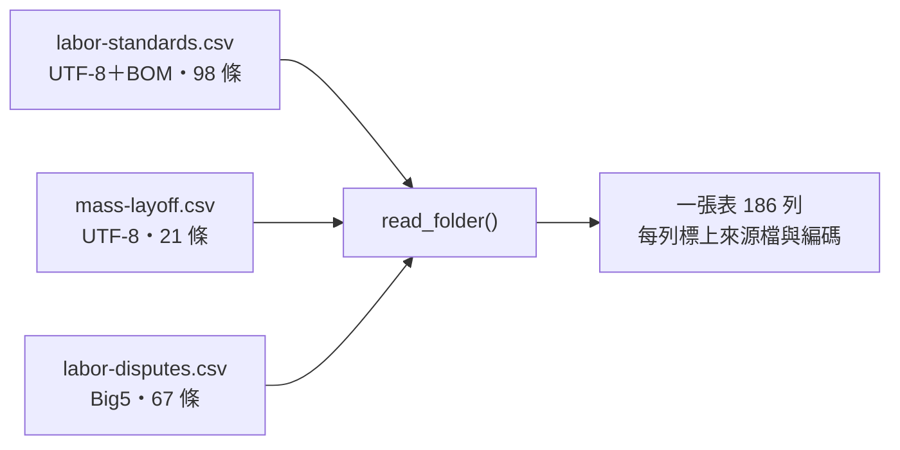
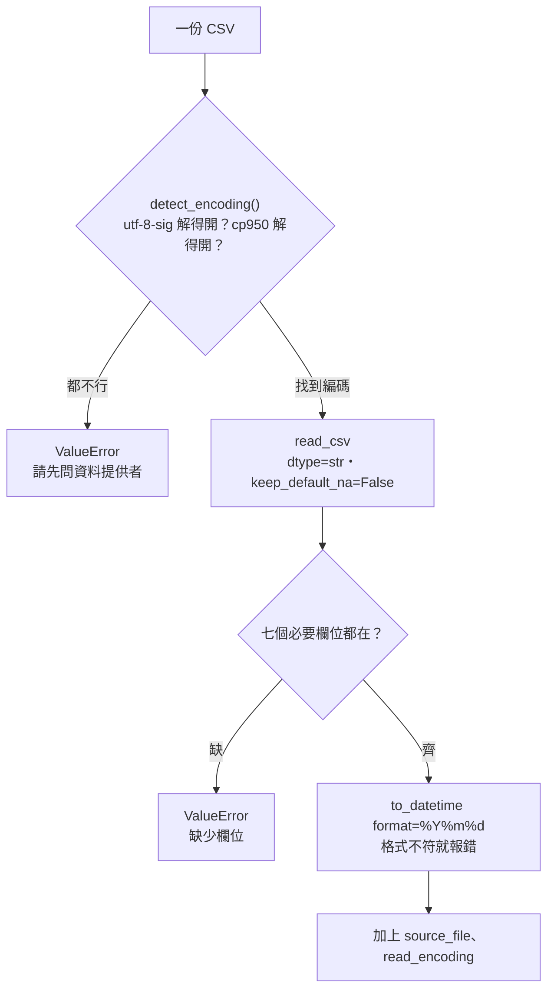
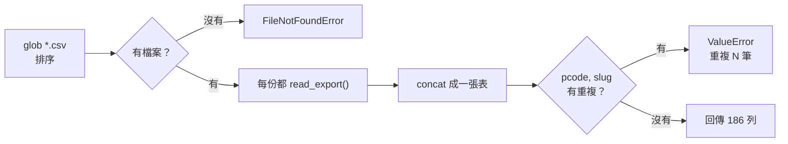

# 02｜CSV、編碼與多檔讀取

> **正文初稿：2026-10-05；2026-10-06 改版：改成圖表為主，程式逐段解說。**
> 本節把三份不同來源的 CSV 讀成一張表。核心只有一句：**一行 `read_csv` 會讓 pandas 替你猜型別，猜錯的時候不會報錯。**
> 本節不是編碼原理課。UTF-8、BOM、Big5 已在 MariaDB 第 16 節學過，這裡只做 pandas 版本。

[回 18 節課綱](../../course-plans/2026-10-data-analysis-18.md)

## 範例程式碼

- [demo：02_read_files.py](https://github.com/4-learn/data-analysis-and-process-demo/blob/master/2026/02_read_files.py)（與本頁 Demo 逐字相同）
- 練習資料與環境說明：[2026/README](https://github.com/4-learn/data-analysis-and-process-demo/tree/master/2026)

## 學習目標與時間

完成後，你能：

- 讀進一份陌生 CSV，並說出每個欄位為什麼是這個型別。
- 處理一份不是 UTF-8 的檔案，而且不會默默換掉讀不懂的字。
- 讀完一整個資料夾，並證明沒有重複、沒有掉欄位。

| 時間 | 活動 | 產出 |
| --- | --- | --- |
| 0–8 分鐘 | 一行 `read_csv` 讀三份檔 | 一份報錯、兩份「成功」 |
| 8–18 分鐘 | 「成功」的那兩份錯在哪 | 型別漂移、`1970-01-01`、空欄變 `float64` |
| 18–28 分鐘 | 先決定型別再讀，程式逐段看 | `dtype=str`、`keep_default_na=False`、明確日期格式 |
| 28–35 分鐘 | 一個資料夾，不是一個檔案 | `pathlib` ＋ `concat` ＋ 合併後驗證 |
| 35–50 分鐘 | Workshop：第四份檔，以及抓 AI 的錯 | 驗證結果與錯誤分析 |

先修：MariaDB 第 16 節（CSV 匯入品質）、爬蟲第 16 節（交給下游）。環境：Python 3.11 以上、pandas 3.0。

## 一、情境：三份檔案，三個來源

主管丟給你一個資料夾：「這三部法規的條文，合成一張表給 LLM 那組用。」



| 檔案 | 法規 | 誰匯出的 | 編碼 | 這份檔的特徵 |
| --- | --- | --- | --- | --- |
| `labor-standards.csv` | 勞動基準法 | 人資用 Excel 另存「CSV UTF-8」 | UTF-8，開頭有 BOM（`EF BB BF`） | 有 `9-1`、`10-1` 這種條次 |
| `mass-layoff.csv` | 大量解僱勞工保護法 | 工程師用程式匯出 | UTF-8，沒有 BOM | 條次全是數字；整部沒有分章 |
| `labor-disputes.csv` | 勞資爭議處理法 | 十年前的舊系統 | Big5（cp950） | — |

三份的欄位相同：`pcode, law_name, slug, article_no, chapter, content, modified_date`。檔案都在 `data/02-exports/`。

你請 AI 幫忙，它給你最常見的答案：

<!-- fn-table -->
| 函式名稱 | 說明 | 官方文件連結 |
|---|---|---|
| `pd.read_csv(path, dtype=str, keep_default_na=False, encoding=)` | 讀 CSV 成 `DataFrame`。`dtype=str` 每欄都當字串；`keep_default_na=False` 空格保持 `""` 不變 `NaN`；`encoding` 指定編碼 | [文件](https://pandas.pydata.org/docs/reference/api/pandas.read_csv.html#pandas.read_csv) |

```python
df = pd.read_csv("data/02-exports/labor-standards.csv")
```

## 二、一行 `read_csv`：一份報錯，兩份「成功」

```text
== 1. 一行 read_csv ==
labor-disputes.csv   UnicodeDecodeError: invalid start byte
labor-standards.csv  98 列；slug=str, chapter=str, modified_date=int64
mass-layoff.csv      21 列；slug=int64, chapter=float64, modified_date=int64
```

**同一個欄位，pandas 依內容猜成不同型別：**

| 欄位 | 勞動基準法 | 大量解僱勞工保護法 | 為什麼不一樣 |
| --- | --- | --- | --- |
| `slug` | `str` | `int64` | 勞基法有 `9-1`，只能當字串；大量解僱法剛好全是數字，就被猜成整數 |
| `chapter` | `str` | `float64` | 大量解僱法沒有分章，整欄空白；空白讀成 `NaN`，而 `NaN` 是浮點數 |
| `modified_date` | `int64` | `int64` | `20240731` 長得像數字，就被當成數字 |

:::warning
**報錯的那份反而最安全。** Big5 那份第一個中文字就解不開，你立刻知道問題在哪。另外兩份「成功」了，但型別是猜的，而且沒有任何錯誤訊息。
:::

## 三、「成功」的代價：錯在下游才爆

```text
== 2. 能讀進來的兩份，合起來 ==
slug dtype=object； slug == '1' 有 1 筆，slug == 1 有 1 筆
modified_date 原值 20150701 → pd.to_datetime() = 1970-01-01 00:00:00.020150701
```

| 問題 | 你寫的 | 實際得到 | 為什麼 |
| --- | --- | --- | --- |
| 同一欄混了兩種型別 | `df["slug"] == "1"` | 只找到 1 筆，大量解僱法的第 1 條不見了 | 合併後 `slug` 裡有字串 `'1'` 也有整數 `1` |
| 日期變成 1970 年 | `pd.to_datetime(20150701)` | `1970-01-01 00:00:00.020150701` | 整數被當成「從 1970-01-01 起算的奈秒數」 |

一行 `read_csv` 留下的四種錯，只有一種會報錯：

| 錯誤 | 在哪裡爆 | 會報錯嗎 |
| --- | --- | --- |
| 編碼不對 | `read_csv` 當下 | ✅ 會 |
| `slug` 型別漂移 | 篩選、`merge`（第 14 節）、去重 | ❌ 不會，只是少資料 |
| 空欄變 `float64` | 字串操作、匯出 | ⚠️ 有時會，有時變成 `"nan"` 字串 |
| 日期被當整數 | 時間篩選與彙總（第 10–11 節） | ❌ 不會，日期變 1970 |

> **型別是讀進來時決定的，不是之後才修的。** 讀進來後再修，你得先知道哪裡錯了，但上表大部分的錯不會告訴你。

## 四、先決定型別，再讀：五條規則

| # | 規則 | 寫法 | 不這樣做會怎樣（實測） |
| --- | --- | --- | --- |
| 1 | 所有欄位先當字串讀 | `dtype=str` | `mass-layoff.csv` 的 `slug` 變 `int64` |
| 2 | 空字串保持空字串 | `keep_default_na=False` | 只寫 `dtype=str`，`chapter` 的 21 格仍會變成 `NaN` |
| 3 | 日期給明確格式 | `pd.to_datetime(..., format="%Y%m%d")` | 格式不符時直接報 `ValueError`，不會猜一個答案 |
| 4 | 編碼只試白名單，都失敗就停 | `ENCODINGS = ("utf-8-sig", "cp950")` | 改用 `encoding_errors="replace"`：67 列全讀進來，67 列的 `content` 都含 `�` |
| 5 | 每一列記下來源 | `source_file`、`read_encoding` | 出錯時追不回是哪個檔、用什麼編碼讀的 |

一份檔案的讀法（`read_export()`）：



整個資料夾（`read_folder()`）：



## 五、程式逐段解說

完整程式在第六段。這裡依執行順序，一段一段看。

### 第 0 段：設定

<!-- fn-table -->
| 函式名稱 | 說明 | 官方文件連結 |
|---|---|---|
| `Path(__file__).resolve().parent` | `__file__` 是這支程式自己的路徑；`resolve()` 轉成完整路徑，`.parent` 取所在資料夾。從哪裡執行都找得到 `data/` | [文件](https://docs.python.org/3.12/library/pathlib.html#pathlib.Path.resolve) |
| 前面介紹過 | 用法同前，括號內是在哪裡第一次介紹 | [`Path()`](https://docs.python.org/3.12/library/pathlib.html#pathlib.Path)（爬蟲 10） |

<!-- 節錄: 02_read_files.py -->
```python
DATA = Path(__file__).resolve().parent / "data" / "02-exports"
REQUIRED = ["pcode", "law_name", "slug", "article_no", "chapter", "content", "modified_date"]
ENCODINGS = ("utf-8-sig", "cp950")  # 先試 UTF-8（順便吃掉 BOM），再試 Big5；都不行就停
```

| 名稱 | 做什麼 | 為什麼這樣寫 |
| --- | --- | --- |
| `DATA` | 資料夾位置，以程式檔所在處為基準 | 從哪個目錄執行都找得到檔案 |
| `REQUIRED` | 七個必要欄位 | 讀完立刻檢查，缺欄位就停，不等到下游才發現 |
| `ENCODINGS` | 依序嘗試的編碼 | `utf-8-sig` 有 BOM 就去掉、沒有也照常讀；只接受預期中的兩種 |

### 第 1 段：`naive_read()`，對照組

<!-- fn-table -->
| 函式名稱 | 說明 | 官方文件連結 |
|---|---|---|
| `exc.reason` | `UnicodeDecodeError` 的錯誤原因文字 | [文件](https://docs.python.org/3.12/library/exceptions.html#UnicodeError.reason) |
| `s.dtype` | 這一欄的型別：`str`、`int64`、`float64`、`datetime64[…]`、`object`（什麼都可能有） | [文件](https://pandas.pydata.org/docs/reference/api/pandas.Series.dtype.html#pandas.Series.dtype) |
| `df["欄"]`／`df[["欄1", "欄2"]]` | 取一欄得到 `Series`；給一個 list 取多欄，得到 `DataFrame`。新增欄位也是 `df["新欄"] = 值` | [文件](https://pandas.pydata.org/docs/user_guide/indexing.html#basics) |
| 前面介紹過 | 用法同前，括號內是在哪裡第一次介紹 | [`pd.read_csv()`](https://pandas.pydata.org/docs/reference/api/pandas.read_csv.html#pandas.read_csv)（第 02 節） |

<!-- 節錄: 02_read_files.py -->
```python
def naive_read(path):
    """AI 最常給的寫法：一行 read_csv。回傳 (DataFrame 或 None, 說明)。"""
    try:
        df = pd.read_csv(path)
    except UnicodeDecodeError as exc:
        return None, f"UnicodeDecodeError: {exc.reason}"
    types = ", ".join(f"{c}={df[c].dtype}" for c in ("slug", "chapter", "modified_date"))
    return df, f"{len(df)} 列；{types}"
```

| 行 | 做什麼 |
| --- | --- |
| `pd.read_csv(path)` | 什麼參數都不給，型別與編碼全交給 pandas |
| `except UnicodeDecodeError` | 接住 Big5 那份的錯誤，讓其他兩份還能繼續示範 |
| `types = ...` | 只印出三個會被猜錯的欄位的型別 |

這段只是用來「看見問題」，**不要拿去用**。

### 第 2 段：`detect_encoding()`，編碼白名單

<!-- fn-table -->
| 函式名稱 | 說明 | 官方文件連結 |
|---|---|---|
| `path.read_bytes()` | 把整個檔案讀成 bytes（還沒解碼），才能自己試不同編碼 | [文件](https://docs.python.org/3.12/library/pathlib.html#pathlib.Path.read_bytes) |
| `path.name` | 路徑最後的檔名，例如 `mass-layoff.csv` | [文件](https://docs.python.org/3.12/library/pathlib.html#pathlib.PurePath.name) |
| 前面介紹過 | 用法同前，括號內是在哪裡第一次介紹 | [`Path()`](https://docs.python.org/3.12/library/pathlib.html#pathlib.Path)（爬蟲 10）、[`raw.decode()`](https://docs.python.org/3.12/library/stdtypes.html#bytes.decode)（爬蟲 03） |

<!-- 節錄: 02_read_files.py -->
```python
def detect_encoding(path):
    raw = Path(path).read_bytes()
    for enc in ENCODINGS:
        try:
            raw.decode(enc)
            return enc
        except UnicodeDecodeError:
            continue
    raise ValueError(f"{Path(path).name}: 不是 {' / '.join(ENCODINGS)}，請先問資料提供者用什麼編碼")
```

| 行 | 做什麼 | 為什麼 |
| --- | --- | --- |
| `read_bytes()` | 讀原始位元組，還沒解碼 | 解碼前才能試不同編碼 |
| `raw.decode(enc)` | 用這個編碼把**整份檔**解一次 | 整份都解得開才算數；只試開頭幾行可能漏掉後面的字 |
| `return enc` | 第一個成功的就用 | 白名單有順序：UTF-8 優先 |
| `raise ValueError(...)` | 都失敗就停，並說下一步該做什麼 | 不用 `errors="replace"`，那會把讀不懂的字默默換成 `�` |

這是「排除法」，不是「辨識」。全是英數的檔案 UTF-8 和 Big5 都解得開，會回 UTF-8；對英數而言兩者結果相同，不會出錯。

### 第 3 段：`read_export()`，讀一份檔

<!-- fn-table -->
| 函式名稱 | 說明 | 官方文件連結 |
|---|---|---|
| `df.columns` | 所有欄名。可以 `for c in df.columns`，也可以 `"欄" in df.columns` 檢查有沒有這欄 | [文件](https://pandas.pydata.org/docs/reference/api/pandas.DataFrame.columns.html#pandas.DataFrame.columns) |
| `pd.to_datetime(s, format=, utc=, errors=)` | 字串轉日期時間。`format` 指定格式（`"ISO8601"` 或 `"%Y%m%d"`），格式不符就報錯；`utc=True` 統一轉成 UTC | [文件](https://pandas.pydata.org/docs/reference/api/pandas.to_datetime.html#pandas.to_datetime) |
| 前面介紹過 | 用法同前，括號內是在哪裡第一次介紹 | [`pd.read_csv()`](https://pandas.pydata.org/docs/reference/api/pandas.read_csv.html#pandas.read_csv)（第 02 節）、[`path.name`](https://docs.python.org/3.12/library/pathlib.html#pathlib.PurePath.name)（第 02 節）、[`Path()`](https://docs.python.org/3.12/library/pathlib.html#pathlib.Path)（爬蟲 10）、[`df["欄"]`](https://pandas.pydata.org/docs/user_guide/indexing.html#basics)（第 02 節） |

<!-- 節錄: 02_read_files.py -->
```python
def read_export(path):
    """讀一份匯出檔：型別在讀進來時就決定，不留給 pandas 猜。"""
    enc = detect_encoding(path)
    df = pd.read_csv(path, encoding=enc, dtype=str, keep_default_na=False)
    missing = [c for c in REQUIRED if c not in df.columns]
    if missing:
        raise ValueError(f"{Path(path).name}: 缺少欄位 {missing}")
    df["modified_date"] = pd.to_datetime(df["modified_date"], format="%Y%m%d")  # 格式不對會直接報錯
    df["source_file"] = Path(path).name
    df["read_encoding"] = enc
    return df
```

| 行 | 對應規則 | 做什麼 |
| --- | --- | --- |
| `detect_encoding(path)` | 規則 4 | 先決定編碼 |
| `dtype=str` | 規則 1 | 每一欄都當字串，`slug` 不會變整數 |
| `keep_default_na=False` | 規則 2 | 空白保持 `""`，不變 `NaN`；要不要算缺值留給第 08 節判斷 |
| `missing = ...` | — | 缺欄位就停，錯誤訊息寫出是哪份檔、缺哪幾欄 |
| `format="%Y%m%d"` | 規則 3 | 只接受 `20240731` 這種格式，其他寫法直接報錯 |
| `source_file`、`read_encoding` | 規則 5 | 每一列都追得回來源 |

### 第 4 段：`read_folder()`，讀整個資料夾

<!-- fn-table -->
| 函式名稱 | 說明 | 官方文件連結 |
|---|---|---|
| `folder.glob("*.csv")` | 找出資料夾裡符合樣式的檔案；順序不固定，要自己 `sorted()` | [文件](https://docs.python.org/3.12/library/pathlib.html#pathlib.Path.glob) |
| `pd.concat([df1, df2], ignore_index=True, axis=)` | 把多個表上下疊起來（`axis=1` 則左右並排）。`ignore_index=True` 重新編列號 0、1、2… | [文件](https://pandas.pydata.org/docs/reference/api/pandas.concat.html#pandas.concat) |
| `.duplicated(欄, keep=)` | 標出重複的列（True／False）。`keep="first"` 第一次出現的不算重複；`keep=False` 所有重複的都標出 | [文件](https://pandas.pydata.org/docs/reference/api/pandas.DataFrame.duplicated.html#pandas.DataFrame.duplicated) |
| `.any()`／`.any(axis=1)` | 是否**至少一個** True。`axis=1` 是每一列各算一次 | [文件](https://pandas.pydata.org/docs/reference/api/pandas.Series.any.html#pandas.Series.any) |
| `.sum()` | 加總。對 True／False 加總＝數有幾個 True | [文件](https://pandas.pydata.org/docs/reference/api/pandas.Series.sum.html#pandas.Series.sum) |
| 前面介紹過 | 用法同前，括號內是在哪裡第一次介紹 | [`Path()`](https://docs.python.org/3.12/library/pathlib.html#pathlib.Path)（爬蟲 10） |

<!-- 節錄: 02_read_files.py -->
```python
def read_folder(folder):
    files = sorted(Path(folder).glob("*.csv"))
    if not files:
        raise FileNotFoundError(f"{folder} 沒有 CSV")
    df = pd.concat([read_export(p) for p in files], ignore_index=True)
    dup = df.duplicated(["pcode", "slug"])
    if dup.any():
        raise ValueError(f"(pcode, slug) 重複 {int(dup.sum())} 筆")
    return df
```

| 行 | 做什麼 | 為什麼 |
| --- | --- | --- |
| `sorted(...glob("*.csv"))` | 找出所有 CSV，依檔名排序 | `glob` 不保證順序；排序後每次執行結果相同 |
| `if not files` | 空資料夾就報錯 | 路徑打錯時，不會默默得到一張空表 |
| `pd.concat(..., ignore_index=True)` | 疊成一張表，重新編列號 | 否則三份的列號都從 0 開始，會重複 |
| `duplicated(["pcode", "slug"])` | 同一部法規的同一條出現兩次 | 有人把同一份檔放了兩次，這裡會擋下（Workshop 會實驗） |

### 第 5 段：主程式，三段輸出

| 程式段 | 輸出標題 | 示範什麼 |
| --- | --- | --- |
| `naive_read()` 跑三份 | `== 1. 一行 read_csv ==` | 一份報錯、兩份型別被猜 |
| 合併兩份「成功」的 | `== 2. 能讀進來的兩份，合起來 ==` | `slug` 混型別、日期變 1970 |
| `read_folder(DATA)` | `== 3. 先決定型別，再讀 ==` | 186 列、型別一致、日期正確 |

## 六、完整程式與執行結果

以下為完整 `02_read_files.py`，只讀 `data/02-exports/`，不寫任何檔案。

<!-- fn-table -->
| 函式名稱 | 說明 | 官方文件連結 |
|---|---|---|
| `df[條件]`（布林遮罩） | `df["zone"] == "Z4"` 會得到一整欄 True／False；放進 `df[...]` 只留下 True 的列。這是 pandas 篩選的基本寫法 | [文件](https://pandas.pydata.org/docs/user_guide/indexing.html#boolean-indexing) |
| `.iloc[位置]` | 依**位置**（第幾個，從 0 起）取值；`s.iloc[0]` 是第一個，不管它的標籤是什麼 | [文件](https://pandas.pydata.org/docs/reference/api/pandas.Series.iloc.html#pandas.Series.iloc) |
| `df.groupby(欄, sort=, dropna=)` | 依某欄的值分組，後面接 `.size()`、`.sum()`、`.agg()` 算每組。`dropna=False` 時缺值也自成一組（預設會**丟掉**） | [文件](https://pandas.pydata.org/docs/reference/api/pandas.DataFrame.groupby.html#pandas.DataFrame.groupby) |
| `df.to_string(index=)` | 把整張表轉成對齊好的文字（`print` 用）；不會像直接 `print(df)` 那樣把中間省略成 `...` | [文件](https://pandas.pydata.org/docs/reference/api/pandas.DataFrame.to_string.html#pandas.DataFrame.to_string) |
| `.groupby(...).size()` | 每組有幾列 | [文件](https://pandas.pydata.org/docs/reference/api/pandas.api.typing.DataFrameGroupBy.size.html#pandas.api.typing.DataFrameGroupBy.size) |
| `.groupby(...)[欄].first()` | 每組的第一個值 | [文件](https://pandas.pydata.org/docs/reference/api/pandas.api.typing.SeriesGroupBy.first.html#pandas.api.typing.SeriesGroupBy.first) |
| `s.dt.date` | 只取日期部分（Python 的 `date`） | [文件](https://pandas.pydata.org/docs/reference/api/pandas.Series.dt.date.html#pandas.Series.dt.date) |
| 前面介紹過 | 用法同前，括號內是在哪裡第一次介紹 | [`Path(__file__).resolve().parent`](https://docs.python.org/3.12/library/pathlib.html#pathlib.Path.resolve)（第 02 節）、[`Path()`](https://docs.python.org/3.12/library/pathlib.html#pathlib.Path)（爬蟲 10）、[`pd.read_csv()`](https://pandas.pydata.org/docs/reference/api/pandas.read_csv.html#pandas.read_csv)（第 02 節）、[`exc.reason`](https://docs.python.org/3.12/library/exceptions.html#UnicodeError.reason)（第 02 節）、[`s.dtype`](https://pandas.pydata.org/docs/reference/api/pandas.Series.dtype.html#pandas.Series.dtype)（第 02 節）、[`df["欄"]`](https://pandas.pydata.org/docs/user_guide/indexing.html#basics)（第 02 節）、[`path.read_bytes()`](https://docs.python.org/3.12/library/pathlib.html#pathlib.Path.read_bytes)（第 02 節）、[`raw.decode()`](https://docs.python.org/3.12/library/stdtypes.html#bytes.decode)（爬蟲 03）、[`path.name`](https://docs.python.org/3.12/library/pathlib.html#pathlib.PurePath.name)（第 02 節）、[`df.columns`](https://pandas.pydata.org/docs/reference/api/pandas.DataFrame.columns.html#pandas.DataFrame.columns)（第 02 節）、[`pd.to_datetime()`](https://pandas.pydata.org/docs/reference/api/pandas.to_datetime.html#pandas.to_datetime)（第 02 節）、[`folder.glob()`](https://docs.python.org/3.12/library/pathlib.html#pathlib.Path.glob)（第 02 節）、[`pd.concat()`](https://pandas.pydata.org/docs/reference/api/pandas.concat.html#pandas.concat)（第 02 節）、[`.duplicated()`](https://pandas.pydata.org/docs/reference/api/pandas.DataFrame.duplicated.html#pandas.DataFrame.duplicated)（第 02 節）、[`.any()`](https://pandas.pydata.org/docs/reference/api/pandas.Series.any.html#pandas.Series.any)（第 02 節）、[`.sum()`](https://pandas.pydata.org/docs/reference/api/pandas.Series.sum.html#pandas.Series.sum)（第 02 節） |

<!-- demo: 02_read_files.py -->
```python
"""第 02 節：把三份不同來源的 CSV 讀成同一張可信的表。"""

from pathlib import Path

import pandas as pd

DATA = Path(__file__).resolve().parent / "data" / "02-exports"
REQUIRED = ["pcode", "law_name", "slug", "article_no", "chapter", "content", "modified_date"]
ENCODINGS = ("utf-8-sig", "cp950")  # 先試 UTF-8（順便吃掉 BOM），再試 Big5；都不行就停


def naive_read(path):
    """AI 最常給的寫法：一行 read_csv。回傳 (DataFrame 或 None, 說明)。"""
    try:
        df = pd.read_csv(path)
    except UnicodeDecodeError as exc:
        return None, f"UnicodeDecodeError: {exc.reason}"
    types = ", ".join(f"{c}={df[c].dtype}" for c in ("slug", "chapter", "modified_date"))
    return df, f"{len(df)} 列；{types}"


def detect_encoding(path):
    raw = Path(path).read_bytes()
    for enc in ENCODINGS:
        try:
            raw.decode(enc)
            return enc
        except UnicodeDecodeError:
            continue
    raise ValueError(f"{Path(path).name}: 不是 {' / '.join(ENCODINGS)}，請先問資料提供者用什麼編碼")


def read_export(path):
    """讀一份匯出檔：型別在讀進來時就決定，不留給 pandas 猜。"""
    enc = detect_encoding(path)
    df = pd.read_csv(path, encoding=enc, dtype=str, keep_default_na=False)
    missing = [c for c in REQUIRED if c not in df.columns]
    if missing:
        raise ValueError(f"{Path(path).name}: 缺少欄位 {missing}")
    df["modified_date"] = pd.to_datetime(df["modified_date"], format="%Y%m%d")  # 格式不對會直接報錯
    df["source_file"] = Path(path).name
    df["read_encoding"] = enc
    return df


def read_folder(folder):
    files = sorted(Path(folder).glob("*.csv"))
    if not files:
        raise FileNotFoundError(f"{folder} 沒有 CSV")
    df = pd.concat([read_export(p) for p in files], ignore_index=True)
    dup = df.duplicated(["pcode", "slug"])
    if dup.any():
        raise ValueError(f"(pcode, slug) 重複 {int(dup.sum())} 筆")
    return df


if __name__ == "__main__":
    print("== 1. 一行 read_csv ==")
    naive = {}
    for p in sorted(DATA.glob("*.csv")):
        naive[p.name], note = naive_read(p)
        print(f"{p.name:20} {note}")

    print("\n== 2. 能讀進來的兩份，合起來 ==")
    both = pd.concat([naive["labor-standards.csv"], naive["mass-layoff.csv"]])
    print(f"slug dtype={both['slug'].dtype}；",
          f"slug == '1' 有 {(both['slug'] == '1').sum()} 筆，slug == 1 有 {(both['slug'] == 1).sum()} 筆")
    raw_date = naive["mass-layoff.csv"]["modified_date"]
    print(f"modified_date 原值 {raw_date.iloc[0]} → pd.to_datetime() = {pd.to_datetime(raw_date).iloc[0]}")

    print("\n== 3. 先決定型別，再讀 ==")
    df = read_folder(DATA)
    print(df.groupby(["source_file", "read_encoding"]).size().to_string())
    print(f"合計 {len(df)} 列；slug dtype={df['slug'].dtype}；chapter 空字串 {(df['chapter'] == '').sum()} 筆")
    print(df.groupby("law_name")["modified_date"].first().dt.date.to_string())
```

執行（在本目錄下）：

```bash
python3 02_read_files.py
```

第三段的輸出：

```text
== 3. 先決定型別，再讀 ==
source_file          read_encoding
labor-disputes.csv   cp950            67
labor-standards.csv  utf-8-sig        98
mass-layoff.csv      utf-8-sig        21
合計 186 列；slug dtype=str；chapter 空字串 21 筆
law_name
勞動基準法        2024-07-31
勞資爭議處理法      2021-04-28
大量解僱勞工保護法    2015-07-01
```

| 你看到的 | 代表什麼 |
| --- | --- |
| 186 = 98 ＋ 21 ＋ 67 | 三份都讀進來，列數對得上 |
| `slug dtype=str` | `'9-1'` 和 `'1'` 是同一種東西，篩選與合併不會漏 |
| `chapter` 空字串 21 筆 | 正好是大量解僱法的 21 條。它沒有分章，**是事實，不是缺值** |
| 三部法規的日期 | 都落在合理年份，沒有 1970 |
| `mass-layoff.csv` 標成 `utf-8-sig` | 只代表「以 UTF-8 讀成功」，**不代表檔案有 BOM**；要知道有沒有 BOM，看前三個位元組 |

## 七、為什麼不用自動偵測編碼套件？

| 做法 | 猜錯時 | 本節的選擇 |
| --- | --- | --- |
| `chardet`、`charset-normalizer` 自動猜 | 短檔或全是常用字的檔，Big5 與 GBK 容易互相誤判；讀出另一套中文字，**不報錯** | 不用 |
| 白名單（`detect_encoding()`） | 不在白名單就停下來問人 | ✅ 採用 |

## Workshop：第四份檔，以及抓 AI 的錯

### 任務與時間

**35–42 分鐘：第四份檔。** 把下列程式存成 `make_fourth.py` 並執行，它會在 `data/02-exports/` 產生一份新的匯出檔 `extra.csv`：

<!-- fn-table -->
| 函式名稱 | 說明 | 官方文件連結 |
|---|---|---|
| `df.to_csv(path=None, index=)` | `DataFrame` 轉 CSV；沒給路徑就回傳字串。`index=False` 不輸出列號 | [文件](https://pandas.pydata.org/docs/reference/api/pandas.DataFrame.to_csv.html#pandas.DataFrame.to_csv) |
| `df.head(n)` | 前 n 列（預設 5） | [文件](https://pandas.pydata.org/docs/reference/api/pandas.DataFrame.head.html#pandas.DataFrame.head) |
| 前面介紹過 | 用法同前，括號內是在哪裡第一次介紹 | [`Path()`](https://docs.python.org/3.12/library/pathlib.html#pathlib.Path)（爬蟲 10）、[`pd.read_csv()`](https://pandas.pydata.org/docs/reference/api/pandas.read_csv.html#pandas.read_csv)（第 02 節） |

```python
# make_fourth.py — Workshop 用，本節測試不涵蓋這段
from pathlib import Path
import pandas as pd

src = Path("data/02-exports/mass-layoff.csv")
df = pd.read_csv(src, dtype=str, keep_default_na=False)
df.head(3).to_csv("data/02-exports/extra.csv", index=False)
```

1. 先預測：重新執行 `02_read_files.py` 會發生什麼？
2. 執行，對照你的預測。
3. 指出擋下它的是哪一行程式，說明它為什麼存在。
4. **刪除** `extra.csv`，否則之後每次執行都會停在同一個錯誤。

**42–50 分鐘：抓 AI 的錯。** 把下列需求丟給 OpenCode（或任何 LLM），取得它的程式碼：

> 「讀 `data/02-exports/` 底下所有 CSV，合併成一個 DataFrame，找出 `slug` 是 1 的條文。」

用本節的檢查驗收它：

| 檢查 | 怎麼確認 | 正確答案 | AI 的版本通過嗎 |
| --- | --- | --- | --- |
| 三份都讀得進來？ | 列數 | 186 | |
| `slug` 只有一種型別？ | `df["slug"].map(type).value_counts()` | 只有 `str` | |
| 「slug 是 1」找到幾條？ | 篩選結果的列數 | 3（每部法規各 1 條） | |
| 日期是否合理？ | 最早、最晚的 `modified_date` | 2015-07-01 到 2024-07-31 | |
| 重複放檔會被擋嗎？ | 放回 `extra.csv` 再跑一次 | 會報錯 | |

:::spoiler 參考判讀（教師用）
- `extra.csv` 的三列與大量解僱法前三條的 `(pcode, slug)` 相同，`read_folder()` 會以 `(pcode, slug) 重複 3 筆` 停下。少了那行檢查，合併結果是 189 列，下游每項統計都會多算。
- 常見 AI 答案寫 `encoding="utf-8"`，在 Big5 那份報錯；修正版常改成 `encoding_errors="ignore"` 或 `"replace"`。**那是把錯誤藏起來，不是修好。** 實測 `encoding_errors="replace"`：67 列全讀得進來、沒有報錯，但 67 列的 `content` 都含 `�`，法規名稱變成 `�Ҹꪧij�B�z�k`。
- 就算 AI 替 Big5 那份指定 `cp950`、其他用預設讀取，合併後 `slug` 是 165 個字串＋21 個整數。實測 `== 1` 找到 **1** 條、`== "1"` 找到 **2** 條；正確答案是 **3** 條。列數 186 是對的——**列數對，不代表內容對。**
- 同一份 AI 版本的 `modified_date` 最小值 `20150701`、最大值 `20240731`，看起來合理，因為整數比大小剛好成立；一轉成日期就變 1970 年。
- 「找出 slug 是 1」本身有歧義：`slug` 是網址用的代號，`article_no` 才是「第 1 條」。能指出這一點，比寫對程式更重要。
:::

### 驗收

- 能重現第三段輸出：186 列、`slug` 為字串、三部法規日期正確。
- 能用一句話說明「為什麼一行 `read_csv` 的錯誤不會報錯」，並舉出本節至少兩個例子。
- `extra.csv` 實驗：說出預測、實際結果，以及擋下它的那行程式。
- AI 驗收表都有填，且至少指出一個 AI 版本的問題（或證明它都通過了）。

## 教師紀錄與下一步

:::spoiler 教師紀錄（實測環境、資料來源、界線）
**實測**：2026-10-05，Ubuntu 20.04，Python 3.11.8，pandas 3.0.6、numpy 2.4.6。本頁輸出為該環境實際執行貼上。另以 Python 3.10.15／pandas 2.3.3 執行：程式同樣成功，差別只有字串欄 dtype 顯示為 `object` 而非 `str`。2026-10-06 改版時再以 Python 3.11.2／pandas 3.0.6 與 pandas 2.3.3 實測第四段表格的每一項（`dtype=str` 不加 `keep_default_na=False` 時 `chapter` 21 格為 `NaN`；`encoding_errors="replace"` 67 列含 `�`）。**本節尚未實班試教。**

**資料**：`data/02-exports/` 由 `tools/build_fixtures.py` 從 [4-learn/crawler-playground](https://github.com/4-learn/crawler-playground)（MIT）固定 commit `15279335` 產生，雜湊記在 `data/MANIFEST.json`。條文取自練習站，可能經刻意修改以供練習，不具法律效力。

**界線**：本節不教 `read_excel`。Excel 的型別問題（日期序號、合併儲存格、多工作表）足以自成一節，去處（第 04 節前段或附錄）待老師決定。

**舊教材**：舊版沒有任何讀檔章節（`read_csv` 全課 0 次）；本節為新增。
:::

**下一節**：第 03 節〈JSON／JSONL 與巢狀結構〉讀爬蟲課交付的 `data/articles.jsonl`，含 `source_url`、`fetched_at`、`content_hash`、`source_version` 四個來源欄位。
