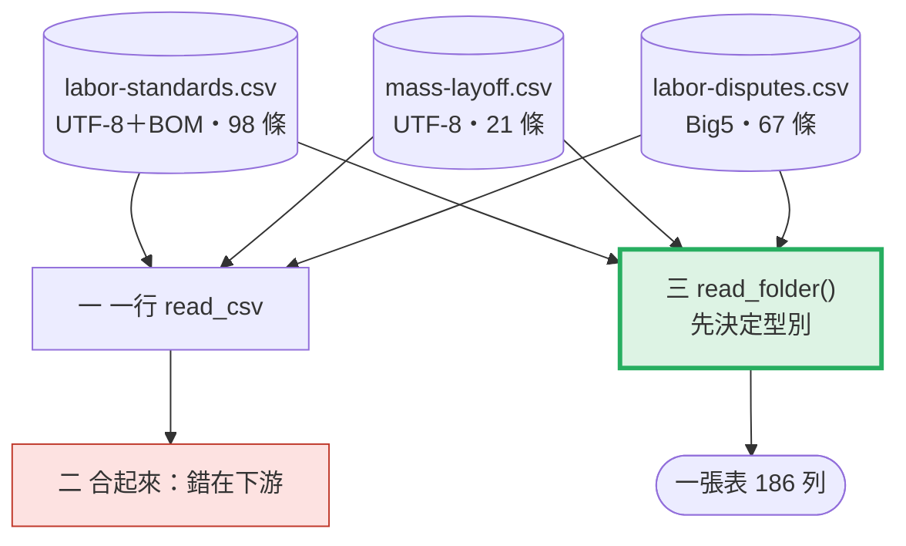
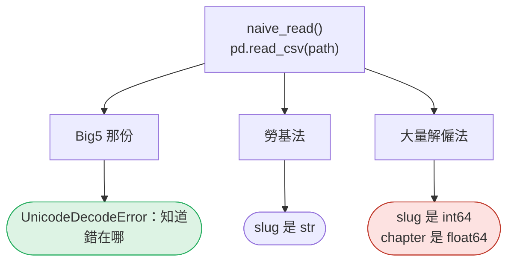
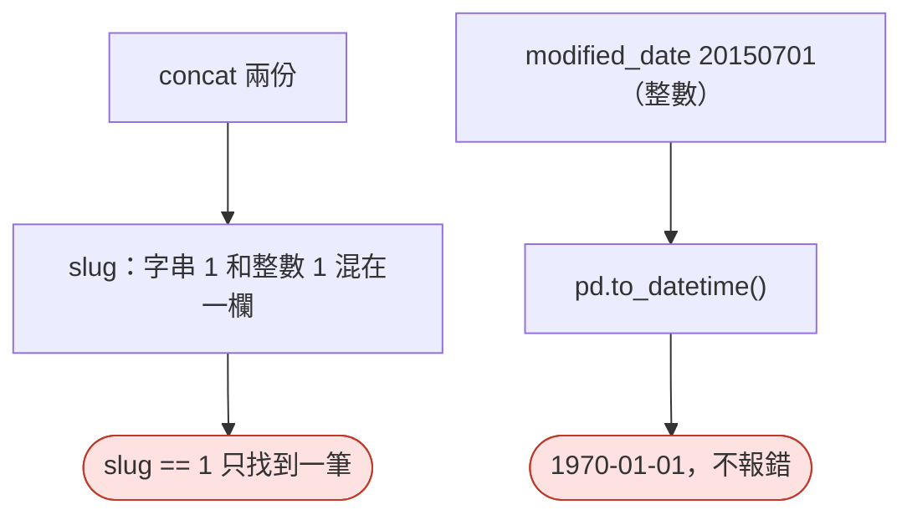
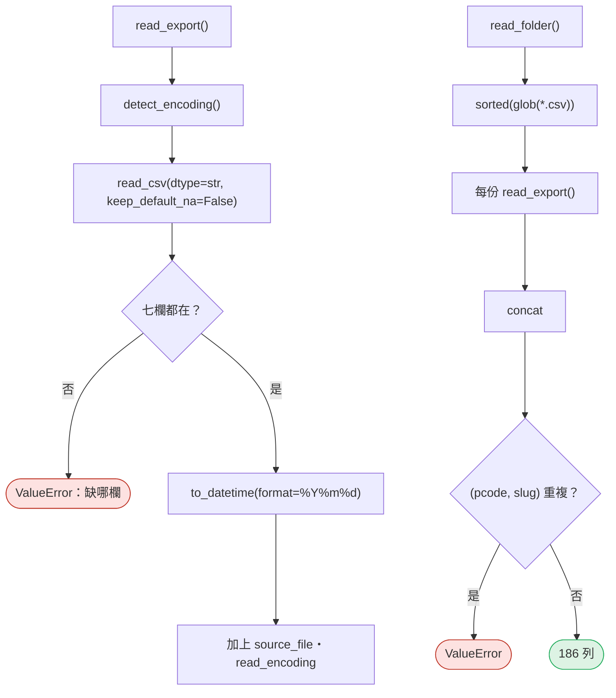

# 03｜CSV、編碼與多檔讀取

> 三份不同來源的 CSV 讀成一張表。一行 `read_csv` 讓 pandas 猜型別，猜錯不會報錯。

<!-- 格式：每段一張圖 -->
[回 19 節課綱](../../course-plans/2026-10-data-analysis-18.md)

## 範例程式碼

| 檔案 | 講解段落 | 內容 | 執行指令 |
| --- | --- | --- | --- |
| [`03_read_files.py`](https://github.com/4-learn/data-analysis-and-process-demo/blob/master/2026/03_read_files.py) | 零～三 | 一行 read_csv 的問題、先決定型別、讀整個資料夾 | `python3 03_read_files.py` |

- 在 [`2026/`](https://github.com/4-learn/data-analysis-and-process-demo/tree/master/2026) 資料夾執行；練習資料與環境說明見該資料夾的 README。
- 只讀 `data/`，不寫檔、不連網。

## 學完能做到

| 時間 | 段落 | 學完能做到 |
| --- | --- | --- |
| 0–8 分 | 一 | 看出一行 `read_csv` 一份報錯、兩份「成功」 |
| 8–18 分 | 二 | 說出「成功」的兩份錯在哪：型別漂移、1970 |
| 18–35 分 | 零、三 | 先決定型別再讀；讀整個資料夾並驗證 |
| 35–50 分 | Workshop | 第四份檔、抓 AI 的錯 |

## 本節流程



每段都是：**問題 → 位置（黃色）→ 步驟圖 → 程式 → 輸出 → 重點**。

## 零、準備：欄位與編碼白名單

**問題：** 讀檔前先定好什麼？

**在流程中的位置：**


**這段做了什麼：**


<!-- fn-table -->
| 函式名稱 | 說明 | 官方文件連結 |
|---|---|---|
| 前面介紹過 | 用法同前，括號內是在哪裡第一次介紹 | [`Path(__file__).resolve().parent`](https://docs.python.org/3.12/library/pathlib.html#pathlib.Path.resolve)（第 02 節）、[`Path()`](https://docs.python.org/3.12/library/pathlib.html#pathlib.Path)（爬蟲 10） |

<!-- 節錄: 03_read_files.py -->
```python
from pathlib import Path

import pandas as pd

DATA = Path(__file__).resolve().parent / "data" / "03-exports"
REQUIRED = ["pcode", "law_name", "slug", "article_no", "chapter", "content", "modified_date"]
ENCODINGS = ("utf-8-sig", "cp950")  # 先試 UTF-8（順便吃掉 BOM），再試 Big5；都不行就停
```

<!-- fn-table -->
| 函式名稱 | 說明 | 官方文件連結 |
|---|---|---|
| `path.read_bytes()` | 把整個檔案讀成 bytes（還沒解碼），才能自己試不同編碼 | [文件](https://docs.python.org/3.12/library/pathlib.html#pathlib.Path.read_bytes) |
| 前面介紹過 | 用法同前，括號內是在哪裡第一次介紹 | [`path.name`](https://docs.python.org/3.12/library/pathlib.html#pathlib.PurePath.name)（第 02 節）、[`raw.decode()`](https://docs.python.org/3.12/library/stdtypes.html#bytes.decode)（爬蟲 03）、[`Path()`](https://docs.python.org/3.12/library/pathlib.html#pathlib.Path)（爬蟲 10） |

<!-- 節錄: 03_read_files.py -->
```python
def detect_encoding(path):
    raw = Path(path).read_bytes()
    for enc in ENCODINGS:
        try:
            raw.decode(enc)
            return enc
        except UnicodeDecodeError:
            continue
    raise ValueError(f"{Path(path).name}: 不是 {' / '.join(ENCODINGS)}，請先問資料提供者用什麼編碼")
```

- 白名單是**排除法**：不在名單就停，不用 `errors="replace"` 把字換成 `�`。

| 檔案 | 誰匯出的 | 編碼 |
| --- | --- | --- |
| `labor-standards.csv` | 人資用 Excel 另存 | UTF-8，開頭有 BOM |
| `mass-layoff.csv` | 工程師用程式匯出 | UTF-8 |
| `labor-disputes.csv` | 十年前的舊系統 | Big5（cp950） |

## 一、一行 `read_csv`：一份報錯，兩份「成功」

**問題：** AI 給的 `pd.read_csv(path)`，三份讀起來怎樣？

**在流程中的位置：**


**這段做了什麼：**



<!-- fn-table -->
| 函式名稱 | 說明 | 官方文件連結 |
|---|---|---|
| `exc.reason` | `UnicodeDecodeError` 的錯誤原因文字 | [文件](https://docs.python.org/3.12/library/exceptions.html#UnicodeError.reason) |
| `s.dtype` | 這一欄的型別：`str`、`int64`、`float64`、`datetime64[…]`、`object`（什麼都可能有） | [文件](https://pandas.pydata.org/docs/reference/api/pandas.Series.dtype.html#pandas.Series.dtype) |
| 前面介紹過 | 用法同前，括號內是在哪裡第一次介紹 | [`df["欄"]`](https://pandas.pydata.org/docs/user_guide/indexing.html#basics)（第 02 節）、[`pd.read_csv()`](https://pandas.pydata.org/docs/reference/api/pandas.read_csv.html#pandas.read_csv)（第 02 節） |

<!-- 節錄: 03_read_files.py -->
```python
def naive_read(path):
    """AI 最常給的寫法：一行 read_csv。回傳 (DataFrame 或 None, 說明)。"""
    try:
        df = pd.read_csv(path)
    except UnicodeDecodeError as exc:
        return None, f"UnicodeDecodeError: {exc.reason}"
    types = ", ".join(f"{c}={df[c].dtype}" for c in ("slug", "chapter", "modified_date"))
    return df, f"{len(df)} 列；{types}"
```

<!-- fn-table -->
| 函式名稱 | 說明 | 官方文件連結 |
|---|---|---|
| `folder.glob("*.csv")` | 找出資料夾裡符合樣式的檔案；順序不固定，要自己 `sorted()` | [文件](https://docs.python.org/3.12/library/pathlib.html#pathlib.Path.glob) |
| 前面介紹過 | 用法同前，括號內是在哪裡第一次介紹 | [`path.name`](https://docs.python.org/3.12/library/pathlib.html#pathlib.PurePath.name)（第 02 節） |

<!-- 節錄: 03_read_files.py -->
```python
print("== 1. 一行 read_csv ==")
naive = {}
for p in sorted(DATA.glob("*.csv")):
    naive[p.name], note = naive_read(p)
    print(f"{p.name:20} {note}")
```

<sub>📄 來源：執行 `python3 03_read_files.py` 的輸出（第 1 段）</sub>

```text
== 1. 一行 read_csv ==
labor-disputes.csv   UnicodeDecodeError: invalid start byte
labor-standards.csv  98 列；slug=str, chapter=str, modified_date=int64
mass-layoff.csv      21 列；slug=int64, chapter=float64, modified_date=int64
```

- **報錯的那份反而最安全。**
- 同一欄，pandas 依內容猜成不同型別，沒有任何錯誤訊息。

## 二、「成功」的代價：錯在下游才爆

**問題：** 兩份「成功」的合起來會怎樣？

**在流程中的位置：**


**這段做了什麼：**



<!-- fn-table -->
| 函式名稱 | 說明 | 官方文件連結 |
|---|---|---|
| `pd.concat([df1, df2], ignore_index=True, axis=)` | 把多個表上下疊起來（`axis=1` 則左右並排）。`ignore_index=True` 重新編列號 0、1、2… | [文件](https://pandas.pydata.org/docs/reference/api/pandas.concat.html#pandas.concat) |
| `pd.to_datetime(s, format=, utc=, errors=)` | 字串轉日期時間。`format` 指定格式（`"ISO8601"` 或 `"%Y%m%d"`），格式不符就報錯；`utc=True` 統一轉成 UTC | [文件](https://pandas.pydata.org/docs/reference/api/pandas.to_datetime.html#pandas.to_datetime) |
| 前面介紹過 | 用法同前，括號內是在哪裡第一次介紹 | [`.iloc[]`](https://pandas.pydata.org/docs/reference/api/pandas.Series.iloc.html#pandas.Series.iloc)（第 02 節）、[`.sum()`](https://pandas.pydata.org/docs/reference/api/pandas.Series.sum.html#pandas.Series.sum)（第 02 節）、[`df["欄"]`](https://pandas.pydata.org/docs/user_guide/indexing.html#basics)（第 02 節）、[`df[條件]`](https://pandas.pydata.org/docs/user_guide/indexing.html#boolean-indexing)（第 02 節）、[`s.dtype`](https://pandas.pydata.org/docs/reference/api/pandas.Series.dtype.html#pandas.Series.dtype)（第 03 節） |

<!-- 節錄: 03_read_files.py -->
```python
print("\n== 2. 能讀進來的兩份，合起來 ==")
both = pd.concat([naive["labor-standards.csv"], naive["mass-layoff.csv"]])
print(f"slug dtype={both['slug'].dtype}；",
      f"slug == '1' 有 {(both['slug'] == '1').sum()} 筆，slug == 1 有 {(both['slug'] == 1).sum()} 筆")
raw_date = naive["mass-layoff.csv"]["modified_date"]
print(f"modified_date 原值 {raw_date.iloc[0]} → pd.to_datetime() = {pd.to_datetime(raw_date).iloc[0]}")
```

<sub>📄 來源：執行 `python3 03_read_files.py` 的輸出（第 2 段）</sub>

```text
== 2. 能讀進來的兩份，合起來 ==
slug dtype=object； slug == '1' 有 1 筆，slug == 1 有 1 筆
modified_date 原值 20150701 → pd.to_datetime() = 1970-01-01 00:00:00.020150701
```

- **型別是讀進來時決定的，不是之後才修的。**

| 錯誤 | 在哪裡爆 | 會報錯嗎 |
| --- | --- | --- |
| 編碼不對 | `read_csv` 當下 | 會 |
| `slug` 型別漂移 | 篩選、`merge`、去重 | 不會，只是少資料 |
| 空欄變 `float64` | 字串操作、匯出 | 有時會 |
| 日期被當整數 | 時間彙總 | 不會，變 1970 |

## 三、先決定型別，再讀

**問題：** 正確的讀法？

**在流程中的位置：**


**這段做了什麼：**



<!-- fn-table -->
| 函式名稱 | 說明 | 官方文件連結 |
|---|---|---|
| `.duplicated(欄, keep=)` | 標出重複的列（True／False）。`keep="first"` 第一次出現的不算重複；`keep=False` 所有重複的都標出 | [文件](https://pandas.pydata.org/docs/reference/api/pandas.DataFrame.duplicated.html#pandas.DataFrame.duplicated) |
| `.any()`／`.any(axis=1)` | 是否**至少一個** True。`axis=1` 是每一列各算一次 | [文件](https://pandas.pydata.org/docs/reference/api/pandas.Series.any.html#pandas.Series.any) |
| 前面介紹過 | 用法同前，括號內是在哪裡第一次介紹 | [`.sum()`](https://pandas.pydata.org/docs/reference/api/pandas.Series.sum.html#pandas.Series.sum)（第 02 節）、[`df.columns`](https://pandas.pydata.org/docs/reference/api/pandas.DataFrame.columns.html#pandas.DataFrame.columns)（第 02 節）、[`df["欄"]`](https://pandas.pydata.org/docs/user_guide/indexing.html#basics)（第 02 節）、[`path.name`](https://docs.python.org/3.12/library/pathlib.html#pathlib.PurePath.name)（第 02 節）、[`pd.read_csv()`](https://pandas.pydata.org/docs/reference/api/pandas.read_csv.html#pandas.read_csv)（第 02 節）、[`folder.glob()`](https://docs.python.org/3.12/library/pathlib.html#pathlib.Path.glob)（第 03 節）、[`pd.concat()`](https://pandas.pydata.org/docs/reference/api/pandas.concat.html#pandas.concat)（第 03 節）、[`pd.to_datetime()`](https://pandas.pydata.org/docs/reference/api/pandas.to_datetime.html#pandas.to_datetime)（第 03 節）、[`Path()`](https://docs.python.org/3.12/library/pathlib.html#pathlib.Path)（爬蟲 10） |

<!-- 節錄: 03_read_files.py -->
```python
def read_export(path):
    """讀一份匯出檔：型別在讀進來時就決定，不留給 pandas 猜。"""
    enc = detect_encoding(path)
    df = pd.read_csv(path, encoding=enc, dtype=str, keep_default_na=False)
    missing = [c for c in REQUIRED if c not in df.columns]
    if missing:
        raise ValueError(f"{Path(path).name}: 缺少欄位 {missing}")
    df["modified_date"] = pd.to_datetime(df["modified_date"], format="%Y%m%d")  # 格式不對會直接報錯
    df["source_file"] = Path(path).name
    df["read_encoding"] = enc
    return df


def read_folder(folder):
    files = sorted(Path(folder).glob("*.csv"))
    if not files:
        raise FileNotFoundError(f"{folder} 沒有 CSV")
    df = pd.concat([read_export(p) for p in files], ignore_index=True)
    dup = df.duplicated(["pcode", "slug"])
    if dup.any():
        raise ValueError(f"(pcode, slug) 重複 {int(dup.sum())} 筆")
    return df
```

<!-- fn-table -->
| 函式名稱 | 說明 | 官方文件連結 |
|---|---|---|
| `.groupby(...)[欄].first()` | 每組的第一個值 | [文件](https://pandas.pydata.org/docs/reference/api/pandas.api.typing.SeriesGroupBy.first.html#pandas.api.typing.SeriesGroupBy.first) |
| `s.dt.date` | 只取日期部分（Python 的 `date`） | [文件](https://pandas.pydata.org/docs/reference/api/pandas.Series.dt.date.html#pandas.Series.dt.date) |
| 前面介紹過 | 用法同前，括號內是在哪裡第一次介紹 | [`.sum()`](https://pandas.pydata.org/docs/reference/api/pandas.Series.sum.html#pandas.Series.sum)（第 02 節）、[`df.groupby()`](https://pandas.pydata.org/docs/reference/api/pandas.DataFrame.groupby.html#pandas.DataFrame.groupby)（第 02 節）、[`df.to_string()`](https://pandas.pydata.org/docs/reference/api/pandas.DataFrame.to_string.html#pandas.DataFrame.to_string)（第 02 節）、[`df["欄"]`](https://pandas.pydata.org/docs/user_guide/indexing.html#basics)（第 02 節）、[`df[條件]`](https://pandas.pydata.org/docs/user_guide/indexing.html#boolean-indexing)（第 02 節）、[`groupby().size()`](https://pandas.pydata.org/docs/reference/api/pandas.api.typing.DataFrameGroupBy.size.html#pandas.api.typing.DataFrameGroupBy.size)（第 02 節）、[`s.dtype`](https://pandas.pydata.org/docs/reference/api/pandas.Series.dtype.html#pandas.Series.dtype)（第 03 節） |

<!-- 節錄: 03_read_files.py -->
```python
print("\n== 3. 先決定型別，再讀 ==")
df = read_folder(DATA)
print(df.groupby(["source_file", "read_encoding"]).size().to_string())
print(f"合計 {len(df)} 列；slug dtype={df['slug'].dtype}；chapter 空字串 {(df['chapter'] == '').sum()} 筆")
print(df.groupby("law_name")["modified_date"].first().dt.date.to_string())
```

<sub>📄 來源：執行 `python3 03_read_files.py` 的輸出（第 3 段）</sub>

```text
== 3. 先決定型別，再讀 ==
source_file          read_encoding
labor-disputes.csv   cp950            67
labor-standards.csv  utf-8-sig        98
mass-layoff.csv      utf-8-sig        21
合計 186 列；slug dtype=str；chapter 空字串 21 筆
law_name
勞動基準法        2024-07-31
勞資爭議處理法      2021-04-28
大量解僱勞工保護法    2015-07-01
```

- `chapter` 空字串 21 筆＝大量解僱法沒有分章，**是事實，不是缺值**。
- `glob` 不保證順序：一律 `sorted()`。

| 規則 | 寫法 |
| --- | --- |
| 全部先當字串 | `dtype=str` |
| 空格保持空字串 | `keep_default_na=False` |
| 日期給明確格式 | `format="%Y%m%d"` |
| 編碼只試白名單 | `detect_encoding()` |
| 每列記下來源 | `source_file`、`read_encoding` |

## 補充：為什麼不用自動偵測編碼套件？

| 做法 | 猜錯時 | 本節的選擇 |
| --- | --- | --- |
| `chardet`、`charset-normalizer` 自動猜 | Big5 與 GBK 容易互相誤判；讀出另一套中文字，**不報錯** | 不用 |
| 白名單（`detect_encoding()`） | 不在白名單就停下來問人 | ✅ 採用 |

## Workshop：第四份檔，以及抓 AI 的錯

### 題目

**課堂題**（約 10 分鐘）：執行起手式，在 `data/03-exports/` 放進第四份檔 `extra.csv`；然後

1. 先預測：重新執行 `03_read_files.py` 會發生什麼？
2. 執行，對照你的預測，指出擋下它的是哪一行程式。
3. **刪除** `data/03-exports/extra.csv`（`rm data/03-exports/extra.csv`），否則之後每次執行都會停在同一個錯誤。

起手式 [`03_workshop_fourth_file.py`](https://github.com/4-learn/data-analysis-and-process-demo/blob/master/2026/03_workshop_fourth_file.py)（在 `2026/` 資料夾執行）：

<!-- fn-table -->
| 函式名稱 | 說明 | 官方文件連結 |
|---|---|---|
| 前面介紹過 | 用法同前，括號內是在哪裡第一次介紹 | [`Path(__file__).resolve().parent`](https://docs.python.org/3.12/library/pathlib.html#pathlib.Path.resolve)（第 02 節）、[`df.head()`](https://pandas.pydata.org/docs/reference/api/pandas.DataFrame.head.html#pandas.DataFrame.head)（第 02 節）、[`df.to_csv()`](https://pandas.pydata.org/docs/reference/api/pandas.DataFrame.to_csv.html#pandas.DataFrame.to_csv)（第 02 節）、[`pd.read_csv()`](https://pandas.pydata.org/docs/reference/api/pandas.read_csv.html#pandas.read_csv)（第 02 節）、[`Path()`](https://docs.python.org/3.12/library/pathlib.html#pathlib.Path)（爬蟲 10） |

<!-- workshop: 03_workshop_fourth_file.py -->
```python
"""第 03 節 Workshop 課堂題：在 data/03-exports/ 放入第四份檔 extra.csv。
執行完，再跑一次 03_read_files.py，看會發生什麼。做完記得刪掉 extra.csv。"""

from pathlib import Path

import pandas as pd

EXPORTS = Path(__file__).resolve().parent / "data" / "03-exports"

if __name__ == "__main__":
    src = pd.read_csv(EXPORTS / "mass-layoff.csv", dtype=str, keep_default_na=False)
    extra = src.head(3)
    extra.to_csv(EXPORTS / "extra.csv", index=False)
    print(f"放入 data/03-exports/extra.csv：{len(extra)} 列（大量解僱法前三條）")
```

**延伸題**（做完課堂題再做）：把下列需求丟給 OpenCode，取得它的程式碼，用本節的檢查驗收：

> 「讀 `data/03-exports/` 底下所有 CSV，合併成一個 DataFrame，找出 `slug` 是 1 的條文。」

| 檢查 | 怎麼確認 | 正確答案 | AI 的版本通過嗎 |
| --- | --- | --- | --- |
| 三份都讀得進來？ | 列數 | 186 | |
| `slug` 只有一種型別？ | `df["slug"].map(type).value_counts()` | 只有 `str` | |
| 「slug 是 1」找到幾條？ | 篩選結果的列數 | 3（每部法規各 1 條） | |
| 日期是否合理？ | 最早、最晚的 `modified_date` | 2015-07-01 到 2024-07-31 | |
| 重複放檔會被擋嗎？ | 放回 `extra.csv` 再跑一次 | 會報錯 | |

### 預期輸出

課堂題：

<sub>📄 來源：執行 `python3 03_workshop_fourth_file.py` 的輸出</sub>

```text
放入 data/03-exports/extra.csv：3 列（大量解僱法前三條）
```

重新執行 `03_read_files.py`：停在 `ValueError: (pcode, slug) 重複 3 筆`，擋下它的是 `read_folder()` 最後的重複檢查。

### 參考判讀

:::spoiler 教師用（點開）
- `extra.csv` 的三列與大量解僱法前三條的 `(pcode, slug)` 相同，`read_folder()` 會以 `(pcode, slug) 重複 3 筆` 停下。少了那行檢查，合併結果是 189 列，下游每項統計都會多算。
- 常見 AI 答案寫 `encoding="utf-8"`，在 Big5 那份報錯；修正版常改成 `encoding_errors="ignore"` 或 `"replace"`。**那是把錯誤藏起來，不是修好。** 實測 `encoding_errors="replace"`：67 列全讀得進來、沒有報錯，但 67 列的 `content` 都含 `�`，法規名稱變成 `�Ҹꪧij�B�z�k`。
- 就算 AI 替 Big5 那份指定 `cp950`、其他用預設讀取，合併後 `slug` 是 165 個字串＋21 個整數。實測 `== 1` 找到 **1** 條、`== "1"` 找到 **2** 條；正確答案是 **3** 條。列數 186 是對的——**列數對，不代表內容對。**
- 同一份 AI 版本的 `modified_date` 最小值 `20150701`、最大值 `20240731`，看起來合理，因為整數比大小剛好成立；一轉成日期就變 1970 年。
- 「找出 slug 是 1」本身有歧義：`slug` 是網址用的代號，`article_no` 才是「第 1 條」。能指出這一點，比寫對程式更重要。
:::

### 驗收

- 預測與實際結果都寫下來，指得出擋下它的那一行。
- `extra.csv` 已刪除，`03_read_files.py` 恢復正常。
- （延伸）AI 驗收表五列都有結論。

## 附錄：完整程式

```bash
python3 03_read_files.py
```

<!-- fn-table -->
| 函式名稱 | 說明 | 官方文件連結 |
|---|---|---|
| （同上） | 這支程式用到的函式，都已在上面各段的表格介紹過 | — |

<!-- demo: 03_read_files.py -->
```python
"""第 03 節：把三份不同來源的 CSV 讀成同一張可信的表。"""

from pathlib import Path

import pandas as pd

DATA = Path(__file__).resolve().parent / "data" / "03-exports"
REQUIRED = ["pcode", "law_name", "slug", "article_no", "chapter", "content", "modified_date"]
ENCODINGS = ("utf-8-sig", "cp950")  # 先試 UTF-8（順便吃掉 BOM），再試 Big5；都不行就停


def naive_read(path):
    """AI 最常給的寫法：一行 read_csv。回傳 (DataFrame 或 None, 說明)。"""
    try:
        df = pd.read_csv(path)
    except UnicodeDecodeError as exc:
        return None, f"UnicodeDecodeError: {exc.reason}"
    types = ", ".join(f"{c}={df[c].dtype}" for c in ("slug", "chapter", "modified_date"))
    return df, f"{len(df)} 列；{types}"


def detect_encoding(path):
    raw = Path(path).read_bytes()
    for enc in ENCODINGS:
        try:
            raw.decode(enc)
            return enc
        except UnicodeDecodeError:
            continue
    raise ValueError(f"{Path(path).name}: 不是 {' / '.join(ENCODINGS)}，請先問資料提供者用什麼編碼")


def read_export(path):
    """讀一份匯出檔：型別在讀進來時就決定，不留給 pandas 猜。"""
    enc = detect_encoding(path)
    df = pd.read_csv(path, encoding=enc, dtype=str, keep_default_na=False)
    missing = [c for c in REQUIRED if c not in df.columns]
    if missing:
        raise ValueError(f"{Path(path).name}: 缺少欄位 {missing}")
    df["modified_date"] = pd.to_datetime(df["modified_date"], format="%Y%m%d")  # 格式不對會直接報錯
    df["source_file"] = Path(path).name
    df["read_encoding"] = enc
    return df


def read_folder(folder):
    files = sorted(Path(folder).glob("*.csv"))
    if not files:
        raise FileNotFoundError(f"{folder} 沒有 CSV")
    df = pd.concat([read_export(p) for p in files], ignore_index=True)
    dup = df.duplicated(["pcode", "slug"])
    if dup.any():
        raise ValueError(f"(pcode, slug) 重複 {int(dup.sum())} 筆")
    return df


if __name__ == "__main__":
    print("== 1. 一行 read_csv ==")
    naive = {}
    for p in sorted(DATA.glob("*.csv")):
        naive[p.name], note = naive_read(p)
        print(f"{p.name:20} {note}")

    print("\n== 2. 能讀進來的兩份，合起來 ==")
    both = pd.concat([naive["labor-standards.csv"], naive["mass-layoff.csv"]])
    print(f"slug dtype={both['slug'].dtype}；",
          f"slug == '1' 有 {(both['slug'] == '1').sum()} 筆，slug == 1 有 {(both['slug'] == 1).sum()} 筆")
    raw_date = naive["mass-layoff.csv"]["modified_date"]
    print(f"modified_date 原值 {raw_date.iloc[0]} → pd.to_datetime() = {pd.to_datetime(raw_date).iloc[0]}")

    print("\n== 3. 先決定型別，再讀 ==")
    df = read_folder(DATA)
    print(df.groupby(["source_file", "read_encoding"]).size().to_string())
    print(f"合計 {len(df)} 列；slug dtype={df['slug'].dtype}；chapter 空字串 {(df['chapter'] == '').sum()} 筆")
    print(df.groupby("law_name")["modified_date"].first().dt.date.to_string())
```

## 教師紀錄與下一步

:::spoiler 實測環境、版本差異、資料來源（點開）
**實測**：2026-10-05，Ubuntu 20.04，Python 3.11.8，pandas 3.0.6、numpy 2.4.6。本頁輸出為該環境實際執行貼上。另以 Python 3.10.15／pandas 2.3.3 執行：程式同樣成功，差別只有字串欄 dtype 顯示為 `object` 而非 `str`。2026-10-06 改版時再以 Python 3.11.2／pandas 3.0.6 與 pandas 2.3.3 實測第四段表格的每一項（`dtype=str` 不加 `keep_default_na=False` 時 `chapter` 21 格為 `NaN`；`encoding_errors="replace"` 67 列含 `�`）。**本節尚未實班試教。**

**資料**：`data/03-exports/` 由 `tools/build_fixtures.py` 從 [4-learn/crawler-playground](https://github.com/4-learn/crawler-playground)（MIT）固定 commit `15279335` 產生，雜湊記在 `data/MANIFEST.json`。條文取自練習站，可能經刻意修改以供練習，不具法律效力。

**界線**：本節不教 `read_excel`。Excel 的型別問題（日期序號、合併儲存格、多工作表）足以自成一節，去處（第 05 節前段或附錄）待老師決定。

:::

**下一節**：第 04 節〈JSON／JSONL 與巢狀結構〉讀爬蟲課交付的 `data/articles.jsonl`，含 `source_url`、`fetched_at`、`content_hash`、`source_version` 四個來源欄位。
