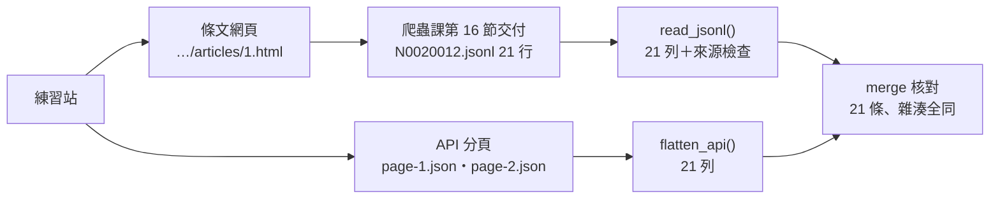
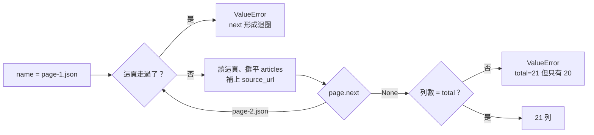

# 03｜JSON／JSONL 與巢狀結構：接手爬蟲課的輸出

> **正文初稿：2026-10-05；2026-10-06 改版：改成圖表為主，程式逐段解說。**
> 本節接爬蟲課第 16 節〈交給下游〉丟過來的資料：讀它交付的 JSONL、攤平 API 的巢狀分頁 JSON，並且**一路保留四個來源欄位**。
> 本節不是 JSON 語法課，也不重教分頁爬取（爬蟲課第 03、05 節）。這裡只處理「檔案已經在你手上之後」的事。

[回 18 節課綱](../../course-plans/2026-10-data-analysis-18.md)

## 範例程式碼

- [demo：03_read_jsonl.py](https://github.com/4-learn/data-analysis-and-process-demo/blob/master/2026/03_read_jsonl.py)（與本頁 Demo 逐字相同）
- 練習資料與環境說明：[2026/README](https://github.com/4-learn/data-analysis-and-process-demo/tree/master/2026)

## 學習目標與時間

完成後，你能：

- 讀一份 JSONL，而不讓 pandas 改寫它的內容。
- 把「一頁一個物件、條文在裡面一層」的 API 回應攤平成一列一條。
- 說出每一列從哪個網址來，並用兩個來源互相核對。

| 時間 | 活動 | 產出 |
| --- | --- | --- |
| 0–6 分鐘 | 爬蟲課交了什麼過來 | 四個來源欄位各回答什麼問題 |
| 6–16 分鐘 | 一行 `read_json`，再存回去 | 21 列被改寫，沒有任何錯誤 |
| 16–22 分鐘 | 先決定型別，再讀 | `dtype=False`、`convert_dates=False`、來源檢查 |
| 22–30 分鐘 | API 的巢狀 JSON | `json_normalize` 的 `record_path`／`meta`，照 `next` 走完 |
| 30–35 分鐘 | 兩個來源互相核對，程式逐段看 | `merge(validate=…)` ＋ 內容雜湊 |
| 35–50 分鐘 | Workshop：全量 749 條 | 每部法規條數與可回溯檢查 |

先修：本課第 02 節；爬蟲課第 05 節（分頁）、第 14 節（驗證）、第 16 節（交給下游）。環境同第 02 節。

## 一、爬蟲課交了什麼過來



每一筆條文都帶四個來源欄位：

| 欄位 | 回答的問題 | 例子 |
| --- | --- | --- |
| `source_url` | 這筆從哪裡來？使用者怎麼回頭核對？ | `…/v1/laws/N0020012/articles/1.html` |
| `fetched_at` | 什麼時候抓的？會不會已經過時？ | `2026-10-05T04:05:23+00:00` |
| `content_hash` | 內容有沒有變？兩份資料是不是同一版？ | 內容的 SHA-256 |
| `source_version` | 是網站哪一版的結構？ | `v1` |

:::warning
這四欄不能加總、不能分組、畫圖也用不到，所以最常在資料處理這一層被丟掉。**一旦丟掉，下游的 LLM 就無法附出處，也沒人能判斷資料新不新。**
:::

本節的檔案（大量解僱勞工保護法：21 條、剛好跨兩頁、條次全是數字）：

| 檔案 | 內容 | 筆數 |
| --- | --- | --- |
| `data/03-crawl/N0020012.jsonl` | 爬蟲課交付格式，一行一條 | 21 |
| `data/03-api/N0020012/page-1.json` | 練習站 v1 API 第 1 頁原始回應 | 20 |
| `data/03-api/N0020012/page-2.json` | 第 2 頁 | 1 |

`03-api/` 兩個檔案與練習站線上回應**位元組完全相同**（2026-10-05 比對）。

## 二、一行 `read_json`，再存回去

AI 最常給的寫法：

<!-- fn-table -->
| 函式名稱 | 說明 | 官方文件連結 |
|---|---|---|
| `pd.read_json(path, lines=True, dtype=False, convert_dates=False)` | 讀 JSON／JSONL 成 `DataFrame`。`lines=True` 一行一筆（JSONL）；`dtype=False` 不猜型別；`convert_dates=False` 不依欄名自動轉日期 | [文件](https://pandas.pydata.org/docs/reference/api/pandas.read_json.html#pandas.read_json) |

```python
df = pd.read_json("data/03-crawl/N0020012.jsonl", lines=True)
```

讀進來、什麼都不改、直接存回去：

```text
== 1. 一行 read_json，再存回去 ==
21 列；slug=int64, fetched_at=datetime64[us, UTC]
存回去後 21 列被改寫，欄位：['fetched_at', 'slug']
第 1 列 slug '1' → 1；fetched_at '2026-10-05T04:05:23+00:00' → 1791173123000
```

**什麼都沒改，21 列全被改寫：**

| 欄位 | 原本 | 讀進來 | 存回去 | 誰做的 |
| --- | --- | --- | --- | --- |
| `slug` | `"1"`（字串） | `int64` | `1`（整數） | 條次剛好全是數字，pandas 猜成整數 |
| `fetched_at` | `"2026-10-05T04:05:23+00:00"` | `datetime64[us, UTC]` | `1791173123000` | 欄名結尾是 `_at`，自動轉日期；`to_json` 再寫成「1970 年起的毫秒數」 |
| `content_hash` | SHA-256 | 不變 | 不變 | — |

pandas 3.0 會對這個預設值發出 `Pandas4Warning`，**但只是警告，檔案照樣寫出去**。

`read_json` 會自動轉成日期的欄名（教師實測，pandas 3.0.6 與 2.3.3 相同）：

| 欄名規則 | 例子 | 會被轉嗎 |
| --- | --- | --- |
| 結尾是 `_at` | `fetched_at` | ✅ |
| 結尾是 `_time` | `event_time` | ✅ |
| 開頭是 `timestamp` | `timestamp_utc` | ✅ |
| 就叫 `modified`、`date`、`datetime` | `modified`、`date` | ✅ |
| 其他 | `updated`、`created_date`、`published` | ❌ |

> **同樣是時間欄，有的被轉、有的不被轉，只看名字。** 這就是不該依賴它的理由。

## 三、先決定型別，再讀

做法跟第 02 節一樣：**不讓 pandas 猜**。

<!-- fn-table -->
| 函式名稱 | 說明 | 官方文件連結 |
|---|---|---|
| 前面介紹過 | 用法同前，括號內是在哪裡第一次介紹 | [`pd.read_json()`](https://pandas.pydata.org/docs/reference/api/pandas.read_json.html#pandas.read_json)（第 03 節） |

```python
pd.read_json(path, lines=True, dtype=False, convert_dates=False)
```

兩個參數要一起寫（教師實測）：

| 寫法 | `slug`（3.0.6） | `fetched_at`（3.0.6） | `fetched_at`（2.3.3） |
| --- | --- | --- | --- |
| 什麼都不寫 | `int64` ❌ | `datetime64` ❌ | `datetime64` ❌ |
| 只寫 `dtype=False` | `str` ✅ | `str` ✅ | `datetime64` ❌ |
| 只寫 `convert_dates=False` | `int64` ❌ | `str` ✅ | `object` ✅ |
| **兩個都寫** | `str` ✅ | `str` ✅ | `object` ✅ |

只寫 `dtype=False` 在 pandas 3 剛好沒事，換到 2.3 就出錯。兩個都寫，才不依賴版本。

讀完做一次來源檢查（`check_provenance()`）：

| 檢查 | 擋下什麼 |
| --- | --- |
| 四個來源欄位都在 | 上游漏給欄位 |
| 沒有空值 | 欄位在，但內容是空的 |
| `fetched_at` 帶時區 | `2026-10-05 12:05:23` 這種不知道是哪個時區的時間 |
| `content_hash` 與內容一致 | 檔案在交付之後被改過 |

## 四、API 的巢狀 JSON

練習站的 API 一次回一頁，條文放在裡面一層：

```json
{
 "version": 1, "pcode": "N0020012", "name": "大量解僱勞工保護法",
 "page": 1, "total_pages": 2, "total": 21, "next": "page-2.json",
 "articles": [
  {"slug": "1", "article_no": "第 1 條", "chapter": "", "section": "", "content": "為保障勞工工作權…"},
  …
 ]
}
```

| 讀法 | 得到什麼 | 問題 |
| --- | --- | --- |
| `pd.read_json(page-1.json)` | 20 列 × 8 欄，`articles` 欄裝的是 dict | 外層欄位重複 20 次；只讀了一頁，**不會告訴你還有下一頁** |
| `json_normalize(page, record_path="articles")` | 20 列 × 5 欄 | 沒有 `pcode`、`name`，**不知道是哪部法規** |
| `json_normalize(page, record_path="articles", meta=[...])` | 20 列 × 8 欄 | ✅ 一列一條，帶著法規代碼與名稱 |

`json_normalize` 的兩個參數：

| 參數 | 意思 | 本節的值 |
| --- | --- | --- |
| `record_path` | **一列是什麼**：取哪個 list 的每個元素 | `"articles"` |
| `meta` | 外層要帶下來的欄位 | `["pcode", "name", "total"]` |

分頁要照 `next` 走到 `None`，不能寫死頁數：



:::info
**API 回應沒有 `source_url`**，`flatten_api()` 幫每一列補上「它是從哪個 API 網址取得的」。那不是條文頁的網址，但它是**真的取得這筆資料的地方**。寫一個好看、但其實沒去抓過的網址，才是錯的。
:::

## 五、程式逐段解說

完整程式在第六段。這裡依執行順序，一段一段看。

### 第 0 段：設定

<!-- fn-table -->
| 函式名稱 | 說明 | 官方文件連結 |
|---|---|---|
| 前面介紹過 | 用法同前，括號內是在哪裡第一次介紹 | [`Path(__file__).resolve().parent`](https://docs.python.org/3.12/library/pathlib.html#pathlib.Path.resolve)（第 02 節）、[`Path()`](https://docs.python.org/3.12/library/pathlib.html#pathlib.Path)（爬蟲 10） |

<!-- 節錄: 03_read_jsonl.py -->
```python
DATA = Path(__file__).resolve().parent / "data"
CRAWL = DATA / "03-crawl" / "N0020012.jsonl"
API = DATA / "03-api" / "N0020012"
API_URL = "https://4-learn.github.io/crawler-playground/v1/api/laws/N0020012/"
PROVENANCE = ["source_url", "fetched_at", "content_hash", "source_version"]
```

| 名稱 | 做什麼 |
| --- | --- |
| `CRAWL` | 爬蟲課交付的 JSONL |
| `API` | 存 API 分頁的資料夾 |
| `API_URL` | API 的線上位置，用來替每一列補上真實來源 |
| `PROVENANCE` | 四個必須保留的來源欄位 |

### 第 1 段：`read_jsonl()`，讀 JSONL

<!-- fn-table -->
| 函式名稱 | 說明 | 官方文件連結 |
|---|---|---|
| 前面介紹過 | 用法同前，括號內是在哪裡第一次介紹 | [`pd.read_json()`](https://pandas.pydata.org/docs/reference/api/pandas.read_json.html#pandas.read_json)（第 03 節） |

<!-- 節錄: 03_read_jsonl.py -->
```python
def read_jsonl(path):
    """讀爬蟲課交付的 JSONL：不讓 pandas 猜型別、不讓它改寫時間字串。"""
    df = pd.read_json(path, lines=True, dtype=False, convert_dates=False)
    check_provenance(df)
    return df
```

| 參數 | 做什麼 |
| --- | --- |
| `lines=True` | 一行一個 JSON 物件（JSONL） |
| `dtype=False` | 不推斷型別，JSON 裡是字串就是字串 |
| `convert_dates=False` | 不看欄名就轉日期 |

讀完立刻 `check_provenance(df)`。**讀檔和檢查綁在一起**，呼叫的人不可能忘記檢查。

### 第 2 段：`check_provenance()`，四項來源檢查

<!-- fn-table -->
| 函式名稱 | 說明 | 官方文件連結 |
|---|---|---|
| `.isna()` | 每一格是不是缺值（`NaN`／`None`／`NaT`），得到 True／False | [文件](https://pandas.pydata.org/docs/reference/api/pandas.Series.isna.html#pandas.Series.isna) |
| `s.str.contains(樣式, regex=, na=)` | 每個字串是否包含某段文字或符合正規表示式；`regex=False` 當普通文字找 | [文件](https://pandas.pydata.org/docs/reference/api/pandas.Series.str.contains.html#pandas.Series.str.contains) |
| `&`／`\|`／`~` | 布林遮罩的「且／或／非」。pandas 不能用 `and`／`or`／`not`；每個條件要加括號：`(a > 1) & (b == "x")` | [文件](https://pandas.pydata.org/docs/user_guide/indexing.html#boolean-operators) |
| `df.loc[列條件, 欄]` | 依**標籤**或布林條件選列，同時選欄：`df.loc[df["x"] > 1, "y"]`。要改值也用它 | [文件](https://pandas.pydata.org/docs/reference/api/pandas.DataFrame.loc.html#pandas.DataFrame.loc) |
| `s.map(函式或 dict)` | 對每個值套用函式（或依 dict 對照換值），得到新的一欄 | [文件](https://pandas.pydata.org/docs/reference/api/pandas.Series.map.html#pandas.Series.map) |
| 前面介紹過 | 用法同前，括號內是在哪裡第一次介紹 | [`df.columns`](https://pandas.pydata.org/docs/reference/api/pandas.DataFrame.columns.html#pandas.DataFrame.columns)（第 02 節）、[`.any()`](https://pandas.pydata.org/docs/reference/api/pandas.Series.any.html#pandas.Series.any)（第 02 節）、[`df[條件]`](https://pandas.pydata.org/docs/user_guide/indexing.html#boolean-indexing)（第 02 節）、[`df["欄"]`](https://pandas.pydata.org/docs/user_guide/indexing.html#basics)（第 02 節）、[`.iloc[]`](https://pandas.pydata.org/docs/reference/api/pandas.Series.iloc.html#pandas.Series.iloc)（第 02 節）、[`.sum()`](https://pandas.pydata.org/docs/reference/api/pandas.Series.sum.html#pandas.Series.sum)（第 02 節）、[`.hexdigest()`](https://docs.python.org/3.12/library/hashlib.html#hashlib.hash.hexdigest)（爬蟲 15）、[`s.encode()`](https://docs.python.org/3.12/library/stdtypes.html#str.encode)（爬蟲 15）、[`hashlib.sha256()`](https://docs.python.org/3.12/library/hashlib.html#hashlib.sha256)（爬蟲 15） |

<!-- 節錄: 03_read_jsonl.py -->
```python
def check_provenance(df):
    missing = [c for c in PROVENANCE if c not in df.columns]
    if missing:
        raise ValueError(f"缺少來源欄位 {missing}")
    empty = [c for c in PROVENANCE if df[c].isna().any() or (df[c] == "").any()]
    if empty:
        raise ValueError(f"來源欄位有空值 {empty}")
    no_tz = ~df["fetched_at"].str.contains(r"(?:[+-]\d\d:\d\d|Z)$")
    if no_tz.any():
        raise ValueError(f"fetched_at 沒有時區 {int(no_tz.sum())} 筆，例如 {df.loc[no_tz, 'fetched_at'].iloc[0]!r}")
    actual = df["content"].map(lambda s: hashlib.sha256(s.encode("utf-8")).hexdigest())
    bad = actual != df["content_hash"]
    if bad.any():
        raise ValueError(f"content_hash 與內容不符 {int(bad.sum())} 筆")
```

| 行 | 檢查 | 細節 |
| --- | --- | --- |
| `missing = ...` | 欄位存在 | 缺哪幾欄一次列出 |
| `empty = ...` | 沒有空值 | `NaN` 和空字串 `""` 都算空 |
| `no_tz = ...` | 帶時區 | 正規表示式：結尾是 `+08:00`、`-05:00` 或 `Z` |
| `actual = ...` | 雜湊一致 | 用 UTF-8 重算 SHA-256，與 `content_hash` 比對 |

每一項失敗都**直接拋例外**，訊息寫出幾筆、哪一筆，不是印個警告就繼續。

### 第 3 段：`flatten_api()`，照 `next` 走完並攤平

<!-- fn-table -->
| 函式名稱 | 說明 | 官方文件連結 |
|---|---|---|
| `path.read_text(encoding="utf-8")` | 把整個檔案讀成一個字串 | [文件](https://docs.python.org/3.12/library/pathlib.html#pathlib.Path.read_text) |
| `pd.json_normalize(data, record_path=, meta=)` | 把巢狀 JSON 攤平成表。`record_path` 指定「一列是哪個 list 的元素」；`meta` 指定外層要帶下來的欄位 | [文件](https://pandas.pydata.org/docs/reference/api/pandas.json_normalize.html#pandas.json_normalize) |
| `.rename(名稱)`／`df.rename(columns={舊: 新})` | `Series` 改名稱；`DataFrame` 改欄名 | [文件](https://pandas.pydata.org/docs/reference/api/pandas.Series.rename.html#pandas.Series.rename) |
| `.drop(columns=)`／`s.drop(標籤)` | 去掉指定的欄或標籤，回傳新的物件 | [文件](https://pandas.pydata.org/docs/reference/api/pandas.DataFrame.drop.html#pandas.DataFrame.drop) |
| 前面介紹過 | 用法同前，括號內是在哪裡第一次介紹 | [`json.loads()`](https://docs.python.org/3.12/library/json.html#json.loads)（爬蟲 03）、[`Path()`](https://docs.python.org/3.12/library/pathlib.html#pathlib.Path)（爬蟲 10）、[`df["欄"]`](https://pandas.pydata.org/docs/user_guide/indexing.html#basics)（第 02 節）、[`pd.concat()`](https://pandas.pydata.org/docs/reference/api/pandas.concat.html#pandas.concat)（第 02 節）、[`.iloc[]`](https://pandas.pydata.org/docs/reference/api/pandas.Series.iloc.html#pandas.Series.iloc)（第 02 節） |

<!-- 節錄: 03_read_jsonl.py -->
```python
def flatten_api(folder, first="page-1.json"):
    """從第一頁開始照 next 走完，把每頁的 articles 攤平成一列一條。"""
    frames, name, seen = [], first, set()
    while name:
        if name in seen:
            raise ValueError(f"next 形成迴圈：{name}")
        seen.add(name)
        page = json.loads((Path(folder) / name).read_text(encoding="utf-8"))
        rows = pd.json_normalize(page, record_path="articles", meta=["pcode", "name", "total"])
        rows["source_url"] = API_URL + name   # 這一列是從哪個網址來的
        frames.append(rows)
        name = page["next"]
    df = pd.concat(frames, ignore_index=True).rename(columns={"name": "law_name"})
    expected = int(df["total"].iloc[0])
    if len(df) != expected:
        raise ValueError(f"API 說 total={expected}，實際攤平 {len(df)} 條")
    return df.drop(columns="total")
```

| 行 | 做什麼 | 為什麼 |
| --- | --- | --- |
| `while name:` | 一直走到 `next` 是 `None` | 不寫死頁數；爬蟲課第 14 節的 AI 就是寫死 `range(1, 5)` 被抓到 |
| `seen` | 記錄走過的頁 | `next` 指回走過的頁時報錯，不會無窮迴圈 |
| `json_normalize(...)` | 一頁攤成 N 列 | `meta` 帶下 `pcode`、`name`、`total` |
| `rows["source_url"] = ...` | 補上真實來源 | 這一列是從哪個 API 網址拿到的 |
| `rename(...)` | `name` 改名 `law_name` | 跟 JSONL 的欄名一致，才能合併 |
| `expected = ...` | 用 API 自己說的 `total` 驗收 | 少一頁、少一條都會被抓到 |
| `drop(columns="total")` | 驗收完就丟掉 | 這欄每一列都一樣，留著沒用 |

### 第 4 段：主程式，四段輸出

| 程式段 | 輸出標題 | 示範什麼 |
| --- | --- | --- |
| `read_json` → `to_json` → 逐列比較 | `== 1. 一行 read_json，再存回去 ==` | 21 列被改寫 |
| `read_jsonl(CRAWL)` | `== 2. 先決定型別，再讀 ==` | 型別保留、來源檢查通過 |
| `read_json(page-1)` 對照 `flatten_api(API)` | `== 3. API 的巢狀 JSON ==` | 怪表 20 列 vs 攤平 21 列 |
| `merge(..., validate="one_to_one")` | `== 4. 兩個來源互相核對 ==` | 21 條對上、雜湊全同 |

第 4 段的 `merge`：

| 參數 | 做什麼 |
| --- | --- |
| `on=["pcode", "slug"]` | 用「哪部法規的哪一條」當鍵 |
| `suffixes=("_crawl", "_api")` | 兩邊同名欄位分別加後綴，兩個來源網址都留著 |
| `validate="one_to_one"` | 任一邊鍵重複就**直接報錯**，不默默產生多的列（第 14 節詳談） |

## 六、完整程式與執行結果

以下為完整 `03_read_jsonl.py`，只讀 `data/03-crawl/` 與 `data/03-api/`，不寫檔、不連線。

<!-- fn-table -->
| 函式名稱 | 說明 | 官方文件連結 |
|---|---|---|
| `df.to_json(orient="records", lines=True, force_ascii=False)` | `DataFrame` 轉 JSON 字串。這三個參數合起來＝JSONL、一列一個物件、中文不轉成 `\uXXXX` | [文件](https://pandas.pydata.org/docs/reference/api/pandas.DataFrame.to_json.html#pandas.DataFrame.to_json) |
| `df.shape` | （列數, 欄數）的 tuple；`df.shape[1]` 是欄數 | [文件](https://pandas.pydata.org/docs/reference/api/pandas.DataFrame.shape.html#pandas.DataFrame.shape) |
| `left.merge(right, on=, how=, validate=, indicator=)` | 依共同欄位把兩張表接起來（SQL 的 JOIN）。`how` 是 inner／left；`validate="one_to_one"` 等會在鍵重複時報錯；`indicator=True` 多一欄標出每列來自哪邊 | [文件](https://pandas.pydata.org/docs/reference/api/pandas.DataFrame.merge.html#pandas.DataFrame.merge) |
| `df.tail(n)` | 最後 n 列 | [文件](https://pandas.pydata.org/docs/reference/api/pandas.DataFrame.tail.html#pandas.DataFrame.tail) |
| 前面介紹過 | 用法同前，括號內是在哪裡第一次介紹 | [`Path(__file__).resolve().parent`](https://docs.python.org/3.12/library/pathlib.html#pathlib.Path.resolve)（第 02 節）、[`Path()`](https://docs.python.org/3.12/library/pathlib.html#pathlib.Path)（爬蟲 10）、[`pd.read_json()`](https://pandas.pydata.org/docs/reference/api/pandas.read_json.html#pandas.read_json)（第 03 節）、[`df.columns`](https://pandas.pydata.org/docs/reference/api/pandas.DataFrame.columns.html#pandas.DataFrame.columns)（第 02 節）、[`.any()`](https://pandas.pydata.org/docs/reference/api/pandas.Series.any.html#pandas.Series.any)（第 02 節）、[`.isna()`](https://pandas.pydata.org/docs/reference/api/pandas.Series.isna.html#pandas.Series.isna)（第 03 節）、[`df[條件]`](https://pandas.pydata.org/docs/user_guide/indexing.html#boolean-indexing)（第 02 節）、[`df["欄"]`](https://pandas.pydata.org/docs/user_guide/indexing.html#basics)（第 02 節）、[`s.str.contains()`](https://pandas.pydata.org/docs/reference/api/pandas.Series.str.contains.html#pandas.Series.str.contains)（第 03 節）、[`& \| ~`](https://pandas.pydata.org/docs/user_guide/indexing.html#boolean-operators)（第 03 節）、[`.iloc[]`](https://pandas.pydata.org/docs/reference/api/pandas.Series.iloc.html#pandas.Series.iloc)（第 02 節）、[`.sum()`](https://pandas.pydata.org/docs/reference/api/pandas.Series.sum.html#pandas.Series.sum)（第 02 節）、[`.loc[]`](https://pandas.pydata.org/docs/reference/api/pandas.DataFrame.loc.html#pandas.DataFrame.loc)（第 03 節）、[`.hexdigest()`](https://docs.python.org/3.12/library/hashlib.html#hashlib.hash.hexdigest)（爬蟲 15）、[`s.encode()`](https://docs.python.org/3.12/library/stdtypes.html#str.encode)（爬蟲 15）、[`hashlib.sha256()`](https://docs.python.org/3.12/library/hashlib.html#hashlib.sha256)（爬蟲 15）、[`s.map()`](https://pandas.pydata.org/docs/reference/api/pandas.Series.map.html#pandas.Series.map)（第 03 節）、[`json.loads()`](https://docs.python.org/3.12/library/json.html#json.loads)（爬蟲 03）、[`path.read_text()`](https://docs.python.org/3.12/library/pathlib.html#pathlib.Path.read_text)（第 03 節）、[`pd.json_normalize()`](https://pandas.pydata.org/docs/reference/api/pandas.json_normalize.html#pandas.json_normalize)（第 03 節）、[`pd.concat()`](https://pandas.pydata.org/docs/reference/api/pandas.concat.html#pandas.concat)（第 02 節）、[`.rename()`](https://pandas.pydata.org/docs/reference/api/pandas.Series.rename.html#pandas.Series.rename)（第 03 節）、[`.drop()`](https://pandas.pydata.org/docs/reference/api/pandas.DataFrame.drop.html#pandas.DataFrame.drop)（第 03 節）、[`s.dtype`](https://pandas.pydata.org/docs/reference/api/pandas.Series.dtype.html#pandas.Series.dtype)（第 02 節）、[`df.to_string()`](https://pandas.pydata.org/docs/reference/api/pandas.DataFrame.to_string.html#pandas.DataFrame.to_string)（第 02 節） |

<!-- demo: 03_read_jsonl.py -->
```python
"""第 03 節：接手爬蟲課的 JSONL 與 API 的巢狀 JSON，而且不弄丟來源。"""

import hashlib
import json
from pathlib import Path

import pandas as pd

DATA = Path(__file__).resolve().parent / "data"
CRAWL = DATA / "03-crawl" / "N0020012.jsonl"
API = DATA / "03-api" / "N0020012"
API_URL = "https://4-learn.github.io/crawler-playground/v1/api/laws/N0020012/"
PROVENANCE = ["source_url", "fetched_at", "content_hash", "source_version"]


def read_jsonl(path):
    """讀爬蟲課交付的 JSONL：不讓 pandas 猜型別、不讓它改寫時間字串。"""
    df = pd.read_json(path, lines=True, dtype=False, convert_dates=False)
    check_provenance(df)
    return df


def check_provenance(df):
    missing = [c for c in PROVENANCE if c not in df.columns]
    if missing:
        raise ValueError(f"缺少來源欄位 {missing}")
    empty = [c for c in PROVENANCE if df[c].isna().any() or (df[c] == "").any()]
    if empty:
        raise ValueError(f"來源欄位有空值 {empty}")
    no_tz = ~df["fetched_at"].str.contains(r"(?:[+-]\d\d:\d\d|Z)$")
    if no_tz.any():
        raise ValueError(f"fetched_at 沒有時區 {int(no_tz.sum())} 筆，例如 {df.loc[no_tz, 'fetched_at'].iloc[0]!r}")
    actual = df["content"].map(lambda s: hashlib.sha256(s.encode("utf-8")).hexdigest())
    bad = actual != df["content_hash"]
    if bad.any():
        raise ValueError(f"content_hash 與內容不符 {int(bad.sum())} 筆")


def flatten_api(folder, first="page-1.json"):
    """從第一頁開始照 next 走完，把每頁的 articles 攤平成一列一條。"""
    frames, name, seen = [], first, set()
    while name:
        if name in seen:
            raise ValueError(f"next 形成迴圈：{name}")
        seen.add(name)
        page = json.loads((Path(folder) / name).read_text(encoding="utf-8"))
        rows = pd.json_normalize(page, record_path="articles", meta=["pcode", "name", "total"])
        rows["source_url"] = API_URL + name   # 這一列是從哪個網址來的
        frames.append(rows)
        name = page["next"]
    df = pd.concat(frames, ignore_index=True).rename(columns={"name": "law_name"})
    expected = int(df["total"].iloc[0])
    if len(df) != expected:
        raise ValueError(f"API 說 total={expected}，實際攤平 {len(df)} 條")
    return df.drop(columns="total")


if __name__ == "__main__":
    print("== 1. 一行 read_json，再存回去 ==")
    naive = pd.read_json(CRAWL, lines=True)
    print(f"{len(naive)} 列；slug={naive['slug'].dtype}, fetched_at={naive['fetched_at'].dtype}")
    original = [json.loads(line) for line in CRAWL.read_text(encoding="utf-8").splitlines()]
    written = [json.loads(line) for line in naive.to_json(orient="records", lines=True, force_ascii=False).splitlines()]
    changed = sorted({k for o, w in zip(original, written) for k in o if o[k] != w[k]})
    print(f"存回去後 {sum(o != w for o, w in zip(original, written))} 列被改寫，欄位：{changed}")
    print(f"第 1 列 slug {original[0]['slug']!r} → {written[0]['slug']!r}；"
          f"fetched_at {original[0]['fetched_at']!r} → {written[0]['fetched_at']!r}")

    print("\n== 2. 先決定型別，再讀 ==")
    crawl = read_jsonl(CRAWL)
    print(f"{len(crawl)} 列；slug={crawl['slug'].dtype}；來源欄位齊全，content_hash 全數相符")
    print(f"fetched_at 原樣保留：{crawl['fetched_at'].iloc[0]}")

    print("\n== 3. API 的巢狀 JSON ==")
    page1 = pd.read_json(API / "page-1.json")
    print(f"read_json 直接讀第 1 頁：{page1.shape[0]} 列 × {page1.shape[1]} 欄；articles 欄裝的是 {type(page1['articles'].iloc[0]).__name__}")
    api = flatten_api(API)
    print(f"照 next 走完攤平：{len(api)} 列；欄位 {list(api.columns)}")

    print("\n== 4. 兩個來源互相核對 ==")
    api["content_hash"] = api["content"].map(lambda s: hashlib.sha256(s.encode("utf-8")).hexdigest())
    both = crawl.merge(api, on=["pcode", "slug"], suffixes=("_crawl", "_api"), validate="one_to_one")
    same = (both["content_hash_crawl"] == both["content_hash_api"]).sum()
    print(f"以 (pcode, slug) 對上 {len(both)} 條；內容雜湊相同 {same} 條")
    print(both[["slug", "source_url_crawl", "source_url_api"]].tail(2).to_string(index=False))
```

執行（在本目錄下）：

```bash
python3 03_read_jsonl.py
```

第二段之後的輸出（第一段的輸出見第二節；執行時最前面還會多一行 `Pandas4Warning: The default 'epoch' date format is deprecated…`）：

```text
== 2. 先決定型別，再讀 ==
21 列；slug=str；來源欄位齊全，content_hash 全數相符
fetched_at 原樣保留：2026-10-05T04:05:23+00:00

== 3. API 的巢狀 JSON ==
read_json 直接讀第 1 頁：20 列 × 8 欄；articles 欄裝的是 dict
照 next 走完攤平：21 列；欄位 ['slug', 'article_no', 'chapter', 'section', 'content', 'pcode', 'law_name', 'source_url']

== 4. 兩個來源互相核對 ==
以 (pcode, slug) 對上 21 條；內容雜湊相同 21 條
slug                                                               source_url_crawl                                                                source_url_api
  20 https://4-learn.github.io/crawler-playground/v1/laws/N0020012/articles/20.html https://4-learn.github.io/crawler-playground/v1/api/laws/N0020012/page-1.json
  21 https://4-learn.github.io/crawler-playground/v1/laws/N0020012/articles/21.html https://4-learn.github.io/crawler-playground/v1/api/laws/N0020012/page-2.json
```

| 你看到的 | 代表什麼 |
| --- | --- |
| 第 3 段：直接讀只有 **20 列** | 只讀了一頁，而且不會告訴你還有下一頁 |
| 第 3 段：攤平後 **21 列** | 照 `next` 走完兩頁，與 `total` 一致 |
| 第 4 段：21 條對上、雜湊全同 | 網頁與 API 兩個來源互相證明：攤平沒有弄丟或弄錯任何一條 |
| 第 21 條有兩個來源網址 | 一個是條文頁、一個是 API 第 2 頁，兩個都是真的 |

## 七、什麼時候用 JSONL，什麼時候用 JSON

| | JSON（一個大物件） | JSONL（一行一個物件） |
| --- | --- | --- |
| 例子 | API 一頁的回應 | 爬蟲課的交付檔 |
| 讀一半壞掉 | 整個檔案讀不了 | 只壞那一行，其他行還能用 |
| 增量追加 | 要重寫整個檔案 | 在檔尾加一行 |
| pandas 讀法 | 常需要 `json_normalize` | `read_json(lines=True)` |
| 適合 | 一次性的結構化回應 | 一筆一筆累積的紀錄 |

爬蟲課選 JSONL 當交付格式，理由正是右欄。本課後面的資料都是 JSONL。

## Workshop：全量 749 條

### 任務與時間

**35–43 分鐘：讀全量。** 用 `read_jsonl()` 讀 `data/articles.jsonl`（9 部法規、749 條），輸出「每部法規有幾條」：

<!-- fn-table -->
| 函式名稱 | 說明 | 官方文件連結 |
|---|---|---|
| 前面介紹過 | 用法同前，括號內是在哪裡第一次介紹 | [`groupby().size()`](https://pandas.pydata.org/docs/reference/api/pandas.api.typing.DataFrameGroupBy.size.html#pandas.api.typing.DataFrameGroupBy.size)（第 02 節）、[`df.groupby()`](https://pandas.pydata.org/docs/reference/api/pandas.DataFrame.groupby.html#pandas.DataFrame.groupby)（第 02 節） |

```python
# Workshop 起手式，本節測試不涵蓋這段
df = read_jsonl(DATA / "articles.jsonl")
print(df.groupby("law_name", sort=False).size())
```

然後回答：**用一行 `pd.read_json(..., lines=True)` 讀全量，`slug` 是什麼型別？為什麼跟第 1 段的 21 條不同？**

**43–50 分鐘：證明每一列都能回溯。** 寫一個檢查：每一列的 `source_url` 結尾必須是 `/{pcode}/articles/{slug}.html`。至少用兩種方式弄壞資料，證明你的檢查會擋下來（例如把某一列的 `slug` 改掉、把 `source_url` 改成空字串）。

:::spoiler 參考判讀（教師用）
- 每部法規條數（教師實測）：

  | 法規 | 條數 |
  | --- | --- |
  | 勞動基準法 | 98 |
  | 性別平等工作法 | 50 |
  | 勞工退休金條例 | 69 |
  | 職業安全衛生法 | 61 |
  | 就業服務法 | 85 |
  | 勞資爭議處理法 | 67 |
  | 大量解僱勞工保護法 | 21 |
  | 勞工職業災害保險及保護法 | 109 |
  | 營造安全衛生設施標準 | 189 |
  | **合計** | **749** |

- 一行 `read_json` 讀全量，`slug` 是 **`str`**：其他法規有 `9-1` 這種條次，整欄沒辦法當整數。**這是最危險的情況**：用全量測試一切正常，上線後某天只處理一部條次全是數字的法規，`slug` 就變成整數，合併開始對不上。看起來沒問題，不代表寫法沒問題，可能只是這份資料剛好沒踩到。
- 回溯檢查可寫成 `df.apply(lambda r: r.source_url.endswith(f"/{r.pcode}/articles/{r.slug}.html"), axis=1).all()`，教師實測 749 列全部通過。若你的檢查在 `slug` 被改掉時**沒有**失敗，代表它只檢查了「網址存在」，沒檢查「網址指向的是這一條」。
- 請 AI 寫「把 JSONL 讀成 DataFrame 並計算每部法規條數」時，常見答案是一行 `read_json`，條數是對的；但若它順手把整張表存回 JSON，`fetched_at` 就會變成毫秒數。檢查 AI 有沒有改寫你沒要求它改的欄位。
:::

### 驗收

- 能重現第 2–4 段輸出，並說明 21 列為什麼在一行 `read_json` ＋ `to_json` 之後全被改寫。
- 每部法規條數正確，合計 749。
- 回答「全量讀進來 `slug` 是 `str`，為什麼這反而危險」。
- 回溯檢查至少擋下兩種你自己做出來的壞資料。

## 教師紀錄與下一步

:::spoiler 教師紀錄（實測環境、資料來源、界線）
**實測**：2026-10-05，Ubuntu 20.04，Python 3.11.8，pandas 3.0.6、numpy 2.4.6。本頁輸出為該環境實際執行貼上。另以 Python 3.10.15／pandas 2.3.3 執行，差別只有：字串欄 dtype 顯示為 `object`、日期解析度為 `ns` 而非 `us`、不印 `Pandas4Warning`，其餘逐字相同。2026-10-06 改版時，以 Python 3.11.2 搭配 pandas 3.0.6 與 2.3.3 重測第二、三節的兩張表（自動轉日期的欄名規則、`dtype`／`convert_dates` 四種組合）。**本節尚未實班試教。**

**資料**：`03-api/` 兩頁與練習站線上 `v1/api/laws/N0020012/page-{1,2}.json` 位元組相同（2026-10-05 以 `cmp` 比對）；`03-crawl/N0020012.jsonl` 是 `articles.jsonl` 的子集。皆由 `tools/build_fixtures.py` 產生，雜湊記於 `data/MANIFEST.json`。

**界線**：本節不處理多層巢狀（`record_path` 給 list、`meta` 給巢狀路徑）。練習站沒有這種結構，硬造範例只會教出「為了用 API 而用」；學員專題遇到時，指向 pandas 文件即可。

**舊教材**：舊版 `read_json`／`json_normalize` 皆 0 次；本節為新增。
:::

**下一節**：第 04 節〈該在資料庫做，還是拉進 pandas？〉——同一份條文已在爬蟲課第 16 節寫進 MariaDB，下一節從資料表讀，並討論「這件事該在 SQL 做，還是在 pandas 做」。
