# 03｜JSON／JSONL 與巢狀結構：接手爬蟲課的輸出

> **2026-10-21 改版：每段一張圖。** 接手爬蟲課的 JSONL 與 API 的巢狀 JSON，一路保留四個來源欄位。

[回 18 節課綱](../../course-plans/2026-10-data-analysis-18.md)

## 範例程式碼

- [demo：03_read_jsonl.py](https://github.com/4-learn/data-analysis-and-process-demo/blob/master/2026/03_read_jsonl.py)（與本頁 Demo 逐字相同）
- 練習資料與環境說明：[2026/README](https://github.com/4-learn/data-analysis-and-process-demo/tree/master/2026)

## 學完能做到

| 時間 | 段落 | 學完能做到 |
| --- | --- | --- |
| 0–16 分 | 零、一 | 看出一行 `read_json` 再存回去，21 列被改寫 |
| 16–22 分 | 二 | 讀 JSONL 不讓 pandas 猜，並檢查來源欄位 |
| 22–30 分 | 三 | 照 `next` 走完分頁，攤平巢狀 JSON |
| 30–35 分 | 四 | 兩個來源互相核對 |
| 35–50 分 | Workshop | 全量 749 條＋回溯檢查 |

## 本節流程

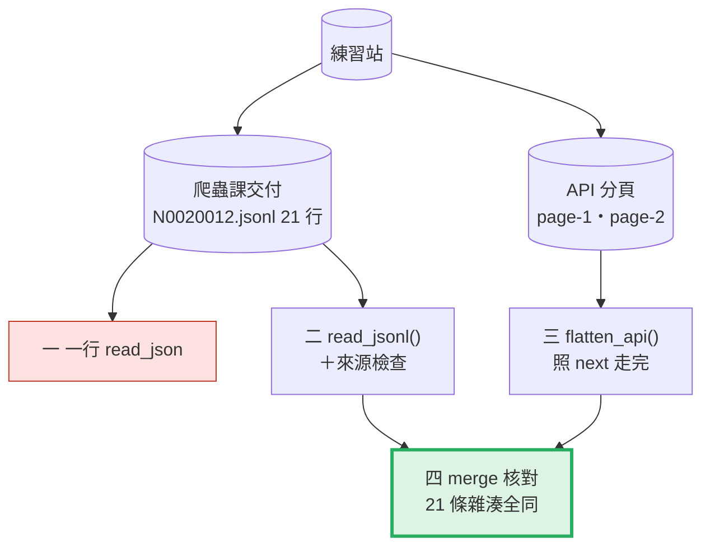

每段都是：**問題 → 位置（黃色）→ 步驟圖 → 程式 → 輸出 → 重點**。

## 零、準備：檔案與四個來源欄位

**問題：** 爬蟲課交過來的每一筆，帶了什麼？

**在流程中的位置：**

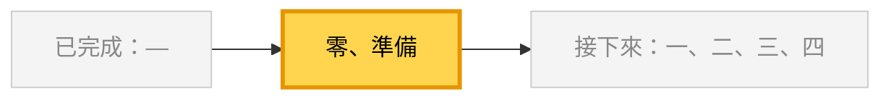

**這段做了什麼：**

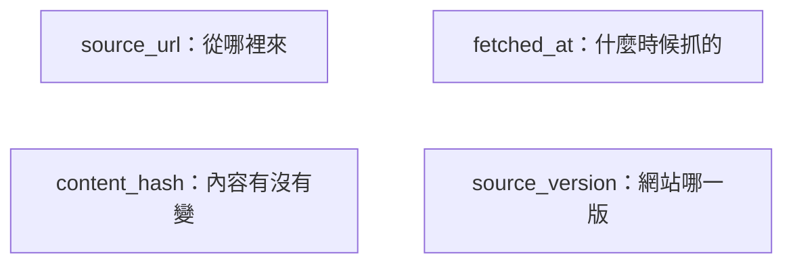

<!-- fn-table -->
| 函式名稱 | 說明 | 官方文件連結 |
|---|---|---|
| 前面介紹過 | 用法同前，括號內是在哪裡第一次介紹 | [`Path(__file__).resolve().parent`](https://docs.python.org/3.12/library/pathlib.html#pathlib.Path.resolve)（第 02 節）、[`Path()`](https://docs.python.org/3.12/library/pathlib.html#pathlib.Path)（爬蟲 10） |

<!-- 節錄: 03_read_jsonl.py -->
```python
import hashlib
import json
from pathlib import Path

import pandas as pd

DATA = Path(__file__).resolve().parent / "data"
CRAWL = DATA / "03-crawl" / "N0020012.jsonl"
API = DATA / "03-api" / "N0020012"
API_URL = "https://4-learn.github.io/crawler-playground/v1/api/laws/N0020012/"
PROVENANCE = ["source_url", "fetched_at", "content_hash", "source_version"]
```

- 這四欄不能加總、不能分組，所以最常在這一層被丟掉。
- **一旦丟掉，LLM 就無法附出處，也沒人能判斷資料新不新。**

## 一、一行 `read_json`，再存回去

**問題：** 讀進來、什麼都不改、存回去，檔案還一樣嗎？

**在流程中的位置：**

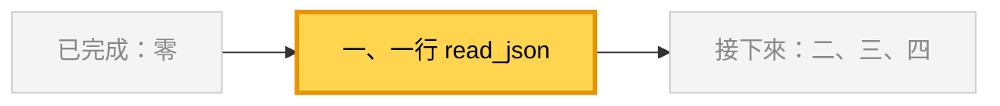

**這段做了什麼：**

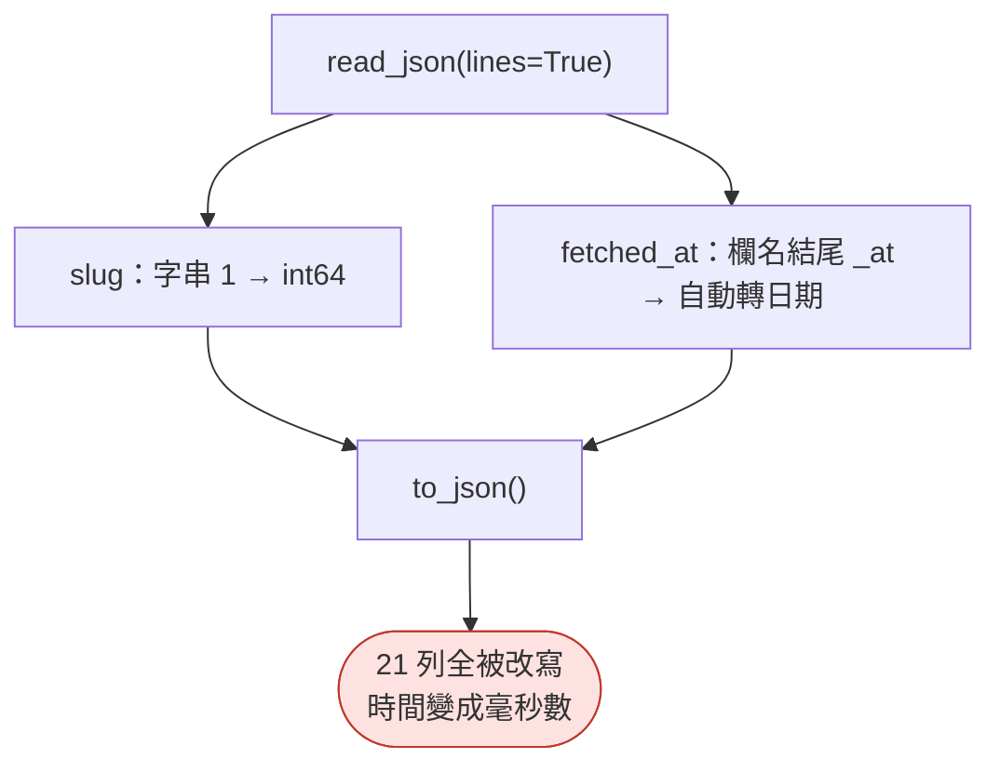

<!-- fn-table -->
| 函式名稱 | 說明 | 官方文件連結 |
|---|---|---|
| `pd.read_json(path, lines=True, dtype=False, convert_dates=False)` | 讀 JSON／JSONL 成 `DataFrame`。`lines=True` 一行一筆（JSONL）；`dtype=False` 不猜型別；`convert_dates=False` 不依欄名自動轉日期 | [文件](https://pandas.pydata.org/docs/reference/api/pandas.read_json.html#pandas.read_json) |
| `path.read_text(encoding="utf-8")` | 把整個檔案讀成一個字串 | [文件](https://docs.python.org/3.12/library/pathlib.html#pathlib.Path.read_text) |
| `df.to_json(orient="records", lines=True, force_ascii=False)` | `DataFrame` 轉 JSON 字串。這三個參數合起來＝JSONL、一列一個物件、中文不轉成 `\uXXXX` | [文件](https://pandas.pydata.org/docs/reference/api/pandas.DataFrame.to_json.html#pandas.DataFrame.to_json) |
| 前面介紹過 | 用法同前，括號內是在哪裡第一次介紹 | [`df["欄"]`](https://pandas.pydata.org/docs/user_guide/indexing.html#basics)（第 02 節）、[`s.dtype`](https://pandas.pydata.org/docs/reference/api/pandas.Series.dtype.html#pandas.Series.dtype)（第 02 節）、[`json.loads()`](https://docs.python.org/3.12/library/json.html#json.loads)（爬蟲 03） |

<!-- 節錄: 03_read_jsonl.py -->
```python
if __name__ == "__main__":
    print("== 1. 一行 read_json，再存回去 ==")
    naive = pd.read_json(CRAWL, lines=True)
    print(f"{len(naive)} 列；slug={naive['slug'].dtype}, fetched_at={naive['fetched_at'].dtype}")
    original = [json.loads(line) for line in CRAWL.read_text(encoding="utf-8").splitlines()]
    written = [json.loads(line) for line in naive.to_json(orient="records", lines=True, force_ascii=False).splitlines()]
    changed = sorted({k for o, w in zip(original, written) for k in o if o[k] != w[k]})
    print(f"存回去後 {sum(o != w for o, w in zip(original, written))} 列被改寫，欄位：{changed}")
    print(f"第 1 列 slug {original[0]['slug']!r} → {written[0]['slug']!r}；"
          f"fetched_at {original[0]['fetched_at']!r} → {written[0]['fetched_at']!r}")
```

```text
== 1. 一行 read_json，再存回去 ==
21 列；slug=int64, fetched_at=datetime64[us, UTC]
存回去後 21 列被改寫，欄位：['fetched_at', 'slug']
第 1 列 slug '1' → 1；fetched_at '2026-10-05T04:05:23+00:00' → 1791173123000
```

- 同樣是時間欄，有的被轉、有的不被轉，**只看名字**。

| 欄名 | 會被自動轉成日期嗎 |
| --- | --- |
| 結尾 `_at`、`_time`；開頭 `timestamp` | 會 |
| 就叫 `modified`、`date`、`datetime` | 會 |
| `updated`、`created_date`、`published` | 不會 |

## 二、先決定型別，再讀

**問題：** 正確的讀法？讀完要檢查什麼？

**在流程中的位置：**

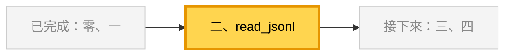

**這段做了什麼：**

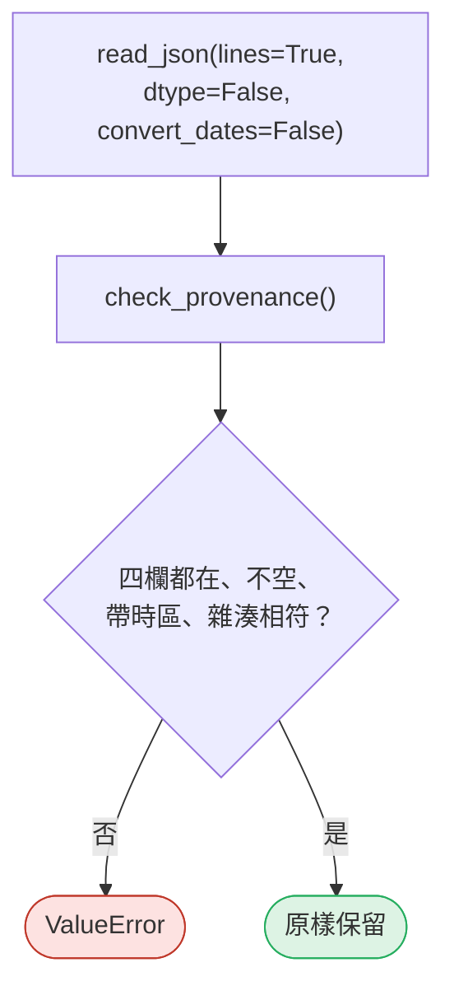

<!-- fn-table -->
| 函式名稱 | 說明 | 官方文件連結 |
|---|---|---|
| `.isna()` | 每一格是不是缺值（`NaN`／`None`／`NaT`），得到 True／False | [文件](https://pandas.pydata.org/docs/reference/api/pandas.Series.isna.html#pandas.Series.isna) |
| `s.str.contains(樣式, regex=, na=)` | 每個字串是否包含某段文字或符合正規表示式；`regex=False` 當普通文字找 | [文件](https://pandas.pydata.org/docs/reference/api/pandas.Series.str.contains.html#pandas.Series.str.contains) |
| `&`／`\|`／`~` | 布林遮罩的「且／或／非」。pandas 不能用 `and`／`or`／`not`；每個條件要加括號：`(a > 1) & (b == "x")` | [文件](https://pandas.pydata.org/docs/user_guide/indexing.html#boolean-operators) |
| `df.loc[列條件, 欄]` | 依**標籤**或布林條件選列，同時選欄：`df.loc[df["x"] > 1, "y"]`。要改值也用它 | [文件](https://pandas.pydata.org/docs/reference/api/pandas.DataFrame.loc.html#pandas.DataFrame.loc) |
| `s.map(函式或 dict)` | 對每個值套用函式（或依 dict 對照換值），得到新的一欄 | [文件](https://pandas.pydata.org/docs/reference/api/pandas.Series.map.html#pandas.Series.map) |
| 前面介紹過 | 用法同前，括號內是在哪裡第一次介紹 | [`.any()`](https://pandas.pydata.org/docs/reference/api/pandas.Series.any.html#pandas.Series.any)（第 02 節）、[`.iloc[]`](https://pandas.pydata.org/docs/reference/api/pandas.Series.iloc.html#pandas.Series.iloc)（第 02 節）、[`.sum()`](https://pandas.pydata.org/docs/reference/api/pandas.Series.sum.html#pandas.Series.sum)（第 02 節）、[`df.columns`](https://pandas.pydata.org/docs/reference/api/pandas.DataFrame.columns.html#pandas.DataFrame.columns)（第 02 節）、[`df["欄"]`](https://pandas.pydata.org/docs/user_guide/indexing.html#basics)（第 02 節）、[`df[條件]`](https://pandas.pydata.org/docs/user_guide/indexing.html#boolean-indexing)（第 02 節）、[`pd.read_json()`](https://pandas.pydata.org/docs/reference/api/pandas.read_json.html#pandas.read_json)（第 03 節）、[`.hexdigest()`](https://docs.python.org/3.12/library/hashlib.html#hashlib.hash.hexdigest)（爬蟲 15）、[`hashlib.sha256()`](https://docs.python.org/3.12/library/hashlib.html#hashlib.sha256)（爬蟲 15）、[`s.encode()`](https://docs.python.org/3.12/library/stdtypes.html#str.encode)（爬蟲 15） |

<!-- 節錄: 03_read_jsonl.py -->
```python
def read_jsonl(path):
    """讀爬蟲課交付的 JSONL：不讓 pandas 猜型別、不讓它改寫時間字串。"""
    df = pd.read_json(path, lines=True, dtype=False, convert_dates=False)
    check_provenance(df)
    return df


def check_provenance(df):
    missing = [c for c in PROVENANCE if c not in df.columns]
    if missing:
        raise ValueError(f"缺少來源欄位 {missing}")
    empty = [c for c in PROVENANCE if df[c].isna().any() or (df[c] == "").any()]
    if empty:
        raise ValueError(f"來源欄位有空值 {empty}")
    no_tz = ~df["fetched_at"].str.contains(r"(?:[+-]\d\d:\d\d|Z)$")
    if no_tz.any():
        raise ValueError(f"fetched_at 沒有時區 {int(no_tz.sum())} 筆，例如 {df.loc[no_tz, 'fetched_at'].iloc[0]!r}")
    actual = df["content"].map(lambda s: hashlib.sha256(s.encode("utf-8")).hexdigest())
    bad = actual != df["content_hash"]
    if bad.any():
        raise ValueError(f"content_hash 與內容不符 {int(bad.sum())} 筆")
```

<!-- fn-table -->
| 函式名稱 | 說明 | 官方文件連結 |
|---|---|---|
| 前面介紹過 | 用法同前，括號內是在哪裡第一次介紹 | [`.iloc[]`](https://pandas.pydata.org/docs/reference/api/pandas.Series.iloc.html#pandas.Series.iloc)（第 02 節）、[`df["欄"]`](https://pandas.pydata.org/docs/user_guide/indexing.html#basics)（第 02 節）、[`s.dtype`](https://pandas.pydata.org/docs/reference/api/pandas.Series.dtype.html#pandas.Series.dtype)（第 02 節） |

<!-- 節錄: 03_read_jsonl.py -->
```python
print("\n== 2. 先決定型別，再讀 ==")
crawl = read_jsonl(CRAWL)
print(f"{len(crawl)} 列；slug={crawl['slug'].dtype}；來源欄位齊全，content_hash 全數相符")
print(f"fetched_at 原樣保留：{crawl['fetched_at'].iloc[0]}")
```

```text
== 2. 先決定型別，再讀 ==
21 列；slug=str；來源欄位齊全，content_hash 全數相符
fetched_at 原樣保留：2026-10-05T04:05:23+00:00
```

- 兩個參數要一起寫，才不依賴 pandas 版本。
- 雜湊對不上 = 檔案在交付後被改過，不該當原始資料往下送。

| 寫法 | `slug` | `fetched_at`（3.0.6） | `fetched_at`（2.3.3） |
| --- | --- | --- | --- |
| 只寫 `dtype=False` | `str` | `str` | `datetime64` ✗ |
| 只寫 `convert_dates=False` | `int64` ✗ | `str` | `object` |
| **兩個都寫** | `str` | `str` | `object` |

## 三、API 的巢狀 JSON

**問題：** 一頁一個物件、條文在裡面一層，怎麼攤平？

**在流程中的位置：**

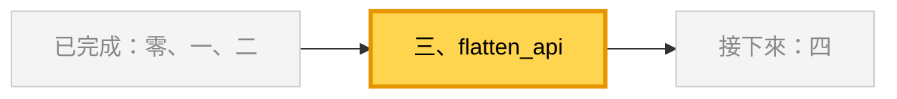

**這段做了什麼：**

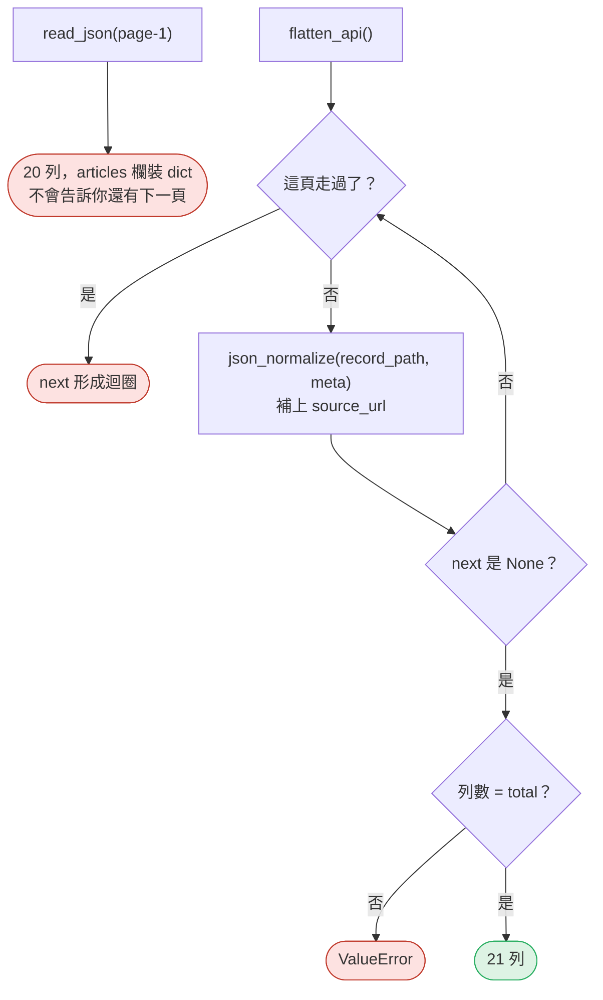

<!-- fn-table -->
| 函式名稱 | 說明 | 官方文件連結 |
|---|---|---|
| `pd.json_normalize(data, record_path=, meta=)` | 把巢狀 JSON 攤平成表。`record_path` 指定「一列是哪個 list 的元素」；`meta` 指定外層要帶下來的欄位 | [文件](https://pandas.pydata.org/docs/reference/api/pandas.json_normalize.html#pandas.json_normalize) |
| `.rename(名稱)`／`df.rename(columns={舊: 新})` | `Series` 改名稱；`DataFrame` 改欄名 | [文件](https://pandas.pydata.org/docs/reference/api/pandas.Series.rename.html#pandas.Series.rename) |
| `.drop(columns=)`／`s.drop(標籤)` | 去掉指定的欄或標籤，回傳新的物件 | [文件](https://pandas.pydata.org/docs/reference/api/pandas.DataFrame.drop.html#pandas.DataFrame.drop) |
| 前面介紹過 | 用法同前，括號內是在哪裡第一次介紹 | [`.iloc[]`](https://pandas.pydata.org/docs/reference/api/pandas.Series.iloc.html#pandas.Series.iloc)（第 02 節）、[`df["欄"]`](https://pandas.pydata.org/docs/user_guide/indexing.html#basics)（第 02 節）、[`pd.concat()`](https://pandas.pydata.org/docs/reference/api/pandas.concat.html#pandas.concat)（第 02 節）、[`path.read_text()`](https://docs.python.org/3.12/library/pathlib.html#pathlib.Path.read_text)（第 03 節）、[`json.loads()`](https://docs.python.org/3.12/library/json.html#json.loads)（爬蟲 03）、[`Path()`](https://docs.python.org/3.12/library/pathlib.html#pathlib.Path)（爬蟲 10） |

<!-- 節錄: 03_read_jsonl.py -->
```python
def flatten_api(folder, first="page-1.json"):
    """從第一頁開始照 next 走完，把每頁的 articles 攤平成一列一條。"""
    frames, name, seen = [], first, set()
    while name:
        if name in seen:
            raise ValueError(f"next 形成迴圈：{name}")
        seen.add(name)
        page = json.loads((Path(folder) / name).read_text(encoding="utf-8"))
        rows = pd.json_normalize(page, record_path="articles", meta=["pcode", "name", "total"])
        rows["source_url"] = API_URL + name   # 這一列是從哪個網址來的
        frames.append(rows)
        name = page["next"]
    df = pd.concat(frames, ignore_index=True).rename(columns={"name": "law_name"})
    expected = int(df["total"].iloc[0])
    if len(df) != expected:
        raise ValueError(f"API 說 total={expected}，實際攤平 {len(df)} 條")
    return df.drop(columns="total")
```

<!-- fn-table -->
| 函式名稱 | 說明 | 官方文件連結 |
|---|---|---|
| `df.shape` | （列數, 欄數）的 tuple；`df.shape[1]` 是欄數 | [文件](https://pandas.pydata.org/docs/reference/api/pandas.DataFrame.shape.html#pandas.DataFrame.shape) |
| 前面介紹過 | 用法同前，括號內是在哪裡第一次介紹 | [`.iloc[]`](https://pandas.pydata.org/docs/reference/api/pandas.Series.iloc.html#pandas.Series.iloc)（第 02 節）、[`df.columns`](https://pandas.pydata.org/docs/reference/api/pandas.DataFrame.columns.html#pandas.DataFrame.columns)（第 02 節）、[`df["欄"]`](https://pandas.pydata.org/docs/user_guide/indexing.html#basics)（第 02 節）、[`pd.read_json()`](https://pandas.pydata.org/docs/reference/api/pandas.read_json.html#pandas.read_json)（第 03 節） |

<!-- 節錄: 03_read_jsonl.py -->
```python
print("\n== 3. API 的巢狀 JSON ==")
page1 = pd.read_json(API / "page-1.json")
print(f"read_json 直接讀第 1 頁：{page1.shape[0]} 列 × {page1.shape[1]} 欄；articles 欄裝的是 {type(page1['articles'].iloc[0]).__name__}")
api = flatten_api(API)
print(f"照 next 走完攤平：{len(api)} 列；欄位 {list(api.columns)}")
```

```text
== 3. API 的巢狀 JSON ==
read_json 直接讀第 1 頁：20 列 × 8 欄；articles 欄裝的是 dict
照 next 走完攤平：21 列；欄位 ['slug', 'article_no', 'chapter', 'section', 'content', 'pcode', 'law_name', 'source_url']
```

- `record_path`：一列是什麼；`meta`：外層要帶下來的欄位。
- API 回應沒有 `source_url`：補上**真正取得這筆資料的網址**。

## 四、兩個來源互相核對

**問題：** 網頁抓的和 API 抓的，是同一份內容嗎？

**在流程中的位置：**

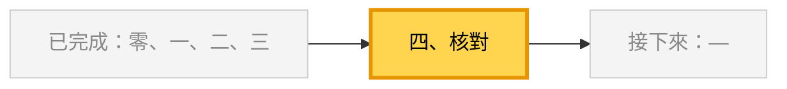

**這段做了什麼：**

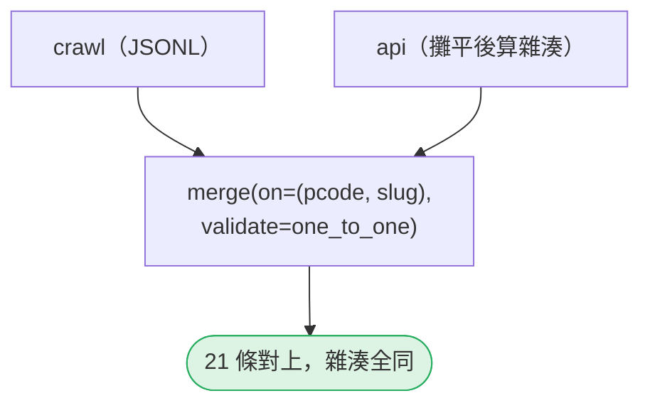

<!-- fn-table -->
| 函式名稱 | 說明 | 官方文件連結 |
|---|---|---|
| `left.merge(right, on=, how=, validate=, indicator=)` | 依共同欄位把兩張表接起來（SQL 的 JOIN）。`how` 是 inner／left；`validate="one_to_one"` 等會在鍵重複時報錯；`indicator=True` 多一欄標出每列來自哪邊 | [文件](https://pandas.pydata.org/docs/reference/api/pandas.DataFrame.merge.html#pandas.DataFrame.merge) |
| `df.tail(n)` | 最後 n 列 | [文件](https://pandas.pydata.org/docs/reference/api/pandas.DataFrame.tail.html#pandas.DataFrame.tail) |
| 前面介紹過 | 用法同前，括號內是在哪裡第一次介紹 | [`.sum()`](https://pandas.pydata.org/docs/reference/api/pandas.Series.sum.html#pandas.Series.sum)（第 02 節）、[`df.to_string()`](https://pandas.pydata.org/docs/reference/api/pandas.DataFrame.to_string.html#pandas.DataFrame.to_string)（第 02 節）、[`df["欄"]`](https://pandas.pydata.org/docs/user_guide/indexing.html#basics)（第 02 節）、[`df[條件]`](https://pandas.pydata.org/docs/user_guide/indexing.html#boolean-indexing)（第 02 節）、[`s.map()`](https://pandas.pydata.org/docs/reference/api/pandas.Series.map.html#pandas.Series.map)（第 03 節）、[`.hexdigest()`](https://docs.python.org/3.12/library/hashlib.html#hashlib.hash.hexdigest)（爬蟲 15）、[`hashlib.sha256()`](https://docs.python.org/3.12/library/hashlib.html#hashlib.sha256)（爬蟲 15）、[`s.encode()`](https://docs.python.org/3.12/library/stdtypes.html#str.encode)（爬蟲 15） |

<!-- 節錄: 03_read_jsonl.py -->
```python
print("\n== 4. 兩個來源互相核對 ==")
api["content_hash"] = api["content"].map(lambda s: hashlib.sha256(s.encode("utf-8")).hexdigest())
both = crawl.merge(api, on=["pcode", "slug"], suffixes=("_crawl", "_api"), validate="one_to_one")
same = (both["content_hash_crawl"] == both["content_hash_api"]).sum()
print(f"以 (pcode, slug) 對上 {len(both)} 條；內容雜湊相同 {same} 條")
print(both[["slug", "source_url_crawl", "source_url_api"]].tail(2).to_string(index=False))
```

```text
== 4. 兩個來源互相核對 ==
以 (pcode, slug) 對上 21 條；內容雜湊相同 21 條
slug                                                               source_url_crawl                                                                source_url_api
  20 https://4-learn.github.io/crawler-playground/v1/laws/N0020012/articles/20.html https://4-learn.github.io/crawler-playground/v1/api/laws/N0020012/page-1.json
  21 https://4-learn.github.io/crawler-playground/v1/laws/N0020012/articles/21.html https://4-learn.github.io/crawler-playground/v1/api/laws/N0020012/page-2.json
```

- `validate="one_to_one"`：任一邊鍵重複就報錯（第 14 節）。
- 第 21 條有兩個來源網址：條文頁與 API 第 2 頁，兩個都是真的。

## Workshop：全量 749 條

### 任務與時間

**35–43 分鐘：讀全量。** 用 `read_jsonl()` 讀 `data/articles.jsonl`（9 部法規、749 條），輸出「每部法規有幾條」：

<!-- fn-table -->
| 函式名稱 | 說明 | 官方文件連結 |
|---|---|---|
| 前面介紹過 | 用法同前，括號內是在哪裡第一次介紹 | [`df.groupby()`](https://pandas.pydata.org/docs/reference/api/pandas.DataFrame.groupby.html#pandas.DataFrame.groupby)（第 02 節）、[`groupby().size()`](https://pandas.pydata.org/docs/reference/api/pandas.api.typing.DataFrameGroupBy.size.html#pandas.api.typing.DataFrameGroupBy.size)（第 02 節） |

```python
# Workshop 起手式，本節測試不涵蓋這段
df = read_jsonl(DATA / "articles.jsonl")
print(df.groupby("law_name", sort=False).size())
```

然後回答：**用一行 `pd.read_json(..., lines=True)` 讀全量，`slug` 是什麼型別？為什麼跟第 1 段的 21 條不同？**

**43–50 分鐘：證明每一列都能回溯。** 寫一個檢查：每一列的 `source_url` 結尾必須是 `/{pcode}/articles/{slug}.html`。至少用兩種方式弄壞資料，證明你的檢查會擋下來（例如把某一列的 `slug` 改掉、把 `source_url` 改成空字串）。

:::spoiler 參考判讀（教師用）
- 每部法規條數（教師實測）：

  | 法規 | 條數 |
  | --- | --- |
  | 勞動基準法 | 98 |
  | 性別平等工作法 | 50 |
  | 勞工退休金條例 | 69 |
  | 職業安全衛生法 | 61 |
  | 就業服務法 | 85 |
  | 勞資爭議處理法 | 67 |
  | 大量解僱勞工保護法 | 21 |
  | 勞工職業災害保險及保護法 | 109 |
  | 營造安全衛生設施標準 | 189 |
  | **合計** | **749** |

- 一行 `read_json` 讀全量，`slug` 是 **`str`**：其他法規有 `9-1` 這種條次，整欄沒辦法當整數。**這是最危險的情況**：用全量測試一切正常，上線後某天只處理一部條次全是數字的法規，`slug` 就變成整數，合併開始對不上。看起來沒問題，不代表寫法沒問題，可能只是這份資料剛好沒踩到。
- 回溯檢查可寫成 `df.apply(lambda r: r.source_url.endswith(f"/{r.pcode}/articles/{r.slug}.html"), axis=1).all()`，教師實測 749 列全部通過。若你的檢查在 `slug` 被改掉時**沒有**失敗，代表它只檢查了「網址存在」，沒檢查「網址指向的是這一條」。
- 請 AI 寫「把 JSONL 讀成 DataFrame 並計算每部法規條數」時，常見答案是一行 `read_json`，條數是對的；但若它順手把整張表存回 JSON，`fetched_at` 就會變成毫秒數。檢查 AI 有沒有改寫你沒要求它改的欄位。
:::

### 驗收

- 能重現第 2–4 段輸出，並說明 21 列為什麼在一行 `read_json` ＋ `to_json` 之後全被改寫。
- 每部法規條數正確，合計 749。
- 回答「全量讀進來 `slug` 是 `str`，為什麼這反而危險」。
- 回溯檢查至少擋下兩種你自己做出來的壞資料。

## 附錄：完整程式

```bash
python3 03_read_jsonl.py
```

<!-- fn-table -->
| 函式名稱 | 說明 | 官方文件連結 |
|---|---|---|
| （同上） | 這支程式用到的函式，都已在上面各段的表格介紹過 | — |

<!-- demo: 03_read_jsonl.py -->
```python
"""第 03 節：接手爬蟲課的 JSONL 與 API 的巢狀 JSON，而且不弄丟來源。"""

import hashlib
import json
from pathlib import Path

import pandas as pd

DATA = Path(__file__).resolve().parent / "data"
CRAWL = DATA / "03-crawl" / "N0020012.jsonl"
API = DATA / "03-api" / "N0020012"
API_URL = "https://4-learn.github.io/crawler-playground/v1/api/laws/N0020012/"
PROVENANCE = ["source_url", "fetched_at", "content_hash", "source_version"]


def read_jsonl(path):
    """讀爬蟲課交付的 JSONL：不讓 pandas 猜型別、不讓它改寫時間字串。"""
    df = pd.read_json(path, lines=True, dtype=False, convert_dates=False)
    check_provenance(df)
    return df


def check_provenance(df):
    missing = [c for c in PROVENANCE if c not in df.columns]
    if missing:
        raise ValueError(f"缺少來源欄位 {missing}")
    empty = [c for c in PROVENANCE if df[c].isna().any() or (df[c] == "").any()]
    if empty:
        raise ValueError(f"來源欄位有空值 {empty}")
    no_tz = ~df["fetched_at"].str.contains(r"(?:[+-]\d\d:\d\d|Z)$")
    if no_tz.any():
        raise ValueError(f"fetched_at 沒有時區 {int(no_tz.sum())} 筆，例如 {df.loc[no_tz, 'fetched_at'].iloc[0]!r}")
    actual = df["content"].map(lambda s: hashlib.sha256(s.encode("utf-8")).hexdigest())
    bad = actual != df["content_hash"]
    if bad.any():
        raise ValueError(f"content_hash 與內容不符 {int(bad.sum())} 筆")


def flatten_api(folder, first="page-1.json"):
    """從第一頁開始照 next 走完，把每頁的 articles 攤平成一列一條。"""
    frames, name, seen = [], first, set()
    while name:
        if name in seen:
            raise ValueError(f"next 形成迴圈：{name}")
        seen.add(name)
        page = json.loads((Path(folder) / name).read_text(encoding="utf-8"))
        rows = pd.json_normalize(page, record_path="articles", meta=["pcode", "name", "total"])
        rows["source_url"] = API_URL + name   # 這一列是從哪個網址來的
        frames.append(rows)
        name = page["next"]
    df = pd.concat(frames, ignore_index=True).rename(columns={"name": "law_name"})
    expected = int(df["total"].iloc[0])
    if len(df) != expected:
        raise ValueError(f"API 說 total={expected}，實際攤平 {len(df)} 條")
    return df.drop(columns="total")


if __name__ == "__main__":
    print("== 1. 一行 read_json，再存回去 ==")
    naive = pd.read_json(CRAWL, lines=True)
    print(f"{len(naive)} 列；slug={naive['slug'].dtype}, fetched_at={naive['fetched_at'].dtype}")
    original = [json.loads(line) for line in CRAWL.read_text(encoding="utf-8").splitlines()]
    written = [json.loads(line) for line in naive.to_json(orient="records", lines=True, force_ascii=False).splitlines()]
    changed = sorted({k for o, w in zip(original, written) for k in o if o[k] != w[k]})
    print(f"存回去後 {sum(o != w for o, w in zip(original, written))} 列被改寫，欄位：{changed}")
    print(f"第 1 列 slug {original[0]['slug']!r} → {written[0]['slug']!r}；"
          f"fetched_at {original[0]['fetched_at']!r} → {written[0]['fetched_at']!r}")

    print("\n== 2. 先決定型別，再讀 ==")
    crawl = read_jsonl(CRAWL)
    print(f"{len(crawl)} 列；slug={crawl['slug'].dtype}；來源欄位齊全，content_hash 全數相符")
    print(f"fetched_at 原樣保留：{crawl['fetched_at'].iloc[0]}")

    print("\n== 3. API 的巢狀 JSON ==")
    page1 = pd.read_json(API / "page-1.json")
    print(f"read_json 直接讀第 1 頁：{page1.shape[0]} 列 × {page1.shape[1]} 欄；articles 欄裝的是 {type(page1['articles'].iloc[0]).__name__}")
    api = flatten_api(API)
    print(f"照 next 走完攤平：{len(api)} 列；欄位 {list(api.columns)}")

    print("\n== 4. 兩個來源互相核對 ==")
    api["content_hash"] = api["content"].map(lambda s: hashlib.sha256(s.encode("utf-8")).hexdigest())
    both = crawl.merge(api, on=["pcode", "slug"], suffixes=("_crawl", "_api"), validate="one_to_one")
    same = (both["content_hash_crawl"] == both["content_hash_api"]).sum()
    print(f"以 (pcode, slug) 對上 {len(both)} 條；內容雜湊相同 {same} 條")
    print(both[["slug", "source_url_crawl", "source_url_api"]].tail(2).to_string(index=False))
```

## 教師紀錄與下一步

:::spoiler 實測環境、版本差異、資料來源（點開）
**實測**：2026-10-05，Ubuntu 20.04，Python 3.11.8，pandas 3.0.6、numpy 2.4.6。本頁輸出為該環境實際執行貼上。另以 Python 3.10.15／pandas 2.3.3 執行，差別只有：字串欄 dtype 顯示為 `object`、日期解析度為 `ns` 而非 `us`、不印 `Pandas4Warning`，其餘逐字相同。2026-10-06 改版時，以 Python 3.11.2 搭配 pandas 3.0.6 與 2.3.3 重測第二、三節的兩張表（自動轉日期的欄名規則、`dtype`／`convert_dates` 四種組合）。**本節尚未實班試教。**

**資料**：`03-api/` 兩頁與練習站線上 `v1/api/laws/N0020012/page-{1,2}.json` 位元組相同（2026-10-05 以 `cmp` 比對）；`03-crawl/N0020012.jsonl` 是 `articles.jsonl` 的子集。皆由 `tools/build_fixtures.py` 產生，雜湊記於 `data/MANIFEST.json`。

**界線**：本節不處理多層巢狀（`record_path` 給 list、`meta` 給巢狀路徑）。練習站沒有這種結構，硬造範例只會教出「為了用 API 而用」；學員專題遇到時，指向 pandas 文件即可。

**舊教材**：舊版 `read_json`／`json_normalize` 皆 0 次；本節為新增。
:::
:::

**下一節**：第 04 節〈該在資料庫做，還是拉進 pandas？〉——同一份條文已在爬蟲課第 16 節寫進 MariaDB，下一節從資料表讀，並討論「這件事該在 SQL 做，還是在 pandas 做」。
