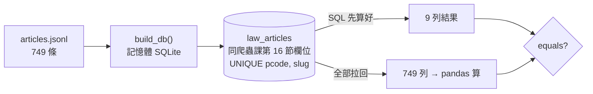
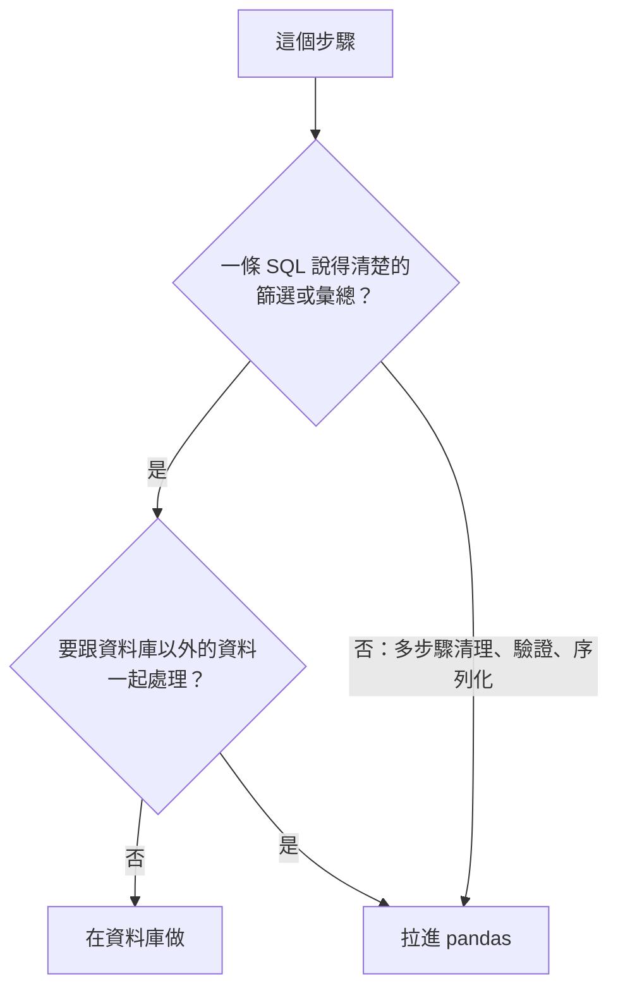

# 04｜該在資料庫做，還是拉進 pandas？

> **正文初稿：2026-10-05；2026-10-06 改版：改成圖表為主，程式逐段解說；MariaDB 段為實測結果。**
> 本節把爬蟲課第 16 節寫進 `law_articles` 的 749 條條文，從資料庫讀進 pandas。同一題各用 SQL 與 pandas 做一次，比較結果、搬運量與安全性，並看清楚 `read_sql` 讀進來的型別是誰決定的。
> 本節不是 SQL 課，也不重教連線、參數化與資源清理（MariaDB 課第 04–13 節）。這裡只處理「查詢結果進 pandas」這一步，以及「這件事該由誰做」。

[回 18 節課綱](../../course-plans/2026-10-data-analysis-18.md)

## 範例程式碼

- [demo：04_sql_or_pandas.py](https://github.com/4-learn/data-analysis-and-process-demo/blob/master/2026/04_sql_or_pandas.py)（與本頁 Demo 逐字相同）
- 練習資料與環境說明：[2026/README](https://github.com/4-learn/data-analysis-and-process-demo/tree/master/2026)

## 學習目標與時間

完成後，你能：

- 用 `pd.read_sql` 加參數讀一個查詢。
- 同一題寫出 SQL 版與 pandas 版，並證明結果相同。
- 說出何時該先在資料庫篩選、何時該拉進來再處理。
- 指出 `read_sql` 讀進來的空值、型別與佔位符，在 SQLite 與 MariaDB 之間哪裡不一樣。

| 時間 | 活動 | 產出 |
| --- | --- | --- |
| 0–5 分鐘 | 為什麼這節用 SQLite | 與 `law_articles` 同欄位、同唯一鍵的記憶體資料庫 |
| 5–12 分鐘 | 同一題，兩種做法 | 每部法規條數：9 列 vs 749 列，結果相同 |
| 12–19 分鐘 | 先篩再拉 vs 全拉再篩 | 15 列 vs 749 列，搬運量差 34 倍 |
| 19–26 分鐘 | 字串拼接 vs `params` | 惡意輸入 190 列 vs 0 列 |
| 26–32 分鐘 | `read_sql` 讀進來的型別，程式逐段看 | `COUNT` 是 `int64`、`SUM` 變 `float64`、`NULL` 被 `groupby` 丟掉 |
| 32–35 分鐘 | 換成 MariaDB 時要改什麼 | 佔位符、`UserWarning`、錯誤型別 |
| 35–50 分鐘 | Workshop：選邊，並抓 AI 的錯 | 一題兩解與選擇理由 |

先修：本課第 03 節；MariaDB 課第 09 節（`GROUP BY`、`NULL`）、第 10–13 節（連線、參數化、交易、錯誤處理）；爬蟲課第 16 節（`law_articles`）。環境同第 02 節，**不需要 MariaDB 與任何資料庫驅動**：`sqlite3` 是 Python 標準函式庫。

## 一、為什麼這節用 SQLite



| | 教室的 MariaDB | 本節 Demo 的 SQLite |
| --- | --- | --- |
| 在哪裡 | 每台 VM 各一顆，不一定還開著 | 標準函式庫，建在記憶體 |
| 資料表內容 | 每個人不一樣（有人只載一部法規、有人補了 `source_version`） | 一律載入同樣的 749 條 |
| 欄位、`NOT NULL`、預設值、唯一鍵 | 爬蟲課第 16 節的 `law_articles` | **相同** |
| 型別名稱 | `VARCHAR(16)`、`DATETIME` | 一律 `TEXT`：SQLite 不檢查長度（實測 `VARCHAR(2)` 存得進 6 個字元），也沒有日期型別 |

```text
== 1. 建表、載入 ==
載入 749 列
同一批再載入一次 → IntegrityError: UNIQUE constraint failed: law_articles.pcode, law_articles.slug
之後仍是 749 列
articles.jsonl 有、資料表沒有的欄位：['source_version']
```

| 你看到的 | 代表什麼 |
| --- | --- |
| 重載被 `IntegrityError` 擋下，仍是 749 列 | 唯一鍵在把關。教師另以「1 列新資料＋3 列重複」實測，`with con:` 讓新的那列也一起回滾（MariaDB 課第 12 節的交易原子性） |
| `source_version` 不在表裡 | **從資料庫讀，拿到的是「表上有的欄位」，不是「上游交付的欄位」**。第 03 節的四個來源欄位，在這裡只剩三個 |

## 二、同一題，兩種做法

題目：每部法規有幾條？

<!-- fn-table -->
| 函式名稱 | 說明 | 官方文件連結 |
|---|---|---|
| `pd.read_sql(sql, con, params=)` | 執行 SQL，把結果直接變成 `DataFrame`；`params` 是 `?` 佔位符的值（tuple） | [文件](https://pandas.pydata.org/docs/reference/api/pandas.read_sql.html#pandas.read_sql) |
| `.reset_index(name=, drop=)` | 把標籤變回一般欄位，列號重新從 0 開始。`drop=True` 直接丟掉舊標籤；`name=` 給 `Series` 的值欄取名 | [文件](https://pandas.pydata.org/docs/reference/api/pandas.DataFrame.reset_index.html#pandas.DataFrame.reset_index) |
| 前面介紹過 | 用法同前，括號內是在哪裡第一次介紹 | [`groupby().size()`](https://pandas.pydata.org/docs/reference/api/pandas.api.typing.DataFrameGroupBy.size.html#pandas.api.typing.DataFrameGroupBy.size)（第 02 節）、[`df.groupby()`](https://pandas.pydata.org/docs/reference/api/pandas.DataFrame.groupby.html#pandas.DataFrame.groupby)（第 02 節） |

```python
# 本節測試不涵蓋這段（節錄自下方 Demo 主程式第二段）
# SQL 做：資料庫算好，只傳 9 列回來
pd.read_sql("SELECT pcode, law_name, COUNT(*) AS n FROM law_articles GROUP BY pcode, law_name ORDER BY pcode", con)

# pandas 做：先把 749 列拉回來，在 Python 裡算
pulled = pd.read_sql("SELECT pcode, law_name FROM law_articles", con)
pulled.groupby(["pcode", "law_name"]).size().reset_index(name="n")
```

```text
== 2. 同一題：每部法規幾條 ==
   pcode     law_name   n
N0020007      勞資爭議處理法  67
N0020012    大量解僱勞工保護法  21
N0030001        勞動基準法  98
N0030014      性別平等工作法  50
N0030020      勞工退休金條例  69
N0050031 勞工職業災害保險及保護法 109
N0060001      職業安全衛生法  61
N0060014   營造安全衛生設施標準 189
N0090001        就業服務法  85
SQL 傳回 9 列；pandas 先拉 749 列再算；兩者 equals：True
```

`equals` 為 `True`：值、欄名、順序、**型別**都一樣（`n` 兩邊都是 `int64`）。

:::warning
SQL 版寫了 `ORDER BY pcode`，`groupby` 預設也依鍵排序，兩邊才剛好對得上。SQL 不寫 `ORDER BY`，**資料庫不保證回傳順序**。比較兩種做法時，先排序再比。
:::

結果一樣，差在哪？

| | 在資料庫做 | 拉進 pandas 做 |
| --- | --- | --- |
| 搬多少資料 | 只搬結果（9 列） | 搬原料（749 列），在本機算 |
| 誰能重現 | 能連資料庫、權限夠的人，一條 SQL | 要有同一份程式、同一版 pandas |
| 權限 | 只要 `SELECT` 權限；也可以只開一個彙總好的 view | 帳號要能讀明細 |
| 擅長 | 篩選、`JOIN`、`GROUP BY`、有索引的查詢 | 多步驟清理、跨來源合併、時間處理、驗證、序列化給 LLM |
| 看不到的 | 不在資料庫裡的東西：另一份 CSV、API 回應、事件檔 | — |



兩種都要會，因為你常常需要**用一邊驗證另一邊**。Workshop 就是這樣做。

## 三、先篩再拉 vs 全拉再篩

LLM 組要「營造安全衛生設施標準裡提到『墜落』的條文」。AI 常見寫法是先 `SELECT *` 全拉回來，再用 pandas 篩：

```text
== 3. 先篩再拉 vs 全拉再篩 ==
全拉          749 列 × 11 欄  約 547,105 位元組
全拉再篩（結果）     15 列 ×  4 欄  約  16,211 位元組
先篩再拉         15 列 ×  4 欄  約  16,211 位元組
兩種做法結果 equals：True；全拉多搬了 34 倍
```

（位元組＝每一格轉成文字後的 UTF-8 長度加總，用來比較相對大小，不是網路封包的實際大小。）

| | 全拉再篩 | 先篩再拉 |
| --- | --- | --- |
| 答案 | 15 條 | 15 條，`equals` 為 `True` |
| 搬運量 | 約 547,105 位元組（34 倍） | 約 16,211 位元組 |
| 拿到的欄位 | 11 欄，包括 `content_hash`、`updated_at` | 只有要的 4 欄 |
| 代價 | 資料一大，就是網路、記憶體與等待時間；多出的欄位之後可能被一起 `to_json` 給 LLM（第 16 節） | — |

所以這不是對錯問題，是**代價**問題。什麼時候全拉反而對？資料量小，而且要對同一份資料切很多次（例如第 06 節的探索）：拉一次、在本機切十次，比查十次合理。**判斷依據是「結果用幾次、資料多大」，不是習慣。**

## 四、字串拼接 vs `params`

AI 最常給的「先篩再拉」：

<!-- fn-table -->
| 函式名稱 | 說明 | 官方文件連結 |
|---|---|---|
| 前面介紹過 | 用法同前，括號內是在哪裡第一次介紹 | [`pd.read_sql()`](https://pandas.pydata.org/docs/reference/api/pandas.read_sql.html#pandas.read_sql)（第 04 節） |

```python
# 本節測試不涵蓋這段（錯誤示範；同一寫法即 Demo 的 naive_find()）
sql = f"SELECT pcode, slug, content FROM law_articles WHERE pcode = '{pcode}' AND content LIKE '%{keyword}%'"
pd.read_sql(sql, con)
```

正常輸入時完全正確。換三種輸入：

```text
== 4. 字串拼接 vs params ==
正常輸入    拼接 → 15 列                                    params → 15 列
惡意輸入    拼接 → 190 列                                   params → 0 列
帶引號的輸入  拼接 → DatabaseError（unrecognized token: "'"）  params → 0 列
```

| 輸入 | 拼接後的 SQL 變成 | 拼接版 | `params` 版 |
| --- | --- | --- | --- |
| `N0060014` | 正常 | 15 列 | 15 列 |
| `N0060014' OR '1'='1` | `pcode = 'N0060014' OR '1'='1' AND content LIKE ...`；`AND` 先結合 | **190 列，不報錯**（189 條全部＋其他法規 1 條） | 0 列（只是一個奇怪的 pcode） |
| `N0060014'` | 引號沒關，語法壞掉 | `DatabaseError` | 0 列 |

`find_articles()` 的三個細節，換到 MariaDB 一樣適用：

| 細節 | ✅ 這樣寫 | ❌ 不要這樣寫 | 為什麼 |
| --- | --- | --- | --- |
| `LIKE` 的 `%` | SQL 寫 `LIKE ?`，值傳 `f"%{keyword}%"` | `LIKE '%?%'` | 引號裡的 `?` 是普通字元，不是佔位符；SQLite 會報參數個數不對 |
| | | `'%' \|\| ? \|\| '%'` | SQLite 的 `\|\|` 是串接，**MariaDB 預設是 `OR`**（實測 `'a' \|\| 'b'` 得 `0`，不報錯） |
| 欄名 | 從白名單 `COLUMNS` 挑 | 把欄名當參數傳 | 參數只能放值，不能代替表名或欄名（MariaDB 課第 11 節） |
| 萬用字元 | 自己另外處理 | 以為參數化會處理 | `find_articles(con, "N0060014", "%")` 回 189 條：參數化擋的是注入，不是 `LIKE` 萬用字元 |

## 五、`read_sql` 讀進來的型別

`read_json` 讀檔時是 pandas 在猜型別（第 03 節）；`read_sql` 不一樣，**型別大部分是資料庫驅動決定的**，pandas 只是把驅動交出來的 Python 值裝進欄位。

```text
== 5. read_sql 讀進來的型別 ==
law_name=str, n=int64, avg_len=float64, no_chapter=float64, fetched_at=str
    law_name   n    avg_len  no_chapter                fetched_at
  營造安全衛生設施標準 189 163.936508         NaN 2026-10-05T04:05:23+00:00
勞工職業災害保險及保護法 109 174.238532         NaN 2026-10-05T04:05:23+00:00
       勞動基準法  98 146.438776         NaN 2026-10-05T04:05:23+00:00
no_chapter 非空的只有：['大量解僱勞工保護法']
chapter 空字串 21 列；NULLIF 之後 NaN 21 列
groupby 預設 728 列；dropna=False 749 列
查無資料：0 列，pcode=object, n=object
```

| SQL 寫的 | 讀進來的型別 | 為什麼 | 怎麼處理 |
| --- | --- | --- | --- |
| `COUNT(*)` | `int64` | — | 沒問題 |
| `SUM(CASE WHEN chapter = '' THEN 1 END)` | `float64` | 9 部裡有 8 部算出 `NULL`（全是 `NULL` 時 `SUM` 回 `NULL`，不是 0），`NULL` 變 `NaN`，整欄變浮點數。跟第 02 節「空欄變 `float64`」是同一件事 | 寫 `COALESCE(SUM(...), 0)` 或 `COUNT(CASE ...)` |
| `fetched_at`（SQLite `TEXT`） | `str` | SQLite 沒有日期型別，存什麼讀回什麼 | 換到 MariaDB 會變成**沒有時區**的日期，見第七段 |
| 查無資料 | `object` | 沒有任何值可推斷型別 | 把「查無資料」當成要處理的結果；否則之後 `concat` 時型別會被拖垮 |

**空字串 vs `NULL`：同一份資料，SQL 和 pandas 答案不同**

| 步驟 | 列數 |
| --- | --- |
| `chapter` 是空字串的 | 21（大量解僱法，沒有分章） |
| `NULLIF(chapter, '')` 之後是 `NaN` 的 | 21 |
| SQL `GROUP BY` | 保留 `NULL` 那一組，合計 749 |
| pandas `groupby` 預設 | **整組丟掉**，合計 728，沒有警告 |
| pandas `groupby(..., dropna=False)` | 749 |

## 六、程式逐段解說

完整程式在下一段。這裡依執行順序，一段一段看。

### 第 0 段：資料表與欄位白名單

<!-- fn-table -->
| 函式名稱 | 說明 | 官方文件連結 |
|---|---|---|
| （無） | 本段只用到 Python 基礎與前幾門課學過的寫法，沒有新的函式 | — |

<!-- 節錄: 04_sql_or_pandas.py -->
```python
COLUMNS = ["pcode", "law_name", "slug", "article_no", "chapter", "content",
           "source_url", "content_hash", "fetched_at"]
INSERT = f"INSERT INTO law_articles ({', '.join(COLUMNS)}) VALUES ({', '.join('?' * len(COLUMNS))})"
```

| 名稱 | 做什麼 |
| --- | --- |
| `SCHEMA` | 建表 SQL（見完整程式），欄位與唯一鍵同爬蟲課第 16 節 |
| `COLUMNS` | 要寫入的 9 欄；也是 `find_articles()` 的欄名白名單 |
| `INSERT` | 用 `COLUMNS` 組出 `INSERT ... VALUES (?, ?, …)`，9 個 `?` 與 9 欄一一對應 |

`INSERT` 裡拼進去的只有**欄名**（來自程式自己的常數），**值**一律是 `?`。這和第四節的拼接不一樣。

### 第 1 段：`build_db()` 與 `load()`

<!-- fn-table -->
| 函式名稱 | 說明 | 官方文件連結 |
|---|---|---|
| `sqlite3.connect(":memory:")` | 開一個 SQLite 資料庫連線；`":memory:"` 建在記憶體、不寫檔 | [文件](https://docs.python.org/3.12/library/sqlite3.html#sqlite3.connect) |
| `df.itertuples(index=False, name=)` | 一列一列取出成 tuple。`index=False` 不含列標籤；`name=None` 得到普通 tuple（不給則是可以用 `row.欄名` 取值的具名 tuple） | [文件](https://pandas.pydata.org/docs/reference/api/pandas.DataFrame.itertuples.html#pandas.DataFrame.itertuples) |
| `con.executemany(sql, 多筆資料)` | 同一句 SQL 對多筆資料各執行一次（批次寫入） | [文件](https://docs.python.org/3.12/library/sqlite3.html#sqlite3.Connection.executemany) |
| 前面介紹過 | 用法同前，括號內是在哪裡第一次介紹 | [`df.columns`](https://pandas.pydata.org/docs/reference/api/pandas.DataFrame.columns.html#pandas.DataFrame.columns)（第 02 節）、[`con.execute()`](https://docs.python.org/3.12/library/sqlite3.html#sqlite3.Connection.execute)（MariaDB 10）、[`df["欄"]`](https://pandas.pydata.org/docs/user_guide/indexing.html#basics)（第 02 節） |

<!-- 節錄: 04_sql_or_pandas.py -->
```python
def build_db(articles):
    """在記憶體建一個與爬蟲課第 16 節同欄位的資料庫，載入條文。"""
    missing = [c for c in COLUMNS if c not in articles.columns]
    if missing:
        raise ValueError(f"缺少欄位 {missing}")
    con = sqlite3.connect(":memory:")
    con.execute(SCHEMA)
    load(con, articles)
    return con


def load(con, articles):
    with con:   # 一批一起成功或一起失敗
        con.executemany(INSERT, articles[COLUMNS].itertuples(index=False, name=None))
```

| 行 | 做什麼 | 為什麼 |
| --- | --- | --- |
| `missing = ...` | 先確認來源有 9 欄 | 缺欄位就停，不建一張半空的表 |
| `sqlite3.connect(":memory:")` | 資料庫建在記憶體 | 不寫檔，每次執行都從乾淨狀態開始 |
| `with con:` | 交易：成功就 commit，任一列失敗就 rollback | 一批一起成功或一起失敗 |
| `articles[COLUMNS]` | 只取 9 欄，順序固定 | 與 `INSERT` 的 `?` 一一對應 |
| `itertuples(index=False, name=None)` | 每列變成普通 tuple | `executemany` 要的格式；不含 index |

### 第 2 段：`find_articles()`，安全的先篩再拉

<!-- fn-table -->
| 函式名稱 | 說明 | 官方文件連結 |
|---|---|---|
| 前面介紹過 | 用法同前，括號內是在哪裡第一次介紹 | [`pd.read_sql()`](https://pandas.pydata.org/docs/reference/api/pandas.read_sql.html#pandas.read_sql)（第 04 節） |

<!-- 節錄: 04_sql_or_pandas.py -->
```python
def find_articles(con, pcode, keyword, columns=("pcode", "slug", "article_no", "content")):
    """先篩再拉：值一律用 ? 佔位；欄名不能當參數，只能從白名單挑。"""
    bad = [c for c in columns if c not in COLUMNS]
    if bad:
        raise ValueError(f"不允許的欄位 {bad}")
    sql = (f"SELECT {', '.join(columns)} FROM law_articles "
           "WHERE pcode = ? AND content LIKE ? ORDER BY id")
    return pd.read_sql(sql, con, params=(pcode, f"%{keyword}%"))
```

| 行 | 做什麼 | 為什麼 |
| --- | --- | --- |
| `columns=(...)` 預設 4 欄 | 只拉需要的欄位 | 欄位也一起篩（第三節） |
| `bad = ...` | 欄名必須在白名單裡 | 欄名不能當參數，只能先檢查再拼 |
| `WHERE pcode = ? AND content LIKE ?` | 兩個值都用 `?` | 值和 SQL 分開送，注入無效 |
| `ORDER BY id` | 固定順序 | 不寫的話，資料庫不保證順序 |
| `params=(pcode, f"%{keyword}%")` | `%` 放在值裡 | 不是寫在 SQL 字串裡 |

### 第 3 段：`naive_find()`，對照組

<!-- fn-table -->
| 函式名稱 | 說明 | 官方文件連結 |
|---|---|---|
| 前面介紹過 | 用法同前，括號內是在哪裡第一次介紹 | [`pd.read_sql()`](https://pandas.pydata.org/docs/reference/api/pandas.read_sql.html#pandas.read_sql)（第 04 節） |

<!-- 節錄: 04_sql_or_pandas.py -->
```python
def naive_find(con, pcode, keyword):
    """AI 常給的寫法：把值拼進 SQL 字串。"""
    sql = f"SELECT pcode, slug, content FROM law_articles WHERE pcode = '{pcode}' AND content LIKE '%{keyword}%'"
    return pd.read_sql(sql, con)
```

把**值**用 f-string 拼進 SQL。只用來示範第四節的三種輸入，**不要拿去用**。

### 第 4 段：兩個小工具

<!-- fn-table -->
| 函式名稱 | 說明 | 官方文件連結 |
|---|---|---|
| 前面介紹過 | 用法同前，括號內是在哪裡第一次介紹 | [`s.encode()`](https://docs.python.org/3.12/library/stdtypes.html#str.encode)（爬蟲 15）、[`df.itertuples()`](https://pandas.pydata.org/docs/reference/api/pandas.DataFrame.itertuples.html#pandas.DataFrame.itertuples)（第 04 節）、[`df.columns`](https://pandas.pydata.org/docs/reference/api/pandas.DataFrame.columns.html#pandas.DataFrame.columns)（第 02 節）、[`s.dtype`](https://pandas.pydata.org/docs/reference/api/pandas.Series.dtype.html#pandas.Series.dtype)（第 02 節）、[`df["欄"]`](https://pandas.pydata.org/docs/user_guide/indexing.html#basics)（第 02 節） |

<!-- 節錄: 04_sql_or_pandas.py -->
```python
def transfer_bytes(df):
    """從資料庫拉過來的資料量：每一格轉成文字後的 UTF-8 位元組數加總（粗略，但不受 pandas 版本影響）。"""
    return sum(len(str(v).encode("utf-8")) for row in df.itertuples(index=False) for v in row)


def describe(df):
    return ", ".join(f"{c}={df[c].dtype}" for c in df.columns)
```

| 函式 | 做什麼 | 用在 |
| --- | --- | --- |
| `transfer_bytes()` | 每格轉成文字、算 UTF-8 長度、全部加總 | 第三節比較搬運量。不用 `memory_usage()`，因為它在不同 pandas 版本結果不同 |
| `describe()` | 印出每欄的 dtype | 第五節看型別 |

### 第 5 段：主程式，五段輸出

| 程式段 | 輸出標題 | 示範什麼 | 本頁對應 |
| --- | --- | --- | --- |
| `build_db()`、重載三列 | `== 1. 建表、載入 ==` | 唯一鍵、交易、少一個來源欄位 | 第一節 |
| SQL `GROUP BY` vs pandas `groupby` | `== 2. 同一題：每部法規幾條 ==` | `equals` 為 `True` | 第二節 |
| `SELECT *` 再篩 vs `find_articles()` | `== 3. 先篩再拉 vs 全拉再篩 ==` | 搬運量 34 倍 | 第三節 |
| 三種輸入 × 兩種寫法 | `== 4. 字串拼接 vs params ==` | 190 列 vs 0 列 | 第四節 |
| 彙總查詢、`NULLIF`、查無資料 | `== 5. read_sql 讀進來的型別 ==` | 型別由驅動決定；`NULL` 被丟掉 | 第五節 |

主程式第四段的 `exc.__cause__`：`read_sql` 把 SQLite 的錯誤包成 `pandas.errors.DatabaseError`，原本的錯誤（`unrecognized token`）放在 `__cause__` 裡。換成 MariaDB 與 pandas 3 時就不是這樣了，見下一段。

### 完整程式

以下為完整 `04_sql_or_pandas.py`，只讀 `data/articles.jsonl`，資料庫建在記憶體裡，不寫檔、不連線。

<!-- fn-table -->
| 函式名稱 | 說明 | 官方文件連結 |
|---|---|---|
| `sqlite3.IntegrityError` | 違反唯一鍵、NOT NULL 等限制時丟出的例外 | [文件](https://docs.python.org/3.12/library/sqlite3.html#sqlite3.IntegrityError) |
| `.equals(另一個)` | 兩個表／欄是否完全相同：值、標籤、**型別**都要一樣 | [文件](https://pandas.pydata.org/docs/reference/api/pandas.DataFrame.equals.html#pandas.DataFrame.equals) |
| `.notna()` | 跟 `isna()` 相反：不是缺值的為 True | [文件](https://pandas.pydata.org/docs/reference/api/pandas.Series.notna.html#pandas.Series.notna) |
| `.tolist()` | 轉成 Python list（`Series`、`Index`、`unique()` 的結果都可以） | [文件](https://pandas.pydata.org/docs/reference/api/pandas.Series.tolist.html) |
| `con.close()` | 關閉資料庫連線 | [文件](https://docs.python.org/3.12/library/sqlite3.html#sqlite3.Connection.close) |
| 前面介紹過 | 用法同前，括號內是在哪裡第一次介紹 | [`Path(__file__).resolve().parent`](https://docs.python.org/3.12/library/pathlib.html#pathlib.Path.resolve)（第 02 節）、[`Path()`](https://docs.python.org/3.12/library/pathlib.html#pathlib.Path)（爬蟲 10）、[`df.columns`](https://pandas.pydata.org/docs/reference/api/pandas.DataFrame.columns.html#pandas.DataFrame.columns)（第 02 節）、[`sqlite3.connect()`](https://docs.python.org/3.12/library/sqlite3.html#sqlite3.connect)（第 04 節）、[`con.execute()`](https://docs.python.org/3.12/library/sqlite3.html#sqlite3.Connection.execute)（MariaDB 10）、[`df.itertuples()`](https://pandas.pydata.org/docs/reference/api/pandas.DataFrame.itertuples.html#pandas.DataFrame.itertuples)（第 04 節）、[`con.executemany()`](https://docs.python.org/3.12/library/sqlite3.html#sqlite3.Connection.executemany)（第 04 節）、[`df["欄"]`](https://pandas.pydata.org/docs/user_guide/indexing.html#basics)（第 02 節）、[`pd.read_sql()`](https://pandas.pydata.org/docs/reference/api/pandas.read_sql.html#pandas.read_sql)（第 04 節）、[`s.encode()`](https://docs.python.org/3.12/library/stdtypes.html#str.encode)（爬蟲 15）、[`s.dtype`](https://pandas.pydata.org/docs/reference/api/pandas.Series.dtype.html#pandas.Series.dtype)（第 02 節）、[`pd.read_json()`](https://pandas.pydata.org/docs/reference/api/pandas.read_json.html#pandas.read_json)（第 03 節）、[`.iloc[]`](https://pandas.pydata.org/docs/reference/api/pandas.Series.iloc.html#pandas.Series.iloc)（第 02 節）、[`df.head()`](https://pandas.pydata.org/docs/reference/api/pandas.DataFrame.head.html#pandas.DataFrame.head)（第 02 節）、[`df.groupby()`](https://pandas.pydata.org/docs/reference/api/pandas.DataFrame.groupby.html#pandas.DataFrame.groupby)（第 02 節）、[`.reset_index()`](https://pandas.pydata.org/docs/reference/api/pandas.DataFrame.reset_index.html#pandas.DataFrame.reset_index)（第 04 節）、[`groupby().size()`](https://pandas.pydata.org/docs/reference/api/pandas.api.typing.DataFrameGroupBy.size.html#pandas.api.typing.DataFrameGroupBy.size)（第 02 節）、[`df.to_string()`](https://pandas.pydata.org/docs/reference/api/pandas.DataFrame.to_string.html#pandas.DataFrame.to_string)（第 02 節）、[`s.str.contains()`](https://pandas.pydata.org/docs/reference/api/pandas.Series.str.contains.html#pandas.Series.str.contains)（第 03 節）、[`& \| ~`](https://pandas.pydata.org/docs/user_guide/indexing.html#boolean-operators)（第 03 節）、[`df[條件]`](https://pandas.pydata.org/docs/user_guide/indexing.html#boolean-indexing)（第 02 節）、[`df.shape`](https://pandas.pydata.org/docs/reference/api/pandas.DataFrame.shape.html#pandas.DataFrame.shape)（第 03 節）、[`.loc[]`](https://pandas.pydata.org/docs/reference/api/pandas.DataFrame.loc.html#pandas.DataFrame.loc)（第 03 節）、[`.isna()`](https://pandas.pydata.org/docs/reference/api/pandas.Series.isna.html#pandas.Series.isna)（第 03 節）、[`.sum()`](https://pandas.pydata.org/docs/reference/api/pandas.Series.sum.html#pandas.Series.sum)（第 02 節） |

<!-- demo: 04_sql_or_pandas.py -->
```python
"""第 04 節：同一份條文放在資料庫裡，哪些事該在 SQL 做，哪些該拉進 pandas 做。"""

import sqlite3
from pathlib import Path

import pandas as pd

DATA = Path(__file__).resolve().parent / "data"

# 欄位與唯一鍵同爬蟲課第 16 節的 law_articles；型別改成 SQLite 的寫法（SQLite 沒有 VARCHAR 長度、DATETIME）
SCHEMA = """
CREATE TABLE law_articles (
  id           INTEGER PRIMARY KEY AUTOINCREMENT,
  pcode        TEXT NOT NULL,
  law_name     TEXT NOT NULL,
  slug         TEXT NOT NULL,
  article_no   TEXT NOT NULL,
  chapter      TEXT NOT NULL DEFAULT '',
  content      TEXT NOT NULL,
  source_url   TEXT NOT NULL,
  content_hash TEXT NOT NULL,
  fetched_at   TEXT NOT NULL,
  updated_at   TEXT NOT NULL DEFAULT CURRENT_TIMESTAMP,
  UNIQUE (pcode, slug)
)"""
COLUMNS = ["pcode", "law_name", "slug", "article_no", "chapter", "content",
           "source_url", "content_hash", "fetched_at"]
INSERT = f"INSERT INTO law_articles ({', '.join(COLUMNS)}) VALUES ({', '.join('?' * len(COLUMNS))})"


def build_db(articles):
    """在記憶體建一個與爬蟲課第 16 節同欄位的資料庫，載入條文。"""
    missing = [c for c in COLUMNS if c not in articles.columns]
    if missing:
        raise ValueError(f"缺少欄位 {missing}")
    con = sqlite3.connect(":memory:")
    con.execute(SCHEMA)
    load(con, articles)
    return con


def load(con, articles):
    with con:   # 一批一起成功或一起失敗
        con.executemany(INSERT, articles[COLUMNS].itertuples(index=False, name=None))


def find_articles(con, pcode, keyword, columns=("pcode", "slug", "article_no", "content")):
    """先篩再拉：值一律用 ? 佔位；欄名不能當參數，只能從白名單挑。"""
    bad = [c for c in columns if c not in COLUMNS]
    if bad:
        raise ValueError(f"不允許的欄位 {bad}")
    sql = (f"SELECT {', '.join(columns)} FROM law_articles "
           "WHERE pcode = ? AND content LIKE ? ORDER BY id")
    return pd.read_sql(sql, con, params=(pcode, f"%{keyword}%"))


def naive_find(con, pcode, keyword):
    """AI 常給的寫法：把值拼進 SQL 字串。"""
    sql = f"SELECT pcode, slug, content FROM law_articles WHERE pcode = '{pcode}' AND content LIKE '%{keyword}%'"
    return pd.read_sql(sql, con)


def transfer_bytes(df):
    """從資料庫拉過來的資料量：每一格轉成文字後的 UTF-8 位元組數加總（粗略，但不受 pandas 版本影響）。"""
    return sum(len(str(v).encode("utf-8")) for row in df.itertuples(index=False) for v in row)


def describe(df):
    return ", ".join(f"{c}={df[c].dtype}" for c in df.columns)


if __name__ == "__main__":
    articles = pd.read_json(DATA / "articles.jsonl", lines=True, dtype=False, convert_dates=False)
    con = build_db(articles)

    print("== 1. 建表、載入 ==")
    print(f"載入 {pd.read_sql('SELECT COUNT(*) AS n FROM law_articles', con)['n'].iloc[0]} 列")
    try:
        load(con, articles.head(3))
    except sqlite3.IntegrityError as exc:
        print(f"同一批再載入一次 → IntegrityError: {exc}")
    print(f"之後仍是 {pd.read_sql('SELECT COUNT(*) AS n FROM law_articles', con)['n'].iloc[0]} 列")
    print(f"articles.jsonl 有、資料表沒有的欄位：{[c for c in articles.columns if c not in COLUMNS]}")

    print("\n== 2. 同一題：每部法規幾條 ==")
    in_sql = pd.read_sql("SELECT pcode, law_name, COUNT(*) AS n FROM law_articles "
                         "GROUP BY pcode, law_name ORDER BY pcode", con)
    pulled = pd.read_sql("SELECT pcode, law_name FROM law_articles", con)
    in_pandas = pulled.groupby(["pcode", "law_name"]).size().reset_index(name="n")
    print(in_sql.to_string(index=False))
    print(f"SQL 傳回 {len(in_sql)} 列；pandas 先拉 {len(pulled)} 列再算；兩者 equals：{in_sql.equals(in_pandas)}")

    print("\n== 3. 先篩再拉 vs 全拉再篩 ==")
    everything = pd.read_sql("SELECT * FROM law_articles", con)
    after = everything[(everything["pcode"] == "N0060014") & everything["content"].str.contains("墜落", regex=False)]
    after = after[["pcode", "slug", "article_no", "content"]].reset_index(drop=True)
    before = find_articles(con, "N0060014", "墜落")
    for label, df in [("全拉", everything), ("全拉再篩（結果）", after), ("先篩再拉", before)]:
        print(f"{label:10} {len(df):>4} 列 × {df.shape[1]:>2} 欄  約 {transfer_bytes(df):>7,} 位元組")
    print(f"兩種做法結果 equals：{after.equals(before)}；全拉多搬了 {transfer_bytes(everything) / transfer_bytes(before):.0f} 倍")

    print("\n== 4. 字串拼接 vs params ==")
    for label, pcode in [("正常輸入", "N0060014"), ("惡意輸入", "N0060014' OR '1'='1"), ("帶引號的輸入", "N0060014'")]:
        try:
            naive = f"{len(naive_find(con, pcode, '墜落'))} 列"
        except Exception as exc:
            naive = f"{type(exc).__name__}（{exc.__cause__}）"
        safe = len(find_articles(con, pcode, "墜落"))
        print(f"{label:6}  拼接 → {naive:38}  params → {safe} 列")

    print("\n== 5. read_sql 讀進來的型別 ==")
    stats = pd.read_sql(
        "SELECT law_name, COUNT(*) AS n, AVG(LENGTH(content)) AS avg_len, "
        "SUM(CASE WHEN chapter = '' THEN 1 END) AS no_chapter, MAX(fetched_at) AS fetched_at "
        "FROM law_articles GROUP BY law_name ORDER BY n DESC", con)
    print(describe(stats))
    print(stats.head(3).to_string(index=False))
    print(f"no_chapter 非空的只有：{stats.loc[stats['no_chapter'].notna(), 'law_name'].tolist()}")
    chap = pd.read_sql("SELECT chapter, NULLIF(chapter, '') AS chapter_or_null FROM law_articles", con)
    print(f"chapter 空字串 {(chap['chapter'] == '').sum()} 列；NULLIF 之後 NaN {chap['chapter_or_null'].isna().sum()} 列")
    print(f"groupby 預設 {int(chap.groupby('chapter_or_null').size().sum())} 列；dropna=False {int(chap.groupby('chapter_or_null', dropna=False).size().sum())} 列")
    empty = pd.read_sql("SELECT pcode, COUNT(*) AS n FROM law_articles WHERE pcode = ? GROUP BY pcode", con, params=("N9999999",))
    print(f"查無資料：{len(empty)} 列，{describe(empty)}")
    con.close()
```

執行（在本目錄下）：

```bash
python3 04_sql_or_pandas.py
```

## 七、換成 MariaDB 時要改什麼

連線沿用 MariaDB 課第 10、13 節（受限帳號、設定檔不進版控、`closing()` 管理生命週期），本節不重教。

<!-- fn-table -->
| 函式名稱 | 說明 | 官方文件連結 |
|---|---|---|
| `warnings.filterwarnings("ignore", message=, category=)` | 只關掉**符合條件**的那一種警告，其他照常顯示 | [文件](https://docs.python.org/3.12/library/warnings.html#warnings.filterwarnings) |
| 前面介紹過 | 用法同前，括號內是在哪裡第一次介紹 | [`with closing()`](https://docs.python.org/3.12/library/contextlib.html#contextlib.closing)（MariaDB 10）、[`pd.read_sql()`](https://pandas.pydata.org/docs/reference/api/pandas.read_sql.html#pandas.read_sql)（第 04 節） |

```python
# 需要 MariaDB 伺服器與 mariadb==1.1.14（MariaDB 課第 10 節）；N0060014 含「墜落」實測 15 列，與 SQLite 版相同
import warnings
from contextlib import closing

import mariadb
import pandas as pd

warnings.filterwarnings("ignore", message="pandas only supports SQLAlchemy", category=UserWarning)

SQL = ("SELECT pcode, slug, article_no, content FROM law_articles "
       "WHERE pcode = ? AND content LIKE ? ORDER BY id")

with closing(mariadb.connect(user=..., password=..., database=..., unix_socket=...)) as con:  # 依 MariaDB 課第 10 節的設定檔
    df = pd.read_sql(SQL, con, params=("N0060014", "%墜落%"))
```

| 行 | 做什麼 |
| --- | --- |
| `warnings.filterwarnings(...)` | 只關掉 pandas 對非 sqlite3 連線的那一句警告，其他警告照常顯示 |
| `SQL = ...` | 與 SQLite 版相同；MariaDB 一樣用 `?` 佔位 |
| `closing(mariadb.connect(...))` | 離開 `with` 時一定關連線 |
| `pd.read_sql(SQL, con, params=...)` | 與 SQLite 版相同的呼叫方式 |

與 SQLite 版的差異（**2026-10-06 MariaDB 11.8.9＋`mariadb` 1.1.14 實測**，pandas 3.0.6 與 2.3.3 各跑一次，載入同樣 749 條）：

| 項目 | SQLite（本節 Demo） | MariaDB（實測） |
| --- | --- | --- |
| 佔位符 | `?` | `?`（`paramstyle` 為 `qmark`）；`%s` 也接受，兩種都回 15 列 |
| `read_sql` 會不會警告 | 不會 | **每次呼叫都發 `UserWarning`**：`pandas only supports SQLAlchemy connectable …` |
| 查詢失敗時的例外 | `pandas.errors.DatabaseError` | **pandas 3.0.6：`mariadb.ProgrammingError`**（不是 `pd.errors.DatabaseError`）；2.3.3：`pandas.errors.DatabaseError` |
| `DATETIME` 欄 | `TEXT`，讀回字串 | `datetime64[us]`（2.3.3 `[ns]`），值 `2026-10-05 04:05:23`，**不帶時區** |
| `AVG()`、`DECIMAL` | `float64` | 驅動交出 `Decimal`；`read_sql` 預設轉成 `float64`，`coerce_float=False` 則留 `object` |
| `LENGTH('墜落')` | 2（字元數） | **6（位元組數）**；要字元數用 `CHAR_LENGTH()` |
| `'a' \|\| 'b'` | `'ab'` | **`0`**，不報錯 |
| 本節 `find_articles()` | 15 列；`%` 189 列 | 15 列；`%` 189 列 |
| 本節 `naive_find()` 惡意輸入 | 190 列 | 190 列 |

三個實際影響：

| # | 影響 | 怎麼做 |
| --- | --- | --- |
| 1 | 警告會一直出現 | 只過濾這一句（如上），**不要** `warnings.simplefilter("ignore")` 全關，第 03 節的 `Pandas4Warning` 你還要看得到 |
| 2 | pandas 3 下 `except pd.errors.DatabaseError` **接不到** MariaDB 的錯 | 接 `mariadb.Error`（MariaDB 課第 13 節），保留真正的錯誤，不用 `except: pass` |
| 3 | 不想依賴 pandas 對其他驅動的「未測試」行為 | 自己用 cursor：`cur.execute(SQL, params)` 後 `pd.DataFrame(cur.fetchall(), columns=[d[0] for d in cur.description])`；注意 `DECIMAL` 欄會留在 `object`，不會自動轉 `float64` |

重跑這些實測：`bash tools/mariadb-04/run.sh`（需要 docker），紀錄在 `tools/mariadb-04/evidence.txt`。

## Workshop：選邊，並抓 AI 的錯

### 任務與時間

**35–42 分鐘：一題兩解。** 題目：「每部法規最長的一條有幾個字？」

1. 用 SQL 寫一次（提示：`GROUP BY`、`MAX`、SQLite 的 `LENGTH`）。
2. 拉 `pcode, content` 進 pandas 再寫一次。
3. 用 `equals` 證明兩邊一樣；不一樣就找出原因。
4. 寫一句話：這題你會選哪一邊？如果資料庫是 MariaDB，SQL 版要改什麼？

**42–46 分鐘：`NULL` 這一組去哪了。** 在 SQL 和 pandas 各做一次「每部法規、每一章各幾條」，章名用 `NULLIF(chapter, '')`。比較兩邊的列數與總條數。

**46–50 分鐘：抓 AI 的錯。** 請 OpenCode 寫：「寫一個函式 `search(con, pcode, keyword)`，從 `law_articles` 找某部法規裡含關鍵字的條文，回傳 DataFrame。」拿它的程式驗收：

| 檢查 | 正確答案 | AI 的版本 |
| --- | --- | --- |
| 第四節三種輸入各呼叫一次 | 15／0／0 列 | |
| 先篩再拉，還是 `SELECT *` 全拉？傳回幾欄？ | 先篩再拉，只回需要的欄 | |
| `LIKE` 的 `%` 寫在哪裡？換到 MariaDB 還成立嗎？ | 寫在值裡；成立 | |
| 傳入 `keyword="%"` 回幾列？ | 189（參數化不處理萬用字元） | |

:::spoiler 參考判讀（教師用）
- **一題兩解**（教師實測）：SQL `SELECT pcode, MAX(LENGTH(content)) AS max_len FROM law_articles GROUP BY pcode ORDER BY pcode` 與 pandas `content.str.len()` 後 `groupby("pcode", as_index=False)["max_len"].max()`，`equals` 為 `True`，兩邊 `max_len` 都是 `int64`。最長的是 `N0060014` 的 935 字，與第 16 節「本資料最長一條 935 字」一致。

  | 資料庫 | SQL 函式 | 最大值 | 與 pandas `equals` |
  | --- | --- | --- | --- |
  | SQLite | `LENGTH` | 935 | `True` |
  | MariaDB（實測） | `LENGTH` | 2455 | **`False`** |
  | MariaDB（實測） | `CHAR_LENGTH` | 935 | `True` |

  這正是「用一邊驗證另一邊」抓得到的錯。選擇：這題兩邊都很短。資料在資料庫、只要結果，用 SQL；接下來還要跟 CSV 合併或做驗證，拉進 pandas。理由說得出來就算對。

- **`NULL` 這一組**（教師實測）：

  | 做法 | 組數 | 合計條數 |
  | --- | --- | --- |
  | SQL `GROUP BY pcode, chapter` | 76 | 749 |
  | pandas `groupby(["pcode", "chapter"])` | 75 | 728 |
  | pandas `dropna=False` | 76 | 749 |

  少掉的 21 條就是大量解僱勞工保護法：沒有分章，不是不存在。

- **抓 AI 的錯**：

  | AI 的寫法 | 結果 |
  | --- | --- |
  | 字串拼接 | 惡意輸入回 190 列、帶引號輸入拋 `DatabaseError` |
  | `LIKE '%?%'` | 參數個數對不上，SQLite 報錯；若只傳一個參數，則是在找含問號的條文，回 0 列——**不報錯，只是找不到** |
  | `'%' \|\| ? \|\| '%'` | SQLite 正確，MariaDB 變成 `OR`（實測 `'a' \|\| 'b'` 得 `0`，不報錯） |
  | 參數化，`keyword="%"` | 189 列：擋住注入，不擋萬用字元 |
:::

### 驗收

- 能重現 Demo 五段輸出，並說明第二段為什麼要寫 `ORDER BY`。
- 一題兩解的 `equals` 為 `True`，並寫出 MariaDB 版要把 `LENGTH` 換成什麼、為什麼。
- 說出 `NULLIF` 之後 SQL 與 pandas 為什麼差 21 條，以及用哪個參數拿回來。
- AI 版本四項檢查都有結論；若它用了字串拼接，指出哪一個輸入會讓它多回資料而不報錯。

## 教師紀錄與下一步

:::spoiler 教師紀錄（實測環境、MariaDB 證據、資料來源、界線）
**實測**：2026-10-05，Ubuntu 20.04，Python 3.11.8（內建 SQLite 3.31.1），pandas 3.0.6、numpy 2.4.6。本頁輸出為該環境實際執行貼上。另以 Python 3.10.15／pandas 2.3.3（SQLite 3.31.1）執行，差別只有一行：第五段字串欄 dtype 顯示為 `object` 而非 `str`（`law_name=object, …, fetched_at=object`）。其餘逐字相同，包括「查無資料」那一行在兩版都是 `object`。

**pandas 版本差異**：非 sqlite3 連線的 `UserWarning` 在 3.0.6 與 2.3.3 訊息相同；查詢失敗時 3.0.6 拋驅動原本的例外、不 `rollback`，2.3.3 包成 `pandas.errors.DatabaseError` 並 `rollback` 一次（`rollback` 次數以假 DBAPI 物件驗證，原因是 3.0.6 的 `SQLiteDatabase.execute()` 只捕捉 `sqlite3.Error`）。**若教室退回 pandas 2.3，第七段影響 2 要改寫。**

**MariaDB 部分的證據等級**：第七段的宣稱已於 2026-10-06 在 MariaDB 11.8.9（官方 `mariadb:11.8` 映像）＋`mariadb` 1.1.14 上實跑：`find_articles` 15 列、`keyword="%"` 189 列、字串拼接惡意輸入 190 列、帶引號輸入的例外型別（3.0.6 `mariadb.ProgrammingError`／2.3.3 `pandas.errors.DatabaseError`），皆與 SQLite 版一致或如表所述；紀錄與重跑腳本在 `tools/mariadb-04/`。**尚未在教室 VM 上跑過**：VM 的 MariaDB 版本、帳號權限、`unix_socket` 設定若不同，開課前仍應跑一次 `run.sh` 的等價步驟。

**資料**：資料表結構取自爬蟲課第 16 節 `law_articles`（欄位、`NOT NULL`、`DEFAULT ''`、`UNIQUE (pcode, slug)` 相同；型別改為 SQLite 的 `TEXT`／`INTEGER`）。內容為 `data/articles.jsonl` 749 條，取自爬蟲課練習站，可能經刻意修改，**不具法律效力**。`updated_at` 是載入當下的時間，每次執行都不同，所以 Demo 不印出它。

**界線**：本節不教 SQLAlchemy、連線池、`chunksize` 分批讀取、`to_sql` 寫回資料庫。位元組數是「每格轉文字後的 UTF-8 長度」，不是網路傳輸量的實測。**`read_excel` 不納入本節**：主題是「該在哪一層做」，Excel 的日期序號、合併儲存格、多工作表跟這個判斷無關，**建議放附錄**。本節**尚未實班試教**。

**舊教材**：無對應舊講義（舊版宣告「本課不教 Database / SQL」，`read_sql` 全課 0 次）；本節為新增，**取代該宣告**。
:::

**下一節**：第 05 節〈一筆事件 = 一列；欄位是 schema〉——前四節都在讀條文（文件）；從下一節開始換成第 01 節的工地事件，先建立「一列是什麼、一欄負責什麼」的心智模型。
