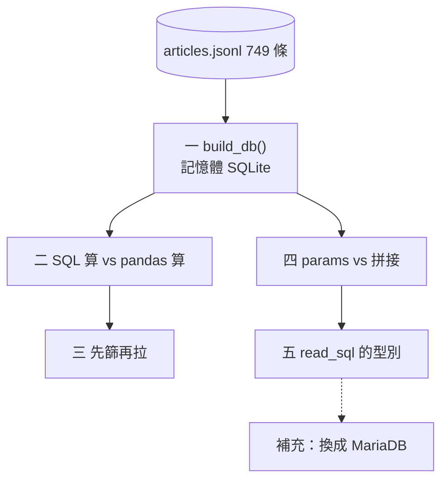
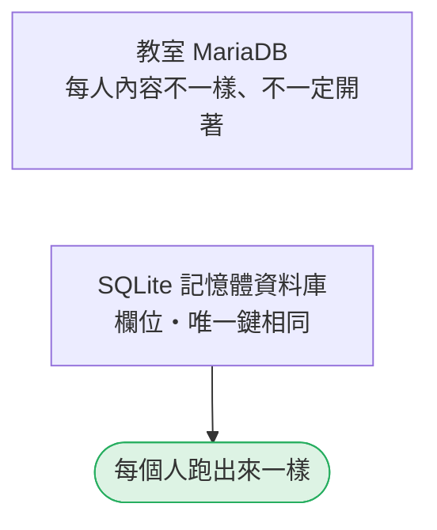
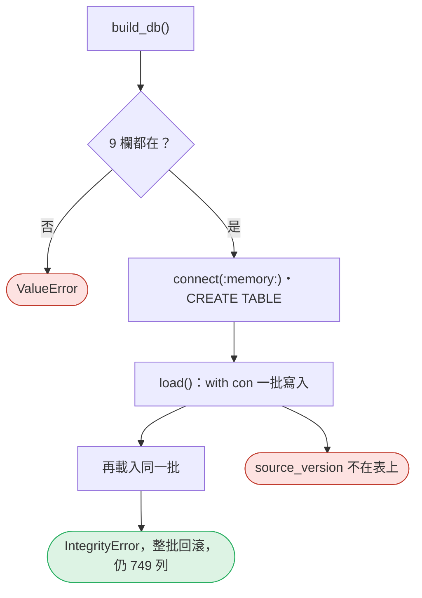
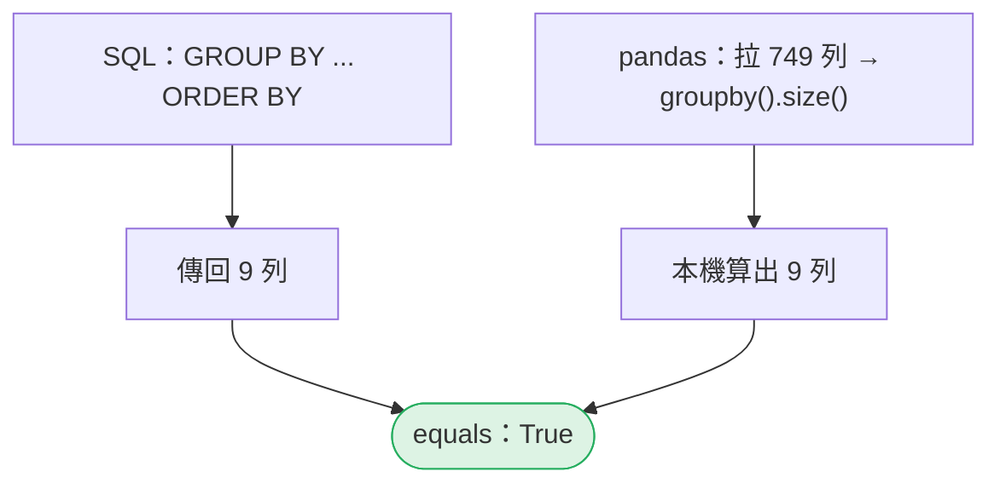
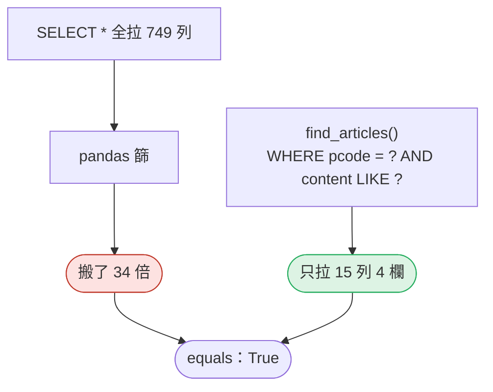
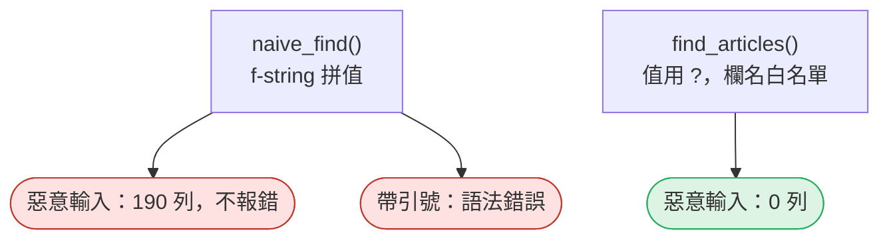
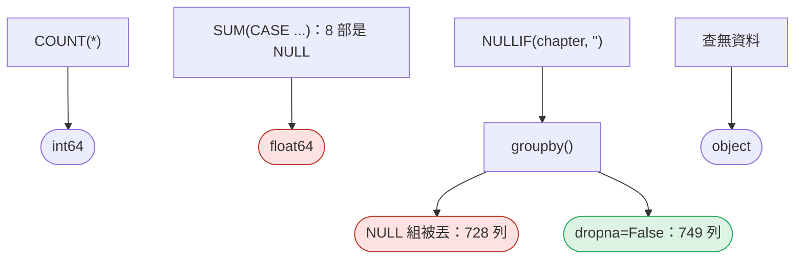
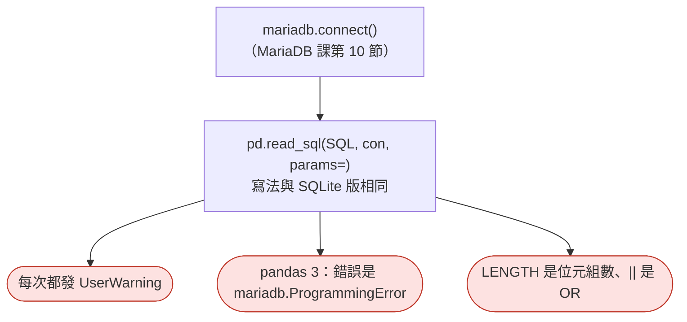

# 04｜該在資料庫做，還是拉進 pandas？

> **2026-10-21 改版：每段一張圖。** 同一份條文放在資料庫裡：哪些事在 SQL 做、哪些拉進 pandas 做。

[回 18 節課綱](../../course-plans/2026-10-data-analysis-18.md)

## 範例程式碼

- [demo：04_sql_or_pandas.py](https://github.com/4-learn/data-analysis-and-process-demo/blob/master/2026/04_sql_or_pandas.py)（與本頁 Demo 逐字相同）
- 練習資料與環境說明：[2026/README](https://github.com/4-learn/data-analysis-and-process-demo/tree/master/2026)

## 學完能做到

| 時間 | 段落 | 學完能做到 |
| --- | --- | --- |
| 0–12 分 | 零～二 | 同一題寫 SQL 版與 pandas 版，證明結果相同 |
| 12–19 分 | 三 | 說出先篩再拉、全拉再篩的代價 |
| 19–26 分 | 四 | 用 `params`，不拼字串 |
| 26–35 分 | 五、MariaDB | 說出 `read_sql` 的型別由誰決定；換 MariaDB 改什麼 |
| 35–50 分 | Workshop | 一題兩解、抓 AI 的錯 |

## 本節流程



每段都是：**問題 → 位置（黃色）→ 步驟圖 → 程式 → 輸出 → 重點**。

## 零、準備：資料表與欄位白名單

**問題：** 為什麼這節用 SQLite？

**在流程中的位置：**


**這段做了什麼：**



<!-- fn-table -->
| 函式名稱 | 說明 | 官方文件連結 |
|---|---|---|
| 前面介紹過 | 用法同前，括號內是在哪裡第一次介紹 | [`Path(__file__).resolve().parent`](https://docs.python.org/3.12/library/pathlib.html#pathlib.Path.resolve)（第 02 節）、[`Path()`](https://docs.python.org/3.12/library/pathlib.html#pathlib.Path)（爬蟲 10） |

<!-- 節錄: 04_sql_or_pandas.py -->
```python
import sqlite3
from pathlib import Path

import pandas as pd

DATA = Path(__file__).resolve().parent / "data"

# 欄位與唯一鍵同爬蟲課第 16 節的 law_articles；型別改成 SQLite 的寫法（SQLite 沒有 VARCHAR 長度、DATETIME）
SCHEMA = """
CREATE TABLE law_articles (
  id           INTEGER PRIMARY KEY AUTOINCREMENT,
  pcode        TEXT NOT NULL,
  law_name     TEXT NOT NULL,
  slug         TEXT NOT NULL,
  article_no   TEXT NOT NULL,
  chapter      TEXT NOT NULL DEFAULT '',
  content      TEXT NOT NULL,
  source_url   TEXT NOT NULL,
  content_hash TEXT NOT NULL,
  fetched_at   TEXT NOT NULL,
  updated_at   TEXT NOT NULL DEFAULT CURRENT_TIMESTAMP,
  UNIQUE (pcode, slug)
)"""
COLUMNS = ["pcode", "law_name", "slug", "article_no", "chapter", "content",
           "source_url", "content_hash", "fetched_at"]
INSERT = f"INSERT INTO law_articles ({', '.join(COLUMNS)}) VALUES ({', '.join('?' * len(COLUMNS))})"
```

<!-- fn-table -->
| 函式名稱 | 說明 | 官方文件連結 |
|---|---|---|
| 前面介紹過 | 用法同前，括號內是在哪裡第一次介紹 | [`pd.read_json()`](https://pandas.pydata.org/docs/reference/api/pandas.read_json.html#pandas.read_json)（第 03 節） |

<!-- 節錄: 04_sql_or_pandas.py -->
```python
if __name__ == "__main__":
    articles = pd.read_json(DATA / "articles.jsonl", lines=True, dtype=False, convert_dates=False)
    con = build_db(articles)
```

- 型別一律 `TEXT`：SQLite 不檢查長度、沒有日期型別。
- `INSERT` 裡拼的只有**欄名**（程式自己的常數），值一律是 `?`。

## 一、建表、載入

**問題：** 唯一鍵在 SQLite 也會把關嗎？

**在流程中的位置：**


**這段做了什麼：**



<!-- fn-table -->
| 函式名稱 | 說明 | 官方文件連結 |
|---|---|---|
| `sqlite3.connect(":memory:")` | 開一個 SQLite 資料庫連線；`":memory:"` 建在記憶體、不寫檔 | [文件](https://docs.python.org/3.12/library/sqlite3.html#sqlite3.connect) |
| `df.itertuples(index=False, name=)` | 一列一列取出成 tuple。`index=False` 不含列標籤；`name=None` 得到普通 tuple（不給則是可以用 `row.欄名` 取值的具名 tuple） | [文件](https://pandas.pydata.org/docs/reference/api/pandas.DataFrame.itertuples.html#pandas.DataFrame.itertuples) |
| `con.executemany(sql, 多筆資料)` | 同一句 SQL 對多筆資料各執行一次（批次寫入） | [文件](https://docs.python.org/3.12/library/sqlite3.html#sqlite3.Connection.executemany) |
| 前面介紹過 | 用法同前，括號內是在哪裡第一次介紹 | [`df.columns`](https://pandas.pydata.org/docs/reference/api/pandas.DataFrame.columns.html#pandas.DataFrame.columns)（第 02 節）、[`df["欄"]`](https://pandas.pydata.org/docs/user_guide/indexing.html#basics)（第 02 節）、[`con.execute()`](https://docs.python.org/3.12/library/sqlite3.html#sqlite3.Connection.execute)（MariaDB 10） |

<!-- 節錄: 04_sql_or_pandas.py -->
```python
def build_db(articles):
    """在記憶體建一個與爬蟲課第 16 節同欄位的資料庫，載入條文。"""
    missing = [c for c in COLUMNS if c not in articles.columns]
    if missing:
        raise ValueError(f"缺少欄位 {missing}")
    con = sqlite3.connect(":memory:")
    con.execute(SCHEMA)
    load(con, articles)
    return con


def load(con, articles):
    with con:   # 一批一起成功或一起失敗
        con.executemany(INSERT, articles[COLUMNS].itertuples(index=False, name=None))
```

<!-- fn-table -->
| 函式名稱 | 說明 | 官方文件連結 |
|---|---|---|
| `pd.read_sql(sql, con, params=)` | 執行 SQL，把結果直接變成 `DataFrame`；`params` 是 `?` 佔位符的值（tuple） | [文件](https://pandas.pydata.org/docs/reference/api/pandas.read_sql.html#pandas.read_sql) |
| `sqlite3.IntegrityError` | 違反唯一鍵、NOT NULL 等限制時丟出的例外 | [文件](https://docs.python.org/3.12/library/sqlite3.html#sqlite3.IntegrityError) |
| 前面介紹過 | 用法同前，括號內是在哪裡第一次介紹 | [`.iloc[]`](https://pandas.pydata.org/docs/reference/api/pandas.Series.iloc.html#pandas.Series.iloc)（第 02 節）、[`df.columns`](https://pandas.pydata.org/docs/reference/api/pandas.DataFrame.columns.html#pandas.DataFrame.columns)（第 02 節）、[`df.head()`](https://pandas.pydata.org/docs/reference/api/pandas.DataFrame.head.html#pandas.DataFrame.head)（第 02 節）、[`df["欄"]`](https://pandas.pydata.org/docs/user_guide/indexing.html#basics)（第 02 節） |

<!-- 節錄: 04_sql_or_pandas.py -->
```python
print("== 1. 建表、載入 ==")
print(f"載入 {pd.read_sql('SELECT COUNT(*) AS n FROM law_articles', con)['n'].iloc[0]} 列")
try:
    load(con, articles.head(3))
except sqlite3.IntegrityError as exc:
    print(f"同一批再載入一次 → IntegrityError: {exc}")
print(f"之後仍是 {pd.read_sql('SELECT COUNT(*) AS n FROM law_articles', con)['n'].iloc[0]} 列")
print(f"articles.jsonl 有、資料表沒有的欄位：{[c for c in articles.columns if c not in COLUMNS]}")
```

```text
== 1. 建表、載入 ==
載入 749 列
同一批再載入一次 → IntegrityError: UNIQUE constraint failed: law_articles.pcode, law_articles.slug
之後仍是 749 列
articles.jsonl 有、資料表沒有的欄位：['source_version']
```

- 從資料庫讀，拿到的是「**表上有的欄位**」，不是上游交付的欄位。

## 二、同一題，兩種做法

**問題：** 每部法規幾條：SQL 算和 pandas 算，結果一樣嗎？

**在流程中的位置：**


**這段做了什麼：**



<!-- fn-table -->
| 函式名稱 | 說明 | 官方文件連結 |
|---|---|---|
| `.reset_index(name=, drop=)` | 把標籤變回一般欄位，列號重新從 0 開始。`drop=True` 直接丟掉舊標籤；`name=` 給 `Series` 的值欄取名 | [文件](https://pandas.pydata.org/docs/reference/api/pandas.DataFrame.reset_index.html#pandas.DataFrame.reset_index) |
| `.equals(另一個)` | 兩個表／欄是否完全相同：值、標籤、**型別**都要一樣 | [文件](https://pandas.pydata.org/docs/reference/api/pandas.DataFrame.equals.html#pandas.DataFrame.equals) |
| 前面介紹過 | 用法同前，括號內是在哪裡第一次介紹 | [`df.groupby()`](https://pandas.pydata.org/docs/reference/api/pandas.DataFrame.groupby.html#pandas.DataFrame.groupby)（第 02 節）、[`df.to_string()`](https://pandas.pydata.org/docs/reference/api/pandas.DataFrame.to_string.html#pandas.DataFrame.to_string)（第 02 節）、[`groupby().size()`](https://pandas.pydata.org/docs/reference/api/pandas.api.typing.DataFrameGroupBy.size.html#pandas.api.typing.DataFrameGroupBy.size)（第 02 節）、[`pd.read_sql()`](https://pandas.pydata.org/docs/reference/api/pandas.read_sql.html#pandas.read_sql)（第 04 節） |

<!-- 節錄: 04_sql_or_pandas.py -->
```python
print("\n== 2. 同一題：每部法規幾條 ==")
in_sql = pd.read_sql("SELECT pcode, law_name, COUNT(*) AS n FROM law_articles "
                     "GROUP BY pcode, law_name ORDER BY pcode", con)
pulled = pd.read_sql("SELECT pcode, law_name FROM law_articles", con)
in_pandas = pulled.groupby(["pcode", "law_name"]).size().reset_index(name="n")
print(in_sql.to_string(index=False))
print(f"SQL 傳回 {len(in_sql)} 列；pandas 先拉 {len(pulled)} 列再算；兩者 equals：{in_sql.equals(in_pandas)}")
```

```text
== 2. 同一題：每部法規幾條 ==
   pcode     law_name   n
N0020007      勞資爭議處理法  67
N0020012    大量解僱勞工保護法  21
N0030001        勞動基準法  98
N0030014      性別平等工作法  50
N0030020      勞工退休金條例  69
N0050031 勞工職業災害保險及保護法 109
N0060001      職業安全衛生法  61
N0060014   營造安全衛生設施標準 189
N0090001        就業服務法  85
SQL 傳回 9 列；pandas 先拉 749 列再算；兩者 equals：True
```

- 比較兩種做法要先排序：SQL 不寫 `ORDER BY`，**順序不保證**。

| | 在資料庫做 | 拉進 pandas 做 |
| --- | --- | --- |
| 搬多少 | 只搬結果 | 搬原料 |
| 擅長 | 篩選、JOIN、GROUP BY | 多步驟清理、跨來源合併、驗證、序列化 |
| 看不到 | 資料庫以外的資料 | — |

## 三、先篩再拉 vs 全拉再篩

**問題：** 同樣的答案，搬了多少資料？

**在流程中的位置：**


**這段做了什麼：**



<!-- fn-table -->
| 函式名稱 | 說明 | 官方文件連結 |
|---|---|---|
| 前面介紹過 | 用法同前，括號內是在哪裡第一次介紹 | [`pd.read_sql()`](https://pandas.pydata.org/docs/reference/api/pandas.read_sql.html#pandas.read_sql)（第 04 節） |

<!-- 節錄: 04_sql_or_pandas.py -->
```python
def find_articles(con, pcode, keyword, columns=("pcode", "slug", "article_no", "content")):
    """先篩再拉：值一律用 ? 佔位；欄名不能當參數，只能從白名單挑。"""
    bad = [c for c in columns if c not in COLUMNS]
    if bad:
        raise ValueError(f"不允許的欄位 {bad}")
    sql = (f"SELECT {', '.join(columns)} FROM law_articles "
           "WHERE pcode = ? AND content LIKE ? ORDER BY id")
    return pd.read_sql(sql, con, params=(pcode, f"%{keyword}%"))
```

<!-- fn-table -->
| 函式名稱 | 說明 | 官方文件連結 |
|---|---|---|
| 前面介紹過 | 用法同前，括號內是在哪裡第一次介紹 | [`df.itertuples()`](https://pandas.pydata.org/docs/reference/api/pandas.DataFrame.itertuples.html#pandas.DataFrame.itertuples)（第 04 節）、[`s.encode()`](https://docs.python.org/3.12/library/stdtypes.html#str.encode)（爬蟲 15） |

<!-- 節錄: 04_sql_or_pandas.py -->
```python
def transfer_bytes(df):
    """從資料庫拉過來的資料量：每一格轉成文字後的 UTF-8 位元組數加總（粗略，但不受 pandas 版本影響）。"""
    return sum(len(str(v).encode("utf-8")) for row in df.itertuples(index=False) for v in row)
```

<!-- fn-table -->
| 函式名稱 | 說明 | 官方文件連結 |
|---|---|---|
| 前面介紹過 | 用法同前，括號內是在哪裡第一次介紹 | [`df["欄"]`](https://pandas.pydata.org/docs/user_guide/indexing.html#basics)（第 02 節）、[`df[條件]`](https://pandas.pydata.org/docs/user_guide/indexing.html#boolean-indexing)（第 02 節）、[`& \| ~`](https://pandas.pydata.org/docs/user_guide/indexing.html#boolean-operators)（第 03 節）、[`df.shape`](https://pandas.pydata.org/docs/reference/api/pandas.DataFrame.shape.html#pandas.DataFrame.shape)（第 03 節）、[`s.str.contains()`](https://pandas.pydata.org/docs/reference/api/pandas.Series.str.contains.html#pandas.Series.str.contains)（第 03 節）、[`.equals()`](https://pandas.pydata.org/docs/reference/api/pandas.DataFrame.equals.html#pandas.DataFrame.equals)（第 04 節）、[`.reset_index()`](https://pandas.pydata.org/docs/reference/api/pandas.DataFrame.reset_index.html#pandas.DataFrame.reset_index)（第 04 節）、[`pd.read_sql()`](https://pandas.pydata.org/docs/reference/api/pandas.read_sql.html#pandas.read_sql)（第 04 節） |

<!-- 節錄: 04_sql_or_pandas.py -->
```python
print("\n== 3. 先篩再拉 vs 全拉再篩 ==")
everything = pd.read_sql("SELECT * FROM law_articles", con)
after = everything[(everything["pcode"] == "N0060014") & everything["content"].str.contains("墜落", regex=False)]
after = after[["pcode", "slug", "article_no", "content"]].reset_index(drop=True)
before = find_articles(con, "N0060014", "墜落")
for label, df in [("全拉", everything), ("全拉再篩（結果）", after), ("先篩再拉", before)]:
    print(f"{label:10} {len(df):>4} 列 × {df.shape[1]:>2} 欄  約 {transfer_bytes(df):>7,} 位元組")
print(f"兩種做法結果 equals：{after.equals(before)}；全拉多搬了 {transfer_bytes(everything) / transfer_bytes(before):.0f} 倍")
```

```text
== 3. 先篩再拉 vs 全拉再篩 ==
全拉          749 列 × 11 欄  約 547,105 位元組
全拉再篩（結果）     15 列 ×  4 欄  約  16,211 位元組
先篩再拉         15 列 ×  4 欄  約  16,211 位元組
兩種做法結果 equals：True；全拉多搬了 34 倍
```

- 不是對錯，是**代價**：結果用幾次、資料多大，決定先篩還是全拉。

## 四、字串拼接 vs `params`

**問題：** AI 把值拼進 SQL，會怎樣？

**在流程中的位置：**


**這段做了什麼：**



<!-- fn-table -->
| 函式名稱 | 說明 | 官方文件連結 |
|---|---|---|
| 前面介紹過 | 用法同前，括號內是在哪裡第一次介紹 | [`pd.read_sql()`](https://pandas.pydata.org/docs/reference/api/pandas.read_sql.html#pandas.read_sql)（第 04 節） |

<!-- 節錄: 04_sql_or_pandas.py -->
```python
def naive_find(con, pcode, keyword):
    """AI 常給的寫法：把值拼進 SQL 字串。"""
    sql = f"SELECT pcode, slug, content FROM law_articles WHERE pcode = '{pcode}' AND content LIKE '%{keyword}%'"
    return pd.read_sql(sql, con)
```

<!-- fn-table -->
| 函式名稱 | 說明 | 官方文件連結 |
|---|---|---|
| （無） | 本段只用到 Python 基礎與前幾門課學過的寫法，沒有新的函式 | — |

<!-- 節錄: 04_sql_or_pandas.py -->
```python
print("\n== 4. 字串拼接 vs params ==")
for label, pcode in [("正常輸入", "N0060014"), ("惡意輸入", "N0060014' OR '1'='1"), ("帶引號的輸入", "N0060014'")]:
    try:
        naive = f"{len(naive_find(con, pcode, '墜落'))} 列"
    except Exception as exc:
        naive = f"{type(exc).__name__}（{exc.__cause__}）"
    safe = len(find_articles(con, pcode, "墜落"))
    print(f"{label:6}  拼接 → {naive:38}  params → {safe} 列")
```

```text
== 4. 字串拼接 vs params ==
正常輸入    拼接 → 15 列                                    params → 15 列
惡意輸入    拼接 → 190 列                                   params → 0 列
帶引號的輸入  拼接 → DatabaseError（unrecognized token: "'"）  params → 0 列
```

- `LIKE` 的 `%` 放在**值**裡；`'%' || ? || '%'` 到 MariaDB 會變成 `OR`。
- 參數化擋注入，不擋萬用字元：`keyword="%"` 回 189 條。

## 五、`read_sql` 讀進來的型別

**問題：** `read_sql` 的型別是誰決定的？

**在流程中的位置：**


**這段做了什麼：**



<!-- fn-table -->
| 函式名稱 | 說明 | 官方文件連結 |
|---|---|---|
| 前面介紹過 | 用法同前，括號內是在哪裡第一次介紹 | [`df.columns`](https://pandas.pydata.org/docs/reference/api/pandas.DataFrame.columns.html#pandas.DataFrame.columns)（第 02 節）、[`df["欄"]`](https://pandas.pydata.org/docs/user_guide/indexing.html#basics)（第 02 節）、[`s.dtype`](https://pandas.pydata.org/docs/reference/api/pandas.Series.dtype.html#pandas.Series.dtype)（第 02 節） |

<!-- 節錄: 04_sql_or_pandas.py -->
```python
def describe(df):
    return ", ".join(f"{c}={df[c].dtype}" for c in df.columns)
```

<!-- fn-table -->
| 函式名稱 | 說明 | 官方文件連結 |
|---|---|---|
| `.notna()` | 跟 `isna()` 相反：不是缺值的為 True | [文件](https://pandas.pydata.org/docs/reference/api/pandas.Series.notna.html#pandas.Series.notna) |
| `.tolist()` | 轉成 Python list（`Series`、`Index`、`unique()` 的結果都可以） | [文件](https://pandas.pydata.org/docs/reference/api/pandas.Series.tolist.html) |
| `con.close()` | 關閉資料庫連線 | [文件](https://docs.python.org/3.12/library/sqlite3.html#sqlite3.Connection.close) |
| 前面介紹過 | 用法同前，括號內是在哪裡第一次介紹 | [`.sum()`](https://pandas.pydata.org/docs/reference/api/pandas.Series.sum.html#pandas.Series.sum)（第 02 節）、[`df.groupby()`](https://pandas.pydata.org/docs/reference/api/pandas.DataFrame.groupby.html#pandas.DataFrame.groupby)（第 02 節）、[`df.head()`](https://pandas.pydata.org/docs/reference/api/pandas.DataFrame.head.html#pandas.DataFrame.head)（第 02 節）、[`df.to_string()`](https://pandas.pydata.org/docs/reference/api/pandas.DataFrame.to_string.html#pandas.DataFrame.to_string)（第 02 節）、[`df["欄"]`](https://pandas.pydata.org/docs/user_guide/indexing.html#basics)（第 02 節）、[`df[條件]`](https://pandas.pydata.org/docs/user_guide/indexing.html#boolean-indexing)（第 02 節）、[`groupby().size()`](https://pandas.pydata.org/docs/reference/api/pandas.api.typing.DataFrameGroupBy.size.html#pandas.api.typing.DataFrameGroupBy.size)（第 02 節）、[`.isna()`](https://pandas.pydata.org/docs/reference/api/pandas.Series.isna.html#pandas.Series.isna)（第 03 節）、[`.loc[]`](https://pandas.pydata.org/docs/reference/api/pandas.DataFrame.loc.html#pandas.DataFrame.loc)（第 03 節）、[`pd.read_sql()`](https://pandas.pydata.org/docs/reference/api/pandas.read_sql.html#pandas.read_sql)（第 04 節） |

<!-- 節錄: 04_sql_or_pandas.py -->
```python
print("\n== 5. read_sql 讀進來的型別 ==")
stats = pd.read_sql(
    "SELECT law_name, COUNT(*) AS n, AVG(LENGTH(content)) AS avg_len, "
    "SUM(CASE WHEN chapter = '' THEN 1 END) AS no_chapter, MAX(fetched_at) AS fetched_at "
    "FROM law_articles GROUP BY law_name ORDER BY n DESC", con)
print(describe(stats))
print(stats.head(3).to_string(index=False))
print(f"no_chapter 非空的只有：{stats.loc[stats['no_chapter'].notna(), 'law_name'].tolist()}")
chap = pd.read_sql("SELECT chapter, NULLIF(chapter, '') AS chapter_or_null FROM law_articles", con)
print(f"chapter 空字串 {(chap['chapter'] == '').sum()} 列；NULLIF 之後 NaN {chap['chapter_or_null'].isna().sum()} 列")
print(f"groupby 預設 {int(chap.groupby('chapter_or_null').size().sum())} 列；dropna=False {int(chap.groupby('chapter_or_null', dropna=False).size().sum())} 列")
empty = pd.read_sql("SELECT pcode, COUNT(*) AS n FROM law_articles WHERE pcode = ? GROUP BY pcode", con, params=("N9999999",))
print(f"查無資料：{len(empty)} 列，{describe(empty)}")
con.close()
```

```text
== 5. read_sql 讀進來的型別 ==
law_name=str, n=int64, avg_len=float64, no_chapter=float64, fetched_at=str
    law_name   n    avg_len  no_chapter                fetched_at
  營造安全衛生設施標準 189 163.936508         NaN 2026-10-05T04:05:23+00:00
勞工職業災害保險及保護法 109 174.238532         NaN 2026-10-05T04:05:23+00:00
       勞動基準法  98 146.438776         NaN 2026-10-05T04:05:23+00:00
no_chapter 非空的只有：['大量解僱勞工保護法']
chapter 空字串 21 列；NULLIF 之後 NaN 21 列
groupby 預設 728 列；dropna=False 749 列
查無資料：0 列，pcode=object, n=object
```

- 型別大部分由**資料庫驅動**決定，pandas 只是裝進欄位。
- SQL `GROUP BY` 保留 NULL 組；pandas `groupby` 預設丟掉。

## 補充：換成 MariaDB 時要改什麼

**問題：** 同一支程式改連教室的 MariaDB，哪些地方不一樣？



<!-- fn-table -->
| 函式名稱 | 說明 | 官方文件連結 |
|---|---|---|
| `warnings.filterwarnings("ignore", message=, category=)` | 只關掉**符合條件**的那一種警告，其他照常顯示 | [文件](https://docs.python.org/3.12/library/warnings.html#warnings.filterwarnings) |
| 前面介紹過 | 用法同前，括號內是在哪裡第一次介紹 | [`pd.read_sql()`](https://pandas.pydata.org/docs/reference/api/pandas.read_sql.html#pandas.read_sql)（第 04 節）、[`with closing()`](https://docs.python.org/3.12/library/contextlib.html#contextlib.closing)（MariaDB 10） |

```python
# 需要 MariaDB 伺服器與 mariadb==1.1.14（MariaDB 課第 10 節）；N0060014 含「墜落」實測 15 列，與 SQLite 版相同
import warnings
from contextlib import closing

import mariadb
import pandas as pd

warnings.filterwarnings("ignore", message="pandas only supports SQLAlchemy", category=UserWarning)

SQL = ("SELECT pcode, slug, article_no, content FROM law_articles "
       "WHERE pcode = ? AND content LIKE ? ORDER BY id")

with closing(mariadb.connect(user=..., password=..., database=..., unix_socket=...)) as con:  # 依 MariaDB 課第 10 節的設定檔
    df = pd.read_sql(SQL, con, params=("N0060014", "%墜落%"))
```

與 SQLite 版的差異（**2026-10-06 MariaDB 11.8.9＋`mariadb` 1.1.14 實測**，pandas 3.0.6 與 2.3.3 各跑一次，載入同樣 749 條）：

| 項目 | SQLite（本節 Demo） | MariaDB（實測） |
| --- | --- | --- |
| 佔位符 | `?` | `?`（`paramstyle` 為 `qmark`）；`%s` 也接受，兩種都回 15 列 |
| `read_sql` 會不會警告 | 不會 | **每次呼叫都發 `UserWarning`**：`pandas only supports SQLAlchemy connectable …` |
| 查詢失敗時的例外 | `pandas.errors.DatabaseError` | **pandas 3.0.6：`mariadb.ProgrammingError`**（不是 `pd.errors.DatabaseError`）；2.3.3：`pandas.errors.DatabaseError` |
| `DATETIME` 欄 | `TEXT`，讀回字串 | `datetime64[us]`（2.3.3 `[ns]`），值 `2026-10-05 04:05:23`，**不帶時區** |
| `AVG()`、`DECIMAL` | `float64` | 驅動交出 `Decimal`；`read_sql` 預設轉成 `float64`，`coerce_float=False` 則留 `object` |
| `LENGTH('墜落')` | 2（字元數） | **6（位元組數）**；要字元數用 `CHAR_LENGTH()` |
| `'a' \|\| 'b'` | `'ab'` | **`0`**，不報錯 |
| 本節 `find_articles()` | 15 列；`%` 189 列 | 15 列；`%` 189 列 |
| 本節 `naive_find()` 惡意輸入 | 190 列 | 190 列 |

三個實際影響：

| # | 影響 | 怎麼做 |
| --- | --- | --- |
| 1 | 警告會一直出現 | 只過濾這一句（如上），**不要** `warnings.simplefilter("ignore")` 全關，第 03 節的 `Pandas4Warning` 你還要看得到 |
| 2 | pandas 3 下 `except pd.errors.DatabaseError` **接不到** MariaDB 的錯 | 接 `mariadb.Error`（MariaDB 課第 13 節），保留真正的錯誤，不用 `except: pass` |
| 3 | 不想依賴 pandas 對其他驅動的「未測試」行為 | 自己用 cursor：`cur.execute(SQL, params)` 後 `pd.DataFrame(cur.fetchall(), columns=[d[0] for d in cur.description])`；注意 `DECIMAL` 欄會留在 `object`，不會自動轉 `float64` |

重跑這些實測：`bash tools/mariadb-04/run.sh`（需要 docker），紀錄在 `tools/mariadb-04/evidence.txt`。

## Workshop：選邊，並抓 AI 的錯

### 任務與時間

**35–42 分鐘：一題兩解。** 題目：「每部法規最長的一條有幾個字？」

1. 用 SQL 寫一次（提示：`GROUP BY`、`MAX`、SQLite 的 `LENGTH`）。
2. 拉 `pcode, content` 進 pandas 再寫一次。
3. 用 `equals` 證明兩邊一樣；不一樣就找出原因。
4. 寫一句話：這題你會選哪一邊？如果資料庫是 MariaDB，SQL 版要改什麼？

**42–46 分鐘：`NULL` 這一組去哪了。** 在 SQL 和 pandas 各做一次「每部法規、每一章各幾條」，章名用 `NULLIF(chapter, '')`。比較兩邊的列數與總條數。

**46–50 分鐘：抓 AI 的錯。** 請 OpenCode 寫：「寫一個函式 `search(con, pcode, keyword)`，從 `law_articles` 找某部法規裡含關鍵字的條文，回傳 DataFrame。」拿它的程式驗收：

| 檢查 | 正確答案 | AI 的版本 |
| --- | --- | --- |
| 第四節三種輸入各呼叫一次 | 15／0／0 列 | |
| 先篩再拉，還是 `SELECT *` 全拉？傳回幾欄？ | 先篩再拉，只回需要的欄 | |
| `LIKE` 的 `%` 寫在哪裡？換到 MariaDB 還成立嗎？ | 寫在值裡；成立 | |
| 傳入 `keyword="%"` 回幾列？ | 189（參數化不處理萬用字元） | |

:::spoiler 參考判讀（教師用）
- **一題兩解**（教師實測）：SQL `SELECT pcode, MAX(LENGTH(content)) AS max_len FROM law_articles GROUP BY pcode ORDER BY pcode` 與 pandas `content.str.len()` 後 `groupby("pcode", as_index=False)["max_len"].max()`，`equals` 為 `True`，兩邊 `max_len` 都是 `int64`。最長的是 `N0060014` 的 935 字，與第 16 節「本資料最長一條 935 字」一致。

  | 資料庫 | SQL 函式 | 最大值 | 與 pandas `equals` |
  | --- | --- | --- | --- |
  | SQLite | `LENGTH` | 935 | `True` |
  | MariaDB（實測） | `LENGTH` | 2455 | **`False`** |
  | MariaDB（實測） | `CHAR_LENGTH` | 935 | `True` |

  這正是「用一邊驗證另一邊」抓得到的錯。選擇：這題兩邊都很短。資料在資料庫、只要結果，用 SQL；接下來還要跟 CSV 合併或做驗證，拉進 pandas。理由說得出來就算對。

- **`NULL` 這一組**（教師實測）：

  | 做法 | 組數 | 合計條數 |
  | --- | --- | --- |
  | SQL `GROUP BY pcode, chapter` | 76 | 749 |
  | pandas `groupby(["pcode", "chapter"])` | 75 | 728 |
  | pandas `dropna=False` | 76 | 749 |

  少掉的 21 條就是大量解僱勞工保護法：沒有分章，不是不存在。

- **抓 AI 的錯**：

  | AI 的寫法 | 結果 |
  | --- | --- |
  | 字串拼接 | 惡意輸入回 190 列、帶引號輸入拋 `DatabaseError` |
  | `LIKE '%?%'` | 參數個數對不上，SQLite 報錯；若只傳一個參數，則是在找含問號的條文，回 0 列——**不報錯，只是找不到** |
  | `'%' \|\| ? \|\| '%'` | SQLite 正確，MariaDB 變成 `OR`（實測 `'a' \|\| 'b'` 得 `0`，不報錯） |
  | 參數化，`keyword="%"` | 189 列：擋住注入，不擋萬用字元 |
:::

### 驗收

- 能重現 Demo 五段輸出，並說明第二段為什麼要寫 `ORDER BY`。
- 一題兩解的 `equals` 為 `True`，並寫出 MariaDB 版要把 `LENGTH` 換成什麼、為什麼。
- 說出 `NULLIF` 之後 SQL 與 pandas 為什麼差 21 條，以及用哪個參數拿回來。
- AI 版本四項檢查都有結論；若它用了字串拼接，指出哪一個輸入會讓它多回資料而不報錯。

## 附錄：完整程式

```bash
python3 04_sql_or_pandas.py
```

<!-- fn-table -->
| 函式名稱 | 說明 | 官方文件連結 |
|---|---|---|
| （同上） | 這支程式用到的函式，都已在上面各段的表格介紹過 | — |

<!-- demo: 04_sql_or_pandas.py -->
```python
"""第 04 節：同一份條文放在資料庫裡，哪些事該在 SQL 做，哪些該拉進 pandas 做。"""

import sqlite3
from pathlib import Path

import pandas as pd

DATA = Path(__file__).resolve().parent / "data"

# 欄位與唯一鍵同爬蟲課第 16 節的 law_articles；型別改成 SQLite 的寫法（SQLite 沒有 VARCHAR 長度、DATETIME）
SCHEMA = """
CREATE TABLE law_articles (
  id           INTEGER PRIMARY KEY AUTOINCREMENT,
  pcode        TEXT NOT NULL,
  law_name     TEXT NOT NULL,
  slug         TEXT NOT NULL,
  article_no   TEXT NOT NULL,
  chapter      TEXT NOT NULL DEFAULT '',
  content      TEXT NOT NULL,
  source_url   TEXT NOT NULL,
  content_hash TEXT NOT NULL,
  fetched_at   TEXT NOT NULL,
  updated_at   TEXT NOT NULL DEFAULT CURRENT_TIMESTAMP,
  UNIQUE (pcode, slug)
)"""
COLUMNS = ["pcode", "law_name", "slug", "article_no", "chapter", "content",
           "source_url", "content_hash", "fetched_at"]
INSERT = f"INSERT INTO law_articles ({', '.join(COLUMNS)}) VALUES ({', '.join('?' * len(COLUMNS))})"


def build_db(articles):
    """在記憶體建一個與爬蟲課第 16 節同欄位的資料庫，載入條文。"""
    missing = [c for c in COLUMNS if c not in articles.columns]
    if missing:
        raise ValueError(f"缺少欄位 {missing}")
    con = sqlite3.connect(":memory:")
    con.execute(SCHEMA)
    load(con, articles)
    return con


def load(con, articles):
    with con:   # 一批一起成功或一起失敗
        con.executemany(INSERT, articles[COLUMNS].itertuples(index=False, name=None))


def find_articles(con, pcode, keyword, columns=("pcode", "slug", "article_no", "content")):
    """先篩再拉：值一律用 ? 佔位；欄名不能當參數，只能從白名單挑。"""
    bad = [c for c in columns if c not in COLUMNS]
    if bad:
        raise ValueError(f"不允許的欄位 {bad}")
    sql = (f"SELECT {', '.join(columns)} FROM law_articles "
           "WHERE pcode = ? AND content LIKE ? ORDER BY id")
    return pd.read_sql(sql, con, params=(pcode, f"%{keyword}%"))


def naive_find(con, pcode, keyword):
    """AI 常給的寫法：把值拼進 SQL 字串。"""
    sql = f"SELECT pcode, slug, content FROM law_articles WHERE pcode = '{pcode}' AND content LIKE '%{keyword}%'"
    return pd.read_sql(sql, con)


def transfer_bytes(df):
    """從資料庫拉過來的資料量：每一格轉成文字後的 UTF-8 位元組數加總（粗略，但不受 pandas 版本影響）。"""
    return sum(len(str(v).encode("utf-8")) for row in df.itertuples(index=False) for v in row)


def describe(df):
    return ", ".join(f"{c}={df[c].dtype}" for c in df.columns)


if __name__ == "__main__":
    articles = pd.read_json(DATA / "articles.jsonl", lines=True, dtype=False, convert_dates=False)
    con = build_db(articles)

    print("== 1. 建表、載入 ==")
    print(f"載入 {pd.read_sql('SELECT COUNT(*) AS n FROM law_articles', con)['n'].iloc[0]} 列")
    try:
        load(con, articles.head(3))
    except sqlite3.IntegrityError as exc:
        print(f"同一批再載入一次 → IntegrityError: {exc}")
    print(f"之後仍是 {pd.read_sql('SELECT COUNT(*) AS n FROM law_articles', con)['n'].iloc[0]} 列")
    print(f"articles.jsonl 有、資料表沒有的欄位：{[c for c in articles.columns if c not in COLUMNS]}")

    print("\n== 2. 同一題：每部法規幾條 ==")
    in_sql = pd.read_sql("SELECT pcode, law_name, COUNT(*) AS n FROM law_articles "
                         "GROUP BY pcode, law_name ORDER BY pcode", con)
    pulled = pd.read_sql("SELECT pcode, law_name FROM law_articles", con)
    in_pandas = pulled.groupby(["pcode", "law_name"]).size().reset_index(name="n")
    print(in_sql.to_string(index=False))
    print(f"SQL 傳回 {len(in_sql)} 列；pandas 先拉 {len(pulled)} 列再算；兩者 equals：{in_sql.equals(in_pandas)}")

    print("\n== 3. 先篩再拉 vs 全拉再篩 ==")
    everything = pd.read_sql("SELECT * FROM law_articles", con)
    after = everything[(everything["pcode"] == "N0060014") & everything["content"].str.contains("墜落", regex=False)]
    after = after[["pcode", "slug", "article_no", "content"]].reset_index(drop=True)
    before = find_articles(con, "N0060014", "墜落")
    for label, df in [("全拉", everything), ("全拉再篩（結果）", after), ("先篩再拉", before)]:
        print(f"{label:10} {len(df):>4} 列 × {df.shape[1]:>2} 欄  約 {transfer_bytes(df):>7,} 位元組")
    print(f"兩種做法結果 equals：{after.equals(before)}；全拉多搬了 {transfer_bytes(everything) / transfer_bytes(before):.0f} 倍")

    print("\n== 4. 字串拼接 vs params ==")
    for label, pcode in [("正常輸入", "N0060014"), ("惡意輸入", "N0060014' OR '1'='1"), ("帶引號的輸入", "N0060014'")]:
        try:
            naive = f"{len(naive_find(con, pcode, '墜落'))} 列"
        except Exception as exc:
            naive = f"{type(exc).__name__}（{exc.__cause__}）"
        safe = len(find_articles(con, pcode, "墜落"))
        print(f"{label:6}  拼接 → {naive:38}  params → {safe} 列")

    print("\n== 5. read_sql 讀進來的型別 ==")
    stats = pd.read_sql(
        "SELECT law_name, COUNT(*) AS n, AVG(LENGTH(content)) AS avg_len, "
        "SUM(CASE WHEN chapter = '' THEN 1 END) AS no_chapter, MAX(fetched_at) AS fetched_at "
        "FROM law_articles GROUP BY law_name ORDER BY n DESC", con)
    print(describe(stats))
    print(stats.head(3).to_string(index=False))
    print(f"no_chapter 非空的只有：{stats.loc[stats['no_chapter'].notna(), 'law_name'].tolist()}")
    chap = pd.read_sql("SELECT chapter, NULLIF(chapter, '') AS chapter_or_null FROM law_articles", con)
    print(f"chapter 空字串 {(chap['chapter'] == '').sum()} 列；NULLIF 之後 NaN {chap['chapter_or_null'].isna().sum()} 列")
    print(f"groupby 預設 {int(chap.groupby('chapter_or_null').size().sum())} 列；dropna=False {int(chap.groupby('chapter_or_null', dropna=False).size().sum())} 列")
    empty = pd.read_sql("SELECT pcode, COUNT(*) AS n FROM law_articles WHERE pcode = ? GROUP BY pcode", con, params=("N9999999",))
    print(f"查無資料：{len(empty)} 列，{describe(empty)}")
    con.close()
```

## 教師紀錄與下一步

:::spoiler 實測環境、版本差異、資料來源（點開）
**實測**：2026-10-05，Ubuntu 20.04，Python 3.11.8（內建 SQLite 3.31.1），pandas 3.0.6、numpy 2.4.6。本頁輸出為該環境實際執行貼上。另以 Python 3.10.15／pandas 2.3.3（SQLite 3.31.1）執行，差別只有一行：第五段字串欄 dtype 顯示為 `object` 而非 `str`（`law_name=object, …, fetched_at=object`）。其餘逐字相同，包括「查無資料」那一行在兩版都是 `object`。

**pandas 版本差異**：非 sqlite3 連線的 `UserWarning` 在 3.0.6 與 2.3.3 訊息相同；查詢失敗時 3.0.6 拋驅動原本的例外、不 `rollback`，2.3.3 包成 `pandas.errors.DatabaseError` 並 `rollback` 一次（`rollback` 次數以假 DBAPI 物件驗證，原因是 3.0.6 的 `SQLiteDatabase.execute()` 只捕捉 `sqlite3.Error`）。**若教室退回 pandas 2.3，第七段影響 2 要改寫。**

**MariaDB 部分的證據等級**：第七段的宣稱已於 2026-10-06 在 MariaDB 11.8.9（官方 `mariadb:11.8` 映像）＋`mariadb` 1.1.14 上實跑：`find_articles` 15 列、`keyword="%"` 189 列、字串拼接惡意輸入 190 列、帶引號輸入的例外型別（3.0.6 `mariadb.ProgrammingError`／2.3.3 `pandas.errors.DatabaseError`），皆與 SQLite 版一致或如表所述；紀錄與重跑腳本在 `tools/mariadb-04/`。**尚未在教室 VM 上跑過**：VM 的 MariaDB 版本、帳號權限、`unix_socket` 設定若不同，開課前仍應跑一次 `run.sh` 的等價步驟。

**資料**：資料表結構取自爬蟲課第 16 節 `law_articles`（欄位、`NOT NULL`、`DEFAULT ''`、`UNIQUE (pcode, slug)` 相同；型別改為 SQLite 的 `TEXT`／`INTEGER`）。內容為 `data/articles.jsonl` 749 條，取自爬蟲課練習站，可能經刻意修改，**不具法律效力**。`updated_at` 是載入當下的時間，每次執行都不同，所以 Demo 不印出它。

**界線**：本節不教 SQLAlchemy、連線池、`chunksize` 分批讀取、`to_sql` 寫回資料庫。位元組數是「每格轉文字後的 UTF-8 長度」，不是網路傳輸量的實測。**`read_excel` 不納入本節**：主題是「該在哪一層做」，Excel 的日期序號、合併儲存格、多工作表跟這個判斷無關，**建議放附錄**。本節**尚未實班試教**。

**舊教材**：無對應舊講義（舊版宣告「本課不教 Database / SQL」，`read_sql` 全課 0 次）；本節為新增，**取代該宣告**。
:::
:::

**下一節**：第 05 節〈一筆事件 = 一列；欄位是 schema〉——前四節都在讀條文（文件）；從下一節開始換成第 01 節的工地事件，先建立「一列是什麼、一欄負責什麼」的心智模型。
