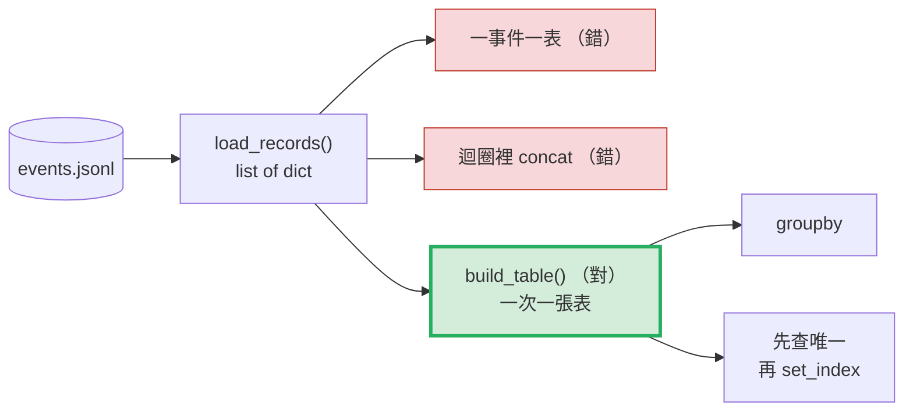
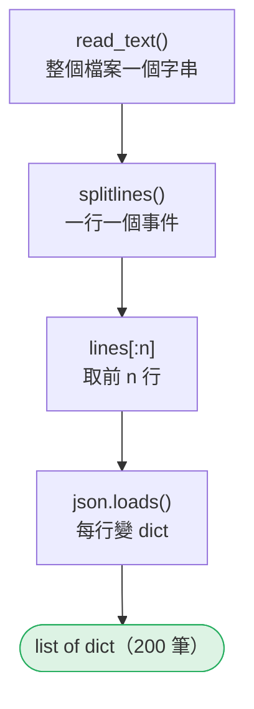
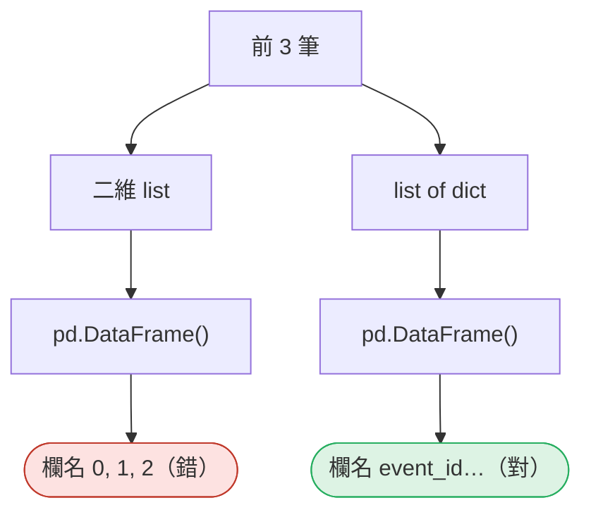
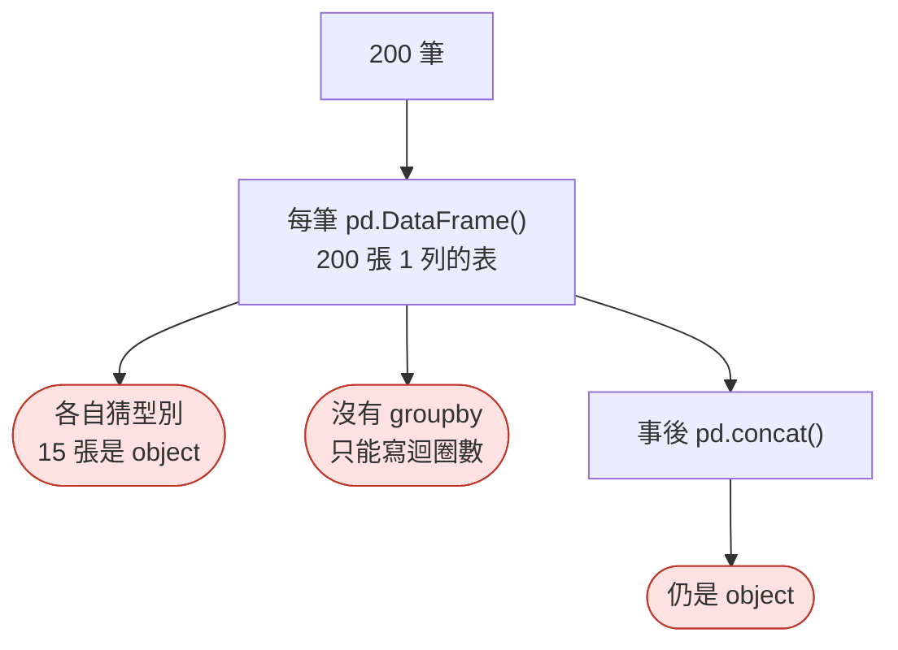
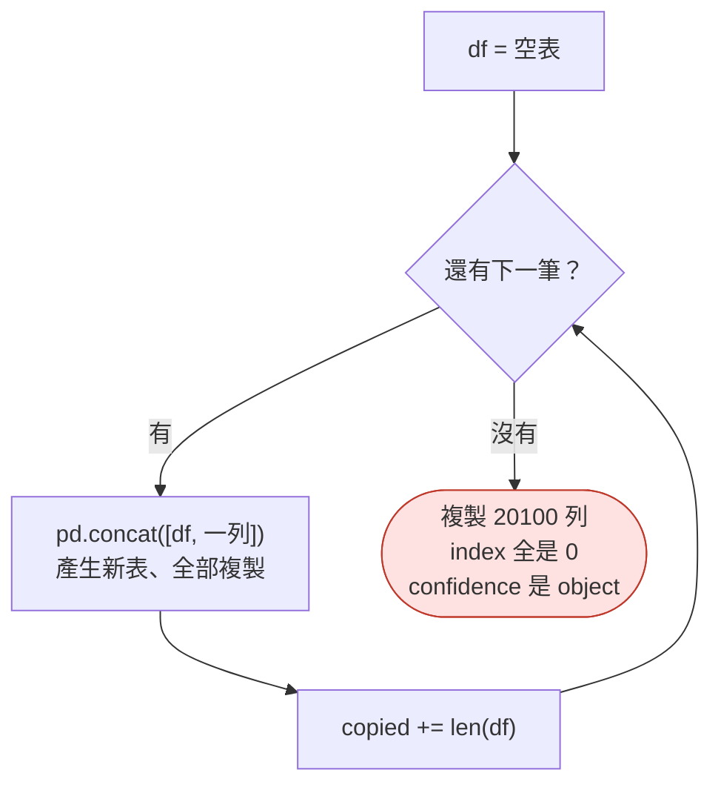
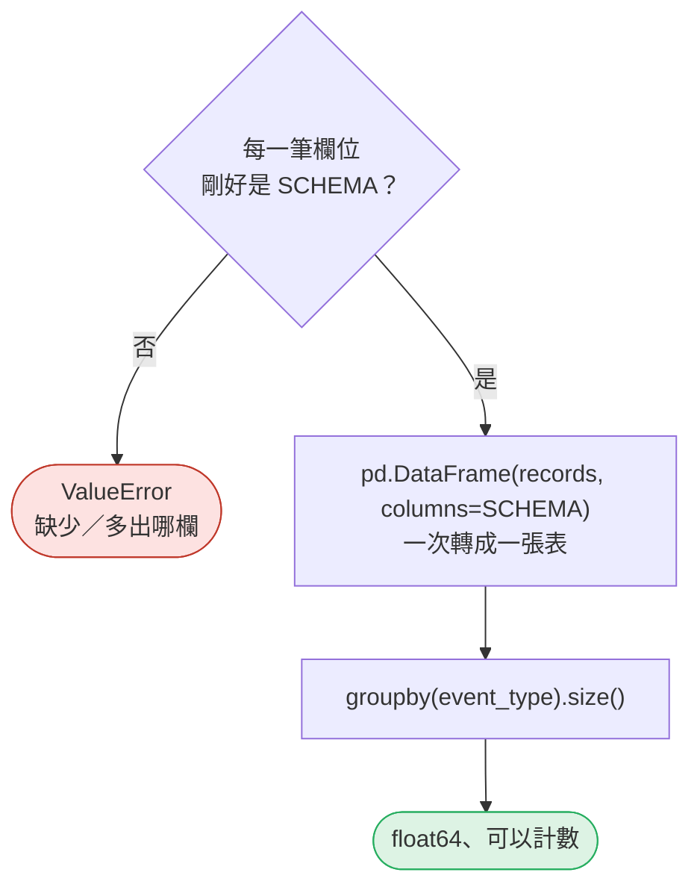
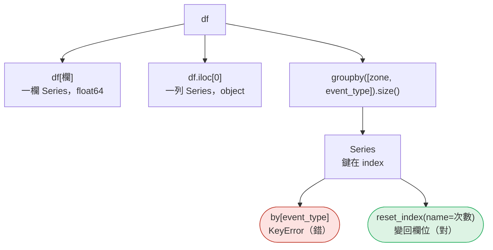
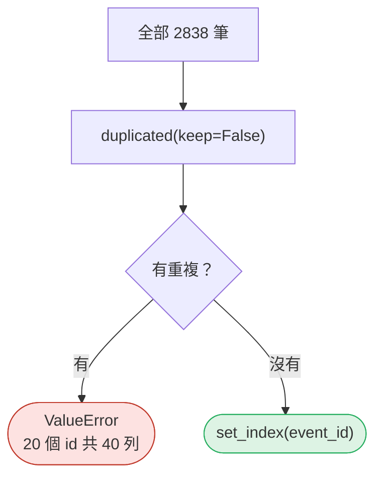

# 05｜一筆事件 = 一列；欄位是 schema

> **2026-10-21 改版：每段一張圖。** 一筆事件 = 一列；一批事件一次變一張表。
> 不是 DataFrame API 導覽，也不是 list／dict 複習。

[回 18 節課綱](../../course-plans/2026-10-data-analysis-18.md)

## 範例程式碼

- [demo：05_event_row.py](https://github.com/4-learn/data-analysis-and-process-demo/blob/master/2026/05_event_row.py)（與本頁 Demo 逐字相同）
- 練習資料與環境說明：[2026/README](https://github.com/4-learn/data-analysis-and-process-demo/tree/master/2026)

## 學完能做到

| 時間 | 段落 | 學完能做到 |
| --- | --- | --- |
| 0–5 分 | 一 | 說出二維 list 為什麼沒有欄名 |
| 5–21 分 | 二、三 | 指出兩種錯寫法為什麼之後沒辦法 `groupby` |
| 21–27 分 | 四 | 一次把 list of dict 變成表並計數 |
| 27–35 分 | 五、六 | `groupby` 後 `reset_index(name=)`；`set_index` 前先查唯一 |
| 35–50 分 | Workshop | 前 500 筆每區違規次數 |

## 本節流程



每段都是：**問題 → 位置（黃色）→ 步驟圖 → 程式 → 輸出 → 重點**。

## 零、準備：讀進 list of dict

**在流程中的位置：**


**這段做了什麼：**



<!-- fn-table -->
| 函式名稱 | 說明 | 官方文件連結 |
|---|---|---|
| 前面介紹過 | 用法同前，括號內是在哪裡第一次介紹 | [`Path(__file__).resolve().parent`](https://docs.python.org/3.12/library/pathlib.html#pathlib.Path.resolve)（第 02 節）、[`Path()`](https://docs.python.org/3.12/library/pathlib.html#pathlib.Path)（爬蟲 10） |

<!-- 節錄: 05_event_row.py -->
```python
import json
from pathlib import Path

import pandas as pd

DATA = Path(__file__).resolve().parent / "data"
EVENTS = DATA / "events" / "events.jsonl"
SCHEMA = ["event_id", "site", "zone", "camera_id", "model_version", "worker_id",
          "event_type", "confidence", "event_time", "ingested_at", "handled_at", "snapshot"]
```

<!-- fn-table -->
| 函式名稱 | 說明 | 官方文件連結 |
|---|---|---|
| 前面介紹過 | 用法同前，括號內是在哪裡第一次介紹 | [`path.read_text()`](https://docs.python.org/3.12/library/pathlib.html#pathlib.Path.read_text)（第 03 節）、[`json.loads()`](https://docs.python.org/3.12/library/json.html#json.loads)（爬蟲 03）、[`Path()`](https://docs.python.org/3.12/library/pathlib.html#pathlib.Path)（爬蟲 10） |

<!-- 節錄: 05_event_row.py -->
```python
def load_records(path, n=None):
    """讀 JSONL 成 list of dict（還不是 DataFrame）。n=None 讀全部。"""
    lines = Path(path).read_text(encoding="utf-8").splitlines()
    return [json.loads(line) for line in lines[:n]]
```

<!-- fn-table -->
| 函式名稱 | 說明 | 官方文件連結 |
|---|---|---|
| （無） | 本段只用到 Python 基礎與前幾門課學過的寫法，沒有新的函式 | — |

<!-- 節錄: 05_event_row.py -->
```python
records = load_records(EVENTS, 200)
```

- `SCHEMA`：12 個欄位，後面 `build_table()` 用它當契約。

## 一、容器不是語意

**問題：** 二維 list 和 list of dict，交給 pandas 差在哪？

**在流程中的位置：**


**這段做了什麼：**



<!-- fn-table -->
| 函式名稱 | 說明 | 官方文件連結 |
|---|---|---|
| `pd.DataFrame(資料, columns=)` | 建立表格。資料可以是「一列一個 dict 的 list」或「欄名 → 一欄值的 dict」 | [文件](https://pandas.pydata.org/docs/reference/api/pandas.DataFrame.html#pandas.DataFrame) |
| 前面介紹過 | 用法同前，括號內是在哪裡第一次介紹 | [`df.columns`](https://pandas.pydata.org/docs/reference/api/pandas.DataFrame.columns.html#pandas.DataFrame.columns)（第 02 節）、[`.tolist()`](https://pandas.pydata.org/docs/reference/api/pandas.Series.tolist.html)（第 04 節） |

<!-- 節錄: 05_event_row.py -->
```python
print("== 1. 暖身：容器不是語意 ==")
grid = [[r["zone"], r["event_type"], r["confidence"]] for r in records[:3]]
print(f"二維 list：{grid}")
print(f"pd.DataFrame(二維 list) 的欄名：{pd.DataFrame(grid).columns.tolist()}")
print(f"pd.DataFrame(list of dict) 的欄名：{pd.DataFrame(records[:3]).columns.tolist()[:4]} …")
```

```text
== 1. 暖身：容器不是語意 ==
二維 list：[['Z3', 'ppe_ok', 0.7], ['Z1', 'ppe_ok', 0.73], ['Z2', 'no_harness', 0.82]]
pd.DataFrame(二維 list) 的欄名：[0, 1, 2]
pd.DataFrame(list of dict) 的欄名：['event_id', 'site', 'zone', 'camera_id'] …
```

- 二維 list 沒有欄名，只能叫 `0, 1, 2`。**欄名就是 schema。**

## 二、一事件一表 （錯）

**問題：** 每個事件包成一個 DataFrame，錯在哪？

**在流程中的位置：**


**這段做了什麼：**



<!-- fn-table -->
| 函式名稱 | 說明 | 官方文件連結 |
|---|---|---|
| `pd.Series(資料, index=, name=, dtype=)` | 建立「一欄」：有 index（標籤）的一維資料。`DataFrame` 的每一欄都是一個 `Series` | [文件](https://pandas.pydata.org/docs/reference/api/pandas.Series.html#pandas.Series) |
| `s.value_counts()` | 每個值出現幾次，由多到少排列 | [文件](https://pandas.pydata.org/docs/reference/api/pandas.Series.value_counts.html#pandas.Series.value_counts) |
| `s.to_dict()`／`df.to_dict("records")` | 轉成 Python dict；`Series` 是「index → 值」，`df.to_dict("records")` 是「一列一個 dict 的 list」 | [文件](https://pandas.pydata.org/docs/reference/api/pandas.Series.to_dict.html#pandas.Series.to_dict) |
| 前面介紹過 | 用法同前，括號內是在哪裡第一次介紹 | [`df["欄"]`](https://pandas.pydata.org/docs/user_guide/indexing.html#basics)（第 02 節）、[`s.dtype`](https://pandas.pydata.org/docs/reference/api/pandas.Series.dtype.html#pandas.Series.dtype)（第 02 節）、[`df.shape`](https://pandas.pydata.org/docs/reference/api/pandas.DataFrame.shape.html#pandas.DataFrame.shape)（第 03 節）、[`pd.DataFrame()`](https://pandas.pydata.org/docs/reference/api/pandas.DataFrame.html#pandas.DataFrame)（第 05 節） |

<!-- 節錄: 05_event_row.py -->
```python
print("\n== 2. 一個事件一個 DataFrame ==")
frames = [pd.DataFrame([r]) for r in records]
kinds = pd.Series([str(f["confidence"].dtype) for f in frames]).value_counts()
print(f"{len(frames)} 個 DataFrame，各 {frames[0].shape[0]} 列；confidence 的 dtype：{kinds.to_dict()}")
```

<!-- fn-table -->
| 函式名稱 | 說明 | 官方文件連結 |
|---|---|---|
| `d.items()` | 逐一取出 dict 的（key, 值），可以放進 `for k, v in d.items()` | [文件](https://docs.python.org/3.12/library/stdtypes.html#dict.items) |
| 前面介紹過 | 用法同前，括號內是在哪裡第一次介紹 | [`.iloc[]`](https://pandas.pydata.org/docs/reference/api/pandas.Series.iloc.html#pandas.Series.iloc)（第 02 節）、[`df["欄"]`](https://pandas.pydata.org/docs/user_guide/indexing.html#basics)（第 02 節）、[`pd.concat()`](https://pandas.pydata.org/docs/reference/api/pandas.concat.html#pandas.concat)（第 02 節）、[`s.dtype`](https://pandas.pydata.org/docs/reference/api/pandas.Series.dtype.html#pandas.Series.dtype)（第 02 節） |

<!-- 節錄: 05_event_row.py -->
```python
counts = {}
for f in frames:                                   # 沒有 groupby 可用，只能自己數
    t = f["event_type"].iloc[0]
    counts[t] = counts.get(t, 0) + 1
print(f"想數每種事件幾次，只能寫迴圈：{dict(sorted(counts.items()))}")
print(f"事後 pd.concat(frames)：confidence={pd.concat(frames, ignore_index=True)['confidence'].dtype}")
```

```text
== 2. 一個事件一個 DataFrame ==
200 個 DataFrame，各 1 列；confidence 的 dtype：{'float64': 185, 'object': 15}
想數每種事件幾次，只能寫迴圈：{'no_harness': 7, 'no_helmet': 18, 'ppe_ok': 169, 'restricted_entry': 6}
事後 pd.concat(frames)：confidence=object
```

- 型別一列一列猜：15 張表是 `object`。
- 沒有 `groupby`，只能自己寫迴圈數。

## 三、迴圈裡 `concat` （錯）

**問題：** AI 最常給的累積寫法，表對嗎？

**在流程中的位置：**


**這段做了什麼：**



<!-- fn-table -->
| 函式名稱 | 說明 | 官方文件連結 |
|---|---|---|
| 前面介紹過 | 用法同前，括號內是在哪裡第一次介紹 | [`pd.concat()`](https://pandas.pydata.org/docs/reference/api/pandas.concat.html#pandas.concat)（第 02 節）、[`pd.DataFrame()`](https://pandas.pydata.org/docs/reference/api/pandas.DataFrame.html#pandas.DataFrame)（第 05 節） |

<!-- 節錄: 05_event_row.py -->
```python
def concat_in_loop(records):
    """反模式：for 迴圈裡 df = pd.concat([df, row])。回傳 (df, concat 次數, 累計複製列數)。"""
    df, calls, copied = pd.DataFrame(), 0, 0
    for rec in records:
        df = pd.concat([df, pd.DataFrame([rec])])
        calls += 1
        copied += len(df)          # 每次 concat 都產生一張新表，把目前為止的列全部複製一次
    return df, calls, copied
```

<!-- fn-table -->
| 函式名稱 | 說明 | 官方文件連結 |
|---|---|---|
| `df.index` | 列的標籤（預設是 0、1、2…）；篩選後會保留原本的標籤，不會重新編號 | [文件](https://pandas.pydata.org/docs/reference/api/pandas.DataFrame.index.html#pandas.DataFrame.index) |
| `.is_unique` | 這一欄（或 index）的值是不是都不重複（True／False） | [文件](https://pandas.pydata.org/docs/reference/api/pandas.Series.is_unique.html#pandas.Series.is_unique) |
| `df.select_dtypes("number")` | 只留指定型別的欄位 | [文件](https://pandas.pydata.org/docs/reference/api/pandas.DataFrame.select_dtypes.html#pandas.DataFrame.select_dtypes) |
| 前面介紹過 | 用法同前，括號內是在哪裡第一次介紹 | [`.sum()`](https://pandas.pydata.org/docs/reference/api/pandas.Series.sum.html#pandas.Series.sum)（第 02 節）、[`df.columns`](https://pandas.pydata.org/docs/reference/api/pandas.DataFrame.columns.html#pandas.DataFrame.columns)（第 02 節）、[`df["欄"]`](https://pandas.pydata.org/docs/user_guide/indexing.html#basics)（第 02 節）、[`s.dtype`](https://pandas.pydata.org/docs/reference/api/pandas.Series.dtype.html#pandas.Series.dtype)（第 02 節）、[`.loc[]`](https://pandas.pydata.org/docs/reference/api/pandas.DataFrame.loc.html#pandas.DataFrame.loc)（第 03 節）、[`.tolist()`](https://pandas.pydata.org/docs/reference/api/pandas.Series.tolist.html)（第 04 節） |

<!-- 節錄: 05_event_row.py -->
```python
print("\n== 3. for 迴圈裡 df = pd.concat([df, row]) ==")
looped, calls, copied = concat_in_loop(records)
print(f"{len(looped)} 列；concat 呼叫 {calls} 次，累計複製 {copied} 列（是列數的 {copied // len(looped)} 倍以上）")
print(f"index 是 0 的列：{int((looped.index == 0).sum())} 列；index 唯一嗎？{looped.index.is_unique}")
print(f"looped.loc[0] 拿到 {len(looped.loc[0])} 列，不是 1 列")
print(f"迴圈累積的 confidence={looped['confidence'].dtype}；"
      f"數值欄 select_dtypes('number')={looped.select_dtypes('number').columns.tolist()}")
```

```text
== 3. for 迴圈裡 df = pd.concat([df, row]) ==
200 列；concat 呼叫 200 次，累計複製 20100 列（是列數的 100 倍以上）
index 是 0 的列：200 列；index 唯一嗎？False
looped.loc[0] 拿到 200 列，不是 1 列
迴圈累積的 confidence=object；數值欄 select_dtypes('number')=[]
```

| 現象 | 後果 |
| --- | --- |
| 複製 20100 列 | 越來越慢（200 筆慢 100 倍以上） |
| index 全是 `0` | `loc[0]` 拿到 200 列 |
| `confidence` 是 `object` | 不能當數字算 |

## 四、`build_table()` （對）

**問題：** 正確做法？先收進 list，**最後一次**轉成表。

**在流程中的位置：**


**這段做了什麼：**



<!-- fn-table -->
| 函式名稱 | 說明 | 官方文件連結 |
|---|---|---|
| 前面介紹過 | 用法同前，括號內是在哪裡第一次介紹 | [`pd.DataFrame()`](https://pandas.pydata.org/docs/reference/api/pandas.DataFrame.html#pandas.DataFrame)（第 05 節） |

<!-- 節錄: 05_event_row.py -->
```python
def build_table(records):
    """一批事件 → 一張表。欄位是契約：每一筆的欄位都要剛好是 SCHEMA，否則停下來。"""
    for i, rec in enumerate(records):
        missing = [c for c in SCHEMA if c not in rec]
        extra = [c for c in rec if c not in SCHEMA]
        if missing or extra:
            raise ValueError(f"第 {i} 筆欄位不符 schema：缺少 {missing}，多出 {extra}")
    return pd.DataFrame(records, columns=SCHEMA)
```

<!-- fn-table -->
| 函式名稱 | 說明 | 官方文件連結 |
|---|---|---|
| 前面介紹過 | 用法同前，括號內是在哪裡第一次介紹 | [`.sum()`](https://pandas.pydata.org/docs/reference/api/pandas.Series.sum.html#pandas.Series.sum)（第 02 節）、[`df.groupby()`](https://pandas.pydata.org/docs/reference/api/pandas.DataFrame.groupby.html#pandas.DataFrame.groupby)（第 02 節）、[`df.to_string()`](https://pandas.pydata.org/docs/reference/api/pandas.DataFrame.to_string.html#pandas.DataFrame.to_string)（第 02 節）、[`df["欄"]`](https://pandas.pydata.org/docs/user_guide/indexing.html#basics)（第 02 節）、[`groupby().size()`](https://pandas.pydata.org/docs/reference/api/pandas.api.typing.DataFrameGroupBy.size.html#pandas.api.typing.DataFrameGroupBy.size)（第 02 節）、[`s.dtype`](https://pandas.pydata.org/docs/reference/api/pandas.Series.dtype.html#pandas.Series.dtype)（第 02 節）、[`.isna()`](https://pandas.pydata.org/docs/reference/api/pandas.Series.isna.html#pandas.Series.isna)（第 03 節）、[`df.shape`](https://pandas.pydata.org/docs/reference/api/pandas.DataFrame.shape.html#pandas.DataFrame.shape)（第 03 節）、[`.is_unique`](https://pandas.pydata.org/docs/reference/api/pandas.Series.is_unique.html#pandas.Series.is_unique)（第 05 節）、[`df.index`](https://pandas.pydata.org/docs/reference/api/pandas.DataFrame.index.html#pandas.DataFrame.index)（第 05 節） |

<!-- 節錄: 05_event_row.py -->
```python
print("\n== 4. list of dict → DataFrame，一次 groupby ==")
df = build_table(records)
print(f"{df.shape[0]} 列 × {df.shape[1]} 欄；index 唯一嗎？{df.index.is_unique}；"
      f"confidence={df['confidence'].dtype}，缺值 {int(df['confidence'].isna().sum())} 筆")
print(df.groupby("event_type").size().to_string())
```

```text
== 4. list of dict → DataFrame，一次 groupby ==
200 列 × 12 欄；index 唯一嗎？True；confidence=float64，缺值 15 筆
event_type
no_harness            7
no_helmet            18
ppe_ok              169
restricted_entry      6
```

- 同樣 15 個 `null`，一次轉換 → `float64`，缺值是 `NaN`。

## 五、`groupby` 的結果

**問題：** 一欄、一列、`groupby` 結果，各是什麼？

**在流程中的位置：**


**這段做了什麼：**



<!-- fn-table -->
| 函式名稱 | 說明 | 官方文件連結 |
|---|---|---|
| 前面介紹過 | 用法同前，括號內是在哪裡第一次介紹 | [`.iloc[]`](https://pandas.pydata.org/docs/reference/api/pandas.Series.iloc.html#pandas.Series.iloc)（第 02 節）、[`df["欄"]`](https://pandas.pydata.org/docs/user_guide/indexing.html#basics)（第 02 節）、[`s.dtype`](https://pandas.pydata.org/docs/reference/api/pandas.Series.dtype.html#pandas.Series.dtype)（第 02 節） |

<!-- 節錄: 05_event_row.py -->
```python
print("\n== 5. Series 就是一欄；groupby 的結果也是 Series ==")
print(f"df['confidence'] 是 {type(df['confidence']).__name__}，dtype={df['confidence'].dtype}")
print(f"df.iloc[0]（一列）也是 {type(df.iloc[0]).__name__}，但 dtype={df.iloc[0].dtype}——一列裡混了字串和數字")
```

<!-- fn-table -->
| 函式名稱 | 說明 | 官方文件連結 |
|---|---|---|
| `index.names` | 多層 index 每一層的名字 | [文件](https://pandas.pydata.org/docs/reference/api/pandas.MultiIndex.names.html#pandas.MultiIndex.names) |
| `s[標籤]` | 從 `Series` 依標籤取一個值，例如 `counts["W041"]`；給布林遮罩則是篩選 | [文件](https://pandas.pydata.org/docs/user_guide/indexing.html#basics) |
| 前面介紹過 | 用法同前，括號內是在哪裡第一次介紹 | [`df.columns`](https://pandas.pydata.org/docs/reference/api/pandas.DataFrame.columns.html#pandas.DataFrame.columns)（第 02 節）、[`df.groupby()`](https://pandas.pydata.org/docs/reference/api/pandas.DataFrame.groupby.html#pandas.DataFrame.groupby)（第 02 節）、[`df.head()`](https://pandas.pydata.org/docs/reference/api/pandas.DataFrame.head.html#pandas.DataFrame.head)（第 02 節）、[`df.to_string()`](https://pandas.pydata.org/docs/reference/api/pandas.DataFrame.to_string.html#pandas.DataFrame.to_string)（第 02 節）、[`groupby().size()`](https://pandas.pydata.org/docs/reference/api/pandas.api.typing.DataFrameGroupBy.size.html#pandas.api.typing.DataFrameGroupBy.size)（第 02 節）、[`.reset_index()`](https://pandas.pydata.org/docs/reference/api/pandas.DataFrame.reset_index.html#pandas.DataFrame.reset_index)（第 04 節）、[`.tolist()`](https://pandas.pydata.org/docs/reference/api/pandas.Series.tolist.html)（第 04 節）、[`df.index`](https://pandas.pydata.org/docs/reference/api/pandas.DataFrame.index.html#pandas.DataFrame.index)（第 05 節） |

<!-- 節錄: 05_event_row.py -->
```python
by = df.groupby(["zone", "event_type"]).size()
print(f"groupby 結果：{type(by).__name__}，index={list(by.index.names)}，欄位？沒有")
try:
    by["event_type"]
except KeyError as exc:
    print(f"by['event_type'] → KeyError: {exc}")
print(f"忘了 name：reset_index() 的欄名 {by.reset_index().columns.tolist()}")
print(by.reset_index(name="次數").head(4).to_string(index=False))
```

```text
== 5. Series 就是一欄；groupby 的結果也是 Series ==
df['confidence'] 是 Series，dtype=float64
df.iloc[0]（一列）也是 Series，但 dtype=object——一列裡混了字串和數字
groupby 結果：Series，index=['zone', 'event_type']，欄位？沒有
by['event_type'] → KeyError: 'event_type'
忘了 name：reset_index() 的欄名 ['zone', 'event_type', 0]
zone event_type  次數
  Z1  no_helmet   9
  Z1     ppe_ok  53
  Z2 no_harness   5
  Z2  no_helmet   4
```

- 型別屬於**欄**，不屬於列。
- `groupby` 的鍵在 index 裡 → 先 `reset_index(name=...)`。

## 六、`set_index` 前先查唯一

**問題：** `event_id` 可以直接當 index 嗎？

**在流程中的位置：**


**這段做了什麼：**



<!-- fn-table -->
| 函式名稱 | 說明 | 官方文件連結 |
|---|---|---|
| `df.set_index(欄)` | 把某一欄當成列的標籤 | [文件](https://pandas.pydata.org/docs/reference/api/pandas.DataFrame.set_index.html#pandas.DataFrame.set_index) |
| `.nunique(dropna=)` | 有幾個不同的值；`dropna=False` 時 `NaN` 也算一種 | [文件](https://pandas.pydata.org/docs/reference/api/pandas.Series.nunique.html#pandas.Series.nunique) |
| 前面介紹過 | 用法同前，括號內是在哪裡第一次介紹 | [`.duplicated()`](https://pandas.pydata.org/docs/reference/api/pandas.DataFrame.duplicated.html#pandas.DataFrame.duplicated)（第 02 節）、[`.iloc[]`](https://pandas.pydata.org/docs/reference/api/pandas.Series.iloc.html#pandas.Series.iloc)（第 02 節）、[`df["欄"]`](https://pandas.pydata.org/docs/user_guide/indexing.html#basics)（第 02 節）、[`.loc[]`](https://pandas.pydata.org/docs/reference/api/pandas.DataFrame.loc.html#pandas.DataFrame.loc)（第 03 節）、[`df.shape`](https://pandas.pydata.org/docs/reference/api/pandas.DataFrame.shape.html#pandas.DataFrame.shape)（第 03 節）、[`.is_unique`](https://pandas.pydata.org/docs/reference/api/pandas.Series.is_unique.html#pandas.Series.is_unique)（第 05 節）、[`df.index`](https://pandas.pydata.org/docs/reference/api/pandas.DataFrame.index.html#pandas.DataFrame.index)（第 05 節） |

<!-- 節錄: 05_event_row.py -->
```python
print("\n== 6. 用 event_id 當 index：先確定它唯一 ==")
full = build_table(load_records(EVENTS))
by_id = full.set_index("event_id")
dup = full["event_id"].duplicated(keep=False)
print(f"全檔 {len(full)} 列，event_id 不同值 {full['event_id'].nunique()} 個；index 唯一嗎？{by_id.index.is_unique}")
first = full.loc[dup, "event_id"].iloc[0]
print(f"by_id.loc[{first!r}] 拿到 {type(by_id.loc[first]).__name__} {by_id.loc[first].shape}，不是一列")
```

<!-- fn-table -->
| 函式名稱 | 說明 | 官方文件連結 |
|---|---|---|
| `s.unique()` | 不重複的值（依出現順序） | [文件](https://pandas.pydata.org/docs/reference/api/pandas.Series.unique.html#pandas.Series.unique) |
| 前面介紹過 | 用法同前，括號內是在哪裡第一次介紹 | [`.any()`](https://pandas.pydata.org/docs/reference/api/pandas.Series.any.html#pandas.Series.any)（第 02 節）、[`.duplicated()`](https://pandas.pydata.org/docs/reference/api/pandas.DataFrame.duplicated.html#pandas.DataFrame.duplicated)（第 02 節）、[`.sum()`](https://pandas.pydata.org/docs/reference/api/pandas.Series.sum.html#pandas.Series.sum)（第 02 節）、[`df["欄"]`](https://pandas.pydata.org/docs/user_guide/indexing.html#basics)（第 02 節）、[`.loc[]`](https://pandas.pydata.org/docs/reference/api/pandas.DataFrame.loc.html#pandas.DataFrame.loc)（第 03 節）、[`df.set_index()`](https://pandas.pydata.org/docs/reference/api/pandas.DataFrame.set_index.html#pandas.DataFrame.set_index)（第 05 節） |

<!-- 節錄: 05_event_row.py -->
```python
def index_by_event_id(df):
    """把 event_id 當 index 之前，先確定它真的唯一；不唯一就停下來，並說出是哪幾個。"""
    dup = df["event_id"].duplicated(keep=False)
    if dup.any():
        ids = df.loc[dup, "event_id"].unique()
        raise ValueError(f"event_id 重複：{len(ids)} 個 id 共 {int(dup.sum())} 列，例如 {ids[0]}")
    return df.set_index("event_id")
```

<!-- fn-table -->
| 函式名稱 | 說明 | 官方文件連結 |
|---|---|---|
| （無） | 本段只用到 Python 基礎與前幾門課學過的寫法，沒有新的函式 | — |

<!-- 節錄: 05_event_row.py -->
```python
try:
    index_by_event_id(full)
except ValueError as exc:
    print(f"index_by_event_id() → ValueError: {exc}")
```

```text
== 6. 用 event_id 當 index：先確定它唯一 ==
全檔 2838 列，event_id 不同值 2818 個；index 唯一嗎？False
by_id.loc['cam-05-20260910-0016'] 拿到 DataFrame (2, 11)，不是一列
index_by_event_id() → ValueError: event_id 重複：20 個 id 共 40 列，例如 cam-05-20260910-0016
```

- 補傳送了兩次，20 個 id 重複；`set_index` **不會報錯**。
- `loc[id]` 有時一列、有時兩列。

## Workshop：判斷寫法，然後一次計數

### 任務與時間


**35–40 分：判斷寫法。** 兩段都在算前 500 筆的 `no_helmet` 次數：

<!-- fn-table -->
| 函式名稱 | 說明 | 官方文件連結 |
|---|---|---|
| 前面介紹過 | 用法同前，括號內是在哪裡第一次介紹 | [`.iloc[]`](https://pandas.pydata.org/docs/reference/api/pandas.Series.iloc.html#pandas.Series.iloc)（第 02 節）、[`.sum()`](https://pandas.pydata.org/docs/reference/api/pandas.Series.sum.html#pandas.Series.sum)（第 02 節）、[`df["欄"]`](https://pandas.pydata.org/docs/user_guide/indexing.html#basics)（第 02 節）、[`pd.DataFrame()`](https://pandas.pydata.org/docs/reference/api/pandas.DataFrame.html#pandas.DataFrame)（第 05 節） |

```python
# 寫法 A——Workshop 題目，本節測試不涵蓋這段
frames = [pd.DataFrame([r]) for r in load_records(EVENTS, 500)]
n = sum(f["event_type"].iloc[0] == "no_helmet" for f in frames)

# 寫法 B
df = build_table(load_records(EVENTS, 500))
n = (df["event_type"] == "no_helmet").sum()
```

- 兩個 `n` 一樣嗎？
- 下一個需求是「每區各幾次違規」，哪一種改得動？一句話說明 A **為什麼沒辦法 `groupby`**。

**40–45 分：一次計數。** 用寫法 B 的 `df`（違規＝`event_type != "ppe_ok"`）：

| 要算 | 結果要長怎樣 |
| --- | --- |
| 每區違規次數 | 兩欄：`zone`、`次數` |
| 違規最多的 `worker_id` | 看看第一名是誰 |

**45–50 分：抓 AI 的錯。** 請 OpenCode 寫「逐行讀 `events.jsonl`，每筆累積到 DataFrame，最後統計每種事件幾次」，再逐項檢查：

| 檢查 | 怎麼確認 |
| --- | --- |
| 跑得起來嗎？ | 有 `df.append` 就會 `AttributeError` |
| 計數對嗎？ | 與 `build_table()` 版比較 |
| index 唯一嗎？ | `df.index.is_unique` |
| `confidence` 是數字嗎？ | `df["confidence"].dtype` |
| 有沒有在迴圈裡 `concat`？ | 讀程式 |

### 參考判讀

:::spoiler 教師用（點開）

- 兩個 `n` 都是 **44**（教師實測）。答案一樣，所以「結果對」不能用來判斷寫法對。A 的每個表只有 1 列，「每個區域各幾次」只能再寫一個字典迴圈；B 是 `df[df["event_type"] != "ppe_ok"].groupby("zone").size()` 一行。**A 之後沒辦法 `groupby`，因為 `groupby` 要在「同一張表的同一欄」裡分組，而 A 的事件散在 500 張表裡。**
- 前 500 筆（2026-08-31 07:04～09-04 10:17）每區違規數：Z1 18、Z2 22、Z3 30、Z4 14，合計 84（教師實測）。用 `.reset_index(name="次數")` 才會得到 `zone`、`次數` 兩欄；只寫 `.reset_index()` 計數欄叫 `0`。
- 「違規次數最多的 `worker_id`」若直接 `groupby("worker_id").size()` 取最大，**第一名是空字串 `""`，14 次**——那是 14 筆辨識不到臉的違規，不是一個人。排除空字串後是 W018、W029 各 7 次（並列），W020 4 次。能指出「第一名不是人」比算對數字重要；並列怎麼處理是第 07 節的題目。
- AI 版本常見兩種：舊的 `df.append(row)` 在 pandas 3.0.6 直接 `AttributeError`；新的 `pd.concat([df, row])` 跑得動，前 500 筆 `no_helmet` 一樣 44 次，但 `index.is_unique` 是 `False`（500 列都叫 `0`），pandas 3.0.6 下 `confidence` 是 `object`。**計數對、表是壞的**——下一個需求才會爆。
- 若 AI 版本有 `ignore_index=True`，index 是好的；仍要指出它在迴圈裡複製整張表。修法是把 dict 收進 list、迴圈外一次 `pd.DataFrame(list)`。

:::

### 驗收

- 能重現第四至六段輸出。
- 用一句話說出寫法 A「之後為什麼無法 `groupby`」。
- 每區違規數 Z1 18、Z2 22、Z3 30、Z4 14，且結果欄名是 `zone`、`次數`（不是 `0`）。
- 指出 `worker_id == ""` 不是一個人。
- AI 驗收表五列都有結論；若 AI 版本有迴圈 `concat`，寫出改法。

## 附錄：完整程式

```bash
python3 05_event_row.py
```

<!-- fn-table -->
| 函式名稱 | 說明 | 官方文件連結 |
|---|---|---|
| （同上） | 這支程式用到的函式，都已在上面各段的表格介紹過 | — |

<!-- demo: 05_event_row.py -->
```python
"""第 05 節：一筆事件是一列，欄位是 schema；不要一個事件一個 DataFrame。"""

import json
from pathlib import Path

import pandas as pd

DATA = Path(__file__).resolve().parent / "data"
EVENTS = DATA / "events" / "events.jsonl"
SCHEMA = ["event_id", "site", "zone", "camera_id", "model_version", "worker_id",
          "event_type", "confidence", "event_time", "ingested_at", "handled_at", "snapshot"]


def load_records(path, n=None):
    """讀 JSONL 成 list of dict（還不是 DataFrame）。n=None 讀全部。"""
    lines = Path(path).read_text(encoding="utf-8").splitlines()
    return [json.loads(line) for line in lines[:n]]


def build_table(records):
    """一批事件 → 一張表。欄位是契約：每一筆的欄位都要剛好是 SCHEMA，否則停下來。"""
    for i, rec in enumerate(records):
        missing = [c for c in SCHEMA if c not in rec]
        extra = [c for c in rec if c not in SCHEMA]
        if missing or extra:
            raise ValueError(f"第 {i} 筆欄位不符 schema：缺少 {missing}，多出 {extra}")
    return pd.DataFrame(records, columns=SCHEMA)


def concat_in_loop(records):
    """反模式：for 迴圈裡 df = pd.concat([df, row])。回傳 (df, concat 次數, 累計複製列數)。"""
    df, calls, copied = pd.DataFrame(), 0, 0
    for rec in records:
        df = pd.concat([df, pd.DataFrame([rec])])
        calls += 1
        copied += len(df)          # 每次 concat 都產生一張新表，把目前為止的列全部複製一次
    return df, calls, copied


def index_by_event_id(df):
    """把 event_id 當 index 之前，先確定它真的唯一；不唯一就停下來，並說出是哪幾個。"""
    dup = df["event_id"].duplicated(keep=False)
    if dup.any():
        ids = df.loc[dup, "event_id"].unique()
        raise ValueError(f"event_id 重複：{len(ids)} 個 id 共 {int(dup.sum())} 列，例如 {ids[0]}")
    return df.set_index("event_id")


if __name__ == "__main__":
    records = load_records(EVENTS, 200)

    print("== 1. 暖身：容器不是語意 ==")
    grid = [[r["zone"], r["event_type"], r["confidence"]] for r in records[:3]]
    print(f"二維 list：{grid}")
    print(f"pd.DataFrame(二維 list) 的欄名：{pd.DataFrame(grid).columns.tolist()}")
    print(f"pd.DataFrame(list of dict) 的欄名：{pd.DataFrame(records[:3]).columns.tolist()[:4]} …")

    print("\n== 2. 一個事件一個 DataFrame ==")
    frames = [pd.DataFrame([r]) for r in records]
    kinds = pd.Series([str(f["confidence"].dtype) for f in frames]).value_counts()
    print(f"{len(frames)} 個 DataFrame，各 {frames[0].shape[0]} 列；confidence 的 dtype：{kinds.to_dict()}")
    counts = {}
    for f in frames:                                   # 沒有 groupby 可用，只能自己數
        t = f["event_type"].iloc[0]
        counts[t] = counts.get(t, 0) + 1
    print(f"想數每種事件幾次，只能寫迴圈：{dict(sorted(counts.items()))}")
    print(f"事後 pd.concat(frames)：confidence={pd.concat(frames, ignore_index=True)['confidence'].dtype}")

    print("\n== 3. for 迴圈裡 df = pd.concat([df, row]) ==")
    looped, calls, copied = concat_in_loop(records)
    print(f"{len(looped)} 列；concat 呼叫 {calls} 次，累計複製 {copied} 列（是列數的 {copied // len(looped)} 倍以上）")
    print(f"index 是 0 的列：{int((looped.index == 0).sum())} 列；index 唯一嗎？{looped.index.is_unique}")
    print(f"looped.loc[0] 拿到 {len(looped.loc[0])} 列，不是 1 列")
    print(f"迴圈累積的 confidence={looped['confidence'].dtype}；"
          f"數值欄 select_dtypes('number')={looped.select_dtypes('number').columns.tolist()}")

    print("\n== 4. list of dict → DataFrame，一次 groupby ==")
    df = build_table(records)
    print(f"{df.shape[0]} 列 × {df.shape[1]} 欄；index 唯一嗎？{df.index.is_unique}；"
          f"confidence={df['confidence'].dtype}，缺值 {int(df['confidence'].isna().sum())} 筆")
    print(df.groupby("event_type").size().to_string())

    print("\n== 5. Series 就是一欄；groupby 的結果也是 Series ==")
    print(f"df['confidence'] 是 {type(df['confidence']).__name__}，dtype={df['confidence'].dtype}")
    print(f"df.iloc[0]（一列）也是 {type(df.iloc[0]).__name__}，但 dtype={df.iloc[0].dtype}——一列裡混了字串和數字")
    by = df.groupby(["zone", "event_type"]).size()
    print(f"groupby 結果：{type(by).__name__}，index={list(by.index.names)}，欄位？沒有")
    try:
        by["event_type"]
    except KeyError as exc:
        print(f"by['event_type'] → KeyError: {exc}")
    print(f"忘了 name：reset_index() 的欄名 {by.reset_index().columns.tolist()}")
    print(by.reset_index(name="次數").head(4).to_string(index=False))

    print("\n== 6. 用 event_id 當 index：先確定它唯一 ==")
    full = build_table(load_records(EVENTS))
    by_id = full.set_index("event_id")
    dup = full["event_id"].duplicated(keep=False)
    print(f"全檔 {len(full)} 列，event_id 不同值 {full['event_id'].nunique()} 個；index 唯一嗎？{by_id.index.is_unique}")
    first = full.loc[dup, "event_id"].iloc[0]
    print(f"by_id.loc[{first!r}] 拿到 {type(by_id.loc[first]).__name__} {by_id.loc[first].shape}，不是一列")
    try:
        index_by_event_id(full)
    except ValueError as exc:
        print(f"index_by_event_id() → ValueError: {exc}")
```

## 教師紀錄與下一步

:::spoiler 實測環境、版本差異、資料來源（點開）
**實測**：2026-10-05，Ubuntu 20.04，Python 3.11.8，pandas 3.0.6、numpy 2.4.6。本頁輸出為該環境實際執行貼上（**本機實測**）。另以 Python 3.10.15／pandas 2.3.3 執行，差別兩行，皆在第二、三段：

- `事後 pd.concat(frames)：confidence=object` 在 2.3.3 是 `float64`；
- `迴圈累積的 confidence=object；數值欄 select_dtypes('number')=[]` 在 2.3.3 是 `float64`、`['confidence']`。

原因：2.3.3 在 concat 時會略過「全是缺值」的單列表來決定型別（並發 `FutureWarning`，說未來版本不再略過）；3.0.6 已改成不略過，於是 `None` 讓整欄變 `object`。**這正是「型別取決於當初怎麼切」的例子：同一份程式，換 pandas 版本型別就不同**；一次 `pd.DataFrame(records)` 兩版都是 `float64`。測試以 `PANDAS2_DIFFS` 精確替換這兩行。另 2.3.3 的 `df.append` 同樣不存在。

「慢 N 倍」：教師在本機以 `time.perf_counter` 量 200 筆，迴圈 `concat` 比一次轉換慢約 270 倍（3.0.6）／約 200 倍（2.3.3）；800 筆約 490／365 倍（單次量測）。秒數與倍數隨機器變動，**不貼進輸出**；`test_lesson_05.py` 只斷言 200 筆「慢 10 倍以上」。穩定的證據是「累計複製 20100 列」。

**資料**：`data/events/events.jsonl` 前 200 筆（2026-08-31 07:04 起），由 `tools/build_events.py` 以固定種子產生，雜湊記於 `data/events/MANIFEST.json`。全部為合成資料，人員、事件皆虛構，不代表任何真實工地統計。

**界線**：本節不談 `iterrows`／`apply` 的效能（第 13 節）、不處理重複 `event_id` 該留哪一筆（第 08、09 節）、不教 MultiIndex——遇到 `groupby` 多鍵結果一律 `reset_index(name=...)` 攤平。本節**尚未實班試教**。

**舊教材**：濃縮合併 [DataFrame 初體驗](https://hackmd.io/@yillkid/SkhiueRH-l)、[DataFrame Basic](https://hackmd.io/@yillkid/Sylb42oN5)、[一個 event = DataFrame 的一列](https://hackmd.io/@yillkid/SJLW-FU4-g)、[欄位設計](https://hackmd.io/@yillkid/BJcbT2LEbg)、[Series](https://hackmd.io/@yillkid/H16l3-EJq)，暖身取自 [Python 二維陣列](https://hackmd.io/@yillkid/rkeBxdxzZe)、[Python Multi-List](https://hackmd.io/@yillkid/H1idoAcN9)。保留：「一個 event = 一列」「欄位是資料契約」「一列也是 Series」「index 不是分類工具」四個核心主張，以及「寫法 A／B 判斷」的 Workshop 題型（改用真實事件檔，並加上一次計數與 AI 驗收）。刪除：手打 dict literal 的範例、`to_string` 小節、`timestamp/person/event/value` 四欄最小 schema（本課事件檔已有 12 欄真實 schema）、二維陣列巢狀迴圈與 4×4 座位表 Workshop（含 `input()` 互動）。Series 篇的 `pd.to_numeric(errors="coerce")` 清洗移到第 08 節（那裡要談它安靜丟資料）。舊版「`object` dtype 不能做數值判斷」的說法保留其意、改寫成「型別屬於欄，不屬於列」；pandas 3 的文字欄已是 `str`，不再教「文字欄就是 `object`」。
:::

**下一節**：第 06 節〈五分鐘探索法〉——拿到一份沒見過的廠商匯出檔，五分鐘內說出它能不能用。本節第三段那欄被弄成 `object` 的 `confidence`，下一節會以另一種面貌出現：`"87%"`。
