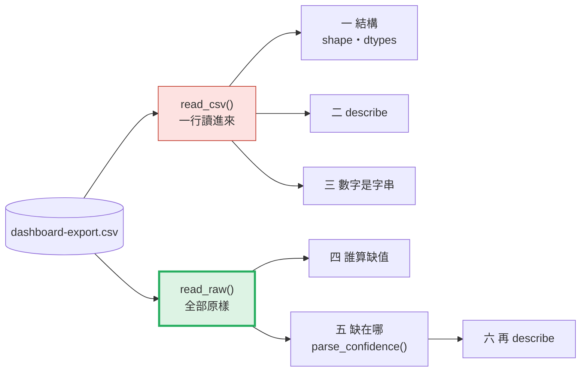
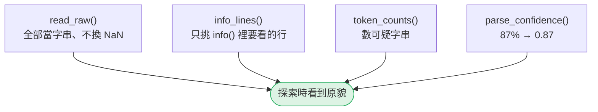
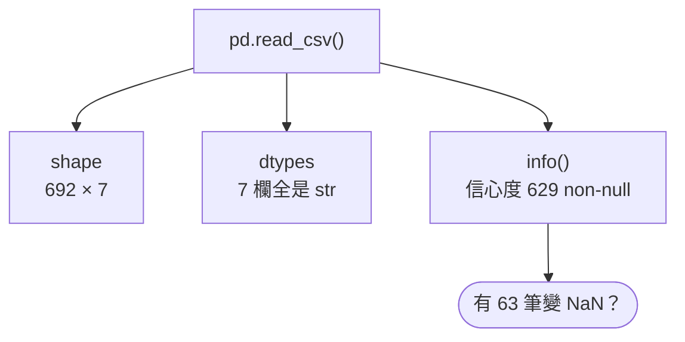
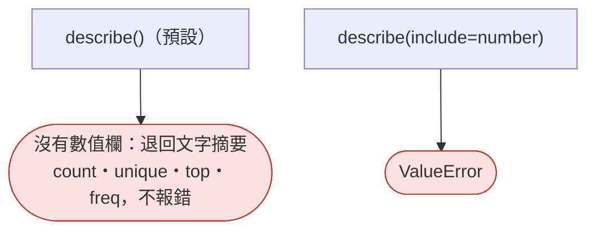
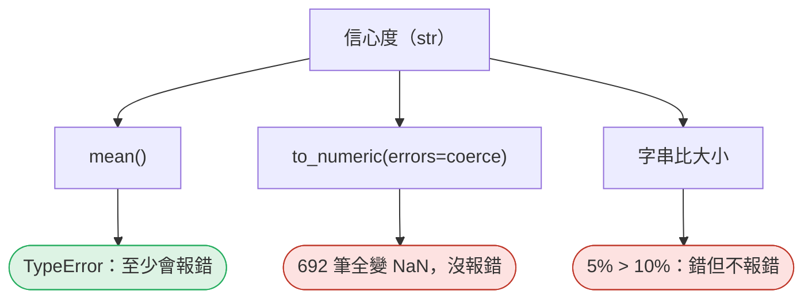
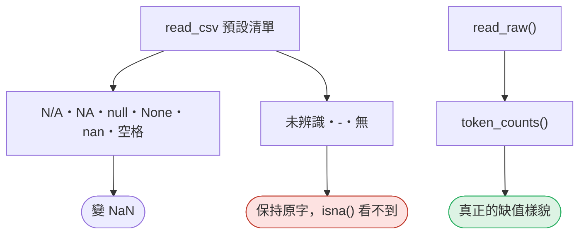
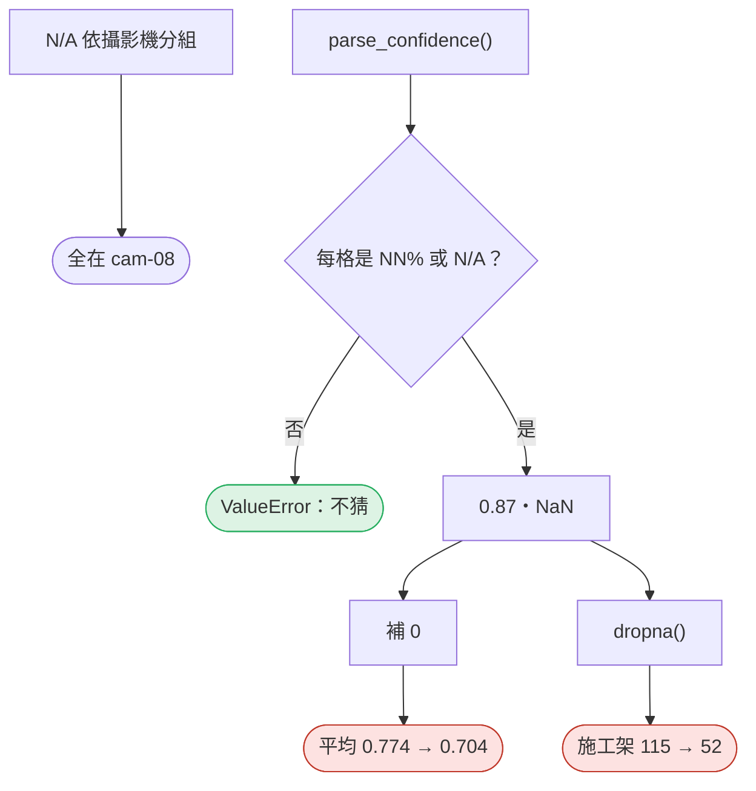
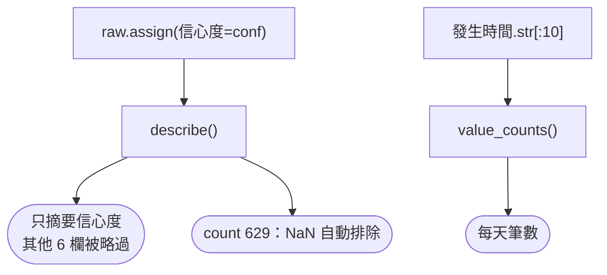

# 06｜五分鐘探索法：這份資料能不能用？

> **2026-10-21 改版：每段一張圖。** 陌生匯出檔五分鐘：先結構、後內容、最後缺值；只看不改。

[回 18 節課綱](../../course-plans/2026-10-data-analysis-18.md)

## 範例程式碼

- [demo：06_explore.py](https://github.com/4-learn/data-analysis-and-process-demo/blob/master/2026/06_explore.py)（與本頁 Demo 逐字相同）
- 練習資料與環境說明：[2026/README](https://github.com/4-learn/data-analysis-and-process-demo/tree/master/2026)

## 學完能做到

| 時間 | 段落 | 學完能做到 |
| --- | --- | --- |
| 0–12 分 | 一 | 說出 shape、dtypes、info() 各回答什麼 |
| 12–18 分 | 二 | 看出 describe() 什麼時候什麼都沒告訴你 |
| 18–25 分 | 三、四 | 指出哪些字被當成缺值、哪些沒有 |
| 25–35 分 | 五、六 | 處理缺值前，先說出缺在哪裡 |
| 35–50 分 | Workshop | 五個觀察、三個問題 |

## 本節流程



每段都是：**問題 → 位置（黃色）→ 步驟圖 → 程式 → 輸出 → 重點**。

## 零、準備：三個小工具

**問題：** 探索要用哪幾個工具？

**在流程中的位置：**


**這段做了什麼：**



<!-- fn-table -->
| 函式名稱 | 說明 | 官方文件連結 |
|---|---|---|
| `re.compile(樣式)` | 把正規表示式先編譯好，重複使用 | [文件](https://docs.python.org/3.12/library/re.html#re.compile) |
| 前面介紹過 | 用法同前，括號內是在哪裡第一次介紹 | [`Path(__file__).resolve().parent`](https://docs.python.org/3.12/library/pathlib.html#pathlib.Path.resolve)（第 02 節）、[`Path()`](https://docs.python.org/3.12/library/pathlib.html#pathlib.Path)（爬蟲 10） |

<!-- 節錄: 06_explore.py -->
```python
import io
import re
from pathlib import Path

import pandas as pd

DATA = Path(__file__).resolve().parent / "data"
EXPORT = DATA / "events" / "dashboard-export.csv"
PERCENT = re.compile(r"\d{1,3}%")
```

<!-- fn-table -->
| 函式名稱 | 說明 | 官方文件連結 |
|---|---|---|
| `io.StringIO(文字)` | 把一段字串包成「檔案」，可以直接丟給 `pd.read_csv`，或讓函式寫進去 | [文件](https://docs.python.org/3.12/library/io.html#io.StringIO) |
| `df.info(buf=)` | 印出每欄的型別與非空值數量；`buf` 指定要寫到哪裡（預設印到螢幕） | [文件](https://pandas.pydata.org/docs/reference/api/pandas.DataFrame.info.html#pandas.DataFrame.info) |
| `buf.getvalue()` | 取出寫進 `StringIO` 的全部文字 | [文件](https://docs.python.org/3.12/library/io.html#io.StringIO.getvalue) |
| `repr(x)` | 顯示值的「原始寫法」，字串會帶引號，看得出空白與 `""` | [文件](https://docs.python.org/3.12/library/functions.html#repr) |
| 前面介紹過 | 用法同前，括號內是在哪裡第一次介紹 | [`.sum()`](https://pandas.pydata.org/docs/reference/api/pandas.Series.sum.html#pandas.Series.sum)（第 02 節）、[`df[條件]`](https://pandas.pydata.org/docs/user_guide/indexing.html#boolean-indexing)（第 02 節）、[`pd.read_csv()`](https://pandas.pydata.org/docs/reference/api/pandas.read_csv.html#pandas.read_csv)（第 02 節）、[`pd.DataFrame()`](https://pandas.pydata.org/docs/reference/api/pandas.DataFrame.html#pandas.DataFrame)（第 05 節） |

<!-- 節錄: 06_explore.py -->
```python
def read_raw(path):
    """探索用的讀法：全部當字串、不替你把任何字換成 NaN。"""
    return pd.read_csv(path, dtype=str, keep_default_na=False, encoding="utf-8-sig")


def info_lines(df, keys):
    """df.info() 印給人看；這裡只挑出含 keys 的幾行（去掉行尾空白）。"""
    buf = io.StringIO()
    df.info(buf=buf)
    return [line.strip() for line in buf.getvalue().splitlines() if any(k in line for k in keys)]


def token_counts(df, tokens):
    """每個「看起來像缺值」的字串，在每一欄出現幾次。只列出有出現的。"""
    table = pd.DataFrame({repr(t): (df == t).sum() for t in tokens})
    return table[table.sum(axis=1) > 0]
```

- `read_raw()` 用第 02 節的讀法：`dtype=str, keep_default_na=False`。
- `parse_confidence()` 在第五段才講。

## 一、先看結構

**問題：** 一行 `read_csv` 之後，整份檔長什麼樣？

**在流程中的位置：**


**這段做了什麼：**



<!-- fn-table -->
| 函式名稱 | 說明 | 官方文件連結 |
|---|---|---|
| `df.dtypes` | 每一欄的型別 | [文件](https://pandas.pydata.org/docs/reference/api/pandas.DataFrame.dtypes.html#pandas.DataFrame.dtypes) |
| `.astype(型別)` | 轉換型別，例如 `.astype(int)`、`.astype(str)` | [文件](https://pandas.pydata.org/docs/reference/api/pandas.Series.astype.html#pandas.Series.astype) |
| 前面介紹過 | 用法同前，括號內是在哪裡第一次介紹 | [`df.columns`](https://pandas.pydata.org/docs/reference/api/pandas.DataFrame.columns.html#pandas.DataFrame.columns)（第 02 節）、[`pd.read_csv()`](https://pandas.pydata.org/docs/reference/api/pandas.read_csv.html#pandas.read_csv)（第 02 節）、[`df.shape`](https://pandas.pydata.org/docs/reference/api/pandas.DataFrame.shape.html#pandas.DataFrame.shape)（第 03 節）、[`.tolist()`](https://pandas.pydata.org/docs/reference/api/pandas.Series.tolist.html)（第 04 節）、[`.to_dict()`](https://pandas.pydata.org/docs/reference/api/pandas.Series.to_dict.html#pandas.Series.to_dict)（第 05 節）、[`s.value_counts()`](https://pandas.pydata.org/docs/reference/api/pandas.Series.value_counts.html#pandas.Series.value_counts)（第 05 節） |

<!-- 節錄: 06_explore.py -->
```python
print("== 1. 先看結構：一行 read_csv 之後 ==")
naive = pd.read_csv(EXPORT)
print(f"shape={naive.shape}")
print(f"columns={naive.columns.tolist()}")
print(f"dtypes：{naive.dtypes.astype(str).value_counts().to_dict()}")
for line in info_lines(naive, ["信心度", "dtypes:"]):
    print(f"info()：{line}")
```

```text
== 1. 先看結構：一行 read_csv 之後 ==
shape=(692, 7)
columns=['事件編號', '區域', '攝影機', '人員', '事件', '信心度', '發生時間']
dtypes：{'str': 7}
info()：5   信心度     629 non-null    str
info()：dtypes: str(7)
```

- 七欄全是 `str`：信心度、發生時間都不是數字或時間。
- 只有信心度 629 non-null → 63 筆被當成缺值（第四段解答）。

## 二、`describe()` 什麼都沒說

**問題：** 一個數值欄都沒有時，`describe()` 給什麼？

**在流程中的位置：**


**這段做了什麼：**



<!-- fn-table -->
| 函式名稱 | 說明 | 官方文件連結 |
|---|---|---|
| `df.describe(include=, percentiles=)` | 數值欄的摘要統計：個數、平均、標準差、最小、四分位數、最大 | [文件](https://pandas.pydata.org/docs/reference/api/pandas.DataFrame.describe.html#pandas.DataFrame.describe) |
| 前面介紹過 | 用法同前，括號內是在哪裡第一次介紹 | [`df.to_string()`](https://pandas.pydata.org/docs/reference/api/pandas.DataFrame.to_string.html#pandas.DataFrame.to_string)（第 02 節）、[`.drop()`](https://pandas.pydata.org/docs/reference/api/pandas.DataFrame.drop.html#pandas.DataFrame.drop)（第 03 節） |

<!-- 節錄: 06_explore.py -->
```python
print("\n== 2. describe() 預設只摘要數值欄——這份一欄都沒有 ==")
print(naive.drop(columns=["事件編號", "發生時間"]).describe().to_string())
try:
    naive.describe(include="number")
except ValueError as exc:
    print(f"describe(include='number') → {type(exc).__name__}")
```

```text
== 2. describe() 預設只摘要數值欄——這份一欄都沒有 ==
         區域     攝影機   人員     事件  信心度
count   692     692  692    692  629
unique    4       8   53      4   59
top     出入口  cam-01  未辨識  防護具正確  80%
freq    232     120   92    575   23
describe(include='number') → ValueError
```

- 不報錯，只是**安靜地換一種表**。
- 人員最常見是「未辨識」92 次——一個「人」出現最多次，而它不是人。

## 三、數字被讀成字串

**問題：** `"87%"` 這種欄，三種常見處理各得到什麼？

**在流程中的位置：**


**這段做了什麼：**



<!-- fn-table -->
| 函式名稱 | 說明 | 官方文件連結 |
|---|---|---|
| `s.mean()` | 平均。`NaN` 會被跳過，不算進分母 | [文件](https://pandas.pydata.org/docs/reference/api/pandas.Series.mean.html#pandas.Series.mean) |
| `pd.to_numeric(s, errors=)` | 把字串轉成數字；`errors="coerce"` 會把轉不了的**默默變 `NaN`** | [文件](https://pandas.pydata.org/docs/reference/api/pandas.to_numeric.html#pandas.to_numeric) |
| `.dropna(subset=)` | 去掉有缺值的列；`subset` 只看指定欄 | [文件](https://pandas.pydata.org/docs/reference/api/pandas.Series.dropna.html#pandas.Series.dropna) |
| `s.max()` | 最大值（字串欄就是字典順序最大） | [文件](https://pandas.pydata.org/docs/reference/api/pandas.Series.max.html#pandas.Series.max) |
| `s.min()` | 最小值 | [文件](https://pandas.pydata.org/docs/reference/api/pandas.Series.min.html#pandas.Series.min) |
| 前面介紹過 | 用法同前，括號內是在哪裡第一次介紹 | [`.sum()`](https://pandas.pydata.org/docs/reference/api/pandas.Series.sum.html#pandas.Series.sum)（第 02 節）、[`df["欄"]`](https://pandas.pydata.org/docs/user_guide/indexing.html#basics)（第 02 節）、[`.isna()`](https://pandas.pydata.org/docs/reference/api/pandas.Series.isna.html#pandas.Series.isna)（第 03 節） |

<!-- 節錄: 06_explore.py -->
```python
print("\n== 3. 數字被讀成字串 ==")
try:
    naive["信心度"].mean()
except TypeError as exc:
    print(f"信心度.mean() → {type(exc).__name__}")
coerced = pd.to_numeric(naive["信心度"], errors="coerce")
print(f"pd.to_numeric(errors='coerce')：{len(coerced)} 筆裡 {int(coerced.isna().sum())} 筆變 NaN，平均={coerced.mean()}")
text = naive["信心度"].dropna()
print(f"字串比大小：最小 {text.min()!r}，最大 {text.max()!r}，'5%' > '10%' 是 {'5%' > '10%'}")
```

```text
== 3. 數字被讀成字串 ==
信心度.mean() → TypeError
pd.to_numeric(errors='coerce')：692 筆裡 692 筆變 NaN，平均=nan
字串比大小：最小 '35%'，最大 '99%'，'5%' > '10%' 是 True
```

- `errors="coerce"` 是 AI 常給的修法：整欄靜靜變 NaN。
- 字串比大小這份剛好對，只因為信心度都是兩位數。

## 四、誰被當成缺值

**問題：** `'N/A'` 和 `'未辨識'` 都代表「沒有值」，pandas 怎麼看？

**在流程中的位置：**


**這段做了什麼：**



<!-- fn-table -->
| 函式名稱 | 說明 | 官方文件連結 |
|---|---|---|
| 前面介紹過 | 用法同前，括號內是在哪裡第一次介紹 | [`.sum()`](https://pandas.pydata.org/docs/reference/api/pandas.Series.sum.html#pandas.Series.sum)（第 02 節）、[`df.to_string()`](https://pandas.pydata.org/docs/reference/api/pandas.DataFrame.to_string.html#pandas.DataFrame.to_string)（第 02 節）、[`df["欄"]`](https://pandas.pydata.org/docs/user_guide/indexing.html#basics)（第 02 節）、[`df[條件]`](https://pandas.pydata.org/docs/user_guide/indexing.html#boolean-indexing)（第 02 節）、[`pd.read_csv()`](https://pandas.pydata.org/docs/reference/api/pandas.read_csv.html#pandas.read_csv)（第 02 節）、[`.isna()`](https://pandas.pydata.org/docs/reference/api/pandas.Series.isna.html#pandas.Series.isna)（第 03 節）、[`.to_dict()`](https://pandas.pydata.org/docs/reference/api/pandas.Series.to_dict.html#pandas.Series.to_dict)（第 05 節）、[`io.StringIO()`](https://docs.python.org/3.12/library/io.html#io.StringIO)（第 06 節） |

<!-- 節錄: 06_explore.py -->
```python
print("\n== 4. 哪些字被當成缺值：'N/A' 會，'未辨識' 不會 ==")
print(f"預設讀法 isna()：{naive.isna().sum()[lambda s: s > 0].to_dict()}；人員=='未辨識' {int((naive['人員'] == '未辨識').sum())} 筆")
probe = pd.read_csv(io.StringIO("v\nN/A\nNA\nn/a\nnull\nNULL\nNone\nnan\n-\n未辨識\n無\n"))
print(f"同一套預設規則：{dict(zip(['N/A', 'NA', 'n/a', 'null', 'NULL', 'None', 'nan', '-', '未辨識', '無'], probe['v'].isna()))}")
raw = read_raw(EXPORT)
print(f"read_raw()：isna 合計 {int(raw.isna().sum().sum())}；各欄可疑字串：")
print(token_counts(raw, ["", "N/A", "未辨識", "-"]).to_string())
```

```text
== 4. 哪些字被當成缺值：'N/A' 會，'未辨識' 不會 ==
預設讀法 isna()：{'信心度': 63}；人員=='未辨識' 92 筆
同一套預設規則：{'N/A': True, 'NA': True, 'n/a': True, 'null': True, 'NULL': True, 'None': True, 'nan': True, '-': False, '未辨識': False, '無': False}
read_raw()：isna 合計 0；各欄可疑字串：
     ''  'N/A'  '未辨識'  '-'
人員    0      0     92    0
信心度   0     63      0    0
```

- 決定誰算缺值的是**那張清單**，不是資料的意思。
- 探索時用 `read_raw()` 看原貌，再自己數可疑字串。

## 五、缺值分布先於處理決策

**問題：** 63 個 `N/A` 缺在哪裡？補 0、刪掉各會怎樣？

**在流程中的位置：**


**這段做了什麼：**



<!-- fn-table -->
| 函式名稱 | 說明 | 官方文件連結 |
|---|---|---|
| `s.str.fullmatch(樣式, na=)` | **整個**字串是否完全符合正規表示式（不是只有一部分符合） | [文件](https://pandas.pydata.org/docs/reference/api/pandas.Series.str.fullmatch.html#pandas.Series.str.fullmatch) |
| `.all()` | 是否**全部**都是 True | [文件](https://pandas.pydata.org/docs/reference/api/pandas.Series.all.html#pandas.Series.all) |
| `s1 - s2`、`s / 100`（整欄運算） | 對整欄直接做加減乘除，每一列各算一次，不用寫迴圈；兩欄相減時依標籤對齊 | [文件](https://pandas.pydata.org/docs/user_guide/basics.html#flexible-binary-operations) |
| `s.where(條件, 其他)` | 條件成立的保留，不成立的換成「其他」（沒給就是 `NaN`） | [文件](https://pandas.pydata.org/docs/reference/api/pandas.Series.where.html#pandas.Series.where) |
| `s.str.removesuffix(後綴)` | 有這個結尾就去掉，沒有就不動 | [文件](https://pandas.pydata.org/docs/reference/api/pandas.Series.str.removesuffix.html#pandas.Series.str.removesuffix) |
| 前面介紹過 | 用法同前，括號內是在哪裡第一次介紹 | [`.any()`](https://pandas.pydata.org/docs/reference/api/pandas.Series.any.html#pandas.Series.any)（第 02 節）、[`.iloc[]`](https://pandas.pydata.org/docs/reference/api/pandas.Series.iloc.html#pandas.Series.iloc)（第 02 節）、[`.sum()`](https://pandas.pydata.org/docs/reference/api/pandas.Series.sum.html#pandas.Series.sum)（第 02 節）、[`df[條件]`](https://pandas.pydata.org/docs/user_guide/indexing.html#boolean-indexing)（第 02 節）、[`& \| ~`](https://pandas.pydata.org/docs/user_guide/indexing.html#boolean-operators)（第 03 節）、[`pd.to_numeric()`](https://pandas.pydata.org/docs/reference/api/pandas.to_numeric.html#pandas.to_numeric)（第 06 節） |

<!-- 節錄: 06_explore.py -->
```python
def parse_confidence(s):
    """'87%' → 0.87；'N/A' → NaN；其他任何寫法都停下來，不猜。"""
    ok = s.str.fullmatch(PERCENT.pattern) | (s == "N/A")
    if not ok.all():
        bad = s[~ok]
        raise ValueError(f"信心度有無法解讀的值 {len(bad)} 筆，例如 {bad.iloc[0]!r}")
    value = pd.to_numeric(s.where(s != "N/A").str.removesuffix("%")) / 100
    if (value > 1).any():
        raise ValueError(f"信心度超過 100% 有 {int((value > 1).sum())} 筆")
    return value
```

<!-- fn-table -->
| 函式名稱 | 說明 | 官方文件連結 |
|---|---|---|
| `.sort_index()` | 依標籤排序 | [文件](https://pandas.pydata.org/docs/reference/api/pandas.Series.sort_index.html#pandas.Series.sort_index) |
| `.fillna(值)` | 把缺值換成指定的值 | [文件](https://pandas.pydata.org/docs/reference/api/pandas.Series.fillna.html#pandas.Series.fillna) |
| 前面介紹過 | 用法同前，括號內是在哪裡第一次介紹 | [`.sum()`](https://pandas.pydata.org/docs/reference/api/pandas.Series.sum.html#pandas.Series.sum)（第 02 節）、[`df.to_string()`](https://pandas.pydata.org/docs/reference/api/pandas.DataFrame.to_string.html#pandas.DataFrame.to_string)（第 02 節）、[`df["欄"]`](https://pandas.pydata.org/docs/user_guide/indexing.html#basics)（第 02 節）、[`df[條件]`](https://pandas.pydata.org/docs/user_guide/indexing.html#boolean-indexing)（第 02 節）、[`.loc[]`](https://pandas.pydata.org/docs/reference/api/pandas.DataFrame.loc.html#pandas.DataFrame.loc)（第 03 節）、[`.notna()`](https://pandas.pydata.org/docs/reference/api/pandas.Series.notna.html#pandas.Series.notna)（第 04 節）、[`.to_dict()`](https://pandas.pydata.org/docs/reference/api/pandas.Series.to_dict.html#pandas.Series.to_dict)（第 05 節）、[`pd.DataFrame()`](https://pandas.pydata.org/docs/reference/api/pandas.DataFrame.html#pandas.DataFrame)（第 05 節）、[`s.value_counts()`](https://pandas.pydata.org/docs/reference/api/pandas.Series.value_counts.html#pandas.Series.value_counts)（第 05 節）、[`s.max()`](https://pandas.pydata.org/docs/reference/api/pandas.Series.max.html#pandas.Series.max)（第 06 節）、[`s.mean()`](https://pandas.pydata.org/docs/reference/api/pandas.Series.mean.html#pandas.Series.mean)（第 06 節）、[`s.min()`](https://pandas.pydata.org/docs/reference/api/pandas.Series.min.html#pandas.Series.min)（第 06 節） |

<!-- 節錄: 06_explore.py -->
```python
print("\n== 5. 缺值分布先於處理決策 ==")
na = raw["信心度"] == "N/A"
print(f"信心度 N/A 依攝影機：{raw.loc[na, '攝影機'].value_counts().to_dict()}；cam-08 全部 {int((raw['攝影機'] == 'cam-08').sum())} 筆")
unknown = raw["人員"] == "未辨識"
print(f"人員 未辨識 依區域：{raw.loc[unknown, '區域'].value_counts().sort_index().to_dict()}")
conf = parse_confidence(raw["信心度"])
print(f"parse_confidence()：{conf.notna().sum()} 筆數值，範圍 {conf.min()}～{conf.max()}，平均 {conf.mean():.3f}；補 0 後平均 {conf.fillna(0).mean():.3f}")
kept = raw[conf.notna()]
zone = pd.DataFrame({"全部": raw["區域"].value_counts(), "dropna 後": kept["區域"].value_counts()})
zone["違規（全部）"] = raw.loc[raw["事件"] != "防護具正確", "區域"].value_counts()
zone["違規（dropna 後）"] = kept.loc[kept["事件"] != "防護具正確", "區域"].value_counts()
print(zone.to_string())
```

```text
== 5. 缺值分布先於處理決策 ==
信心度 N/A 依攝影機：{'cam-08': 63}；cam-08 全部 63 筆
人員 未辨識 依區域：{'出入口': 24, '施工架': 20, '鋼構組立': 28, '開挖區': 20}
parse_confidence()：629 筆數值，範圍 0.35～0.99，平均 0.774；補 0 後平均 0.704
       全部  dropna 後  違規（全部）  違規（dropna 後）
區域                                       
出入口   232       232      26            26
開挖區   188       188      38            38
鋼構組立  157       157      32            32
施工架   115        52      21            14
```

- cam-08 全部是 `N/A`：缺值不是隨機的。原因是推測，這份檔證實不了。

| 處理 | 結果 |
| --- | --- |
| 補 0 | 63 筆「沒記錄」變成「信心度 0%」，平均被拉低 |
| `dropna()` | 刪掉施工架一半事件，違規 21 → 14，**系統性低估** |
| 保留 NaN | 第 08 節討論 |

## 六、轉好型別再 `describe()`

**問題：** 轉成數字之後，`describe()` 給什麼？

**在流程中的位置：**


**這段做了什麼：**



<!-- fn-table -->
| 函式名稱 | 說明 | 官方文件連結 |
|---|---|---|
| `df.assign(新欄=值)` | 加上（或覆蓋）欄位，回傳**新的**表，原表不變 | [文件](https://pandas.pydata.org/docs/reference/api/pandas.DataFrame.assign.html#pandas.DataFrame.assign) |
| `.round(n)` | 四捨五入到小數 n 位 | [文件](https://pandas.pydata.org/docs/reference/api/pandas.DataFrame.round.html#pandas.DataFrame.round) |
| `s.str[a:b]` | 對整欄每個字串做切片，例如 `event_time.str[:10]` 取出日期部分 | [文件](https://pandas.pydata.org/docs/user_guide/text.html#indexing-with-str) |
| 前面介紹過 | 用法同前，括號內是在哪裡第一次介紹 | [`df.to_string()`](https://pandas.pydata.org/docs/reference/api/pandas.DataFrame.to_string.html#pandas.DataFrame.to_string)（第 02 節）、[`df["欄"]`](https://pandas.pydata.org/docs/user_guide/indexing.html#basics)（第 02 節）、[`.to_dict()`](https://pandas.pydata.org/docs/reference/api/pandas.Series.to_dict.html#pandas.Series.to_dict)（第 05 節）、[`s.value_counts()`](https://pandas.pydata.org/docs/reference/api/pandas.Series.value_counts.html#pandas.Series.value_counts)（第 05 節）、[`.sort_index()`](https://pandas.pydata.org/docs/reference/api/pandas.Series.sort_index.html#pandas.Series.sort_index)（第 06 節）、[`df.describe()`](https://pandas.pydata.org/docs/reference/api/pandas.DataFrame.describe.html#pandas.DataFrame.describe)（第 06 節）、[`s.max()`](https://pandas.pydata.org/docs/reference/api/pandas.Series.max.html#pandas.Series.max)（第 06 節）、[`s.min()`](https://pandas.pydata.org/docs/reference/api/pandas.Series.min.html#pandas.Series.min)（第 06 節） |

<!-- 節錄: 06_explore.py -->
```python
print("\n== 6. 轉好型別之後，describe 才有東西 ==")
print(raw.assign(信心度=conf).describe().round(3).to_string())
day = raw["發生時間"].str[:10].value_counts().sort_index()
print(f"發生時間 {raw['發生時間'].min()}～{raw['發生時間'].max()}；每天筆數 {day.to_dict()}")
```

```text
== 6. 轉好型別之後，describe 才有東西 ==
           信心度
count  629.000
mean     0.774
std      0.140
min      0.350
25%      0.670
50%      0.790
75%      0.880
max      0.990
發生時間 2026/08/31 07:04～2026/09/05 16:59；每天筆數 {'2026/08/31': 117, '2026/09/01': 112, '2026/09/02': 126, '2026/09/03': 107, '2026/09/04': 110, '2026/09/05': 120}
```

- `count` 是 629 不是 692，要自己跟 `shape` 對照。
- 時間欄還是字串；轉成真正的時間是第 10–11 節。

## Workshop：五個觀察、三個問題

### 任務與時間

**35–45 分鐘：探索報告。** 用 `python -i 06_explore.py`（或自己從 `read_raw()` 開始），交一份報告：

```text
已確認的觀察（每條附：用哪個指令、看到什麼數字）
1.
2.
3.
4.
5.

目前不能回答的問題（每條附：缺什麼資訊才能回答、該問誰）
1.
2.
3.
```

規則：**觀察**必須是「任何人跑同一個指令都會得到的事實」；凡是「因為…所以…」「應該是…」都是**推測**，要嘛放進問題，要嘛標明「推測」。

**45–50 分鐘：抓 AI 的錯。** 把這份 CSV 丟給 OpenCode，請它「探索這份資料並計算平均信心度與每區違規數」。檢查它的程式：

| 檢查 | 怎麼確認 |
| --- | --- |
| 信心度怎麼轉的？ | `errors="coerce"` 會讓 692 筆全變 NaN；`.str.replace("%", "")` 能用但要檢查 `N/A` 去哪了 |
| 平均信心度是多少？ | 應為 0.774（或 77.4%）、基於 629 筆；若是 0.704 代表補了 0 |
| 有沒有 `dropna()`？ | 每區違規數施工架應為 21；若是 14 代表被 `dropna()` 砍了 |
| 「人員」欄有沒有缺值？ | AI 若只看 `isna()` 會說 0 |
| 報告裡有沒有推測當事實？ | 例如「cam-08 故障」 |

### 參考判讀

:::spoiler 教師用（點開）
可以列為**已確認觀察**的例子（教師實測，皆可由 Demo 或一行指令重現）：

- 692 列 × 7 欄，七欄讀進來都是字串；`事件編號` 692 個不重複。
- 發生時間 2026/08/31 07:04～2026/09/05 16:59，6 天，每天 107～126 筆；檔案依發生時間由早到晚排序（`raw["發生時間"].is_monotonic_increasing` 為 `True`）。
- 4 個區域、8 台攝影機，每區恰好 2 台（`raw.groupby("區域")["攝影機"].nunique()`）。
- 事件 4 種：防護具正確 575、未戴安全帽 61、高處未使用安全帶 33、跨越警示線 23。
- 信心度 629 筆為 `NN%`，範圍 35%～99%；63 筆為 `N/A`，**全部且只有** cam-08。
- 人員 92 筆為「未辨識」，四區都有；其餘 52 個不同的 `W` 編號（W 加三位數字）。

應列為**不能回答的問題**的例子：

- cam-08 為什麼沒有信心度？是設備型號、設定，還是匯出程式的問題？（問廠商；本檔沒有設備型號欄。）
- 「未辨識」的人是誰？同一個人被多次未辨識嗎？（本檔無法回答，可能永遠無法回答。）
- 信心度是什麼的信心度——事件類型判斷，還是人臉辨識？門檻多少才會被記錄？（問廠商。）
- 發生時間是哪個時區？只到分鐘，同一分鐘多筆時誰先誰後？（問廠商；第 10 節會談。）
- 這是全部事件，還是儀表板有篩選過？第一週週日沒有資料，是停工還是沒匯出？

常見把推測寫成觀察的錯：「cam-08 故障」「施工架違規比較少」（`dropna` 之後才會這樣看）、「W018 最常違規」（不排除「未辨識」時，違規次數第一名是「未辨識」22 筆；排除後 W018 10 筆，但「未辨識」裡可能有 W018）。

AI 版本的實測結果：

- `pd.to_numeric(df["信心度"], errors="coerce")`：692 筆全 NaN、平均 `nan`、無錯誤。
- `df["信心度"].astype(float)`：`ValueError: could not convert string to float: '70%'`——會報錯，比 `coerce` 安全。
- `df["信心度"].str.replace("%", "").astype(float)`：得到 63 個 NaN、平均 77.4（百分比單位）。這個能用，因為 `N/A` 在讀檔時已經被預設清單變成 NaN——**它是靠讀檔的副作用才沒報錯**。若改成 `keep_default_na=False` 讀，`"N/A"` 會讓 `astype(float)` 報錯。
- 補 0 後平均 70.35；`df.dropna()` 剩 629 列、施工架 52 列。
:::

### 驗收

- 能重現第五段輸出，說出 63 個 `N/A` 的分布。
- 報告有 5 個觀察、3 個問題；每個觀察附指令與數字；沒有把推測寫成觀察。
- 能說出「`describe()` 在這份檔上為什麼沒有 `mean`」以及「轉型之後為什麼 `count` 是 629」。
- AI 驗收表五列都有結論，並指出至少一個 AI 版本的問題（或證明它都通過）。

## 附錄：完整程式

```bash
python3 06_explore.py
```

<!-- fn-table -->
| 函式名稱 | 說明 | 官方文件連結 |
|---|---|---|
| （同上） | 這支程式用到的函式，都已在上面各段的表格介紹過 | — |

<!-- demo: 06_explore.py -->
```python
"""第 06 節：五分鐘探索法——拿到一份沒見過的匯出檔，先看結構、再看內容、最後看缺值。"""

import io
import re
from pathlib import Path

import pandas as pd

DATA = Path(__file__).resolve().parent / "data"
EXPORT = DATA / "events" / "dashboard-export.csv"
PERCENT = re.compile(r"\d{1,3}%")


def read_raw(path):
    """探索用的讀法：全部當字串、不替你把任何字換成 NaN。"""
    return pd.read_csv(path, dtype=str, keep_default_na=False, encoding="utf-8-sig")


def info_lines(df, keys):
    """df.info() 印給人看；這裡只挑出含 keys 的幾行（去掉行尾空白）。"""
    buf = io.StringIO()
    df.info(buf=buf)
    return [line.strip() for line in buf.getvalue().splitlines() if any(k in line for k in keys)]


def token_counts(df, tokens):
    """每個「看起來像缺值」的字串，在每一欄出現幾次。只列出有出現的。"""
    table = pd.DataFrame({repr(t): (df == t).sum() for t in tokens})
    return table[table.sum(axis=1) > 0]


def parse_confidence(s):
    """'87%' → 0.87；'N/A' → NaN；其他任何寫法都停下來，不猜。"""
    ok = s.str.fullmatch(PERCENT.pattern) | (s == "N/A")
    if not ok.all():
        bad = s[~ok]
        raise ValueError(f"信心度有無法解讀的值 {len(bad)} 筆，例如 {bad.iloc[0]!r}")
    value = pd.to_numeric(s.where(s != "N/A").str.removesuffix("%")) / 100
    if (value > 1).any():
        raise ValueError(f"信心度超過 100% 有 {int((value > 1).sum())} 筆")
    return value


if __name__ == "__main__":
    print("== 1. 先看結構：一行 read_csv 之後 ==")
    naive = pd.read_csv(EXPORT)
    print(f"shape={naive.shape}")
    print(f"columns={naive.columns.tolist()}")
    print(f"dtypes：{naive.dtypes.astype(str).value_counts().to_dict()}")
    for line in info_lines(naive, ["信心度", "dtypes:"]):
        print(f"info()：{line}")

    print("\n== 2. describe() 預設只摘要數值欄——這份一欄都沒有 ==")
    print(naive.drop(columns=["事件編號", "發生時間"]).describe().to_string())
    try:
        naive.describe(include="number")
    except ValueError as exc:
        print(f"describe(include='number') → {type(exc).__name__}")

    print("\n== 3. 數字被讀成字串 ==")
    try:
        naive["信心度"].mean()
    except TypeError as exc:
        print(f"信心度.mean() → {type(exc).__name__}")
    coerced = pd.to_numeric(naive["信心度"], errors="coerce")
    print(f"pd.to_numeric(errors='coerce')：{len(coerced)} 筆裡 {int(coerced.isna().sum())} 筆變 NaN，平均={coerced.mean()}")
    text = naive["信心度"].dropna()
    print(f"字串比大小：最小 {text.min()!r}，最大 {text.max()!r}，'5%' > '10%' 是 {'5%' > '10%'}")

    print("\n== 4. 哪些字被當成缺值：'N/A' 會，'未辨識' 不會 ==")
    print(f"預設讀法 isna()：{naive.isna().sum()[lambda s: s > 0].to_dict()}；人員=='未辨識' {int((naive['人員'] == '未辨識').sum())} 筆")
    probe = pd.read_csv(io.StringIO("v\nN/A\nNA\nn/a\nnull\nNULL\nNone\nnan\n-\n未辨識\n無\n"))
    print(f"同一套預設規則：{dict(zip(['N/A', 'NA', 'n/a', 'null', 'NULL', 'None', 'nan', '-', '未辨識', '無'], probe['v'].isna()))}")
    raw = read_raw(EXPORT)
    print(f"read_raw()：isna 合計 {int(raw.isna().sum().sum())}；各欄可疑字串：")
    print(token_counts(raw, ["", "N/A", "未辨識", "-"]).to_string())

    print("\n== 5. 缺值分布先於處理決策 ==")
    na = raw["信心度"] == "N/A"
    print(f"信心度 N/A 依攝影機：{raw.loc[na, '攝影機'].value_counts().to_dict()}；cam-08 全部 {int((raw['攝影機'] == 'cam-08').sum())} 筆")
    unknown = raw["人員"] == "未辨識"
    print(f"人員 未辨識 依區域：{raw.loc[unknown, '區域'].value_counts().sort_index().to_dict()}")
    conf = parse_confidence(raw["信心度"])
    print(f"parse_confidence()：{conf.notna().sum()} 筆數值，範圍 {conf.min()}～{conf.max()}，平均 {conf.mean():.3f}；補 0 後平均 {conf.fillna(0).mean():.3f}")
    kept = raw[conf.notna()]
    zone = pd.DataFrame({"全部": raw["區域"].value_counts(), "dropna 後": kept["區域"].value_counts()})
    zone["違規（全部）"] = raw.loc[raw["事件"] != "防護具正確", "區域"].value_counts()
    zone["違規（dropna 後）"] = kept.loc[kept["事件"] != "防護具正確", "區域"].value_counts()
    print(zone.to_string())

    print("\n== 6. 轉好型別之後，describe 才有東西 ==")
    print(raw.assign(信心度=conf).describe().round(3).to_string())
    day = raw["發生時間"].str[:10].value_counts().sort_index()
    print(f"發生時間 {raw['發生時間'].min()}～{raw['發生時間'].max()}；每天筆數 {day.to_dict()}")
```

## 教師紀錄與下一步

:::spoiler 實測環境、版本差異、資料來源（點開）
**實測**：2026-10-05，Ubuntu 20.04，Python 3.11.8，pandas 3.0.6、numpy 2.4.6。本頁輸出為該環境實際執行貼上（**本機實測**）。另以 Python 3.10.15／pandas 2.3.3 執行，差別只在第一段三行：字串欄 dtype 顯示為 `object` 而非 `str`（`dtypes：{'object': 7}`、`info()` 該行為 `object`、`dtypes: object(7)`）。測試以 `PANDAS2_DIFFS` 精確替換。

其他版本差異（不在 Demo 輸出中，教師另外實測）：

- `describe(include="number")` 在無數值欄時，兩版都拋 `ValueError`，但訊息不同：3.0.6 為 `No columns match the specified include or exclude data types`，2.3.3 為 `No objects to concatenate`。Demo 只印例外類別。
- 全為字串欄時 `describe()` 的 `top`：若某欄每個值都只出現一次（如「事件編號」），兩版挑出的 `top` 不同（3.0.6 為第一筆，2.3.3 為另一筆）。這是 Demo 把「事件編號」拿掉的原因之一——**並列時的 `top` 不可依賴**。
- `info()` 的 memory usage：3.0.6 印 `38.0 KB`，2.3.3 印 `38.0+ KB`（`object` 欄不深算）。Demo 不印這行。
- 字串欄 `mean()` 兩版都 `TypeError`，訊息不同。Demo 只印例外類別。
- 2.3.3 的 `object` 欄含 NaN 時 `.max()` 會 `TypeError`；Demo 先 `dropna()` 再比，兩版一致。

**資料**：`data/events/dashboard-export.csv` 由 `tools/build_events.py` 產生：第 05 節 `events.jsonl` 中 `event_time` 早於 2026-09-06 的事件、依 `event_id` 去重、依發生時間排序，欄名中文化，`confidence` 轉成百分比字串，null 寫 `N/A`，空 `worker_id` 寫「未辨識」。教師另外核對：692 個事件編號與事件檔第一週去重後的 692 個 id 完全相同，發生時間逐筆一致。**這些是教師知道、學生在本節不該假設知道的事**——Workshop 的「不能回答的問題」正是建立在「只看這份檔」的前提上。全部為合成資料。

**界線**：本節不做清理、不做時間轉換、不跨檔比對。`ydata-profiling` 這類一鍵 EDA 只提一句（教師未在本環境實測）：不論工具多完整，它拿到的都是**讀進來之後**的 DataFrame，讀檔時被換成 NaN 或沒被換的，它無從得知。課綱「待確認事項」中「第 06 節要不要擴」尚未定案，本稿依目前規格只做最小分析。本節**尚未實班試教**。

**舊教材**：無。舊版 `describe` 全課 0 次；本節為新增，沒有可改寫的舊講義。
:::

**下一節**：第 07 節〈欄位選取、布林篩選與 Top-K〉——回到 `events.jsonl`，從「看」走到「挑」：篩出某區某時段的違規、找出違規最多的前三名，以及缺值在比較中為什麼兩邊都不算。
