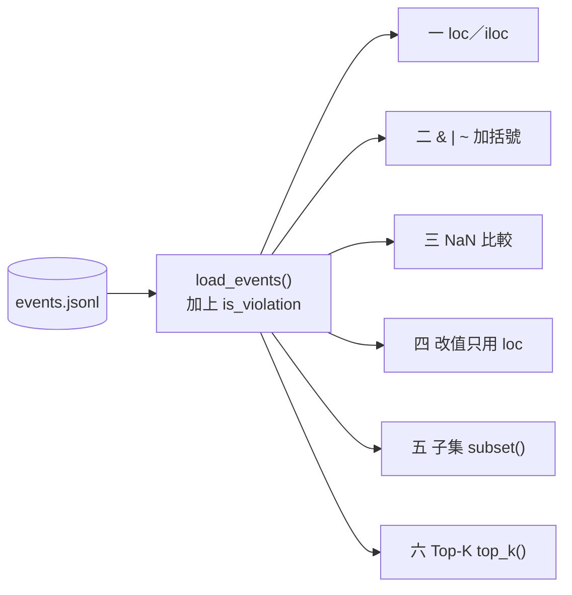
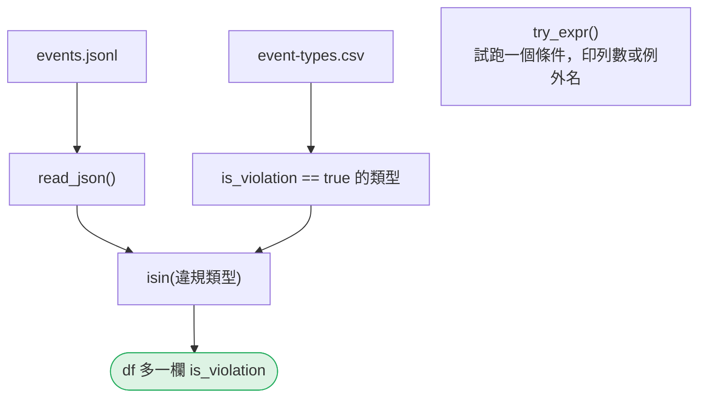
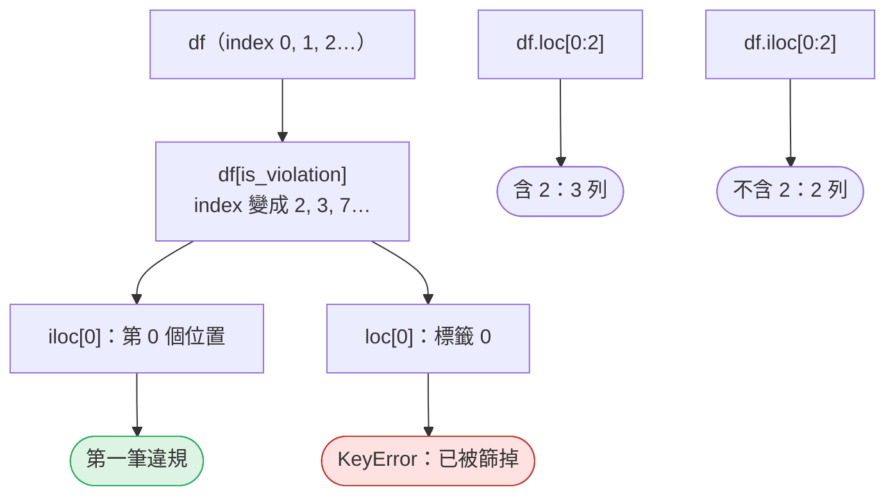
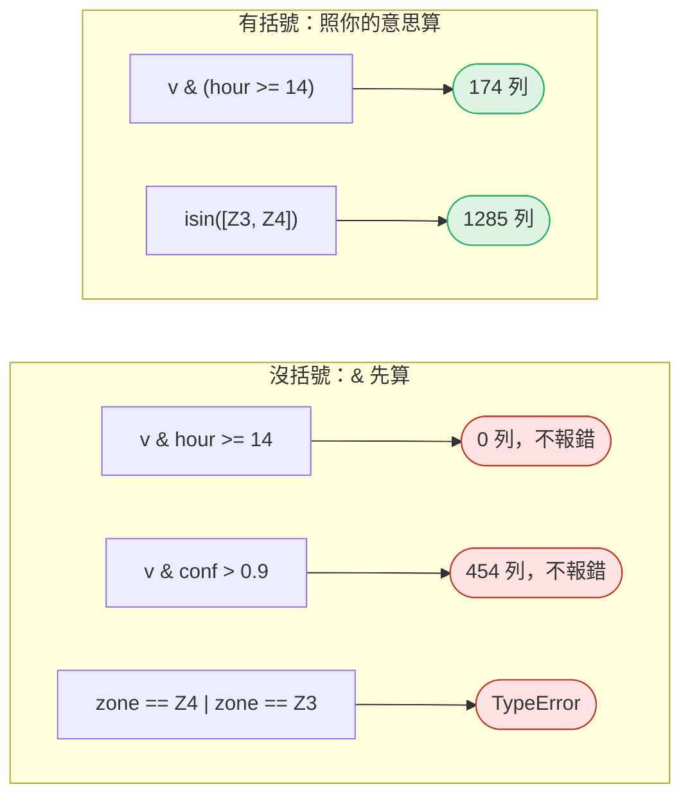
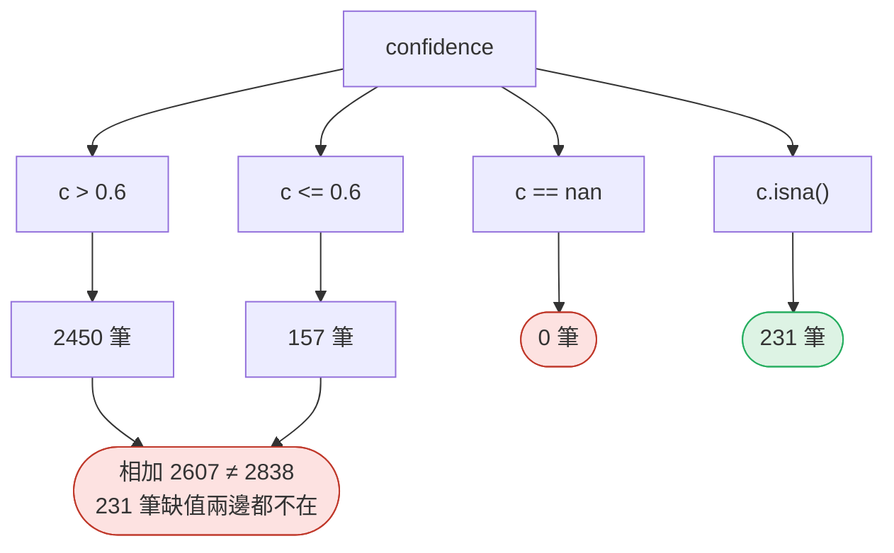
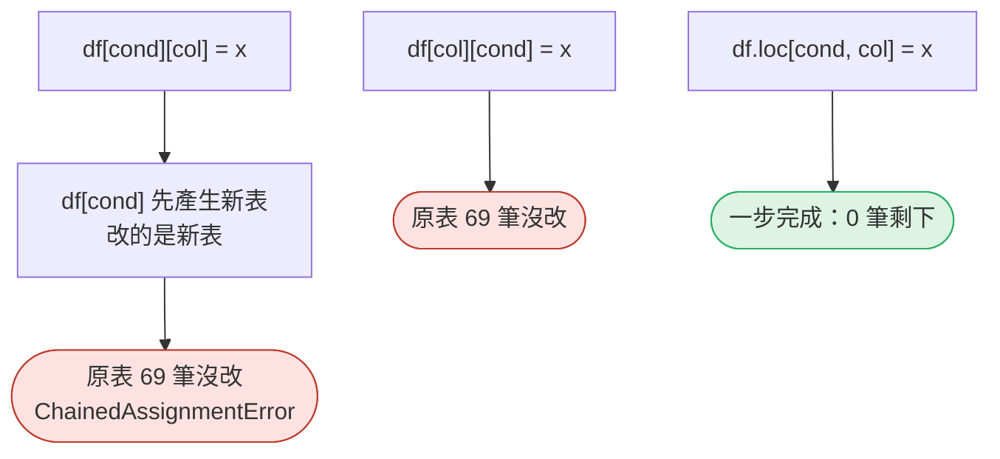
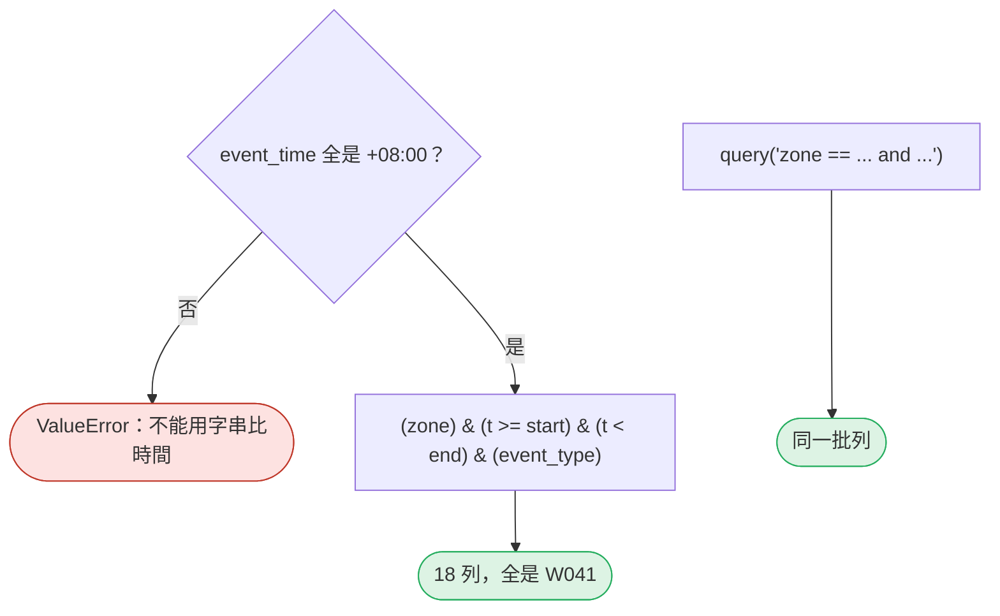
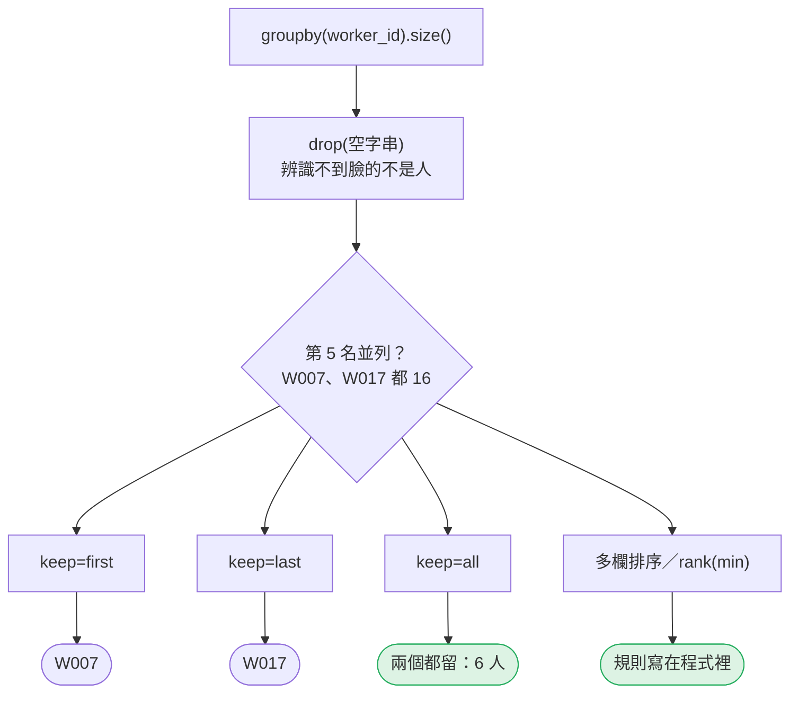

# 07｜欄位選取、布林篩選與 Top-K

> **2026-10-21 改版：每段一張圖。** 挑對資料，並且知道自己挑掉了什麼。第四段只在 pandas 3 成立。

[回 18 節課綱](../../course-plans/2026-10-data-analysis-18.md)

## 範例程式碼

- [demo：07_select_filter.py](https://github.com/4-learn/data-analysis-and-process-demo/blob/master/2026/07_select_filter.py)（與本頁 Demo 逐字相同）
- 練習資料與環境說明：[2026/README](https://github.com/4-learn/data-analysis-and-process-demo/tree/master/2026)

## 學完能做到

| 時間 | 段落 | 學完能做到 |
| --- | --- | --- |
| 0–6 分 | 一 | 說出 `loc` 看標籤、`iloc` 看位置 |
| 6–13 分 | 二 | 寫出不會因優先順序出錯的複合條件 |
| 13–19 分 | 三 | 說出「高」＋「低」為什麼不等於全部 |
| 19–27 分 | 四 | 只用 `df.loc[cond, col] = x` 改值 |
| 27–35 分 | 五、六 | 子集計數；Top-K 名次相同時怎麼辦 |
| 35–50 分 | Workshop | 子集計數、前三名、抓 AI 的錯 |

## 本節流程



每段都是：**問題 → 位置（黃色）→ 步驟圖 → 程式 → 輸出 → 重點**。

## 零、準備：讀檔與三個小工具

**問題：** 違規怎麼標出來？

**在流程中的位置：**


**這段做了什麼：**



<!-- fn-table -->
| 函式名稱 | 說明 | 官方文件連結 |
|---|---|---|
| `s.isin(集合)` | 每個值是不是在集合裡，得到 True／False 一欄，常放進 `df[...]` 篩選 | [文件](https://pandas.pydata.org/docs/reference/api/pandas.Series.isin.html#pandas.Series.isin) |
| 前面介紹過 | 用法同前，括號內是在哪裡第一次介紹 | [`.sum()`](https://pandas.pydata.org/docs/reference/api/pandas.Series.sum.html#pandas.Series.sum)（第 02 節）、[`Path(__file__).resolve().parent`](https://docs.python.org/3.12/library/pathlib.html#pathlib.Path.resolve)（第 02 節）、[`df["欄"]`](https://pandas.pydata.org/docs/user_guide/indexing.html#basics)（第 02 節）、[`df[條件]`](https://pandas.pydata.org/docs/user_guide/indexing.html#boolean-indexing)（第 02 節）、[`pd.read_csv()`](https://pandas.pydata.org/docs/reference/api/pandas.read_csv.html#pandas.read_csv)（第 02 節）、[`.loc[]`](https://pandas.pydata.org/docs/reference/api/pandas.DataFrame.loc.html#pandas.DataFrame.loc)（第 03 節）、[`pd.read_json()`](https://pandas.pydata.org/docs/reference/api/pandas.read_json.html#pandas.read_json)（第 03 節）、[`df.assign()`](https://pandas.pydata.org/docs/reference/api/pandas.DataFrame.assign.html#pandas.DataFrame.assign)（第 06 節）、[`Path()`](https://docs.python.org/3.12/library/pathlib.html#pathlib.Path)（爬蟲 10） |

<!-- 節錄: 07_select_filter.py -->
```python
import warnings
from pathlib import Path

import pandas as pd

DATA = Path(__file__).resolve().parent / "data"
EVENTS = DATA / "events" / "events.jsonl"
TYPES = DATA / "events" / "event-types.csv"


def load_events():
    df = pd.read_json(EVENTS, lines=True, dtype=False, convert_dates=False)
    types = pd.read_csv(TYPES, dtype=str, keep_default_na=False)
    violations = set(types.loc[types["is_violation"] == "true", "event_type"])
    return df.assign(is_violation=df["event_type"].isin(violations))


def try_expr(label, fn):
    """執行一個篩選運算式，回傳一行說明：得到幾個 True，或丟出哪種例外。"""
    try:
        return f"{label} → {int(fn().sum())} 列"
    except (TypeError, ValueError) as exc:
        return f"{label} → {type(exc).__name__}"
```

- 違規的定義在 `event-types.csv`，不寫死在程式裡。
- `try_expr()` 用在第二段：錯的寫法會報錯，接住後印出例外名稱。

## 一、`loc` 看標籤，`iloc` 看位置

**問題：** 篩選之後，「第 0 個」和「標籤 0」還一樣嗎？

**在流程中的位置：**


**這段做了什麼：**



<!-- fn-table -->
| 函式名稱 | 說明 | 官方文件連結 |
|---|---|---|
| 前面介紹過 | 用法同前，括號內是在哪裡第一次介紹 | [`.iloc[]`](https://pandas.pydata.org/docs/reference/api/pandas.Series.iloc.html#pandas.Series.iloc)（第 02 節）、[`df.to_string()`](https://pandas.pydata.org/docs/reference/api/pandas.DataFrame.to_string.html#pandas.DataFrame.to_string)（第 02 節）、[`df["欄"]`](https://pandas.pydata.org/docs/user_guide/indexing.html#basics)（第 02 節）、[`df[條件]`](https://pandas.pydata.org/docs/user_guide/indexing.html#boolean-indexing)（第 02 節）、[`.loc[]`](https://pandas.pydata.org/docs/reference/api/pandas.DataFrame.loc.html#pandas.DataFrame.loc)（第 03 節）、[`.tolist()`](https://pandas.pydata.org/docs/reference/api/pandas.Series.tolist.html)（第 04 節）、[`df.index`](https://pandas.pydata.org/docs/reference/api/pandas.DataFrame.index.html#pandas.DataFrame.index)（第 05 節）、[`s[標籤]`](https://pandas.pydata.org/docs/user_guide/indexing.html#basics)（第 05 節） |

<!-- 節錄: 07_select_filter.py -->
```python
df = load_events()

print("== 1. loc 看標籤，iloc 看位置 ==")
viol = df[df["is_violation"]]
print(f"全部 {len(df)} 列；違規 {len(viol)} 列，index 前五個：{viol.index[:5].tolist()}")
print(f"viol.iloc[0] → {viol.iloc[0]['event_id']}（第 0 個位置）")
print(f"viol.loc[2]  → {viol.loc[2, 'event_id']}（標籤是 2 的那列）")
try:
    viol.loc[0]
except KeyError as exc:
    print(f"viol.loc[0]  → KeyError: {exc}（標籤 0 是 ppe_ok，被篩掉了）")
print(f"df.loc[0:2] {len(df.loc[0:2])} 列（含 2）；df.iloc[0:2] {len(df.iloc[0:2])} 列（不含 2）")
print(f"df.loc[viol.index[:3], ['worker_id', 'event_type']]：")
print(df.loc[viol.index[:3], ["worker_id", "event_type"]].to_string())
```

```text
== 1. loc 看標籤，iloc 看位置 ==
全部 2838 列；違規 498 列，index 前五個：[2, 3, 7, 9, 11]
viol.iloc[0] → cam-04-20260831-0008（第 0 個位置）
viol.loc[2]  → cam-04-20260831-0008（標籤是 2 的那列）
viol.loc[0]  → KeyError: 0（標籤 0 是 ppe_ok，被篩掉了）
df.loc[0:2] 3 列（含 2）；df.iloc[0:2] 2 列（不含 2）
df.loc[viol.index[:3], ['worker_id', 'event_type']]：
  worker_id        event_type
2      W038        no_harness
3      W022  restricted_entry
7      W048         no_helmet
```

- 選列用條件或標籤（`loc`）；只有「看前幾筆」才用位置（`iloc`、`head`）。

| | 看什麼 | 切片 `0:2` |
| --- | --- | --- |
| `iloc` | 位置（第幾個） | 不含尾端，2 列 |
| `loc` | 標籤（index 的值） | **含**尾端，3 列 |

## 二、`&` `|` `~` 一定要加括號

**問題：** `v & hour >= 14` 為什麼是 0 列？

**在流程中的位置：**


**這段做了什麼：**



<!-- fn-table -->
| 函式名稱 | 說明 | 官方文件連結 |
|---|---|---|
| `.copy()` | 複製一份；之後改它不會動到原本的資料 | [文件](https://pandas.pydata.org/docs/reference/api/pandas.DataFrame.copy.html#pandas.DataFrame.copy) |
| `warnings.catch_warnings(record=True)` | 搭配 `with`：在區塊內把發出的警告收集成 list，而不是印出來 | [文件](https://docs.python.org/3.12/library/warnings.html#warnings.catch_warnings) |
| `warnings.simplefilter("always")` | 設定警告怎麼處理；`"always"` 每次都發出（不因重複而略過） | [文件](https://docs.python.org/3.12/library/warnings.html#warnings.simplefilter) |
| 前面介紹過 | 用法同前，括號內是在哪裡第一次介紹 | [`.sum()`](https://pandas.pydata.org/docs/reference/api/pandas.Series.sum.html#pandas.Series.sum)（第 02 節）、[`df["欄"]`](https://pandas.pydata.org/docs/user_guide/indexing.html#basics)（第 02 節）、[`df[條件]`](https://pandas.pydata.org/docs/user_guide/indexing.html#boolean-indexing)（第 02 節）、[`.loc[]`](https://pandas.pydata.org/docs/reference/api/pandas.DataFrame.loc.html#pandas.DataFrame.loc)（第 03 節）、[`整欄運算`](https://pandas.pydata.org/docs/user_guide/basics.html#flexible-binary-operations)（第 06 節） |

<!-- 節錄: 07_select_filter.py -->
```python
def chained_assignment(df, cond, how):
    """三種「把 cam-02 百分比改回小數」的寫法。回傳 (警告類別, 原表還有幾筆 > 1)。"""
    df = df.copy()
    with warnings.catch_warnings(record=True) as caught:
        warnings.simplefilter("always")
        if how == "df[cond][col] = x":
            df[cond]["confidence"] = df[cond]["confidence"] / 100
        elif how == "df[col][cond] = x":
            df["confidence"][cond] = df["confidence"][cond] / 100
        elif how == "df.loc[cond, col] = x":
            df.loc[cond, "confidence"] = df.loc[cond, "confidence"] / 100
        else:
            raise ValueError(f"未知寫法：{how}")
    kinds = sorted({w.category.__name__ for w in caught}) or ["無"]
    return ",".join(kinds), int((df["confidence"] > 1).sum())
```

<!-- fn-table -->
| 函式名稱 | 說明 | 官方文件連結 |
|---|---|---|
| `s.mask(條件, 其他)` | 跟 `where` 相反：條件**成立**的換掉，其他保留 | [文件](https://pandas.pydata.org/docs/reference/api/pandas.Series.mask.html#pandas.Series.mask) |
| 前面介紹過 | 用法同前，括號內是在哪裡第一次介紹 | [`.sum()`](https://pandas.pydata.org/docs/reference/api/pandas.Series.sum.html#pandas.Series.sum)（第 02 節）、[`df["欄"]`](https://pandas.pydata.org/docs/user_guide/indexing.html#basics)（第 02 節）、[`df[條件]`](https://pandas.pydata.org/docs/user_guide/indexing.html#boolean-indexing)（第 02 節）、[`& \| ~`](https://pandas.pydata.org/docs/user_guide/indexing.html#boolean-operators)（第 03 節）、[`.astype()`](https://pandas.pydata.org/docs/reference/api/pandas.Series.astype.html#pandas.Series.astype)（第 06 節）、[`s.str[a:b]`](https://pandas.pydata.org/docs/user_guide/text.html#indexing-with-str)（第 06 節）、[`整欄運算`](https://pandas.pydata.org/docs/user_guide/basics.html#flexible-binary-operations)（第 06 節）、[`s.isin()`](https://pandas.pydata.org/docs/reference/api/pandas.Series.isin.html#pandas.Series.isin)（第 07 節） |

<!-- 節錄: 07_select_filter.py -->
```python
print("\n== 2. & | ~ 一定要加括號 ==")
hour = df["event_time"].str[11:13].astype(int)
v = df["is_violation"]
print(try_expr("v & (hour >= 14)", lambda: v & (hour >= 14)))
print(try_expr("v & hour >= 14（沒括號）", lambda: v & hour >= 14))
print(try_expr("v & (df.confidence > 0.9)", lambda: v & (df["confidence"] > 0.9)))
c_fixed = df["confidence"].mask(df["confidence"] > 1, df["confidence"] / 100)  # 不改原表
print(f"  其中 c > 1（cam-02 百分比 bug）{int((v & (df['confidence'] > 1)).sum())} 列；"
      f"百分比改回小數後再算是 {int((v & (c_fixed > 0.9)).sum())} 列")
print(try_expr("v & df.confidence > 0.9（沒括號）", lambda: v & df["confidence"] > 0.9))
print(try_expr('df.zone == "Z4" | df.zone == "Z3"', lambda: df["zone"] == "Z4" | df["zone"] == "Z3"))
print(try_expr("hour >= 14 and hour < 16", lambda: hour >= 14 and hour < 16))
print(try_expr('df.zone.isin(["Z3", "Z4"])', lambda: df["zone"].isin(["Z3", "Z4"])))
```

```text
== 2. & | ~ 一定要加括號 ==
v & (hour >= 14) → 174 列
v & hour >= 14（沒括號） → 0 列
v & (df.confidence > 0.9) → 72 列
  其中 c > 1（cam-02 百分比 bug）7 列；百分比改回小數後再算是 67 列
v & df.confidence > 0.9（沒括號） → 454 列
df.zone == "Z4" | df.zone == "Z3" → TypeError
hour >= 14 and hour < 16 → ValueError
df.zone.isin(["Z3", "Z4"]) → 1285 列
```

- `&`、`|` 比 `>=`、`==` 先算：**每個比較各自加括號**。
- 有括號的 72 列中，7 列是 cam-02 百分比 bug；改回小數後是 67 列。
- `chained_assignment()` 留到第四段。

## 三、NaN 在比較裡兩邊都是 False

**問題：** 「高信心」＋「低信心」為什麼少了 231 筆？

**在流程中的位置：**


**這段做了什麼：**



<!-- fn-table -->
| 函式名稱 | 說明 | 官方文件連結 |
|---|---|---|
| 前面介紹過 | 用法同前，括號內是在哪裡第一次介紹 | [`.sum()`](https://pandas.pydata.org/docs/reference/api/pandas.Series.sum.html#pandas.Series.sum)（第 02 節）、[`df["欄"]`](https://pandas.pydata.org/docs/user_guide/indexing.html#basics)（第 02 節）、[`df[條件]`](https://pandas.pydata.org/docs/user_guide/indexing.html#boolean-indexing)（第 02 節）、[`& \| ~`](https://pandas.pydata.org/docs/user_guide/indexing.html#boolean-operators)（第 03 節）、[`.isna()`](https://pandas.pydata.org/docs/reference/api/pandas.Series.isna.html#pandas.Series.isna)（第 03 節） |

<!-- 節錄: 07_select_filter.py -->
```python
print("\n== 3. NaN 在比較裡兩邊都是 False ==")
c = df["confidence"]
high, low = c > 0.6, c <= 0.6
print(f"confidence 缺值 {int(c.isna().sum())}；> 0.6 有 {int(high.sum())}；<= 0.6 有 {int(low.sum())}；"
      f"相加 {int(high.sum() + low.sum())}，少於 {len(df)}")
print(f"~(c > 0.6) 有 {int((~high).sum())}——「不是高」≠「低」，多出來的 {int((~high).sum() - low.sum())} 筆是缺值")
print(f"c == float('nan') 有 {int((c == float('nan')).sum())} 筆；c.isna() 有 {int(c.isna().sum())} 筆")
print(f"另外 c > 1 有 {int((c > 1).sum())} 筆（cam-02 百分比 bug），全部算進了「> 0.6」")
```

```text
== 3. NaN 在比較裡兩邊都是 False ==
confidence 缺值 231；> 0.6 有 2450；<= 0.6 有 157；相加 2607，少於 2838
~(c > 0.6) 有 388——「不是高」≠「低」，多出來的 231 筆是缺值
c == float('nan') 有 0 筆；c.isna() 有 231 筆
另外 c > 1 有 69 筆（cam-02 百分比 bug），全部算進了「> 0.6」
```

- `~(c > 0.6)` 不等於 `c <= 0.6`：前者多了缺值。
- 找缺值只能用 `isna()`。缺值該落哪邊，要明寫在條件裡。

## 四、改值只用 `df.loc[cond, col] = x`

**問題：** `df[cond]["col"] = x` 為什麼改不到原表？

**在流程中的位置：**


**這段做了什麼：**



<!-- fn-table -->
| 函式名稱 | 說明 | 官方文件連結 |
|---|---|---|
| 前面介紹過 | 用法同前，括號內是在哪裡第一次介紹 | [`df["欄"]`](https://pandas.pydata.org/docs/user_guide/indexing.html#basics)（第 02 節）、[`df[條件]`](https://pandas.pydata.org/docs/user_guide/indexing.html#boolean-indexing)（第 02 節） |

<!-- 節錄: 07_select_filter.py -->
```python
print("\n== 4. Copy-on-Write：改值只用 df.loc[cond, col] = x ==")
bug = df["confidence"] > 1
for how in ("df[cond][col] = x", "df[col][cond] = x", "df.loc[cond, col] = x"):
    kind, left = chained_assignment(df, bug, how)
    print(f"{how}：警告 {kind}；原表仍 > 1 的有 {left} 筆")
```

```text
== 4. Copy-on-Write：改值只用 df.loc[cond, col] = x ==
df[cond][col] = x：警告 ChainedAssignmentError；原表仍 > 1 的有 69 筆
df[col][cond] = x：警告 ChainedAssignmentError；原表仍 > 1 的有 69 筆
df.loc[cond, col] = x：警告 無；原表仍 > 1 的有 0 筆
```

- pandas 3 起全面 Copy-on-Write：索引結果都表現得像副本。
- `ChainedAssignmentError` 是警告，程式**不會停**。
- AI 常說的 `SettingWithCopyWarning` 是 pandas 1.x／2.x 的事。

## 五、區域 × 時間 × 事件

**問題：** 施工架 09-22 下午，誰沒掛安全帶？

**在流程中的位置：**


**這段做了什麼：**



<!-- fn-table -->
| 函式名稱 | 說明 | 官方文件連結 |
|---|---|---|
| `s.str.endswith(後綴)` | 每個字串是否以某段文字結尾 | [文件](https://pandas.pydata.org/docs/reference/api/pandas.Series.str.endswith.html#pandas.Series.str.endswith) |
| 前面介紹過 | 用法同前，括號內是在哪裡第一次介紹 | [`df["欄"]`](https://pandas.pydata.org/docs/user_guide/indexing.html#basics)（第 02 節）、[`df[條件]`](https://pandas.pydata.org/docs/user_guide/indexing.html#boolean-indexing)（第 02 節）、[`& \| ~`](https://pandas.pydata.org/docs/user_guide/indexing.html#boolean-operators)（第 03 節）、[`.all()`](https://pandas.pydata.org/docs/reference/api/pandas.Series.all.html#pandas.Series.all)（第 06 節） |

<!-- 節錄: 07_select_filter.py -->
```python
def subset(df, zone, start, end, event_type):
    """區域 × 時間（當地時間字串，含 start、不含 end）× 事件。每個條件各自加括號。"""
    t = df["event_time"]
    if not (t.str.endswith("+08:00")).all():
        raise ValueError("event_time 不全是 +08:00，不能用字串比較時間")
    return df[(df["zone"] == zone) & (t >= start) & (t < end) & (df["event_type"] == event_type)]
```

<!-- fn-table -->
| 函式名稱 | 說明 | 官方文件連結 |
|---|---|---|
| `df.query("欄 == '值' and 欄2 > 1")` | 用一段字串寫篩選條件；條件裡可以直接寫欄名 | [文件](https://pandas.pydata.org/docs/reference/api/pandas.DataFrame.query.html#pandas.DataFrame.query) |
| 前面介紹過 | 用法同前，括號內是在哪裡第一次介紹 | [`df["欄"]`](https://pandas.pydata.org/docs/user_guide/indexing.html#basics)（第 02 節）、[`.equals()`](https://pandas.pydata.org/docs/reference/api/pandas.DataFrame.equals.html#pandas.DataFrame.equals)（第 04 節）、[`.nunique()`](https://pandas.pydata.org/docs/reference/api/pandas.Series.nunique.html#pandas.Series.nunique)（第 05 節）、[`.to_dict()`](https://pandas.pydata.org/docs/reference/api/pandas.Series.to_dict.html#pandas.Series.to_dict)（第 05 節）、[`df.index`](https://pandas.pydata.org/docs/reference/api/pandas.DataFrame.index.html#pandas.DataFrame.index)（第 05 節）、[`s.value_counts()`](https://pandas.pydata.org/docs/reference/api/pandas.Series.value_counts.html#pandas.Series.value_counts)（第 05 節） |

<!-- 節錄: 07_select_filter.py -->
```python
print("\n== 5. 區域 × 時間 × 事件 ==")
s = subset(df, "Z4", "2026-09-22T14:00", "2026-09-22T16:00", "no_harness")
print(f"施工架 09-22 14:00–16:00 未掛安全帶：{len(s)} 列，人員 {s['worker_id'].value_counts().to_dict()}")
q = df.query('zone == "Z4" and event_type == "no_harness" '
             'and "2026-09-22T14:00" <= event_time < "2026-09-22T16:00"')
print(f"同一個條件用 query()：{len(q)} 列；與布林遮罩同一批列？{q.index.equals(s.index)}")
s = subset(df, "Z3", "2026-09-10T00:00", "2026-09-11T00:00", "restricted_entry")
print(f"開挖區 09-10 跨越警示線：{len(s)} 列，不同 event_id {s['event_id'].nunique()} 個")
```

```text
== 5. 區域 × 時間 × 事件 ==
施工架 09-22 14:00–16:00 未掛安全帶：18 列，人員 {'W041': 18}
同一個條件用 query()：18 列；與布林遮罩同一批列？True
開挖區 09-10 跨越警示線：4 列，不同 event_id 2 個
```

- `query()` 是同一件事的另一種寫法，條件長時好讀。
- 開挖區 4 列只有 2 個 `event_id`：**列數不是事件數**。

## 六、Top-K：名次相同怎麼辦

**問題：** 前五名有並列時，誰被留下？

**在流程中的位置：**


**這段做了什麼：**



<!-- fn-table -->
| 函式名稱 | 說明 | 官方文件連結 |
|---|---|---|
| `.nlargest(k, keep=)` | 最大的 k 個；`keep` 決定並列時怎麼取（`"first"`、`"last"`、`"all"`） | [文件](https://pandas.pydata.org/docs/reference/api/pandas.Series.nlargest.html#pandas.Series.nlargest) |

<!-- 節錄: 07_select_filter.py -->
```python
def top_k(counts, k, keep):
    """Top-K，名次相同時由 keep 決定：'first'／'last' 硬切成 k 個，'all' 把並列的都留下。"""
    if keep not in ("first", "last", "all"):
        raise ValueError(f"keep 只能是 first／last／all，收到 {keep!r}")
    return counts.nlargest(k, keep=keep)
```

<!-- fn-table -->
| 函式名稱 | 說明 | 官方文件連結 |
|---|---|---|
| `.sort_values(欄, ascending=, kind="stable")` | 依值排序；`ascending=False` 由大到小；`kind="stable"` 值相同時保留原本順序 | [文件](https://pandas.pydata.org/docs/reference/api/pandas.DataFrame.sort_values.html#pandas.DataFrame.sort_values) |
| `s.rank(method="min", ascending=False)` | 排名；`method="min"` 讓同分的人拿同一個（最好的）名次 | [文件](https://pandas.pydata.org/docs/reference/api/pandas.Series.rank.html#pandas.Series.rank) |
| 前面介紹過 | 用法同前，括號內是在哪裡第一次介紹 | [`.iloc[]`](https://pandas.pydata.org/docs/reference/api/pandas.Series.iloc.html#pandas.Series.iloc)（第 02 節）、[`df.groupby()`](https://pandas.pydata.org/docs/reference/api/pandas.DataFrame.groupby.html#pandas.DataFrame.groupby)（第 02 節）、[`df.head()`](https://pandas.pydata.org/docs/reference/api/pandas.DataFrame.head.html#pandas.DataFrame.head)（第 02 節）、[`df["欄"]`](https://pandas.pydata.org/docs/user_guide/indexing.html#basics)（第 02 節）、[`df[條件]`](https://pandas.pydata.org/docs/user_guide/indexing.html#boolean-indexing)（第 02 節）、[`groupby().size()`](https://pandas.pydata.org/docs/reference/api/pandas.api.typing.DataFrameGroupBy.size.html#pandas.api.typing.DataFrameGroupBy.size)（第 02 節）、[`.drop()`](https://pandas.pydata.org/docs/reference/api/pandas.DataFrame.drop.html#pandas.DataFrame.drop)（第 03 節）、[`.loc[]`](https://pandas.pydata.org/docs/reference/api/pandas.DataFrame.loc.html#pandas.DataFrame.loc)（第 03 節）、[`.rename()`](https://pandas.pydata.org/docs/reference/api/pandas.Series.rename.html#pandas.Series.rename)（第 03 節）、[`.reset_index()`](https://pandas.pydata.org/docs/reference/api/pandas.DataFrame.reset_index.html#pandas.DataFrame.reset_index)（第 04 節）、[`.tolist()`](https://pandas.pydata.org/docs/reference/api/pandas.Series.tolist.html)（第 04 節）、[`.to_dict()`](https://pandas.pydata.org/docs/reference/api/pandas.Series.to_dict.html#pandas.Series.to_dict)（第 05 節）、[`df.index`](https://pandas.pydata.org/docs/reference/api/pandas.DataFrame.index.html#pandas.DataFrame.index)（第 05 節）、[`s.value_counts()`](https://pandas.pydata.org/docs/reference/api/pandas.Series.value_counts.html#pandas.Series.value_counts)（第 05 節）、[`.astype()`](https://pandas.pydata.org/docs/reference/api/pandas.Series.astype.html#pandas.Series.astype)（第 06 節）、[`.nlargest()`](https://pandas.pydata.org/docs/reference/api/pandas.Series.nlargest.html#pandas.Series.nlargest)（第 07 節） |

<!-- 節錄: 07_select_filter.py -->
```python
print("\n== 6. Top-K：三種寫法，以及名次相同 ==")
counts = df[df["is_violation"]].groupby("worker_id").size()
print(f"value_counts().head(3)：{df.loc[df['is_violation'], 'worker_id'].value_counts().head(3).to_dict()}")
named = counts.drop("")
print(f"排除空字串後 nlargest(3)：{named.nlargest(3).to_dict()}")
by_count = named.sort_values(ascending=False, kind="stable")  # 並列時保留分組順序（worker_id 由小到大）
print(f"sort_values(kind='stable').head(3)：{by_count.head(3).to_dict()}")
print(f"第 5 名附近：{by_count.iloc[3:7].to_dict()}")
print(f"sort_values(kind='stable').head(5) → {by_count.head(5).index.tolist()}")
for keep in ("first", "last", "all"):
    print(f"nlargest(5, keep={keep!r}) → {list(top_k(named, 5, keep).index)}")
table = named.rename("次數").reset_index()
tie_break = table.sort_values(["次數", "worker_id"], ascending=[False, True]).head(5)
print(f"多欄排序（次數↓、worker_id↑）head(5) → {tie_break['worker_id'].tolist()}")
ranked = named.rank(method="min", ascending=False).astype(int)
print(f"rank(method='min') ≤ 5：{ranked[ranked <= 5].sort_values().to_dict()}")
```

```text
== 6. Top-K：三種寫法，以及名次相同 ==
value_counts().head(3)：{'': 77, 'W041': 36, 'W029': 33}
排除空字串後 nlargest(3)：{'W041': 36, 'W029': 33, 'W044': 27}
sort_values(kind='stable').head(3)：{'W041': 36, 'W029': 33, 'W044': 27}
第 5 名附近：{'W018': 23, 'W007': 16, 'W017': 16, 'W005': 10}
sort_values(kind='stable').head(5) → ['W041', 'W029', 'W044', 'W018', 'W007']
nlargest(5, keep='first') → ['W041', 'W029', 'W044', 'W018', 'W007']
nlargest(5, keep='last') → ['W041', 'W029', 'W044', 'W018', 'W017']
nlargest(5, keep='all') → ['W041', 'W029', 'W044', 'W018', 'W007', 'W017']
多欄排序（次數↓、worker_id↑）head(5) → ['W041', 'W029', 'W044', 'W018', 'W007']
rank(method='min') ≤ 5：{'W041': 1, 'W029': 2, 'W044': 3, 'W018': 4, 'W007': 5, 'W017': 5}
```

- 第一名是空字串 77 次：Top-K 前先排除不是「人」的值。
- `sort_values` 預設不穩定，並列時要加 `kind="stable"`。
- 要固定結果，就把並列規則寫出來（多欄排序或 `rank`）。

## Workshop：子集計數、前三名，然後抓 AI 的錯

### 任務與時間

**35–41 分鐘：子集計數。** 出入口（Z1）在 2026-09-15～09-17（三天，含 17 日整天）有幾筆未戴安全帽（`no_helmet`）？其中信心度高於 0.8 的有幾筆？用 `subset()` 或自己的布林遮罩，每個條件加括號。先猜，再看 `camera_id` 分布，想想第三段講的哪件事會影響第二個數字。

**41–46 分鐘：前三名。** 「跨越警示線（`restricted_entry`）次數最多的前三名工人是誰？」做兩次：

1. 用原始 `df`；
2. 先 `df.drop_duplicates("event_id")` 再算。

兩次都用至少兩種 Top-K 寫法（例如 `nlargest` 與 `sort_values(ascending=False, kind="stable").head()`），排除空字串。第三名如果有並列，你的報告要怎麼寫？

**46–50 分鐘：抓 AI 的錯。** 請 OpenCode「把 cam-02 信心度大於 1 的值除以 100，然後列出跨越警示線次數前三名」。拿它的程式驗收：

| 檢查 | 怎麼確認 |
| --- | --- |
| 有沒有 chained assignment？ | 搜尋 `][`；跑完 `(df["confidence"] > 1).sum()` 應為 0 |
| 有沒有提到 `SettingWithCopyWarning`？ | pandas 3.0.6 沒有這個警告；它說的「可以忽略」或「加 `.copy()`」是否真的改到原表 |
| 有沒有 `pd.options.mode.chained_assignment = None`？ | pandas 3.0.6 仍發 `ChainedAssignmentError`，且沒改到 |
| 複合條件有沒有括號？ | 讀程式 |
| 前三名有沒有排除空字串、處理重複、說明並列？ | 與你的答案比對 |

### 參考判讀

:::spoiler 教師用（點開）
- **子集計數**：Z1 09-15～17 `no_helmet` 共 **16** 筆（cam-01 9、cam-02 7），沒有缺值（Z1 沒有 cam-08）。信心度 > 0.8 直接算是 **10** 筆，但其中 7 筆是 cam-02 的百分比值（43.0～98.0），**不論真實信心度多少都會被算進去**。用 `df.loc[bug, "confidence"] = df.loc[bug, "confidence"] / 100` 修正後再算是 **6** 筆（教師實測）。差 4 筆：43%、64%、69%、46% 那四筆被百分比 bug 誤算成「高信心」。
- 若時間條件寫成 `t <= "2026-09-17"`，會漏掉 17 日整天：字串 `"2026-09-17T08:00…"` 大於 `"2026-09-17"`。用「含開始、不含結束」的 `>= "2026-09-15"`、`< "2026-09-18"`。
- **前三名（原始 `df`）**：W018 11、W025 7、W007 6；`nlargest(3)` 三種 `keep` 結果相同，`value_counts().head(3)` 也相同。
- **前三名（去重後）**：W018 11、W007 6，**第三名 W004 與 W025 都是 5 次並列**。`nlargest(3)` 預設（`keep="first"`）給 W004，`keep="last"` 給 W025，`keep="all"` 給 4 人。原因：補傳兩次的那批裡有 W025 的 2 筆跨越警示線（同 2 個 `event_id` 各兩列），去重前 W025 是 7 次、穩坐第二；去重後掉到並列第三。**重複資料不只讓數字變大，還改變了排名。**報告的合理寫法是「第三名並列：W004、W025（各 5 次）」，而不是挑一個。
- **兩種寫法在並列時怎麼對得上**：`groupby` 後的順序是 `worker_id` 由小到大（W004 在 W025 前）。`sort_values(ascending=False, kind="stable").head(3)` 保留這個順序，給 W004，與 `nlargest(3)`（`keep="first"`）相同（教師實測）。不加 `kind` 的預設排序並列時順序不保證——這份資料去重後剛好也給 W004，但全部違規的前五名就給了 W017 而不是 W007（第五段），**不能拿「這次剛好一樣」當驗收**。要兩種寫法一定一致，有兩條路：都用 `kind="stable"`／`keep="first"`；或乾脆把 tie-break 寫成規則，用多欄排序 `sort_values(["次數", "worker_id"], ascending=[False, True])`。若要「並列都列出」，對應的是 `nlargest(3, keep="all")` 或 `rank(method="min") <= 3`，不是 `head(3)`。
- **全部違規**的前三名（排除空字串）是 W041 36、W029 33、W044 27，去重前後相同、沒有並列。
- **AI 版本**：`df[df["confidence"] > 1]["confidence"] = ...` 在 pandas 3.0.6 發 `ChainedAssignmentError`，69 筆不變；加 `pd.options.mode.chained_assignment = None` 仍發同一個警告、仍不變；`.copy()` 版不發警告、原表仍不變；`df["confidence"].where(..., inplace=True)` 也發 `ChainedAssignmentError` 且不變（皆教師實測）。只有 `df.loc[cond, "confidence"] = ...` 或整欄重新指定（`df["confidence"] = df["confidence"].mask(cond, df["confidence"] / 100)`）有效。
:::

### 驗收

- 能重現第二至四段輸出，並解釋 `v & df.confidence > 0.9` 為什麼得到 454。
- 子集計數 16 與 6（修正後），並說明 10 與 6 差在哪。
- 程式中**沒有** chained assignment（沒有 `df[...][...] = `）；改值後以 `(df["confidence"] > 1).sum() == 0` 驗證。
- 前三名至少兩種寫法，去重後的並列有明確寫出（列出兩人或說明你的取捨規則）；用 `sort_values` 的話有 `kind="stable"` 或明確的第二排序鍵。
- AI 驗收表五列都有結論。

## 附錄：完整程式

```bash
python3 07_select_filter.py
```

<!-- fn-table -->
| 函式名稱 | 說明 | 官方文件連結 |
|---|---|---|
| （同上） | 這支程式用到的函式，都已在上面各段的表格介紹過 | — |

<!-- demo: 07_select_filter.py -->
```python
"""第 07 節：欄位選取、布林篩選與 Top-K——挑對資料，並且知道自己挑掉了什麼。"""

import warnings
from pathlib import Path

import pandas as pd

DATA = Path(__file__).resolve().parent / "data"
EVENTS = DATA / "events" / "events.jsonl"
TYPES = DATA / "events" / "event-types.csv"


def load_events():
    df = pd.read_json(EVENTS, lines=True, dtype=False, convert_dates=False)
    types = pd.read_csv(TYPES, dtype=str, keep_default_na=False)
    violations = set(types.loc[types["is_violation"] == "true", "event_type"])
    return df.assign(is_violation=df["event_type"].isin(violations))


def try_expr(label, fn):
    """執行一個篩選運算式，回傳一行說明：得到幾個 True，或丟出哪種例外。"""
    try:
        return f"{label} → {int(fn().sum())} 列"
    except (TypeError, ValueError) as exc:
        return f"{label} → {type(exc).__name__}"


def chained_assignment(df, cond, how):
    """三種「把 cam-02 百分比改回小數」的寫法。回傳 (警告類別, 原表還有幾筆 > 1)。"""
    df = df.copy()
    with warnings.catch_warnings(record=True) as caught:
        warnings.simplefilter("always")
        if how == "df[cond][col] = x":
            df[cond]["confidence"] = df[cond]["confidence"] / 100
        elif how == "df[col][cond] = x":
            df["confidence"][cond] = df["confidence"][cond] / 100
        elif how == "df.loc[cond, col] = x":
            df.loc[cond, "confidence"] = df.loc[cond, "confidence"] / 100
        else:
            raise ValueError(f"未知寫法：{how}")
    kinds = sorted({w.category.__name__ for w in caught}) or ["無"]
    return ",".join(kinds), int((df["confidence"] > 1).sum())


def subset(df, zone, start, end, event_type):
    """區域 × 時間（當地時間字串，含 start、不含 end）× 事件。每個條件各自加括號。"""
    t = df["event_time"]
    if not (t.str.endswith("+08:00")).all():
        raise ValueError("event_time 不全是 +08:00，不能用字串比較時間")
    return df[(df["zone"] == zone) & (t >= start) & (t < end) & (df["event_type"] == event_type)]


def top_k(counts, k, keep):
    """Top-K，名次相同時由 keep 決定：'first'／'last' 硬切成 k 個，'all' 把並列的都留下。"""
    if keep not in ("first", "last", "all"):
        raise ValueError(f"keep 只能是 first／last／all，收到 {keep!r}")
    return counts.nlargest(k, keep=keep)


if __name__ == "__main__":
    df = load_events()

    print("== 1. loc 看標籤，iloc 看位置 ==")
    viol = df[df["is_violation"]]
    print(f"全部 {len(df)} 列；違規 {len(viol)} 列，index 前五個：{viol.index[:5].tolist()}")
    print(f"viol.iloc[0] → {viol.iloc[0]['event_id']}（第 0 個位置）")
    print(f"viol.loc[2]  → {viol.loc[2, 'event_id']}（標籤是 2 的那列）")
    try:
        viol.loc[0]
    except KeyError as exc:
        print(f"viol.loc[0]  → KeyError: {exc}（標籤 0 是 ppe_ok，被篩掉了）")
    print(f"df.loc[0:2] {len(df.loc[0:2])} 列（含 2）；df.iloc[0:2] {len(df.iloc[0:2])} 列（不含 2）")
    print(f"df.loc[viol.index[:3], ['worker_id', 'event_type']]：")
    print(df.loc[viol.index[:3], ["worker_id", "event_type"]].to_string())

    print("\n== 2. & | ~ 一定要加括號 ==")
    hour = df["event_time"].str[11:13].astype(int)
    v = df["is_violation"]
    print(try_expr("v & (hour >= 14)", lambda: v & (hour >= 14)))
    print(try_expr("v & hour >= 14（沒括號）", lambda: v & hour >= 14))
    print(try_expr("v & (df.confidence > 0.9)", lambda: v & (df["confidence"] > 0.9)))
    c_fixed = df["confidence"].mask(df["confidence"] > 1, df["confidence"] / 100)  # 不改原表
    print(f"  其中 c > 1（cam-02 百分比 bug）{int((v & (df['confidence'] > 1)).sum())} 列；"
          f"百分比改回小數後再算是 {int((v & (c_fixed > 0.9)).sum())} 列")
    print(try_expr("v & df.confidence > 0.9（沒括號）", lambda: v & df["confidence"] > 0.9))
    print(try_expr('df.zone == "Z4" | df.zone == "Z3"', lambda: df["zone"] == "Z4" | df["zone"] == "Z3"))
    print(try_expr("hour >= 14 and hour < 16", lambda: hour >= 14 and hour < 16))
    print(try_expr('df.zone.isin(["Z3", "Z4"])', lambda: df["zone"].isin(["Z3", "Z4"])))

    print("\n== 3. NaN 在比較裡兩邊都是 False ==")
    c = df["confidence"]
    high, low = c > 0.6, c <= 0.6
    print(f"confidence 缺值 {int(c.isna().sum())}；> 0.6 有 {int(high.sum())}；<= 0.6 有 {int(low.sum())}；"
          f"相加 {int(high.sum() + low.sum())}，少於 {len(df)}")
    print(f"~(c > 0.6) 有 {int((~high).sum())}——「不是高」≠「低」，多出來的 {int((~high).sum() - low.sum())} 筆是缺值")
    print(f"c == float('nan') 有 {int((c == float('nan')).sum())} 筆；c.isna() 有 {int(c.isna().sum())} 筆")
    print(f"另外 c > 1 有 {int((c > 1).sum())} 筆（cam-02 百分比 bug），全部算進了「> 0.6」")

    print("\n== 4. Copy-on-Write：改值只用 df.loc[cond, col] = x ==")
    bug = df["confidence"] > 1
    for how in ("df[cond][col] = x", "df[col][cond] = x", "df.loc[cond, col] = x"):
        kind, left = chained_assignment(df, bug, how)
        print(f"{how}：警告 {kind}；原表仍 > 1 的有 {left} 筆")

    print("\n== 5. 區域 × 時間 × 事件 ==")
    s = subset(df, "Z4", "2026-09-22T14:00", "2026-09-22T16:00", "no_harness")
    print(f"施工架 09-22 14:00–16:00 未掛安全帶：{len(s)} 列，人員 {s['worker_id'].value_counts().to_dict()}")
    q = df.query('zone == "Z4" and event_type == "no_harness" '
                 'and "2026-09-22T14:00" <= event_time < "2026-09-22T16:00"')
    print(f"同一個條件用 query()：{len(q)} 列；與布林遮罩同一批列？{q.index.equals(s.index)}")
    s = subset(df, "Z3", "2026-09-10T00:00", "2026-09-11T00:00", "restricted_entry")
    print(f"開挖區 09-10 跨越警示線：{len(s)} 列，不同 event_id {s['event_id'].nunique()} 個")

    print("\n== 6. Top-K：三種寫法，以及名次相同 ==")
    counts = df[df["is_violation"]].groupby("worker_id").size()
    print(f"value_counts().head(3)：{df.loc[df['is_violation'], 'worker_id'].value_counts().head(3).to_dict()}")
    named = counts.drop("")
    print(f"排除空字串後 nlargest(3)：{named.nlargest(3).to_dict()}")
    by_count = named.sort_values(ascending=False, kind="stable")  # 並列時保留分組順序（worker_id 由小到大）
    print(f"sort_values(kind='stable').head(3)：{by_count.head(3).to_dict()}")
    print(f"第 5 名附近：{by_count.iloc[3:7].to_dict()}")
    print(f"sort_values(kind='stable').head(5) → {by_count.head(5).index.tolist()}")
    for keep in ("first", "last", "all"):
        print(f"nlargest(5, keep={keep!r}) → {list(top_k(named, 5, keep).index)}")
    table = named.rename("次數").reset_index()
    tie_break = table.sort_values(["次數", "worker_id"], ascending=[False, True]).head(5)
    print(f"多欄排序（次數↓、worker_id↑）head(5) → {tie_break['worker_id'].tolist()}")
    ranked = named.rank(method="min", ascending=False).astype(int)
    print(f"rank(method='min') ≤ 5：{ranked[ranked <= 5].sort_values().to_dict()}")
```

## 教師紀錄與下一步

:::spoiler 實測環境、版本差異、資料來源（點開）
**實測**：2026-10-05，Ubuntu 20.04，Python 3.11.8，pandas 3.0.6、numpy 2.4.6。本頁輸出為該環境實際執行貼上（**本機實測**）。

**pandas 2.3.3 差異**（Python 3.10.15，教師實測）——第四段兩行不同，其餘逐字相同：

| 寫法 | pandas 3.0.6 | pandas 2.3.3 |
| --- | --- | --- |
| `df[cond]["confidence"] = …` | `ChainedAssignmentError`；不生效（69 筆不變） | `SettingWithCopyWarning`；**不生效**（69 筆不變） |
| `df["confidence"][cond] = …` | `ChainedAssignmentError`；不生效 | `FutureWarning`（預告 3.0 行為改變）＋ `SettingWithCopyWarning`；**生效**（0 筆） |
| `df.loc[cond, "confidence"] = …` | 無警告；生效 | 無警告；生效 |
| `pd.options.mode.chained_assignment = None` 後再做第一種 | 仍發 `ChainedAssignmentError`；不生效 | 無警告；不生效 |
| `df["confidence"].where(…, inplace=True)` | `ChainedAssignmentError`；不生效 | `FutureWarning`；生效 |

也就是說，2.3.3 的 chained assignment「先選欄再篩列」會生效、「先篩列再選欄」不會，**同一個意圖、兩種順序、兩種結果**；把警告關掉之後連提示都沒有。這正是 pandas 3 改成「一律不生效、一律警告」的理由。`test_lesson_07.py` 以 `PANDAS2_DIFFS` 精確替換這兩行。2.3.3 的 `pandas.errors.SettingWithCopyWarning` 存在，3.0.6 不存在。其他不在輸出中的差異：字串欄 `==` 沒括號的 `TypeError` 訊息兩版不同（Demo 只印例外類別）。課綱「環境決策」提到若退回 2.3.x，本節第四段需改寫——上表就是改寫的依據。

**資料**：`data/events/events.jsonl` 全檔 2838 列、`event-types.csv`。W041 09-22 連續 18 筆 `no_harness`、cam-02 09-15～17 百分比 bug（69 筆，43.0～99.0）、cam-08 信心度 null（231 筆）、cam-05 補傳兩次（20 個 `event_id`）皆為 `tools/build_events.py` 刻意埋入，見 `MANIFEST.json` 的 `planted`。全部為合成資料，排名不代表任何真實人員。

**界線**：第二段的 72 列中有 7 列是 cam-02 百分比 bug，Demo 只在輸出旁並列「改回小數後 67 列」，原表不改；真正決定怎麼修是第 08 節。本節時間條件一律用 `+08:00` 字串比較，並以 `subset()` 檢查前提；轉成 `datetime` 與跨時區比較是第 10–11 節。重複 `event_id` 在 Workshop 只用 `drop_duplicates` 示範對排名的影響，該留哪一筆是第 08、09 節的判斷。`nlargest` 只適用數值欄；字串欄的 Top-K 用 `value_counts`。本節**尚未實班試教**。

**舊教材**：改寫自 [欄位選取與條件篩選](https://hackmd.io/@yillkid/rkFp1GdE-l)。保留：「兩個座標系統」（欄是意義、列是一筆紀錄）、`df["col"]` 回傳 Series、多欄要雙層 `[]`、`iloc`／`loc` 的切片差異、「布林結果當索引」的兩步驟讀法、`if df["event"] == "login"` 的新手錯誤（本節以 `and` 的 `ValueError` 呈現）。刪除：手打 4 列的 `person/event/value` 範例與 Workshop（改用真實事件檔）、舊預期輸出中的 `dtype: object`（pandas 3 為 `str`）。新增：括號陷阱、NaN 比較、Copy-on-Write／chained assignment、`query`、排序與 Top-K（舊版 `nlargest` 0 次）、名次相同的處理、「抓 AI 的錯」。
:::

**下一節**：第 08 節〈缺值與異常：判斷「能不能信」，而不是「格式對不對」〉——本節三次撞到同樣的東西：cam-08 的 231 個 NaN 在比較裡消失、cam-02 的百分比被算成高信心、W041 的 18 筆看起來像離群值。下一節的問題是：**哪個該修、哪個該留、哪個該問人**。
