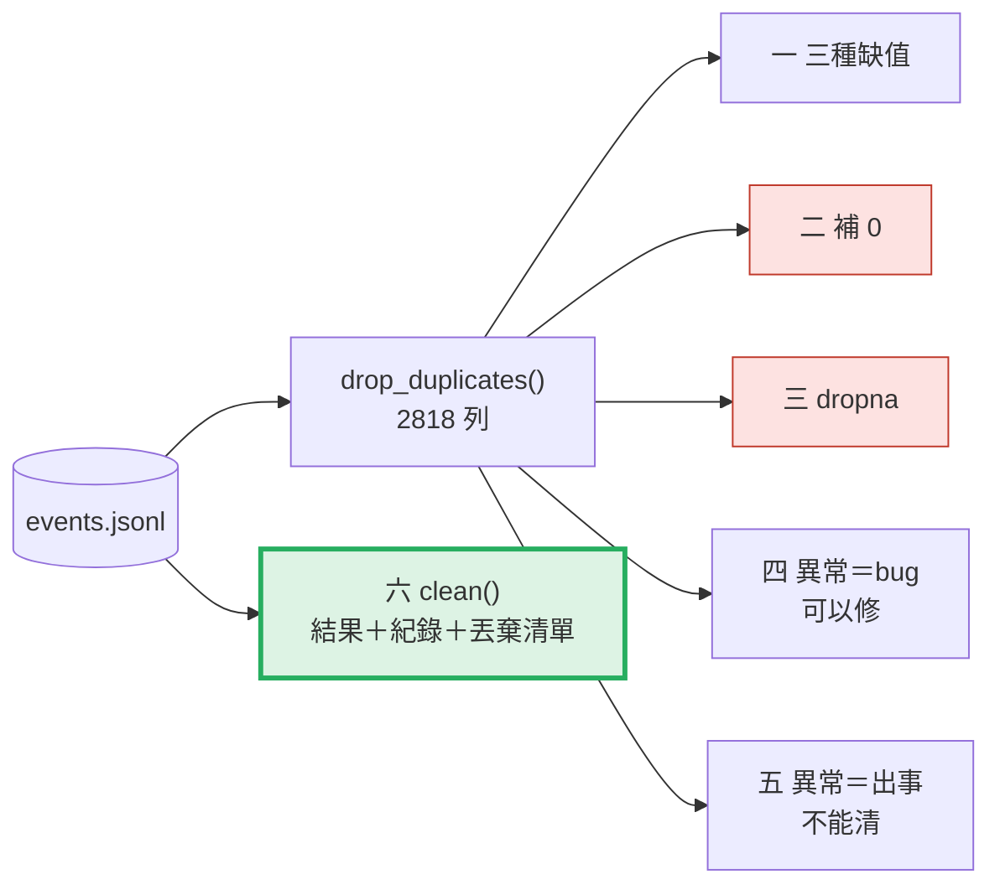
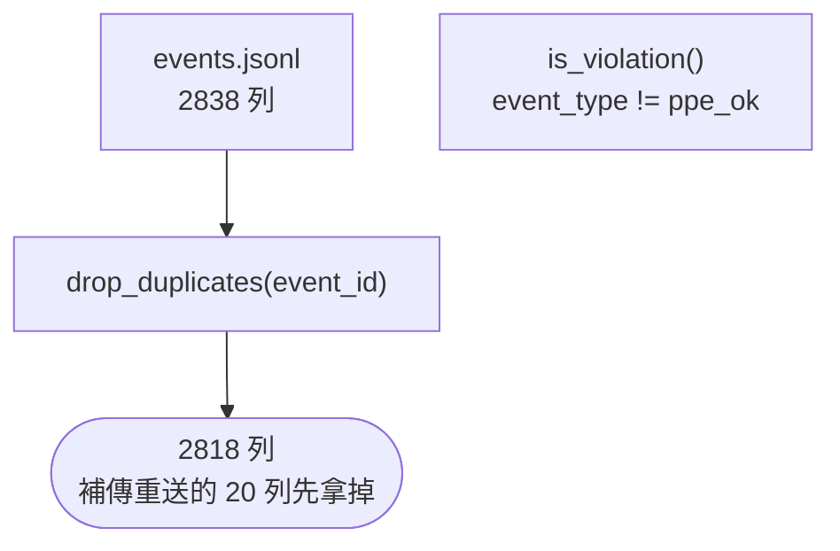
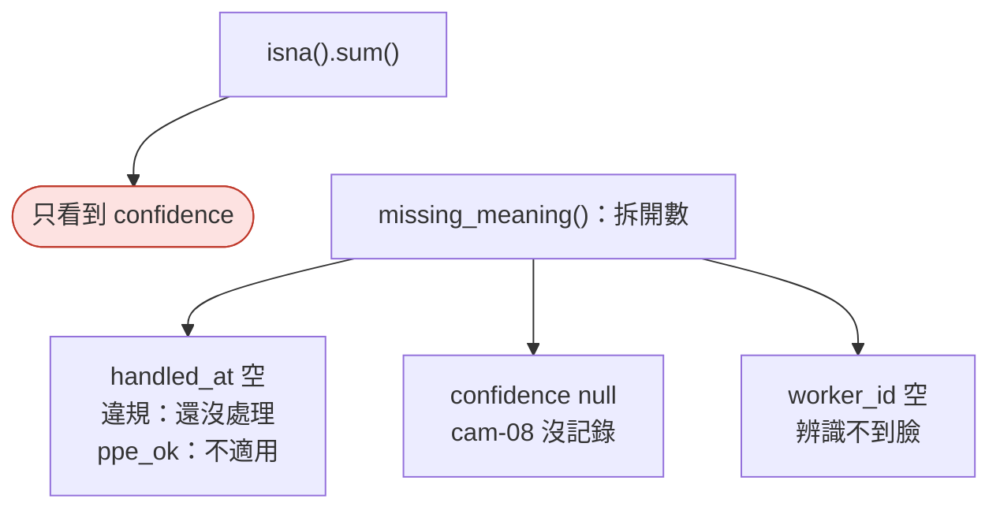
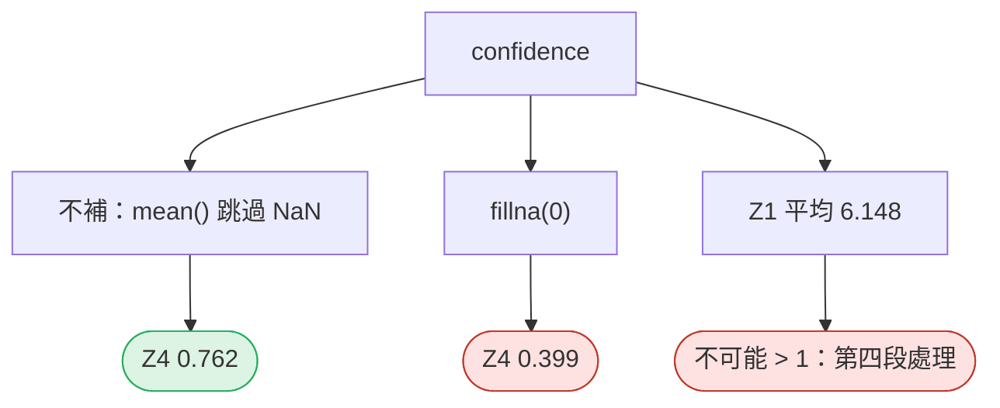
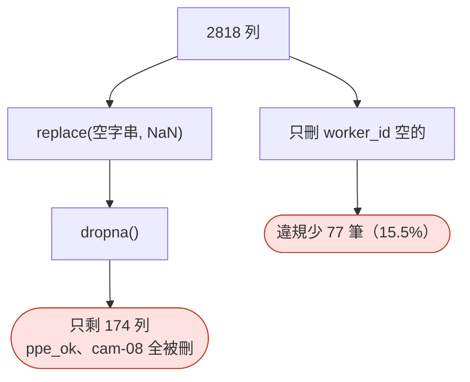
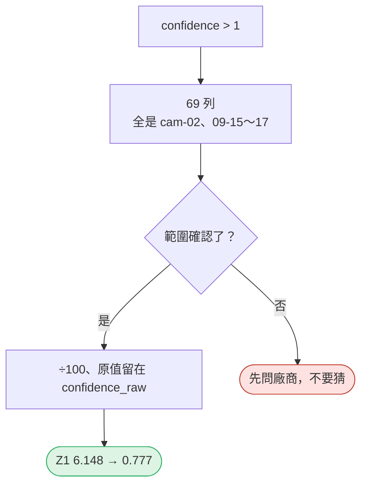
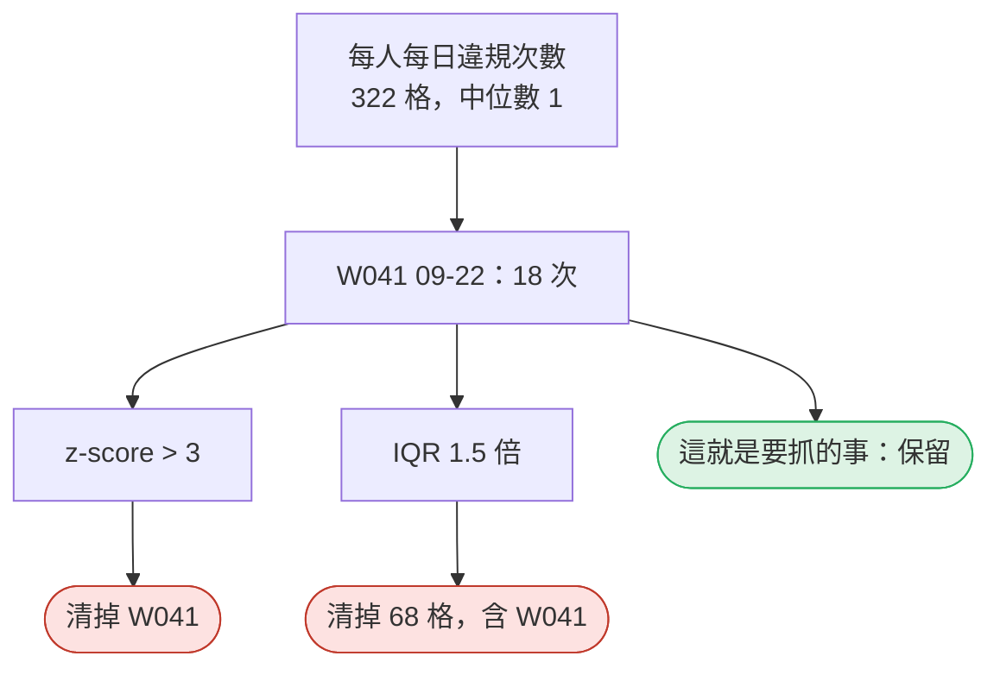
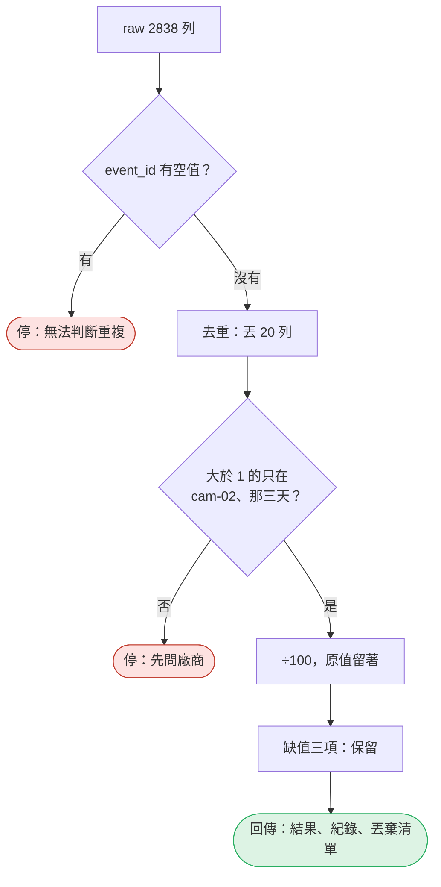

# 08｜缺值與異常：判斷「能不能信」

> **2026-10-21 改版：每段一張圖。** 判斷「能不能信」；每一個清理動作都留下紀錄。

[回 18 節課綱](../../course-plans/2026-10-data-analysis-18.md)

## 範例程式碼

- [demo：08_missing_anomaly.py](https://github.com/4-learn/data-analysis-and-process-demo/blob/master/2026/08_missing_anomaly.py)（與本頁 Demo 逐字相同）
- 練習資料與環境說明：[2026/README](https://github.com/4-learn/data-analysis-and-process-demo/tree/master/2026)

## 學完能做到

| 時間 | 段落 | 學完能做到 |
| --- | --- | --- |
| 0–8 分 | 一 | 說出一個「空」是沒發生、沒記錄還是不適用 |
| 8–15 分 | 二、三 | 算出補 0 與 `dropna` 各讓數字偏多少 |
| 15–30 分 | 四、五 | 分辨「異常＝bug」與「異常＝真的出事」 |
| 30–35 分 | 六 | 清理時交出紀錄與被丟的列 |
| 35–50 分 | Workshop | 補 0 vs `dropna`，交出被丟的列 |

## 本節流程



每段都是：**問題 → 位置（黃色）→ 步驟圖 → 程式 → 輸出 → 重點**。

## 零、準備：讀檔、先去重

**問題：** 第一到五段用哪一份資料？

**在流程中的位置：**


**這段做了什麼：**



<!-- fn-table -->
| 函式名稱 | 說明 | 官方文件連結 |
|---|---|---|
| 前面介紹過 | 用法同前，括號內是在哪裡第一次介紹 | [`Path(__file__).resolve().parent`](https://docs.python.org/3.12/library/pathlib.html#pathlib.Path.resolve)（第 02 節）、[`df["欄"]`](https://pandas.pydata.org/docs/user_guide/indexing.html#basics)（第 02 節）、[`df[條件]`](https://pandas.pydata.org/docs/user_guide/indexing.html#boolean-indexing)（第 02 節）、[`pd.read_json()`](https://pandas.pydata.org/docs/reference/api/pandas.read_json.html#pandas.read_json)（第 03 節）、[`Path()`](https://docs.python.org/3.12/library/pathlib.html#pathlib.Path)（爬蟲 10） |

<!-- 節錄: 08_missing_anomaly.py -->
```python
from pathlib import Path

import numpy as np
import pandas as pd

DATA = Path(__file__).resolve().parent / "data"
EVENTS = DATA / "events" / "events.jsonl"


def load_events(path=EVENTS):
    return pd.read_json(path, lines=True, dtype=False, convert_dates=False)


def is_violation(df):
    return df["event_type"] != "ppe_ok"
```

<!-- fn-table -->
| 函式名稱 | 說明 | 官方文件連結 |
|---|---|---|
| `.drop_duplicates(欄, keep="first")` | 去掉重複的列，同一個鍵只留一列 | [文件](https://pandas.pydata.org/docs/reference/api/pandas.DataFrame.drop_duplicates.html#pandas.DataFrame.drop_duplicates) |

<!-- 節錄: 08_missing_anomaly.py -->
```python
raw = load_events()
events = raw.drop_duplicates("event_id")          # 第 1–5 段先用去重後的 2818 列；正式流程在第 6 段
v = is_violation(events)
```

- 正式的去重與紀錄在第六段 `clean()`；這裡先用最簡單的去重。

## 一、三種缺值，三種意義

**問題：** `isna().sum()` 說只有一欄有缺值，真的嗎？

**在流程中的位置：**


**這段做了什麼：**



<!-- fn-table -->
| 函式名稱 | 說明 | 官方文件連結 |
|---|---|---|
| 前面介紹過 | 用法同前，括號內是在哪裡第一次介紹 | [`.sum()`](https://pandas.pydata.org/docs/reference/api/pandas.Series.sum.html#pandas.Series.sum)（第 02 節）、[`df["欄"]`](https://pandas.pydata.org/docs/user_guide/indexing.html#basics)（第 02 節）、[`df[條件]`](https://pandas.pydata.org/docs/user_guide/indexing.html#boolean-indexing)（第 02 節）、[`& \| ~`](https://pandas.pydata.org/docs/user_guide/indexing.html#boolean-operators)（第 03 節）、[`.isna()`](https://pandas.pydata.org/docs/reference/api/pandas.Series.isna.html#pandas.Series.isna)（第 03 節）、[`.loc[]`](https://pandas.pydata.org/docs/reference/api/pandas.DataFrame.loc.html#pandas.DataFrame.loc)（第 03 節）、[`pd.DataFrame()`](https://pandas.pydata.org/docs/reference/api/pandas.DataFrame.html#pandas.DataFrame)（第 05 節）、[`s.unique()`](https://pandas.pydata.org/docs/reference/api/pandas.Series.unique.html#pandas.Series.unique)（第 05 節） |

<!-- 節錄: 08_missing_anomaly.py -->
```python
def missing_meaning(df):
    """同樣是「空」，意義不同：要拆開來數，不是一句 isna().sum()。"""
    v = is_violation(df)
    rows = [
        ("handled_at", "違規、沒有處理", int((v & (df["handled_at"] == "")).sum()), "沒發生（還沒處理）"),
        ("handled_at", "ppe_ok", int((~v & (df["handled_at"] == "")).sum()), "不適用"),
        ("confidence", "null", int(df["confidence"].isna().sum()), "沒記錄（" + "、".join(
            sorted(df.loc[df["confidence"].isna(), "camera_id"].unique())) + "）"),
        ("worker_id", "空字串", int((df["worker_id"] == "").sum()), "辨識不到臉；事件仍發生"),
    ]
    return pd.DataFrame(rows, columns=["欄位", "情況", "列數", "意義"])
```

<!-- fn-table -->
| 函式名稱 | 說明 | 官方文件連結 |
|---|---|---|
| 前面介紹過 | 用法同前，括號內是在哪裡第一次介紹 | [`.sum()`](https://pandas.pydata.org/docs/reference/api/pandas.Series.sum.html#pandas.Series.sum)（第 02 節）、[`df.to_string()`](https://pandas.pydata.org/docs/reference/api/pandas.DataFrame.to_string.html#pandas.DataFrame.to_string)（第 02 節）、[`df["欄"]`](https://pandas.pydata.org/docs/user_guide/indexing.html#basics)（第 02 節）、[`df[條件]`](https://pandas.pydata.org/docs/user_guide/indexing.html#boolean-indexing)（第 02 節）、[`.isna()`](https://pandas.pydata.org/docs/reference/api/pandas.Series.isna.html#pandas.Series.isna)（第 03 節）、[`s[標籤]`](https://pandas.pydata.org/docs/user_guide/indexing.html#basics)（第 05 節）、[`s.mean()`](https://pandas.pydata.org/docs/reference/api/pandas.Series.mean.html#pandas.Series.mean)（第 06 節） |

<!-- 節錄: 08_missing_anomaly.py -->
```python
print("== 1. 三種缺值，三種意義 ==")
na = events.isna().sum()
print(f"isna().sum() 只看到 confidence {int(na['confidence'])} 個缺值；空字串不算 NaN，"
      f"所以 handled_at {int(na['handled_at'])} 個、worker_id {int(na['worker_id'])} 個")
print(missing_meaning(events).to_string(index=False))
handled = events["handled_at"] != ""
print(f"處理率：分母用全部 {len(events)} 列 → {handled.mean():.1%}；"
      f"分母用違規 {int(v.sum())} 列 → {handled[v].mean():.1%}")
```

```text
== 1. 三種缺值，三種意義 ==
isna().sum() 只看到 confidence 231 個缺值；空字串不算 NaN，所以 handled_at 0 個、worker_id 0 個
        欄位      情況   列數          意義
handled_at 違規、沒有處理  262   沒發生（還沒處理）
handled_at  ppe_ok 2322         不適用
confidence    null  231 沒記錄（cam-08）
 worker_id     空字串  364 辨識不到臉；事件仍發生
處理率：分母用全部 2818 列 → 8.3%；分母用違規 496 列 → 47.2%
```

- 處理率：分母用全部 8.3%，分母用違規 47.2%。**分母選錯就差 5 倍。**

| 欄位 | 空代表 | 能補嗎 |
| --- | --- | --- |
| `handled_at`（違規） | 還沒處理 | 不能，補了就是捏造 |
| `handled_at`（`ppe_ok`） | 不適用 | 不能，它不是缺 |
| `confidence` | cam-08 沒記錄 | 不能補 0 |
| `worker_id` | 辨識不到臉 | 不能刪，事件照樣發生 |

## 二、補 0：平均被拉低

**問題：** AI 常給的 `fillna(0)` 會怎樣？

**在流程中的位置：**


**這段做了什麼：**



<!-- fn-table -->
| 函式名稱 | 說明 | 官方文件連結 |
|---|---|---|
| `.groupby(...)[欄].sum()` | 每組加總 | [文件](https://pandas.pydata.org/docs/reference/api/pandas.api.typing.SeriesGroupBy.sum.html#pandas.api.typing.SeriesGroupBy.sum) |
| `.groupby(...)[欄].mean()` | 每組平均（跳過缺值） | [文件](https://pandas.pydata.org/docs/reference/api/pandas.api.typing.SeriesGroupBy.mean.html#pandas.api.typing.SeriesGroupBy.mean) |
| `df.iterrows()` | 一列一列取出（標籤, 那一列的 `Series`）；慢，只在列很少時用 | [文件](https://pandas.pydata.org/docs/reference/api/pandas.DataFrame.iterrows.html#pandas.DataFrame.iterrows) |
| 前面介紹過 | 用法同前，括號內是在哪裡第一次介紹 | [`df.groupby()`](https://pandas.pydata.org/docs/reference/api/pandas.DataFrame.groupby.html#pandas.DataFrame.groupby)（第 02 節）、[`df.to_string()`](https://pandas.pydata.org/docs/reference/api/pandas.DataFrame.to_string.html#pandas.DataFrame.to_string)（第 02 節）、[`df["欄"]`](https://pandas.pydata.org/docs/user_guide/indexing.html#basics)（第 02 節）、[`df[條件]`](https://pandas.pydata.org/docs/user_guide/indexing.html#boolean-indexing)（第 02 節）、[`.isna()`](https://pandas.pydata.org/docs/reference/api/pandas.Series.isna.html#pandas.Series.isna)（第 03 節）、[`pd.DataFrame()`](https://pandas.pydata.org/docs/reference/api/pandas.DataFrame.html#pandas.DataFrame)（第 05 節）、[`s[標籤]`](https://pandas.pydata.org/docs/user_guide/indexing.html#basics)（第 05 節）、[`.fillna()`](https://pandas.pydata.org/docs/reference/api/pandas.Series.fillna.html#pandas.Series.fillna)（第 06 節）、[`.round()`](https://pandas.pydata.org/docs/reference/api/pandas.DataFrame.round.html#pandas.DataFrame.round)（第 06 節） |

<!-- 節錄: 08_missing_anomaly.py -->
```python
print("\n== 2. 補 0：信心度平均被拉低 ==")
by_zone = pd.DataFrame({
    "缺值": events["confidence"].isna().groupby(events["zone"]).sum(),
    "不補（skipna）": events.groupby("zone")["confidence"].mean(),
    "補 0": events["confidence"].fillna(0).groupby(events["zone"]).mean(),
}).round(3)
print(by_zone.to_string())
over = by_zone[by_zone["不補（skipna）"] > 1]
for zone, row in over.iterrows():
    print(f"{zone} 平均 {row['不補（skipna）']:.3f}：信心度不可能大於 1——先記下，第 4 段處理")
```

```text
== 2. 補 0：信心度平均被拉低 ==
       缺值  不補（skipna）    補 0
zone                        
Z1      0       6.148  6.148
Z2      0       0.773  0.773
Z3      0       0.774  0.774
Z4    231       0.762  0.399
Z1 平均 6.148：信心度不可能大於 1——先記下，第 4 段處理
```

- cam-08 的 231 筆不是「信心度 0」，是「沒有這個數字」。
- 不補就是跳過：報告要寫明分母是有記錄的那些。

## 三、`dropna` 刪掉的是事件

**問題：** 把空的都當缺值再 `dropna()`，剩下什麼？

**在流程中的位置：**


**這段做了什麼：**



<!-- fn-table -->
| 函式名稱 | 說明 | 官方文件連結 |
|---|---|---|
| `np.nan` | NumPy 的「缺值」，型別是浮點數 | [文件](https://numpy.org/doc/stable/reference/constants.html#numpy.nan) |
| `.replace(舊, 新, regex=)` | 把某個值換成另一個值（例如 `""` 換成 `np.nan`）；`regex=True` 時「舊」是正規表示式 | [文件](https://pandas.pydata.org/docs/reference/api/pandas.Series.replace.html#pandas.Series.replace) |
| 前面介紹過 | 用法同前，括號內是在哪裡第一次介紹 | [`.sum()`](https://pandas.pydata.org/docs/reference/api/pandas.Series.sum.html#pandas.Series.sum)（第 02 節）、[`df.groupby()`](https://pandas.pydata.org/docs/reference/api/pandas.DataFrame.groupby.html#pandas.DataFrame.groupby)（第 02 節）、[`df.to_string()`](https://pandas.pydata.org/docs/reference/api/pandas.DataFrame.to_string.html#pandas.DataFrame.to_string)（第 02 節）、[`df["欄"]`](https://pandas.pydata.org/docs/user_guide/indexing.html#basics)（第 02 節）、[`df[條件]`](https://pandas.pydata.org/docs/user_guide/indexing.html#boolean-indexing)（第 02 節）、[`groupby().size()`](https://pandas.pydata.org/docs/reference/api/pandas.api.typing.DataFrameGroupBy.size.html#pandas.api.typing.DataFrameGroupBy.size)（第 02 節）、[`& \| ~`](https://pandas.pydata.org/docs/user_guide/indexing.html#boolean-operators)（第 03 節）、[`pd.DataFrame()`](https://pandas.pydata.org/docs/reference/api/pandas.DataFrame.html#pandas.DataFrame)（第 05 節）、[`.dropna()`](https://pandas.pydata.org/docs/reference/api/pandas.Series.dropna.html#pandas.Series.dropna)（第 06 節）、[`整欄運算`](https://pandas.pydata.org/docs/user_guide/basics.html#flexible-binary-operations)（第 06 節） |

<!-- 節錄: 08_missing_anomaly.py -->
```python
print("\n== 3. dropna 刪掉的是事件，不是壞資料 ==")
naive = events.replace("", np.nan).dropna()
print(f"把空字串當缺值後 dropna()：{len(events)} 列 → {len(naive)} 列；"
      f"ppe_ok {int((~v).sum())} → {int((~is_violation(naive)).sum())} 列；"
      f"cam-08 {int((events['camera_id'] == 'cam-08').sum())} → {int((naive['camera_id'] == 'cam-08').sum())} 列")
known = events[events["worker_id"] != ""]
print(f"只刪 worker_id 空的列：違規 {int(v.sum())} → {int(is_violation(known).sum())}，"
      f"少了 {int(v.sum() - is_violation(known).sum())} 筆（{1 - is_violation(known).sum() / v.sum():.1%}）")
lost = pd.DataFrame({"全部": events[v].groupby("event_type").size(),
                     "刪掉未辨識後": known[is_violation(known)].groupby("event_type").size()})
lost["少掉"] = lost["全部"] - lost["刪掉未辨識後"]
print(lost.to_string())
```

```text
== 3. dropna 刪掉的是事件，不是壞資料 ==
把空字串當缺值後 dropna()：2818 列 → 174 列；ppe_ok 2322 → 0 列；cam-08 231 → 0 列
只刪 worker_id 空的列：違規 496 → 419，少了 77 筆（15.5%）
                   全部  刪掉未辨識後  少掉
event_type                       
no_harness        170     139  31
no_helmet         252     215  37
restricted_entry   74      65   9
```

- `dropna` 的意思是「這筆事件不存在」——先問：不能用在**哪個問題**上？

## 四、異常＝bug：cam-02 的百分比

**問題：** Z1 平均 6.148，是哪些列造成的？

**在流程中的位置：**


**這段做了什麼：**



<!-- fn-table -->
| 函式名稱 | 說明 | 官方文件連結 |
|---|---|---|
| 前面介紹過 | 用法同前，括號內是在哪裡第一次介紹 | [`df["欄"]`](https://pandas.pydata.org/docs/user_guide/indexing.html#basics)（第 02 節）、[`df[條件]`](https://pandas.pydata.org/docs/user_guide/indexing.html#boolean-indexing)（第 02 節） |

<!-- 節錄: 08_missing_anomaly.py -->
```python
def percent_bug(df):
    """confidence 應在 0–1；大於 1 的是韌體把百分比寫進來（第四段）。"""
    return df["confidence"] > 1


# 已確認的 bug 範圍：只有這支攝影機、只有這幾天（第四段）。超出範圍就不是同一個 bug。
PERCENT_BUG_CAMERA = "cam-02"
PERCENT_BUG_DAYS = ("2026-09-15", "2026-09-17")
```

<!-- fn-table -->
| 函式名稱 | 說明 | 官方文件連結 |
|---|---|---|
| 前面介紹過 | 用法同前，括號內是在哪裡第一次介紹 | [`.sum()`](https://pandas.pydata.org/docs/reference/api/pandas.Series.sum.html#pandas.Series.sum)（第 02 節）、[`df["欄"]`](https://pandas.pydata.org/docs/user_guide/indexing.html#basics)（第 02 節）、[`df[條件]`](https://pandas.pydata.org/docs/user_guide/indexing.html#boolean-indexing)（第 02 節）、[`& \| ~`](https://pandas.pydata.org/docs/user_guide/indexing.html#boolean-operators)（第 03 節）、[`.loc[]`](https://pandas.pydata.org/docs/reference/api/pandas.DataFrame.loc.html#pandas.DataFrame.loc)（第 03 節）、[`s.unique()`](https://pandas.pydata.org/docs/reference/api/pandas.Series.unique.html#pandas.Series.unique)（第 05 節）、[`s.max()`](https://pandas.pydata.org/docs/reference/api/pandas.Series.max.html#pandas.Series.max)（第 06 節）、[`s.mean()`](https://pandas.pydata.org/docs/reference/api/pandas.Series.mean.html#pandas.Series.mean)（第 06 節）、[`s.min()`](https://pandas.pydata.org/docs/reference/api/pandas.Series.min.html#pandas.Series.min)（第 06 節）、[`s.str[a:b]`](https://pandas.pydata.org/docs/user_guide/text.html#indexing-with-str)（第 06 節）、[`整欄運算`](https://pandas.pydata.org/docs/user_guide/basics.html#flexible-binary-operations)（第 06 節）、[`.copy()`](https://pandas.pydata.org/docs/reference/api/pandas.DataFrame.copy.html#pandas.DataFrame.copy)（第 07 節） |

<!-- 節錄: 08_missing_anomaly.py -->
```python
print("\n== 4. 異常＝bug：cam-02 的百分比 ==")
bug = percent_bug(events)
days = events.loc[bug, "event_time"].str[:10]
print(f"confidence > 1：{int(bug.sum())} 列；攝影機 {sorted(events.loc[bug, 'camera_id'].unique())}；"
      f"日期 {days.min()}～{days.max()}；範圍 {events.loc[bug, 'confidence'].min():g}～{events.loc[bug, 'confidence'].max():g}")
fixed = events.copy()
fixed.loc[bug, "confidence"] = fixed.loc[bug, "confidence"] / 100
print(f"÷100 後 Z1 平均 {events.loc[events['zone'] == 'Z1', 'confidence'].mean():.3f} → "
      f"{fixed.loc[fixed['zone'] == 'Z1', 'confidence'].mean():.3f}")
c = fixed["confidence"]
print(f"低信心 (c < 0.6)：{int((c < 0.6).sum())} 列；不是高信心 ~(c >= 0.6)：{int((~(c >= 0.6)).sum())} 列；"
      f"差 {int((~(c >= 0.6)).sum() - (c < 0.6).sum())} 列＝NaN（比較一律 False）")
```

```text
== 4. 異常＝bug：cam-02 的百分比 ==
confidence > 1：69 列；攝影機 ['cam-02']；日期 2026-09-15～2026-09-17；範圍 43～99
÷100 後 Z1 平均 6.148 → 0.777
低信心 (c < 0.6)：178 列；不是高信心 ~(c >= 0.6)：409 列；差 231 列＝NaN（比較一律 False）
```

- 可以修，但要：**確認範圍、留原值、寫進紀錄**。
- 最後一行是第 07 節的 NaN 比較：差的 231 列是 cam-08。

## 五、異常＝真的出事：W041

**問題：** 套用常見的「清除離群值」規則，會清掉什麼？

**在流程中的位置：**


**這段做了什麼：**



<!-- fn-table -->
| 函式名稱 | 說明 | 官方文件連結 |
|---|---|---|
| `s.std()` | 標準差 | [文件](https://pandas.pydata.org/docs/reference/api/pandas.Series.std.html#pandas.Series.std) |
| `s.abs()` | 絕對值 | [文件](https://pandas.pydata.org/docs/reference/api/pandas.Series.abs.html#pandas.Series.abs) |
| `s.quantile([0.25, 0.75])` | 分位數，例如 0.25 是第一四分位數 | [文件](https://pandas.pydata.org/docs/reference/api/pandas.Series.quantile.html#pandas.Series.quantile) |
| 前面介紹過 | 用法同前，括號內是在哪裡第一次介紹 | [`df[條件]`](https://pandas.pydata.org/docs/user_guide/indexing.html#boolean-indexing)（第 02 節）、[`& \| ~`](https://pandas.pydata.org/docs/user_guide/indexing.html#boolean-operators)（第 03 節）、[`s.mean()`](https://pandas.pydata.org/docs/reference/api/pandas.Series.mean.html#pandas.Series.mean)（第 06 節）、[`整欄運算`](https://pandas.pydata.org/docs/user_guide/basics.html#flexible-binary-operations)（第 06 節） |

<!-- 節錄: 08_missing_anomaly.py -->
```python
def zscore_outliers(counts, threshold=3.0):
    """常見的「清異常」規則：|z| > threshold 視為離群值。"""
    z = (counts - counts.mean()) / counts.std()
    return z.abs() > threshold


def iqr_outliers(counts, k=1.5):
    q1, q3 = counts.quantile([0.25, 0.75])
    return (counts < q1 - k * (q3 - q1)) | (counts > q3 + k * (q3 - q1))
```

<!-- fn-table -->
| 函式名稱 | 說明 | 官方文件連結 |
|---|---|---|
| `s.idxmax()` | 最大值所在的**標籤**（不是值本身） | [文件](https://pandas.pydata.org/docs/reference/api/pandas.Series.idxmax.html#pandas.Series.idxmax) |
| `s.median()` | 中位數 | [文件](https://pandas.pydata.org/docs/reference/api/pandas.Series.median.html#pandas.Series.median) |
| `pd.MultiIndex.from_arrays([欄1, 欄2])` | 把兩欄組成「兩層」的標籤，例如（人, 日）一組；可以拿來跟另一個兩層 index 比對 | [文件](https://pandas.pydata.org/docs/reference/api/pandas.MultiIndex.from_arrays.html#pandas.MultiIndex.from_arrays) |
| `s.str.startswith(前綴)` | 每個字串是否以某段文字開頭 | [文件](https://pandas.pydata.org/docs/reference/api/pandas.Series.str.startswith.html#pandas.Series.str.startswith) |
| `s.get(標籤, 預設)` | 依標籤取值；沒有這個標籤就回傳預設值，不會報錯 | [文件](https://pandas.pydata.org/docs/reference/api/pandas.Series.get.html#pandas.Series.get) |
| 前面介紹過 | 用法同前，括號內是在哪裡第一次介紹 | [`.sum()`](https://pandas.pydata.org/docs/reference/api/pandas.Series.sum.html#pandas.Series.sum)（第 02 節）、[`df.groupby()`](https://pandas.pydata.org/docs/reference/api/pandas.DataFrame.groupby.html#pandas.DataFrame.groupby)（第 02 節）、[`df["欄"]`](https://pandas.pydata.org/docs/user_guide/indexing.html#basics)（第 02 節）、[`df[條件]`](https://pandas.pydata.org/docs/user_guide/indexing.html#boolean-indexing)（第 02 節）、[`groupby().size()`](https://pandas.pydata.org/docs/reference/api/pandas.api.typing.DataFrameGroupBy.size.html#pandas.api.typing.DataFrameGroupBy.size)（第 02 節）、[`& \| ~`](https://pandas.pydata.org/docs/user_guide/indexing.html#boolean-operators)（第 03 節）、[`.rename()`](https://pandas.pydata.org/docs/reference/api/pandas.Series.rename.html#pandas.Series.rename)（第 03 節）、[`df.index`](https://pandas.pydata.org/docs/reference/api/pandas.DataFrame.index.html#pandas.DataFrame.index)（第 05 節）、[`s.max()`](https://pandas.pydata.org/docs/reference/api/pandas.Series.max.html#pandas.Series.max)（第 06 節）、[`s.str[a:b]`](https://pandas.pydata.org/docs/user_guide/text.html#indexing-with-str)（第 06 節）、[`s.isin()`](https://pandas.pydata.org/docs/reference/api/pandas.Series.isin.html#pandas.Series.isin)（第 07 節） |

<!-- 節錄: 08_missing_anomaly.py -->
```python
print("\n== 5. 異常＝真的出事：W041 ==")
per_day = (events[v & (events["worker_id"] != "")]
           .groupby([events["worker_id"], events["event_time"].str[:10].rename("day")]).size())
print(f"每人每日違規次數：{len(per_day)} 格，中位數 {per_day.median():g}，最大 {per_day.max()}（{per_day.idxmax()}）")
cell = pd.MultiIndex.from_arrays([events["worker_id"], events["event_time"].str[:10]])
d22 = (events["event_type"] == "no_harness") & events["event_time"].str.startswith("2026-09-22")
print(f"09-22 全工地 no_harness {int(d22.sum())} 筆，其中 W041 {int((d22 & (events['worker_id'] == 'W041')).sum())} 筆")
for name, flag in [("z-score > 3", zscore_outliers(per_day)), ("IQR 1.5 倍", iqr_outliers(per_day))]:
    removed = v & (events["worker_id"] != "") & cell.isin(per_day.index[flag])   # 真的照規則判定結果去濾
    kept = events[~removed]
    print(f"{name:12} 清掉 {int(flag.sum()):>2} 格、{int(removed.sum()):>3} 筆事件；"
          f"W041 09-22 被清掉：{bool(flag.get(('W041', '2026-09-22')))}；"
          f"清完 09-22 no_harness 剩 {int(d22[~removed].sum())} 筆（W041 {int((d22[~removed] & (kept['worker_id'] == 'W041')).sum())} 筆）")
```

```text
== 5. 異常＝真的出事：W041 ==
每人每日違規次數：322 格，中位數 1，最大 18（('W041', '2026-09-22')）
09-22 全工地 no_harness 24 筆，其中 W041 18 筆
z-score > 3  清掉  1 格、 18 筆事件；W041 09-22 被清掉：True；清完 09-22 no_harness 剩 6 筆（W041 0 筆）
IQR 1.5 倍    清掉 68 格、165 筆事件；W041 09-22 被清掉：True；清完 09-22 no_harness 剩 2 筆（W041 0 筆）
```

- W041 連續 18 次未掛安全帶——**這套系統存在的理由**。
- 統計規則只會說「它少見」，不會說「它錯」。

## 六、清理紀錄（audit trail）

**問題：** 清理之後，怎麼交代做了什麼？

**在流程中的位置：**


**這段做了什麼：**



<!-- fn-table -->
| 函式名稱 | 說明 | 官方文件連結 |
|---|---|---|
| 前面介紹過 | 用法同前，括號內是在哪裡第一次介紹 | [`.any()`](https://pandas.pydata.org/docs/reference/api/pandas.Series.any.html#pandas.Series.any)（第 02 節）、[`.duplicated()`](https://pandas.pydata.org/docs/reference/api/pandas.DataFrame.duplicated.html#pandas.DataFrame.duplicated)（第 02 節）、[`.sum()`](https://pandas.pydata.org/docs/reference/api/pandas.Series.sum.html#pandas.Series.sum)（第 02 節）、[`df["欄"]`](https://pandas.pydata.org/docs/user_guide/indexing.html#basics)（第 02 節）、[`df[條件]`](https://pandas.pydata.org/docs/user_guide/indexing.html#boolean-indexing)（第 02 節）、[`pd.concat()`](https://pandas.pydata.org/docs/reference/api/pandas.concat.html#pandas.concat)（第 02 節）、[`& \| ~`](https://pandas.pydata.org/docs/user_guide/indexing.html#boolean-operators)（第 03 節）、[`.isna()`](https://pandas.pydata.org/docs/reference/api/pandas.Series.isna.html#pandas.Series.isna)（第 03 節）、[`.loc[]`](https://pandas.pydata.org/docs/reference/api/pandas.DataFrame.loc.html#pandas.DataFrame.loc)（第 03 節）、[`.reset_index()`](https://pandas.pydata.org/docs/reference/api/pandas.DataFrame.reset_index.html#pandas.DataFrame.reset_index)（第 04 節）、[`pd.DataFrame()`](https://pandas.pydata.org/docs/reference/api/pandas.DataFrame.html#pandas.DataFrame)（第 05 節）、[`df.assign()`](https://pandas.pydata.org/docs/reference/api/pandas.DataFrame.assign.html#pandas.DataFrame.assign)（第 06 節）、[`s.max()`](https://pandas.pydata.org/docs/reference/api/pandas.Series.max.html#pandas.Series.max)（第 06 節）、[`s.min()`](https://pandas.pydata.org/docs/reference/api/pandas.Series.min.html#pandas.Series.min)（第 06 節）、[`s.str[a:b]`](https://pandas.pydata.org/docs/user_guide/text.html#indexing-with-str)（第 06 節）、[`整欄運算`](https://pandas.pydata.org/docs/user_guide/basics.html#flexible-binary-operations)（第 06 節）、[`.copy()`](https://pandas.pydata.org/docs/reference/api/pandas.DataFrame.copy.html#pandas.DataFrame.copy)（第 07 節） |

<!-- 節錄: 08_missing_anomaly.py -->
```python
def clean(raw):
    """只做有理由的動作；每一步記下進幾列、出幾列、動了幾列、理由。被丟的列另外回傳。"""
    if raw["event_id"].isna().any() or (raw["event_id"] == "").any():
        raise ValueError("event_id 有空值：無法判斷重複，停止清理")
    log, dropped = [], []
    df = raw.copy()

    dup = df.duplicated("event_id", keep="first")    # 檔案順序＝到達順序：留第一次到的（見第 09 節）
    dropped.append(df[dup].assign(理由="event_id 重複（補傳重送）"))
    log.append(("依 event_id 去重", len(df), len(df) - int(dup.sum()), int(dup.sum()), 0, "補傳送了兩次；保留先到的一列"))
    df = df[~dup].copy()

    bug = percent_bug(df)
    if bug.any() and set(df.loc[bug, "camera_id"]) != {PERCENT_BUG_CAMERA}:
        raise ValueError(f"confidence > 1 出現在 cam-02 以外：{sorted(set(df.loc[bug, 'camera_id']))}，先問廠商")
    days = df.loc[bug, "event_time"].str[:10]
    outside = sorted(set(days[(days < PERCENT_BUG_DAYS[0]) | (days > PERCENT_BUG_DAYS[1])]))
    if outside:
        raise ValueError(f"confidence > 1 出現在 {PERCENT_BUG_DAYS[0]}～{PERCENT_BUG_DAYS[1]} 以外：{outside}，先問廠商")
    span = f"{days.min()[5:]}～{days.max()[5:]}" if bug.any() else "無"
    df["confidence_raw"] = df["confidence"]           # 原值留著，修過的列看得出來
    df.loc[bug, "confidence"] = df.loc[bug, "confidence"] / 100
    log.append(("cam-02 百分比 ÷100", len(df), len(df), 0, int(bug.sum()), f"韌體 bug（{span}）；原值存 confidence_raw"))

    for what, why in [("confidence 缺值", "cam-08 沒記錄：保留 NaN，不補 0"),
                      ("worker_id 空字串", "事件仍發生：保留；人員分析時再排除"),
                      ("handled_at 空字串", "沒處理／不適用：保留，分母要分開算")]:
        log.append((what, len(df), len(df), 0, 0, why))

    log = pd.DataFrame(log, columns=["步驟", "進", "出", "丟棄", "修改", "理由"])
    return df.reset_index(drop=True), log, pd.concat(dropped, ignore_index=True)
```

<!-- fn-table -->
| 函式名稱 | 說明 | 官方文件連結 |
|---|---|---|
| 前面介紹過 | 用法同前，括號內是在哪裡第一次介紹 | [`df.head()`](https://pandas.pydata.org/docs/reference/api/pandas.DataFrame.head.html#pandas.DataFrame.head)（第 02 節）、[`df.to_string()`](https://pandas.pydata.org/docs/reference/api/pandas.DataFrame.to_string.html#pandas.DataFrame.to_string)（第 02 節）、[`df["欄"]`](https://pandas.pydata.org/docs/user_guide/indexing.html#basics)（第 02 節）、[`s.value_counts()`](https://pandas.pydata.org/docs/reference/api/pandas.Series.value_counts.html#pandas.Series.value_counts)（第 05 節） |

<!-- 節錄: 08_missing_anomaly.py -->
```python
print("\n== 6. 清理紀錄（audit trail）==")
cleaned, log, dropped = clean(raw)
print(log.to_string(index=False))
print(f"進 {len(raw)} 列，出 {len(cleaned)} 列；丟棄 {len(dropped)} 列：")
print(dropped["理由"].value_counts().to_string())
print(dropped[["event_id", "event_type", "ingested_at"]].head(3).to_string(index=False))
```

```text
== 6. 清理紀錄（audit trail）==
             步驟    進    出  丟棄  修改                                     理由
  依 event_id 去重 2838 2818  20   0                         補傳送了兩次；保留先到的一列
cam-02 百分比 ÷100 2818 2818   0  69 韌體 bug（09-15～09-17）；原值存 confidence_raw
  confidence 缺值 2818 2818   0   0                 cam-08 沒記錄：保留 NaN，不補 0
  worker_id 空字串 2818 2818   0   0                      事件仍發生：保留；人員分析時再排除
 handled_at 空字串 2818 2818   0   0                      沒處理／不適用：保留，分母要分開算
進 2838 列，出 2818 列；丟棄 20 列：
理由
event_id 重複（補傳重送）    20
            event_id event_type               ingested_at
cam-05-20260910-0016     ppe_ok 2026-09-11T01:19:01+00:00
cam-05-20260910-0028     ppe_ok 2026-09-11T01:19:01+00:00
cam-05-20260910-0024     ppe_ok 2026-09-11T01:19:05+00:00
```

- 每一步記下：進幾列、出幾列、丟幾列、改幾列、**理由**。
- 被丟的列另外交出來，不是消失。

## Workshop：補 0 vs `dropna`，交出被丟的列

### 任務與時間

**35–42 分鐘：同一份資料，兩種處理。** 以去重後的 2,818 列、cam-02 已 ÷100 為起點，分別做：

- A：`confidence` 補 0。
- B：`dropna(subset=["confidence"])`。

各算：全工地的平均信心度、Z4 的違規數、Z4 的 no_harness 數。哪一種處理讓「施工架的模型最不可靠」？哪一種讓「施工架的違規比較少」？

**42–47 分鐘：交出 audit trail。** 把 B 寫成一個函式，回傳 `(結果, 紀錄, 被丟的列)`，紀錄至少有「進、出、丟棄、理由」。被丟的列依 `camera_id` × `event_type` 計數。

**47–50 分鐘：抓 AI 的錯。** 請 OpenCode「清理 `events.jsonl`：去除重複、處理缺值、移除異常值，輸出乾淨的資料」。拿它的程式驗收：

1. 輸出幾列？W041 在 09-22 的 18 筆 no_harness 還在嗎？
2. 去重用的是整列還是 `event_id`？還剩幾個重複的 `event_id`？
3. cam-08 還在嗎？`ppe_ok` 還在嗎？
4. 它有沒有告訴你丟了哪些列、為什麼？

### 參考判讀

:::spoiler 教師用（點開）
- A（補 0）：全工地平均信心度 0.774 → 0.710；Z4 平均 0.762 → 0.399。違規數不變（496 筆），但「信心度最低的區域」變成 Z4——是假的。
- B（`dropna`）：平均信心度不變（0.774），但**違規事件 496 → 452**，Z4 違規 114 → 70、Z4 no_harness 86 → 56。被丟的 231 列全是 cam-08，其中 44 筆違規。B 讓施工架「看起來比較安全」——也是假的。
- 兩種處理**錯的方向不同**：補 0 改的是「數值」，`dropna` 改的是「事件數」。正確答案是：算信心度時跳過 NaN（並寫明分母 2,587 筆），算違規數時保留全部。
- 教師實測一個常見的 AI 版本（`read_json(lines=True)` 預設讀法 → `drop_duplicates()` → `dropna()` → 以 IQR 移除 `confidence` 離群值）：
  - 預設讀法把 `handled_at` 的空字串轉成 `NaT`，所以 `dropna()` 一口氣把 2,838 列砍到 **212 列**，全部是違規、cam-08 為 0；IQR 再砍到 **207 列**。
  - **整列 `drop_duplicates()` 一列都沒刪**（2,838 → 2,838）：補傳的兩列 `ingested_at` 不同。最後的 207 列中仍有 2 個重複的 `event_id`。
  - W041 在 09-22 的 18 筆只剩 14 筆。少掉的 4 筆不是被當成異常，而是**主管還沒處理**（`handled_at` 空）——最需要追的那幾筆，反而先被刪掉。剩下的 14 筆留下來，也只是因為它們剛好有 `handled_at`，不是 AI 判斷對了。請學生追問 AI「為什麼保留這些」，它答不出依據。
  - 如果 AI 版本先把空字串換成 NaN 再 `dropna()`（本節第三段的寫法），結果是 174 列。各家 AI 寫法不同，數字會不同；**判斷標準是：它有沒有交出被丟的列與理由**。
- 若學生的 audit trail 只有「2,818 → 2,587」，不合格：少的 231 列是哪支攝影機、哪些事件類型，要列得出來。
- 若學生用 `cleaned["confidence"] != cleaned["confidence_raw"]` 數「cam-02 修改了幾列」，會得到 **300**，不是 69：NaN 跟 NaN 比較 `!=` 是 `True`，cam-08 的 231 列被算成「改過」（教師撰寫本節測試時自己踩到）。要加上 `& cleaned["confidence_raw"].notna()`。
:::

### 驗收

- 交出清理前後列數，以及被丟棄列的清單（DataFrame 或 CSV 皆可，不必寫檔，印出來即可）與每一類的理由。
- 能說出 `handled_at`、`confidence`、`worker_id` 三種空各代表什麼，以及「處理率」的分母該用哪一個。
- 能解釋為什麼 IQR 在本資料上會把「一天違規 2 次」也當成異常。
- AI 版本的四個問題都有答案，而且至少找到一個它默默丟掉的東西。

## 附錄：完整程式

```bash
python3 08_missing_anomaly.py
```

<!-- fn-table -->
| 函式名稱 | 說明 | 官方文件連結 |
|---|---|---|
| （同上） | 這支程式用到的函式，都已在上面各段的表格介紹過 | — |

<!-- demo: 08_missing_anomaly.py -->
```python
"""第 08 節：缺值與異常——判斷「能不能信」，而且每一個清理動作都留下紀錄。"""

from pathlib import Path

import numpy as np
import pandas as pd

DATA = Path(__file__).resolve().parent / "data"
EVENTS = DATA / "events" / "events.jsonl"


def load_events(path=EVENTS):
    return pd.read_json(path, lines=True, dtype=False, convert_dates=False)


def is_violation(df):
    return df["event_type"] != "ppe_ok"


def missing_meaning(df):
    """同樣是「空」，意義不同：要拆開來數，不是一句 isna().sum()。"""
    v = is_violation(df)
    rows = [
        ("handled_at", "違規、沒有處理", int((v & (df["handled_at"] == "")).sum()), "沒發生（還沒處理）"),
        ("handled_at", "ppe_ok", int((~v & (df["handled_at"] == "")).sum()), "不適用"),
        ("confidence", "null", int(df["confidence"].isna().sum()), "沒記錄（" + "、".join(
            sorted(df.loc[df["confidence"].isna(), "camera_id"].unique())) + "）"),
        ("worker_id", "空字串", int((df["worker_id"] == "").sum()), "辨識不到臉；事件仍發生"),
    ]
    return pd.DataFrame(rows, columns=["欄位", "情況", "列數", "意義"])


def percent_bug(df):
    """confidence 應在 0–1；大於 1 的是韌體把百分比寫進來（第四段）。"""
    return df["confidence"] > 1


# 已確認的 bug 範圍：只有這支攝影機、只有這幾天（第四段）。超出範圍就不是同一個 bug。
PERCENT_BUG_CAMERA = "cam-02"
PERCENT_BUG_DAYS = ("2026-09-15", "2026-09-17")


def zscore_outliers(counts, threshold=3.0):
    """常見的「清異常」規則：|z| > threshold 視為離群值。"""
    z = (counts - counts.mean()) / counts.std()
    return z.abs() > threshold


def iqr_outliers(counts, k=1.5):
    q1, q3 = counts.quantile([0.25, 0.75])
    return (counts < q1 - k * (q3 - q1)) | (counts > q3 + k * (q3 - q1))


def clean(raw):
    """只做有理由的動作；每一步記下進幾列、出幾列、動了幾列、理由。被丟的列另外回傳。"""
    if raw["event_id"].isna().any() or (raw["event_id"] == "").any():
        raise ValueError("event_id 有空值：無法判斷重複，停止清理")
    log, dropped = [], []
    df = raw.copy()

    dup = df.duplicated("event_id", keep="first")    # 檔案順序＝到達順序：留第一次到的（見第 09 節）
    dropped.append(df[dup].assign(理由="event_id 重複（補傳重送）"))
    log.append(("依 event_id 去重", len(df), len(df) - int(dup.sum()), int(dup.sum()), 0, "補傳送了兩次；保留先到的一列"))
    df = df[~dup].copy()

    bug = percent_bug(df)
    if bug.any() and set(df.loc[bug, "camera_id"]) != {PERCENT_BUG_CAMERA}:
        raise ValueError(f"confidence > 1 出現在 cam-02 以外：{sorted(set(df.loc[bug, 'camera_id']))}，先問廠商")
    days = df.loc[bug, "event_time"].str[:10]
    outside = sorted(set(days[(days < PERCENT_BUG_DAYS[0]) | (days > PERCENT_BUG_DAYS[1])]))
    if outside:
        raise ValueError(f"confidence > 1 出現在 {PERCENT_BUG_DAYS[0]}～{PERCENT_BUG_DAYS[1]} 以外：{outside}，先問廠商")
    span = f"{days.min()[5:]}～{days.max()[5:]}" if bug.any() else "無"
    df["confidence_raw"] = df["confidence"]           # 原值留著，修過的列看得出來
    df.loc[bug, "confidence"] = df.loc[bug, "confidence"] / 100
    log.append(("cam-02 百分比 ÷100", len(df), len(df), 0, int(bug.sum()), f"韌體 bug（{span}）；原值存 confidence_raw"))

    for what, why in [("confidence 缺值", "cam-08 沒記錄：保留 NaN，不補 0"),
                      ("worker_id 空字串", "事件仍發生：保留；人員分析時再排除"),
                      ("handled_at 空字串", "沒處理／不適用：保留，分母要分開算")]:
        log.append((what, len(df), len(df), 0, 0, why))

    log = pd.DataFrame(log, columns=["步驟", "進", "出", "丟棄", "修改", "理由"])
    return df.reset_index(drop=True), log, pd.concat(dropped, ignore_index=True)


if __name__ == "__main__":
    raw = load_events()
    events = raw.drop_duplicates("event_id")          # 第 1–5 段先用去重後的 2818 列；正式流程在第 6 段
    v = is_violation(events)

    print("== 1. 三種缺值，三種意義 ==")
    na = events.isna().sum()
    print(f"isna().sum() 只看到 confidence {int(na['confidence'])} 個缺值；空字串不算 NaN，"
          f"所以 handled_at {int(na['handled_at'])} 個、worker_id {int(na['worker_id'])} 個")
    print(missing_meaning(events).to_string(index=False))
    handled = events["handled_at"] != ""
    print(f"處理率：分母用全部 {len(events)} 列 → {handled.mean():.1%}；"
          f"分母用違規 {int(v.sum())} 列 → {handled[v].mean():.1%}")

    print("\n== 2. 補 0：信心度平均被拉低 ==")
    by_zone = pd.DataFrame({
        "缺值": events["confidence"].isna().groupby(events["zone"]).sum(),
        "不補（skipna）": events.groupby("zone")["confidence"].mean(),
        "補 0": events["confidence"].fillna(0).groupby(events["zone"]).mean(),
    }).round(3)
    print(by_zone.to_string())
    over = by_zone[by_zone["不補（skipna）"] > 1]
    for zone, row in over.iterrows():
        print(f"{zone} 平均 {row['不補（skipna）']:.3f}：信心度不可能大於 1——先記下，第 4 段處理")

    print("\n== 3. dropna 刪掉的是事件，不是壞資料 ==")
    naive = events.replace("", np.nan).dropna()
    print(f"把空字串當缺值後 dropna()：{len(events)} 列 → {len(naive)} 列；"
          f"ppe_ok {int((~v).sum())} → {int((~is_violation(naive)).sum())} 列；"
          f"cam-08 {int((events['camera_id'] == 'cam-08').sum())} → {int((naive['camera_id'] == 'cam-08').sum())} 列")
    known = events[events["worker_id"] != ""]
    print(f"只刪 worker_id 空的列：違規 {int(v.sum())} → {int(is_violation(known).sum())}，"
          f"少了 {int(v.sum() - is_violation(known).sum())} 筆（{1 - is_violation(known).sum() / v.sum():.1%}）")
    lost = pd.DataFrame({"全部": events[v].groupby("event_type").size(),
                         "刪掉未辨識後": known[is_violation(known)].groupby("event_type").size()})
    lost["少掉"] = lost["全部"] - lost["刪掉未辨識後"]
    print(lost.to_string())

    print("\n== 4. 異常＝bug：cam-02 的百分比 ==")
    bug = percent_bug(events)
    days = events.loc[bug, "event_time"].str[:10]
    print(f"confidence > 1：{int(bug.sum())} 列；攝影機 {sorted(events.loc[bug, 'camera_id'].unique())}；"
          f"日期 {days.min()}～{days.max()}；範圍 {events.loc[bug, 'confidence'].min():g}～{events.loc[bug, 'confidence'].max():g}")
    fixed = events.copy()
    fixed.loc[bug, "confidence"] = fixed.loc[bug, "confidence"] / 100
    print(f"÷100 後 Z1 平均 {events.loc[events['zone'] == 'Z1', 'confidence'].mean():.3f} → "
          f"{fixed.loc[fixed['zone'] == 'Z1', 'confidence'].mean():.3f}")
    c = fixed["confidence"]
    print(f"低信心 (c < 0.6)：{int((c < 0.6).sum())} 列；不是高信心 ~(c >= 0.6)：{int((~(c >= 0.6)).sum())} 列；"
          f"差 {int((~(c >= 0.6)).sum() - (c < 0.6).sum())} 列＝NaN（比較一律 False）")

    print("\n== 5. 異常＝真的出事：W041 ==")
    per_day = (events[v & (events["worker_id"] != "")]
               .groupby([events["worker_id"], events["event_time"].str[:10].rename("day")]).size())
    print(f"每人每日違規次數：{len(per_day)} 格，中位數 {per_day.median():g}，最大 {per_day.max()}（{per_day.idxmax()}）")
    cell = pd.MultiIndex.from_arrays([events["worker_id"], events["event_time"].str[:10]])
    d22 = (events["event_type"] == "no_harness") & events["event_time"].str.startswith("2026-09-22")
    print(f"09-22 全工地 no_harness {int(d22.sum())} 筆，其中 W041 {int((d22 & (events['worker_id'] == 'W041')).sum())} 筆")
    for name, flag in [("z-score > 3", zscore_outliers(per_day)), ("IQR 1.5 倍", iqr_outliers(per_day))]:
        removed = v & (events["worker_id"] != "") & cell.isin(per_day.index[flag])   # 真的照規則判定結果去濾
        kept = events[~removed]
        print(f"{name:12} 清掉 {int(flag.sum()):>2} 格、{int(removed.sum()):>3} 筆事件；"
              f"W041 09-22 被清掉：{bool(flag.get(('W041', '2026-09-22')))}；"
              f"清完 09-22 no_harness 剩 {int(d22[~removed].sum())} 筆（W041 {int((d22[~removed] & (kept['worker_id'] == 'W041')).sum())} 筆）")

    print("\n== 6. 清理紀錄（audit trail）==")
    cleaned, log, dropped = clean(raw)
    print(log.to_string(index=False))
    print(f"進 {len(raw)} 列，出 {len(cleaned)} 列；丟棄 {len(dropped)} 列：")
    print(dropped["理由"].value_counts().to_string())
    print(dropped[["event_id", "event_type", "ingested_at"]].head(3).to_string(index=False))
```

## 教師紀錄與下一步

:::spoiler 實測環境、版本差異、資料來源（點開）
**實測**：2026-10-05，Ubuntu 20.04，Python 3.11.8，pandas 3.0.6、numpy 2.4.6。本頁輸出為該環境實際執行貼上（**本機實測**）。另以 Python 3.10.15／pandas 2.3.3 執行，**標準輸出逐字相同**。〈參考判讀〉與複習對照表的數字為教師另以兩個環境執行的片段實測，結果相同；這些片段不在 Demo 內，本節測試涵蓋其中的關鍵數字（`test_lesson_08.py`）。

**資料**：`data/events/` 由 `tools/build_events.py`（固定種子）產生，**全部為合成資料**；刻意埋入的狀況列於 `data/events/MANIFEST.json` 的 `planted`。本節用到：三種缺值、cam-02 百分比 bug、W041 的真實異常、補傳重送 20 筆。

**界線**：

- 「W041 是真的出事」是**依資料產生方式**判定的（產生器刻意埋入）。真實資料沒有產生器可以看，判斷要靠現場紀錄、同一時段其他攝影機、主管處理紀錄等旁證；本節不宣稱有一條統計規則能自動分辨。
- z-score 用樣本標準差（`std()` 預設 `ddof=1`）；改成母體標準差，W041 那一格 z 從 15.64 變 15.67，結論相同（教師實測）。
- 補傳重送的去重保留「先到的」一列，是因為兩列除 `ingested_at` 外完全相同；若內容不同，應比照第 09 節停下來。
- 本節**尚未實班試教**。

**舊教材**：改寫自 [缺值處理](https://hackmd.io/@yillkid/ryssxkCN-l)。保留「缺值不是錯，是常態」與「`dropna` 代表這筆事件不存在」兩句——後者升格為第三段的主張。**刪除**「數值欄補 0、次數補預設值」的常見補值情境表：在本資料上補 0 直接造成錯誤結論。論述從「一組清理 API」改為「判斷與紀錄」；`isna`／`fillna`／`dropna` 的語法不再逐一示範。型態（[astype](https://hackmd.io/@yillkid/B1qGwxAV-g)）、重複（[duplicated](https://hackmd.io/@yillkid/B1dnXVC4Zl)）、字串正規化（[str.replace](https://hackmd.io/@yillkid/HyBKSm0VZg)）三篇不再獨立成節，壓成第六段末的複習對照表；舊版「整列一模一樣＝重複」的定義，在本資料上實測會漏掉全部 20 筆重送，改為「先選業務鍵」。
:::

**下一節**：第 09 節〈資料驗證與冪等〉——本節的 `clean()` 是「判斷」；下一節把「不能接受的資料」寫成會讓流程停下來的驗證，並證明同一批重跑結果一樣。
