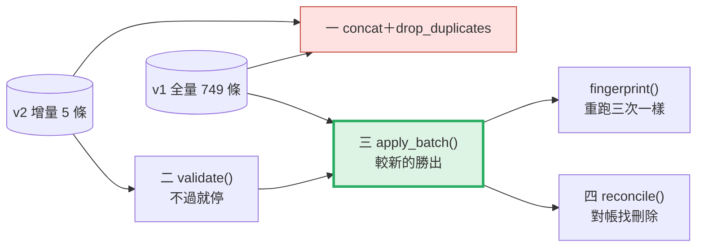
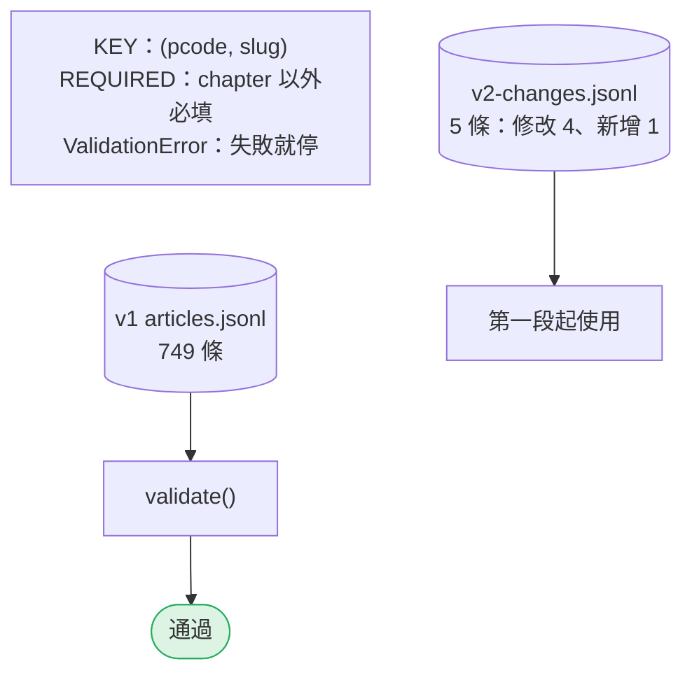
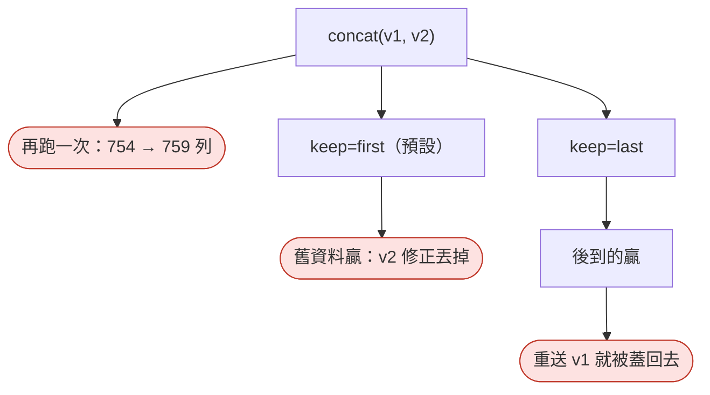
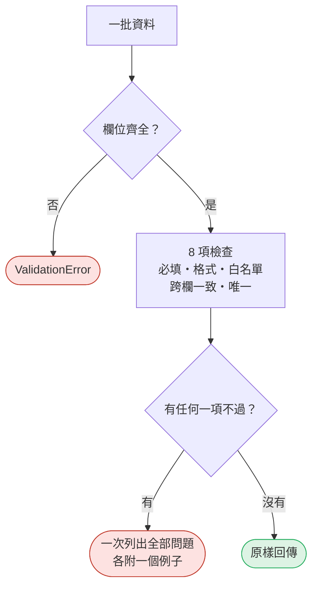
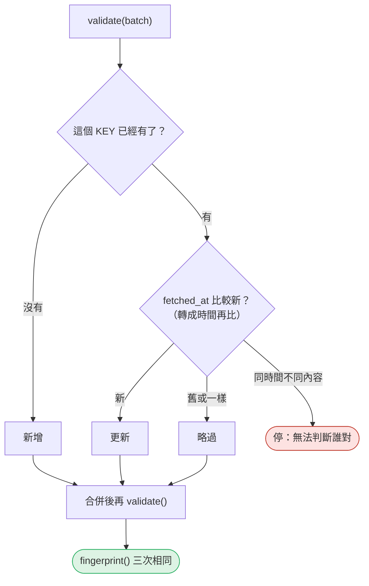
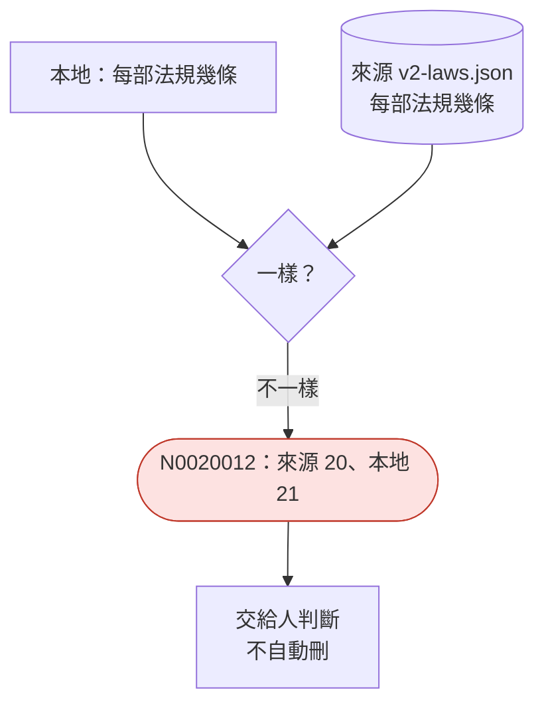

# 09｜資料驗證與冪等：壞資料要被擋下，重跑要一樣

> **2026-10-21 改版：每段一張圖。** 壞資料要被擋下；同一批資料重跑，結果要一樣。

[回 18 節課綱](../../course-plans/2026-10-data-analysis-18.md)

## 範例程式碼

- [demo：09_validate_idempotent.py](https://github.com/4-learn/data-analysis-and-process-demo/blob/master/2026/09_validate_idempotent.py)（與本頁 Demo 逐字相同）
- 練習資料與環境說明：[2026/README](https://github.com/4-learn/data-analysis-and-process-demo/tree/master/2026)

## 學完能做到

| 時間 | 段落 | 學完能做到 |
| --- | --- | --- |
| 0–14 分 | 零、一 | 說明 `concat`＋`drop_duplicates` 為什麼不冪等 |
| 14–22 分 | 二 | 寫一個「不過就停」、一次列出所有問題的驗證 |
| 22–30 分 | 三 | 用指紋證明重跑結果一樣 |
| 30–35 分 | 四 | 用對帳找出增量檔看不到的刪除 |
| 35–50 分 | Workshop | 寫成 pytest，並弄壞它 |

## 本節流程



每段都是：**問題 → 位置（黃色）→ 步驟圖 → 程式 → 輸出 → 重點**。

## 零、準備：規則與兩批資料

**問題：** 這節的資料和規則是什麼？

**在流程中的位置：**


**這段做了什麼：**



<!-- fn-table -->
| 函式名稱 | 說明 | 官方文件連結 |
|---|---|---|
| 前面介紹過 | 用法同前，括號內是在哪裡第一次介紹 | [`Path(__file__).resolve().parent`](https://docs.python.org/3.12/library/pathlib.html#pathlib.Path.resolve)（第 02 節）、[`pd.read_json()`](https://pandas.pydata.org/docs/reference/api/pandas.read_json.html#pandas.read_json)（第 03 節）、[`Path()`](https://docs.python.org/3.12/library/pathlib.html#pathlib.Path)（爬蟲 10）、[`.hexdigest()`](https://docs.python.org/3.12/library/hashlib.html#hashlib.hash.hexdigest)（爬蟲 15）、[`hashlib.sha256()`](https://docs.python.org/3.12/library/hashlib.html#hashlib.sha256)（爬蟲 15）、[`s.encode()`](https://docs.python.org/3.12/library/stdtypes.html#str.encode)（爬蟲 15） |

<!-- 節錄: 09_validate_idempotent.py -->
```python
import hashlib
import json
from pathlib import Path

import pandas as pd

DATA = Path(__file__).resolve().parent / "data"
KEY = ["pcode", "slug"]                      # 業務鍵：一部法規的一條條文
COLUMNS = ["pcode", "law_name", "slug", "article_no", "chapter", "content",
           "source_url", "fetched_at", "content_hash", "source_version"]
REQUIRED = [c for c in COLUMNS if c != "chapter"]   # 沒分章的法規 chapter 就是空的：那是事實，不是缺值
VERSIONS = {"v1", "v2"}


class ValidationError(ValueError):
    """驗證失敗就讓流程停下來；不是印一行 warning 然後繼續。"""


def read_batch(path):
    return pd.read_json(path, lines=True, dtype=False, convert_dates=False)


def sha(text):
    return hashlib.sha256(text.encode("utf-8")).hexdigest()
```

<!-- fn-table -->
| 函式名稱 | 說明 | 官方文件連結 |
|---|---|---|
| （無） | 本段只用到 Python 基礎與前幾門課學過的寫法，沒有新的函式 | — |

<!-- 節錄: 09_validate_idempotent.py -->
```python
v1 = validate(read_batch(DATA / "articles.jsonl"))
v2 = read_batch(DATA / "09-batches" / "v2-changes.jsonl")
print(f"v1 全量 {len(v1)} 條（驗證通過）；v2 增量 {len(v2)} 條，指紋 {fingerprint(v1)}\n")
```

- `chapter` 不是必填：沒分章的法規本來就是空的，那是事實不是缺值。
- 練習站第 2 版還**刪了一條**，但增量檔裡沒有——第四段再談。

## 一、天真的合併

**問題：** `pd.concat([v1, v2]).drop_duplicates(KEY)` 錯在哪？

**在流程中的位置：**


**這段做了什麼：**



<!-- fn-table -->
| 函式名稱 | 說明 | 官方文件連結 |
|---|---|---|
| 前面介紹過 | 用法同前，括號內是在哪裡第一次介紹 | [`.sum()`](https://pandas.pydata.org/docs/reference/api/pandas.Series.sum.html#pandas.Series.sum)（第 02 節）、[`df["欄"]`](https://pandas.pydata.org/docs/user_guide/indexing.html#basics)（第 02 節）、[`df[條件]`](https://pandas.pydata.org/docs/user_guide/indexing.html#boolean-indexing)（第 02 節）、[`pd.concat()`](https://pandas.pydata.org/docs/reference/api/pandas.concat.html#pandas.concat)（第 02 節）、[`.drop_duplicates()`](https://pandas.pydata.org/docs/reference/api/pandas.DataFrame.drop_duplicates.html#pandas.DataFrame.drop_duplicates)（第 08 節） |

<!-- 節錄: 09_validate_idempotent.py -->
```python
print("== 1. 天真的合併：concat ＋ drop_duplicates ==")
once = pd.concat([v1, v2], ignore_index=True)
twice = pd.concat([once, v2], ignore_index=True)
print(f"concat 一次 {len(once)} 列，同一批再跑一次 {len(twice)} 列")
first = once.drop_duplicates(KEY, keep="first")
last = once.drop_duplicates(KEY, keep="last")
replay = pd.concat([last, v1], ignore_index=True).drop_duplicates(KEY, keep="last")
for label, df in [("keep='first'", first), ("keep='last'", last), ("keep='last' 後又重送 v1", replay)]:
    print(f"{label:20} {len(df)} 列；含 v2 修正的條文 {int((df['source_version'] == 'v2').sum())} 條")
```

```text
== 1. 天真的合併：concat ＋ drop_duplicates ==
concat 一次 754 列，同一批再跑一次 759 列
keep='first'         750 列；含 v2 修正的條文 1 條
keep='last'          750 列；含 v2 修正的條文 5 條
keep='last' 後又重送 v1  750 列；含 v2 修正的條文 1 條
```

- 三個問題**都不會報錯**。
- `keep="last"` 是「後到的贏」，不是「新的贏」。

## 二、驗證：不過就停

**問題：** 怎麼在合併之前擋下壞資料？

**在流程中的位置：**


**這段做了什麼：**



<!-- fn-table -->
| 函式名稱 | 說明 | 官方文件連結 |
|---|---|---|
| 前面介紹過 | 用法同前，括號內是在哪裡第一次介紹 | [`.any()`](https://pandas.pydata.org/docs/reference/api/pandas.Series.any.html#pandas.Series.any)（第 02 節）、[`.duplicated()`](https://pandas.pydata.org/docs/reference/api/pandas.DataFrame.duplicated.html#pandas.DataFrame.duplicated)（第 02 節）、[`.iloc[]`](https://pandas.pydata.org/docs/reference/api/pandas.Series.iloc.html#pandas.Series.iloc)（第 02 節）、[`.sum()`](https://pandas.pydata.org/docs/reference/api/pandas.Series.sum.html#pandas.Series.sum)（第 02 節）、[`df.columns`](https://pandas.pydata.org/docs/reference/api/pandas.DataFrame.columns.html#pandas.DataFrame.columns)（第 02 節）、[`df["欄"]`](https://pandas.pydata.org/docs/user_guide/indexing.html#basics)（第 02 節）、[`df[條件]`](https://pandas.pydata.org/docs/user_guide/indexing.html#boolean-indexing)（第 02 節）、[`& \| ~`](https://pandas.pydata.org/docs/user_guide/indexing.html#boolean-operators)（第 03 節）、[`.isna()`](https://pandas.pydata.org/docs/reference/api/pandas.Series.isna.html#pandas.Series.isna)（第 03 節）、[`.loc[]`](https://pandas.pydata.org/docs/reference/api/pandas.DataFrame.loc.html#pandas.DataFrame.loc)（第 03 節）、[`s.map()`](https://pandas.pydata.org/docs/reference/api/pandas.Series.map.html#pandas.Series.map)（第 03 節）、[`s.str.contains()`](https://pandas.pydata.org/docs/reference/api/pandas.Series.str.contains.html#pandas.Series.str.contains)（第 03 節）、[`d.items()`](https://docs.python.org/3.12/library/stdtypes.html#dict.items)（第 05 節）、[`s[標籤]`](https://pandas.pydata.org/docs/user_guide/indexing.html#basics)（第 05 節）、[`.fillna()`](https://pandas.pydata.org/docs/reference/api/pandas.Series.fillna.html#pandas.Series.fillna)（第 06 節）、[`s.str.fullmatch()`](https://pandas.pydata.org/docs/reference/api/pandas.Series.str.fullmatch.html#pandas.Series.str.fullmatch)（第 06 節）、[`整欄運算`](https://pandas.pydata.org/docs/user_guide/basics.html#flexible-binary-operations)（第 06 節）、[`s.isin()`](https://pandas.pydata.org/docs/reference/api/pandas.Series.isin.html#pandas.Series.isin)（第 07 節） |

<!-- 節錄: 09_validate_idempotent.py -->
```python
def validate(df):
    """一次列出所有問題（而不是只報第一個），任何一項不過就拋 ValidationError。"""
    missing = [c for c in COLUMNS if c not in df.columns]
    if missing:
        raise ValidationError(f"缺少欄位 {missing}")
    checks = {
        "必填欄位有空值": df[REQUIRED].isna().any(axis=1) | (df[REQUIRED] == "").any(axis=1),
        "pcode 格式": ~df["pcode"].str.fullmatch(r"N\d{7}", na=False),
        "slug 格式": ~df["slug"].str.fullmatch(r"\d+(?:-\d+)?", na=False),
        "article_no 與 slug 不一致": df["article_no"] != "第 " + df["slug"] + " 條",
        "source_version 不在白名單": ~df["source_version"].isin(VERSIONS),
        "fetched_at 沒有時區": ~df["fetched_at"].str.contains(r"(?:[+-]\d\d:\d\d|Z)$", na=False),
        "content_hash 與內容不符": df["content"].fillna("").map(sha) != df["content_hash"],
        "業務鍵重複": df.duplicated(KEY, keep=False),
    }
    problems = []
    for rule, bad in checks.items():
        if bad.any():
            first = df.loc[bad, KEY].iloc[0]
            problems.append(f"{rule}：{int(bad.sum())} 筆，例如 {first['pcode']}/{first['slug']}")
    if problems:
        raise ValidationError("；".join(problems))
    return df
```

<!-- fn-table -->
| 函式名稱 | 說明 | 官方文件連結 |
|---|---|---|
| 前面介紹過 | 用法同前，括號內是在哪裡第一次介紹 | [`pd.concat()`](https://pandas.pydata.org/docs/reference/api/pandas.concat.html#pandas.concat)（第 02 節）、[`.loc[]`](https://pandas.pydata.org/docs/reference/api/pandas.DataFrame.loc.html#pandas.DataFrame.loc)（第 03 節）、[`df.tail()`](https://pandas.pydata.org/docs/reference/api/pandas.DataFrame.tail.html#pandas.DataFrame.tail)（第 03 節）、[`.copy()`](https://pandas.pydata.org/docs/reference/api/pandas.DataFrame.copy.html#pandas.DataFrame.copy)（第 07 節） |

<!-- 節錄: 09_validate_idempotent.py -->
```python
print("\n== 2. 壞資料要被擋下 ==")
bad = v2.copy()
bad.loc[0, "fetched_at"] = "2026-10-12 12:00:00"         # 少了時區
bad.loc[1, "content"] = bad.loc[1, "content"] + "。"     # 改了內容卻沒重算雜湊
bad = pd.concat([bad, bad.tail(1)], ignore_index=True)   # 同一條送了兩次
try:
    apply_batch(v1, bad)
except ValidationError as exc:
    print("ValidationError:", exc)
```

```text
== 2. 壞資料要被擋下 ==
ValidationError: fetched_at 沒有時區：1 筆，例如 N0030001/24；content_hash 與內容不符：1 筆，例如 N0030001/38；業務鍵重複：2 筆，例如 N0030001/86-1
```

- 失敗就**拋例外**，不是印 warning。
- 一次列出全部、附例子，上游才不用來回好幾輪。

| 檢查 | 擋下什麼 |
| --- | --- |
| 必填非空 | 漏抓、空字串 |
| `pcode`、`slug` 格式 | 型別漂移（`1.0`）、亂碼 |
| `article_no` ＝ `第 {slug} 條` | 兩欄來自不同條文 |
| `source_version` 白名單 | 來路不明的版本 |
| `fetched_at` 帶時區 | 無法比先後的時間 |
| `content_hash` ＝ 內容雜湊 | 改了內容沒重算 |
| `(pcode, slug)` 不重複 | 同一條送兩次 |

## 三、冪等的合併

**問題：** 怎麼讓重送、舊資料晚到，結果都不變？

**在流程中的位置：**


**這段做了什麼：**



<!-- fn-table -->
| 函式名稱 | 說明 | 官方文件連結 |
|---|---|---|
| `pd.Timestamp(值)` | pandas 的「一個時間點」；可以帶時區，可以互相比大小、相減 | [文件](https://pandas.pydata.org/docs/reference/api/pandas.Timestamp.html#pandas.Timestamp) |
| 前面介紹過 | 用法同前，括號內是在哪裡第一次介紹 | [`df["欄"]`](https://pandas.pydata.org/docs/user_guide/indexing.html#basics)（第 02 節）、[`pd.concat()`](https://pandas.pydata.org/docs/reference/api/pandas.concat.html#pandas.concat)（第 02 節）、[`pd.to_datetime()`](https://pandas.pydata.org/docs/reference/api/pandas.to_datetime.html#pandas.to_datetime)（第 02 節）、[`.drop()`](https://pandas.pydata.org/docs/reference/api/pandas.DataFrame.drop.html#pandas.DataFrame.drop)（第 03 節）、[`.loc[]`](https://pandas.pydata.org/docs/reference/api/pandas.DataFrame.loc.html#pandas.DataFrame.loc)（第 03 節）、[`df.to_json()`](https://pandas.pydata.org/docs/reference/api/pandas.DataFrame.to_json.html#pandas.DataFrame.to_json)（第 03 節）、[`.reset_index()`](https://pandas.pydata.org/docs/reference/api/pandas.DataFrame.reset_index.html#pandas.DataFrame.reset_index)（第 04 節）、[`df.itertuples()`](https://pandas.pydata.org/docs/reference/api/pandas.DataFrame.itertuples.html#pandas.DataFrame.itertuples)（第 04 節）、[`df.index`](https://pandas.pydata.org/docs/reference/api/pandas.DataFrame.index.html#pandas.DataFrame.index)（第 05 節）、[`df.set_index()`](https://pandas.pydata.org/docs/reference/api/pandas.DataFrame.set_index.html#pandas.DataFrame.set_index)（第 05 節）、[`s[標籤]`](https://pandas.pydata.org/docs/user_guide/indexing.html#basics)（第 05 節）、[`.sort_values()`](https://pandas.pydata.org/docs/reference/api/pandas.DataFrame.sort_values.html#pandas.DataFrame.sort_values)（第 07 節）、[`.drop_duplicates()`](https://pandas.pydata.org/docs/reference/api/pandas.DataFrame.drop_duplicates.html#pandas.DataFrame.drop_duplicates)（第 08 節） |

<!-- 節錄: 09_validate_idempotent.py -->
```python
def fingerprint(df):
    """整張表的指紋：同樣內容（不論列的順序）得到同樣的值，用來證明重跑結果一致。"""
    text = df.sort_values(KEY)[COLUMNS].to_json(orient="records", lines=True, force_ascii=False)
    return sha(text)[:12]


def apply_batch(current, batch):
    """以業務鍵 upsert：較新的 fetched_at 勝出；較舊或相同的重送不改變任何東西。"""
    validate(batch)
    old = current.set_index(KEY)
    report = {"新增": 0, "更新": 0, "略過（不比現有新）": 0}
    for row in batch.itertuples(index=False):
        key = (row.pcode, row.slug)
        if key not in old.index:
            report["新增"] += 1
            continue
        mine = old.loc[key]
        t_new = pd.Timestamp(row.fetched_at)
        t_old = pd.Timestamp(mine["fetched_at"])
        if t_new == t_old and row.content_hash != mine["content_hash"]:
            raise ValidationError(f"{key[0]}/{key[1]} 同一時間點有兩種內容，無法判斷誰對")
        report["更新" if t_new > t_old else "略過（不比現有新）"] += 1
    combined = pd.concat([current, batch], ignore_index=True)
    combined["_t"] = pd.to_datetime(combined["fetched_at"], utc=True, format="ISO8601")
    result = (combined.sort_values(KEY + ["_t"], kind="stable")
              .drop_duplicates(KEY, keep="last")
              .drop(columns="_t")
              .sort_values(KEY, kind="stable")
              .reset_index(drop=True))
    return validate(result), report
```

<!-- fn-table -->
| 函式名稱 | 說明 | 官方文件連結 |
|---|---|---|
| （無） | 本段只用到 Python 基礎與前幾門課學過的寫法，沒有新的函式 | — |

<!-- 節錄: 09_validate_idempotent.py -->
```python
print("\n== 3. 套用增量，然後重跑 ==")
cur, report = apply_batch(v1, v2)
print(f"第 1 次：{len(cur)} 條，{report}，指紋 {fingerprint(cur)}")
cur2, report = apply_batch(cur, v2)
print(f"第 2 次：{len(cur2)} 條，{report}，指紋 {fingerprint(cur2)}")
cur3, report = apply_batch(cur2, v1)
print(f"重送 v1：{len(cur3)} 條，{report}，指紋 {fingerprint(cur3)}")
```

```text
== 3. 套用增量，然後重跑 ==
第 1 次：750 條，{'新增': 1, '更新': 4, '略過（不比現有新）': 0}，指紋 813624872431
第 2 次：750 條，{'新增': 0, '更新': 0, '略過（不比現有新）': 5}，指紋 813624872431
重送 v1：750 條，{'新增': 0, '更新': 0, '略過（不比現有新）': 749}，指紋 813624872431
```

- **冪等**：做一次和做很多次，結果一樣。
- 證明它：列數一樣不夠，要**指紋**一樣。
- 「略過 749」是訊號：有人重送了舊資料。

## 四、增量看不到的事

**問題：** 三次指紋都一樣，資料就對了嗎？

**在流程中的位置：**


**這段做了什麼：**



<!-- fn-table -->
| 函式名稱 | 說明 | 官方文件連結 |
|---|---|---|
| 前面介紹過 | 用法同前，括號內是在哪裡第一次介紹 | [`df.groupby()`](https://pandas.pydata.org/docs/reference/api/pandas.DataFrame.groupby.html#pandas.DataFrame.groupby)（第 02 節）、[`df["欄"]`](https://pandas.pydata.org/docs/user_guide/indexing.html#basics)（第 02 節）、[`df[條件]`](https://pandas.pydata.org/docs/user_guide/indexing.html#boolean-indexing)（第 02 節）、[`groupby().size()`](https://pandas.pydata.org/docs/reference/api/pandas.api.typing.DataFrameGroupBy.size.html#pandas.api.typing.DataFrameGroupBy.size)（第 02 節）、[`pd.concat()`](https://pandas.pydata.org/docs/reference/api/pandas.concat.html#pandas.concat)（第 02 節）、[`.rename()`](https://pandas.pydata.org/docs/reference/api/pandas.Series.rename.html#pandas.Series.rename)（第 03 節）、[`path.read_text()`](https://docs.python.org/3.12/library/pathlib.html#pathlib.Path.read_text)（第 03 節）、[`pd.Series()`](https://pandas.pydata.org/docs/reference/api/pandas.Series.html#pandas.Series)（第 05 節）、[`.astype()`](https://pandas.pydata.org/docs/reference/api/pandas.Series.astype.html#pandas.Series.astype)（第 06 節）、[`.fillna()`](https://pandas.pydata.org/docs/reference/api/pandas.Series.fillna.html#pandas.Series.fillna)（第 06 節）、[`json.loads()`](https://docs.python.org/3.12/library/json.html#json.loads)（爬蟲 03）、[`Path()`](https://docs.python.org/3.12/library/pathlib.html#pathlib.Path)（爬蟲 10） |

<!-- 節錄: 09_validate_idempotent.py -->
```python
def reconcile(current, summary_path):
    """增量檔裝不下「刪除」：拿來源的條文總數對帳，對不上的列出來交給人判斷。"""
    summary = json.loads(Path(summary_path).read_text(encoding="utf-8"))
    expected = pd.Series({i["code"]: i["articles"] for i in summary["items"]}, name="來源條文數")
    actual = current.groupby("pcode").size().rename("本地條文數")
    table = pd.concat([expected, actual], axis=1).fillna(0).astype(int)
    return table[table["來源條文數"] != table["本地條文數"]]
```

<!-- fn-table -->
| 函式名稱 | 說明 | 官方文件連結 |
|---|---|---|
| 前面介紹過 | 用法同前，括號內是在哪裡第一次介紹 | [`df.to_string()`](https://pandas.pydata.org/docs/reference/api/pandas.DataFrame.to_string.html#pandas.DataFrame.to_string)（第 02 節） |

<!-- 節錄: 09_validate_idempotent.py -->
```python
print("\n== 4. 對帳：增量檔看不到的刪除 ==")
print(reconcile(cur3, DATA / "09-batches" / "v2-laws.json").to_string())
```

```text
== 4. 對帳：增量檔看不到的刪除 ==
          來源條文數  本地條文數
N0020012     20     21
```

- 增量檔只寫有內容的條文，**刪除寫不進去**。
- 對帳只說「哪部少了」，不說「少了哪條」；更不該自動刪。

## Workshop：寫成 pytest，並弄壞它

### 任務與時間

**35–42 分鐘：寫成測試。** 建立 `test_my_batch.py`，用你自己的話寫出至少三個測試：

<!-- fn-table -->
| 函式名稱 | 說明 | 官方文件連結 |
|---|---|---|
| `with pytest.raises(例外, match=):` | 斷言區塊內**一定會**丟出指定的例外（訊息要符合 `match`）；沒丟出測試就失敗 | [文件](https://docs.pytest.org/en/stable/reference/reference.html#pytest.raises) |

```python
# test_my_batch.py — Workshop 起手式，本節測試不涵蓋這段
import pandas as pd
import pytest
from my_pipeline import DATA, ValidationError, apply_batch, fingerprint, read_batch, validate
# 先把本節 Demo 存成 my_pipeline.py


def test_v1_is_valid():
    validate(read_batch(DATA / "articles.jsonl"))


def test_apply_twice_same_fingerprint():
    ...  # 套用 v2 兩次，指紋要相同


def test_missing_timezone_is_rejected():
    ...  # 用 pytest.raises(ValidationError)
```

**42–47 分鐘：弄壞它。** 為下列每一種壞資料寫一個測試，證明 `validate()` 會擋下。**至少一種要擋不下來**——找出 `validate()` 沒有涵蓋的漏洞，並說明它會造成什麼後果：

1. `slug` 寫成 `"1.0"`
2. `source_version` 寫成 `"V2"`
3. `article_no` 寫成 `"第 24 條"`，但 `slug` 是 `"38"`
4. 一條 v2 修改的 `fetched_at` 早於 v1（`2026-01-01T00:00:00+00:00`）
5. `content` 改成 `"（刪除）"`，同時重算 `content_hash`

**47–50 分鐘：抓 AI 的錯。** 請 OpenCode 寫「把每天的增量 JSONL 合併到主表，重跑不能產生重複」。拿它的程式跑：同一批兩次、v2 後再送 v1。指紋一樣嗎？

### 參考判讀

:::spoiler 教師用（點開）
- 1–3 會被擋下：分別違反「slug 格式」、「白名單」、「article_no 與 slug 不一致」。
- **4 不會被擋下，也不該被擋**：它是一筆合法的資料，只是比較舊。`apply_batch()` 會把它「略過」，報告裡看得到。若你的測試寫成 `pytest.raises`，這是測試寫錯，不是程式錯。
- **5 擋不下來**：`（刪除）` 是合法的條文內容——第 1 版就有 9 條本來就是 `（刪除）`。`validate()` 只檢查「格式與一致性」，不判斷「這條是不是剛被刪的」。後果：一條原本有內容的條文，在下游被當成「本來就沒有內容」，LLM 回答時不會引用它，也不會說它被刪了。這是第 08 節「判斷」的範圍，驗證做不到。
- 常見的 AI 版本是 `concat` ＋ `drop_duplicates(keep="last")`：同一批跑兩次指紋相同（它看起來通過了），但 v2 後再送 v1，4 條修改被蓋回去。**只測「同一批跑兩次」的冪等測試，抓不到這個錯**；要再測「舊資料晚到」。
- 若 AI 版本用 `fetched_at` 字串直接比大小：本資料的 `fetched_at` 都是 `+00:00`，字串比較剛好正確。混入 `+08:00` 的資料就會錯。看起來沒問題，可能只是這份資料剛好沒踩到——跟第 03 節一樣。
:::

### 驗收

- 能重現第三段輸出，三次指紋都是 `813624872431`。
- 能解釋為什麼 `keep='first'` 的 750 列是錯的，而且說出被丟掉的是哪 4 條修改。
- `test_my_batch.py` 至少 3 個測試全部通過；故意弄壞的 5 種資料，每種都有測試，且正確判斷哪些該擋、哪些不該擋。
- AI 版本兩種重跑情境都試過，有結論。
- 能說出：冪等通過了，為什麼還是沒發現第 21 條被刪。

## 附錄：完整程式

```bash
python3 09_validate_idempotent.py
```

<!-- fn-table -->
| 函式名稱 | 說明 | 官方文件連結 |
|---|---|---|
| （同上） | 這支程式用到的函式，都已在上面各段的表格介紹過 | — |

<!-- demo: 09_validate_idempotent.py -->
```python
"""第 09 節：壞資料要被擋下，同一批資料重跑要一樣。"""

import hashlib
import json
from pathlib import Path

import pandas as pd

DATA = Path(__file__).resolve().parent / "data"
KEY = ["pcode", "slug"]                      # 業務鍵：一部法規的一條條文
COLUMNS = ["pcode", "law_name", "slug", "article_no", "chapter", "content",
           "source_url", "fetched_at", "content_hash", "source_version"]
REQUIRED = [c for c in COLUMNS if c != "chapter"]   # 沒分章的法規 chapter 就是空的：那是事實，不是缺值
VERSIONS = {"v1", "v2"}


class ValidationError(ValueError):
    """驗證失敗就讓流程停下來；不是印一行 warning 然後繼續。"""


def read_batch(path):
    return pd.read_json(path, lines=True, dtype=False, convert_dates=False)


def sha(text):
    return hashlib.sha256(text.encode("utf-8")).hexdigest()


def validate(df):
    """一次列出所有問題（而不是只報第一個），任何一項不過就拋 ValidationError。"""
    missing = [c for c in COLUMNS if c not in df.columns]
    if missing:
        raise ValidationError(f"缺少欄位 {missing}")
    checks = {
        "必填欄位有空值": df[REQUIRED].isna().any(axis=1) | (df[REQUIRED] == "").any(axis=1),
        "pcode 格式": ~df["pcode"].str.fullmatch(r"N\d{7}", na=False),
        "slug 格式": ~df["slug"].str.fullmatch(r"\d+(?:-\d+)?", na=False),
        "article_no 與 slug 不一致": df["article_no"] != "第 " + df["slug"] + " 條",
        "source_version 不在白名單": ~df["source_version"].isin(VERSIONS),
        "fetched_at 沒有時區": ~df["fetched_at"].str.contains(r"(?:[+-]\d\d:\d\d|Z)$", na=False),
        "content_hash 與內容不符": df["content"].fillna("").map(sha) != df["content_hash"],
        "業務鍵重複": df.duplicated(KEY, keep=False),
    }
    problems = []
    for rule, bad in checks.items():
        if bad.any():
            first = df.loc[bad, KEY].iloc[0]
            problems.append(f"{rule}：{int(bad.sum())} 筆，例如 {first['pcode']}/{first['slug']}")
    if problems:
        raise ValidationError("；".join(problems))
    return df


def fingerprint(df):
    """整張表的指紋：同樣內容（不論列的順序）得到同樣的值，用來證明重跑結果一致。"""
    text = df.sort_values(KEY)[COLUMNS].to_json(orient="records", lines=True, force_ascii=False)
    return sha(text)[:12]


def apply_batch(current, batch):
    """以業務鍵 upsert：較新的 fetched_at 勝出；較舊或相同的重送不改變任何東西。"""
    validate(batch)
    old = current.set_index(KEY)
    report = {"新增": 0, "更新": 0, "略過（不比現有新）": 0}
    for row in batch.itertuples(index=False):
        key = (row.pcode, row.slug)
        if key not in old.index:
            report["新增"] += 1
            continue
        mine = old.loc[key]
        t_new = pd.Timestamp(row.fetched_at)
        t_old = pd.Timestamp(mine["fetched_at"])
        if t_new == t_old and row.content_hash != mine["content_hash"]:
            raise ValidationError(f"{key[0]}/{key[1]} 同一時間點有兩種內容，無法判斷誰對")
        report["更新" if t_new > t_old else "略過（不比現有新）"] += 1
    combined = pd.concat([current, batch], ignore_index=True)
    combined["_t"] = pd.to_datetime(combined["fetched_at"], utc=True, format="ISO8601")
    result = (combined.sort_values(KEY + ["_t"], kind="stable")
              .drop_duplicates(KEY, keep="last")
              .drop(columns="_t")
              .sort_values(KEY, kind="stable")
              .reset_index(drop=True))
    return validate(result), report


def reconcile(current, summary_path):
    """增量檔裝不下「刪除」：拿來源的條文總數對帳，對不上的列出來交給人判斷。"""
    summary = json.loads(Path(summary_path).read_text(encoding="utf-8"))
    expected = pd.Series({i["code"]: i["articles"] for i in summary["items"]}, name="來源條文數")
    actual = current.groupby("pcode").size().rename("本地條文數")
    table = pd.concat([expected, actual], axis=1).fillna(0).astype(int)
    return table[table["來源條文數"] != table["本地條文數"]]


if __name__ == "__main__":
    v1 = validate(read_batch(DATA / "articles.jsonl"))
    v2 = read_batch(DATA / "09-batches" / "v2-changes.jsonl")
    print(f"v1 全量 {len(v1)} 條（驗證通過）；v2 增量 {len(v2)} 條，指紋 {fingerprint(v1)}\n")

    print("== 1. 天真的合併：concat ＋ drop_duplicates ==")
    once = pd.concat([v1, v2], ignore_index=True)
    twice = pd.concat([once, v2], ignore_index=True)
    print(f"concat 一次 {len(once)} 列，同一批再跑一次 {len(twice)} 列")
    first = once.drop_duplicates(KEY, keep="first")
    last = once.drop_duplicates(KEY, keep="last")
    replay = pd.concat([last, v1], ignore_index=True).drop_duplicates(KEY, keep="last")
    for label, df in [("keep='first'", first), ("keep='last'", last), ("keep='last' 後又重送 v1", replay)]:
        print(f"{label:20} {len(df)} 列；含 v2 修正的條文 {int((df['source_version'] == 'v2').sum())} 條")

    print("\n== 2. 壞資料要被擋下 ==")
    bad = v2.copy()
    bad.loc[0, "fetched_at"] = "2026-10-12 12:00:00"         # 少了時區
    bad.loc[1, "content"] = bad.loc[1, "content"] + "。"     # 改了內容卻沒重算雜湊
    bad = pd.concat([bad, bad.tail(1)], ignore_index=True)   # 同一條送了兩次
    try:
        apply_batch(v1, bad)
    except ValidationError as exc:
        print("ValidationError:", exc)

    print("\n== 3. 套用增量，然後重跑 ==")
    cur, report = apply_batch(v1, v2)
    print(f"第 1 次：{len(cur)} 條，{report}，指紋 {fingerprint(cur)}")
    cur2, report = apply_batch(cur, v2)
    print(f"第 2 次：{len(cur2)} 條，{report}，指紋 {fingerprint(cur2)}")
    cur3, report = apply_batch(cur2, v1)
    print(f"重送 v1：{len(cur3)} 條，{report}，指紋 {fingerprint(cur3)}")

    print("\n== 4. 對帳：增量檔看不到的刪除 ==")
    print(reconcile(cur3, DATA / "09-batches" / "v2-laws.json").to_string())
```

## 教師紀錄與下一步

:::spoiler 實測環境、版本差異、資料來源（點開）
**實測**：2026-10-05，Ubuntu 20.04，Python 3.11.8，pandas 3.0.6、numpy 2.4.6。本頁輸出為該環境實際執行貼上（**本機實測**）。另以 Python 3.10.15／pandas 2.3.3 執行，**標準輸出逐字相同**（含三個指紋）。

**資料**：`09-batches/v2-changes.jsonl` 依練習站 `build.py` 的 `V2_MODIFY`／`V2_ADD` 產生，內容與線上 v2 API 逐條比對相同；`09-batches/v2-laws.json` 與線上 `v2/api/laws.json` 位元組相同（皆 2026-10-05 比對）。增量檔的 `fetched_at`（`2026-10-12T04:00:00+00:00`）是**模擬**的第二次交付時間，不是實際抓取時間；`source_url` 指向 v2 條文頁，該頁線上回 200。

**界線**：`apply_batch()` 用 `itertuples` 逐列判斷，是為了產生可讀的報告；全量 749 條重送一次約 0.15 秒（教師實測）。資料量大十倍以上時要改成向量化比對（`merge` 後比較欄位），那是第 14 節的工具。本節不處理「刪除」的自動套用，理由見第五段。本節**尚未實班試教**。

**舊教材**：改寫自 [資料驗證](https://hackmd.io/@yillkid/SJkQFjRNbe)。舊版三項檢查（欄位、型別、值域）全部保留並擴充；差別在舊版**驗證失敗只 `print`**，流程照樣往下走——本節改為拋例外。冪等、跨欄一致性、對帳為新增。
:::

**下一節**：第 10 節〈事件發生時間 vs 資料到達時間〉——本節用 `fetched_at` 判斷新舊；但「事情什麼時候發生」和「資料什麼時候到」是兩回事。下一節回到工地事件：一台攝影機斷線、隔天補傳，以哪個時間彙總，當天的數字就差 20 筆。
