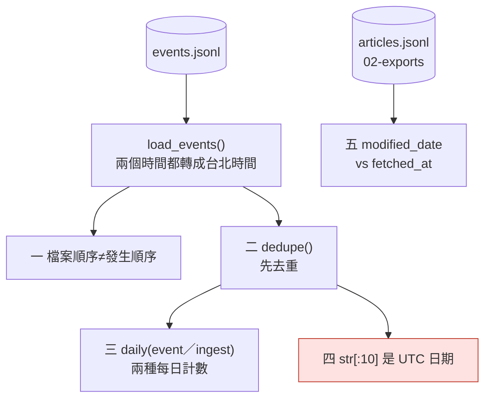
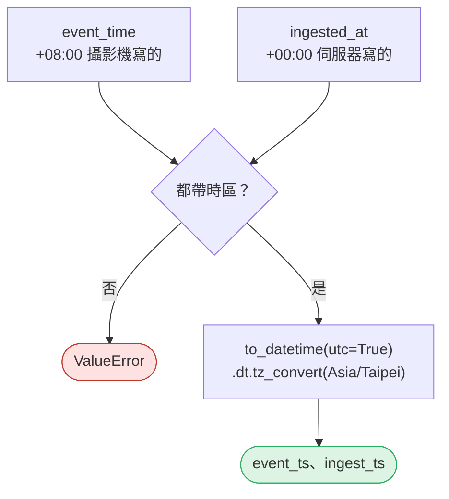
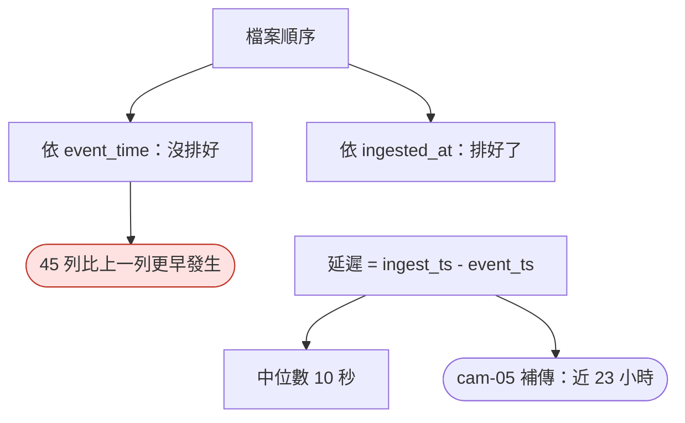
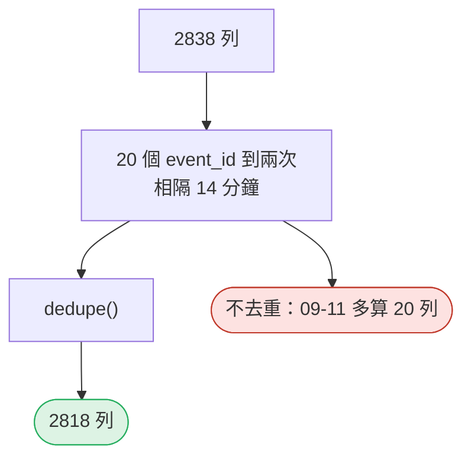
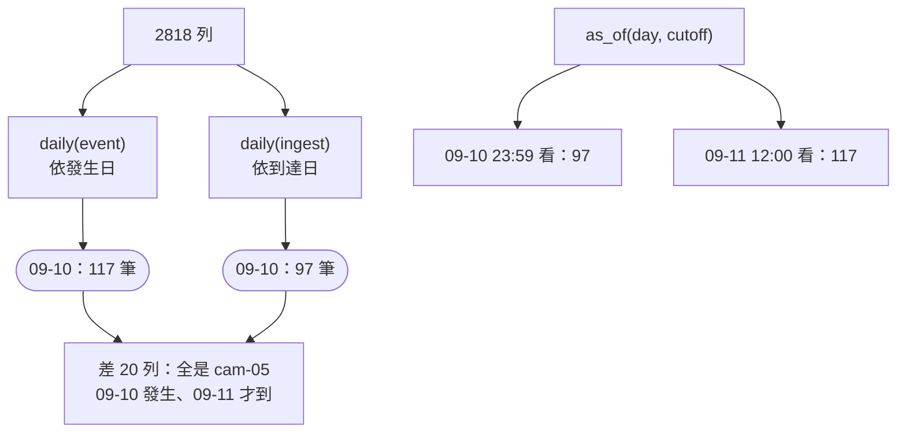
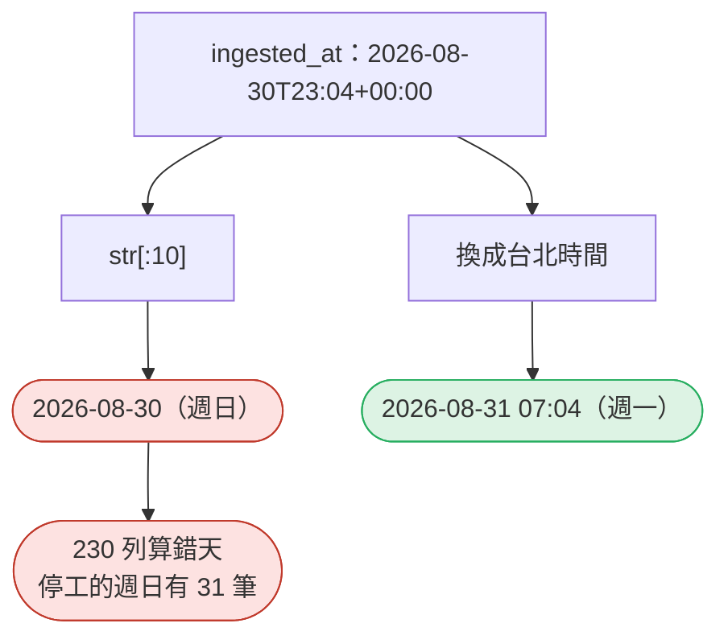
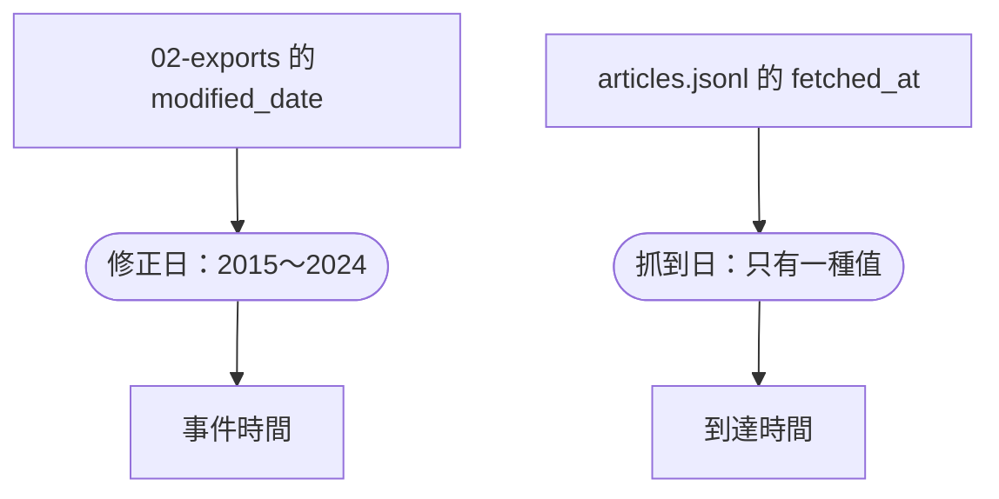

# 10｜事件發生時間 vs 資料到達時間

> **2026-10-21 改版：每段一張圖。** 事件什麼時候發生，和資料什麼時候到，是兩個時間。

[回 18 節課綱](../../course-plans/2026-10-data-analysis-18.md)

## 範例程式碼

- [demo：10_event_vs_ingest.py](https://github.com/4-learn/data-analysis-and-process-demo/blob/master/2026/10_event_vs_ingest.py)（與本頁 Demo 逐字相同）
- 練習資料與環境說明：[2026/README](https://github.com/4-learn/data-analysis-and-process-demo/tree/master/2026)

## 學完能做到

| 時間 | 段落 | 學完能做到 |
| --- | --- | --- |
| 0–12 分 | 一、二 | 說出檔案順序不是發生順序；先去重 |
| 12–24 分 | 三 | 說出兩種每日計數差在哪幾列、各回答什麼問題 |
| 24–30 分 | 四 | 看出 UTC 日期不是台北日期 |
| 30–35 分 | 五 | 分辨法規的 `modified_date` 與 `fetched_at` |
| 35–50 分 | Workshop | 兩種每日計數，差異列清單 |

## 本節流程



每段都是：**問題 → 位置（黃色）→ 步驟圖 → 程式 → 輸出 → 重點**。

## 零、準備：兩個時間都轉成台北時間

**問題：** 一筆事件有哪兩個時間？

**在流程中的位置：**


**這段做了什麼：**



<!-- fn-table -->
| 函式名稱 | 說明 | 官方文件連結 |
|---|---|---|
| `s.dt.tz_convert("Asia/Taipei")` | 已經有時區的時間，換算成另一個時區（同一個時刻，換個寫法） | [文件](https://pandas.pydata.org/docs/reference/api/pandas.Series.dt.tz_convert.html#pandas.Series.dt.tz_convert) |
| 前面介紹過 | 用法同前，括號內是在哪裡第一次介紹 | [`Path(__file__).resolve().parent`](https://docs.python.org/3.12/library/pathlib.html#pathlib.Path.resolve)（第 02 節）、[`df["欄"]`](https://pandas.pydata.org/docs/user_guide/indexing.html#basics)（第 02 節）、[`pd.to_datetime()`](https://pandas.pydata.org/docs/reference/api/pandas.to_datetime.html#pandas.to_datetime)（第 02 節）、[`pd.read_json()`](https://pandas.pydata.org/docs/reference/api/pandas.read_json.html#pandas.read_json)（第 03 節）、[`s.str.contains()`](https://pandas.pydata.org/docs/reference/api/pandas.Series.str.contains.html#pandas.Series.str.contains)（第 03 節）、[`.all()`](https://pandas.pydata.org/docs/reference/api/pandas.Series.all.html#pandas.Series.all)（第 06 節）、[`.sort_values()`](https://pandas.pydata.org/docs/reference/api/pandas.DataFrame.sort_values.html#pandas.DataFrame.sort_values)（第 07 節）、[`.drop_duplicates()`](https://pandas.pydata.org/docs/reference/api/pandas.DataFrame.drop_duplicates.html#pandas.DataFrame.drop_duplicates)（第 08 節）、[`Path()`](https://docs.python.org/3.12/library/pathlib.html#pathlib.Path)（爬蟲 10） |

<!-- 節錄: 10_event_vs_ingest.py -->
```python
from pathlib import Path

import pandas as pd

DATA = Path(__file__).resolve().parent / "data"
EVENTS = DATA / "events" / "events.jsonl"
TPE = "Asia/Taipei"


def load_events(path=EVENTS):
    """讀進來不讓 pandas 猜，再明確轉型：event_time 帶 +08:00，ingested_at 是 UTC。"""
    df = pd.read_json(path, lines=True, dtype=False, convert_dates=False)
    for col in ("event_time", "ingested_at"):
        if not df[col].str.contains(r"(?:[+-]\d\d:\d\d|Z)$").all():
            raise ValueError(f"{col} 有沒帶時區的值，無法換算")
    df["event_ts"] = pd.to_datetime(df["event_time"], utc=True, format="ISO8601").dt.tz_convert(TPE)
    df["ingest_ts"] = pd.to_datetime(df["ingested_at"], utc=True, format="ISO8601").dt.tz_convert(TPE)
    return df


def dedupe(df):
    """補傳送了兩次：依 event_id 去重，保留先到的（第 09 節的冪等）。"""
    return df.sort_values("ingest_ts", kind="stable").drop_duplicates("event_id", keep="first")
```

<!-- fn-table -->
| 函式名稱 | 說明 | 官方文件連結 |
|---|---|---|
| （無） | 本段只用到 Python 基礎與前幾門課學過的寫法，沒有新的函式 | — |

<!-- 節錄: 10_event_vs_ingest.py -->
```python
raw = load_events()
cols = ["event_id", "event_time", "ingested_at"]
```

- `dedupe()` 依 `event_id` 去重、留先到的（第 09 節）。

| 欄位 | 回答 | 誰寫的 |
| --- | --- | --- |
| `event_time` | 什麼時候**發生** | 攝影機（`+08:00`） |
| `ingested_at` | 什麼時候**到** | 伺服器（UTC） |

## 一、檔案順序＝到達順序

**問題：** 檔案第一列是最早發生的事件嗎？

**在流程中的位置：**


**這段做了什麼：**



<!-- fn-table -->
| 函式名稱 | 說明 | 官方文件連結 |
|---|---|---|
| `s.is_monotonic_increasing` | 這一欄是不是由小到大排好（允許相等） | [文件](https://pandas.pydata.org/docs/reference/api/pandas.Series.is_monotonic_increasing.html#pandas.Series.is_monotonic_increasing) |
| `pd.Timedelta("1min")`／`pd.Timedelta(hours=1)` | 一段時間長度；時間相減得到它，也能拿來跟它比大小 | [文件](https://pandas.pydata.org/docs/reference/api/pandas.Timedelta.html#pandas.Timedelta) |
| `s.shift()` | 整欄往下移一格，用來跟「上一列」比較 | [文件](https://pandas.pydata.org/docs/reference/api/pandas.Series.shift.html#pandas.Series.shift) |
| 前面介紹過 | 用法同前，括號內是在哪裡第一次介紹 | [`.duplicated()`](https://pandas.pydata.org/docs/reference/api/pandas.DataFrame.duplicated.html#pandas.DataFrame.duplicated)（第 02 節）、[`.sum()`](https://pandas.pydata.org/docs/reference/api/pandas.Series.sum.html#pandas.Series.sum)（第 02 節）、[`df.to_string()`](https://pandas.pydata.org/docs/reference/api/pandas.DataFrame.to_string.html#pandas.DataFrame.to_string)（第 02 節）、[`df["欄"]`](https://pandas.pydata.org/docs/user_guide/indexing.html#basics)（第 02 節）、[`df[條件]`](https://pandas.pydata.org/docs/user_guide/indexing.html#boolean-indexing)（第 02 節）、[`& \| ~`](https://pandas.pydata.org/docs/user_guide/indexing.html#boolean-operators)（第 03 節）、[`.loc[]`](https://pandas.pydata.org/docs/reference/api/pandas.DataFrame.loc.html#pandas.DataFrame.loc)（第 03 節）、[`.nunique()`](https://pandas.pydata.org/docs/reference/api/pandas.Series.nunique.html#pandas.Series.nunique)（第 05 節）、[`s.unique()`](https://pandas.pydata.org/docs/reference/api/pandas.Series.unique.html#pandas.Series.unique)（第 05 節）、[`s.max()`](https://pandas.pydata.org/docs/reference/api/pandas.Series.max.html#pandas.Series.max)（第 06 節）、[`整欄運算`](https://pandas.pydata.org/docs/user_guide/basics.html#flexible-binary-operations)（第 06 節）、[`s.idxmax()`](https://pandas.pydata.org/docs/reference/api/pandas.Series.idxmax.html#pandas.Series.idxmax)（第 08 節）、[`s.median()`](https://pandas.pydata.org/docs/reference/api/pandas.Series.median.html#pandas.Series.median)（第 08 節） |

<!-- 節錄: 10_event_vs_ingest.py -->
```python
print("== 1. 檔案順序＝到達順序，不是發生順序 ==")
print(f"{len(raw)} 列；依 ingested_at 排好：{raw['ingest_ts'].is_monotonic_increasing}；"
      f"依 event_time 排好：{raw['event_ts'].is_monotonic_increasing}")
delay = raw["ingest_ts"] - raw["event_ts"]
late = delay > pd.Timedelta("1min")
print(f"延遲中位數 {delay.median()}；超過 1 分鐘 {int(late.sum())} 列（{raw.loc[late, 'event_id'].nunique()} 個 event_id，"
      f"每個到了兩次），全是 {sorted(raw.loc[late, 'camera_id'].unique())}")
back = raw["event_ts"] < raw["event_ts"].shift()
print(f"比上一列「更早發生」的列：{int(back.sum())} 列；其中補傳的列 {int((back & late).sum())}、"
      f"其他 {int((back & ~late).sum())}（其他裡 cam-05 {int((back & ~late & (raw['camera_id'] == 'cam-05')).sum())}）")
first = delay[~raw["event_id"].duplicated()]          # 每個 event_id 只看第一次到達（重送見第二段）
i = first.idxmax()
print(f"最長延遲（第一次到達）：{first.max()}，{raw.loc[i, 'event_id']}")
print(raw.loc[i - 2:i + 1, cols].to_string())
```

```text
== 1. 檔案順序＝到達順序，不是發生順序 ==
2838 列；依 ingested_at 排好：True；依 event_time 排好：False
延遲中位數 0 days 00:00:10；超過 1 分鐘 40 列（20 個 event_id，每個到了兩次），全是 ['cam-05']
比上一列「更早發生」的列：45 列；其中補傳的列 20、其他 25（其他裡 cam-05 5）
最長延遲（第一次到達）：0 days 22:54:24，cam-05-20260910-0002
                  event_id                 event_time                ingested_at
1159  cam-05-20260910-0023  2026-09-10T14:23:15+08:00  2026-09-11T01:05:21+00:00
1160  cam-05-20260910-0001  2026-09-10T15:43:10+08:00  2026-09-11T01:05:24+00:00
1161  cam-05-20260910-0002  2026-09-10T10:11:05+08:00  2026-09-11T01:05:29+00:00
1162  cam-05-20260910-0020  2026-09-10T16:47:47+08:00  2026-09-11T01:05:34+00:00
```

- 平常延遲只有 10 秒，兩個時間幾乎一樣——**問題只在少數幾天**。
- 找最長延遲要先排除重送的第二份（只看第一次到達）。

## 二、先去重

**問題：** 補傳送了兩次，先處理什麼？

**在流程中的位置：**


**這段做了什麼：**



<!-- fn-table -->
| 函式名稱 | 說明 | 官方文件連結 |
|---|---|---|
| `.strftime("%Y-%m-%d")` | 時間轉成指定格式的字串 | [文件](https://pandas.pydata.org/docs/reference/api/pandas.Series.dt.strftime.html#pandas.Series.dt.strftime) |
| 前面介紹過 | 用法同前，括號內是在哪裡第一次介紹 | [`df.groupby()`](https://pandas.pydata.org/docs/reference/api/pandas.DataFrame.groupby.html#pandas.DataFrame.groupby)（第 02 節）、[`df["欄"]`](https://pandas.pydata.org/docs/user_guide/indexing.html#basics)（第 02 節）、[`groupby().size()`](https://pandas.pydata.org/docs/reference/api/pandas.api.typing.DataFrameGroupBy.size.html#pandas.api.typing.DataFrameGroupBy.size)（第 02 節） |

<!-- 節錄: 10_event_vs_ingest.py -->
```python
def daily(df, by):
    """by='event'：依事件發生的台北日期；by='ingest'：依資料到達的台北日期。"""
    col = {"event": "event_ts", "ingest": "ingest_ts"}[by]
    return df.groupby(df[col].dt.strftime("%Y-%m-%d")).size()
```

<!-- fn-table -->
| 函式名稱 | 說明 | 官方文件連結 |
|---|---|---|
| `.groupby(...)[欄].agg(函式)` | 每組套用自訂的彙總函式 | [文件](https://pandas.pydata.org/docs/reference/api/pandas.api.typing.SeriesGroupBy.agg.html#pandas.api.typing.SeriesGroupBy.agg) |
| 前面介紹過 | 用法同前，括號內是在哪裡第一次介紹 | [`.duplicated()`](https://pandas.pydata.org/docs/reference/api/pandas.DataFrame.duplicated.html#pandas.DataFrame.duplicated)（第 02 節）、[`df.groupby()`](https://pandas.pydata.org/docs/reference/api/pandas.DataFrame.groupby.html#pandas.DataFrame.groupby)（第 02 節）、[`df["欄"]`](https://pandas.pydata.org/docs/user_guide/indexing.html#basics)（第 02 節）、[`df[條件]`](https://pandas.pydata.org/docs/user_guide/indexing.html#boolean-indexing)（第 02 節）、[`.nunique()`](https://pandas.pydata.org/docs/reference/api/pandas.Series.nunique.html#pandas.Series.nunique)（第 05 節）、[`s[標籤]`](https://pandas.pydata.org/docs/user_guide/indexing.html#basics)（第 05 節）、[`s.max()`](https://pandas.pydata.org/docs/reference/api/pandas.Series.max.html#pandas.Series.max)（第 06 節）、[`s.min()`](https://pandas.pydata.org/docs/reference/api/pandas.Series.min.html#pandas.Series.min)（第 06 節） |

<!-- 節錄: 10_event_vs_ingest.py -->
```python
print("\n== 2. 先去重：補傳送了兩次 ==")
twice = raw[raw["event_id"].duplicated(keep=False)]
gap = twice.groupby("event_id")["ingest_ts"].agg(lambda s: s.max() - s.min())
events = dedupe(raw)
print(f"重複的 event_id {twice['event_id'].nunique()} 個，兩次到達相隔 {sorted(set(gap))}；"
      f"{len(raw)} 列 → {len(events)} 列")
print(f"不去重，09-11 到達的列數：{int(daily(raw, 'ingest')['2026-09-11'])}；去重後：{int(daily(events, 'ingest')['2026-09-11'])}")
```

```text
== 2. 先去重：補傳送了兩次 ==
重複的 event_id 20 個，兩次到達相隔 [Timedelta('0 days 00:14:00')]；2838 列 → 2818 列
不去重，09-11 到達的列數：151；去重後：131
```

- 先依 `event_id` 去重，再談時間。

## 三、以哪個時間彙總

**問題：** 09-10 到底幾筆？

**在流程中的位置：**


**這段做了什麼：**



<!-- fn-table -->
| 函式名稱 | 說明 | 官方文件連結 |
|---|---|---|
| `ts.tzinfo` | 這個時間點的時區；沒有時區是 `None` | [文件](https://pandas.pydata.org/docs/reference/api/pandas.Timestamp.tzinfo.html#pandas.Timestamp.tzinfo) |
| 前面介紹過 | 用法同前，括號內是在哪裡第一次介紹 | [`.sum()`](https://pandas.pydata.org/docs/reference/api/pandas.Series.sum.html#pandas.Series.sum)（第 02 節）、[`df["欄"]`](https://pandas.pydata.org/docs/user_guide/indexing.html#basics)（第 02 節）、[`df[條件]`](https://pandas.pydata.org/docs/user_guide/indexing.html#boolean-indexing)（第 02 節）、[`& \| ~`](https://pandas.pydata.org/docs/user_guide/indexing.html#boolean-operators)（第 03 節）、[`pd.Timestamp()`](https://pandas.pydata.org/docs/reference/api/pandas.Timestamp.html#pandas.Timestamp)（第 09 節）、[`.strftime()`](https://pandas.pydata.org/docs/reference/api/pandas.Series.dt.strftime.html#pandas.Series.dt.strftime)（第 10 節） |

<!-- 節錄: 10_event_vs_ingest.py -->
```python
def as_of(df, day, cutoff):
    """在 cutoff 這個時刻，「day 當天發生的事件」我們知道幾筆？"""
    cutoff = pd.Timestamp(cutoff)
    if cutoff.tzinfo is None:
        raise ValueError("cutoff 要帶時區")
    happened = df["event_ts"].dt.strftime("%Y-%m-%d") == day
    return int((happened & (df["ingest_ts"] <= cutoff)).sum())
```

<!-- fn-table -->
| 函式名稱 | 說明 | 官方文件連結 |
|---|---|---|
| 前面介紹過 | 用法同前，括號內是在哪裡第一次介紹 | [`df.to_string()`](https://pandas.pydata.org/docs/reference/api/pandas.DataFrame.to_string.html#pandas.DataFrame.to_string)（第 02 節）、[`df["欄"]`](https://pandas.pydata.org/docs/user_guide/indexing.html#basics)（第 02 節）、[`df[條件]`](https://pandas.pydata.org/docs/user_guide/indexing.html#boolean-indexing)（第 02 節）、[`s.dt.date`](https://pandas.pydata.org/docs/reference/api/pandas.Series.dt.date.html#pandas.Series.dt.date)（第 02 節）、[`& \| ~`](https://pandas.pydata.org/docs/user_guide/indexing.html#boolean-operators)（第 03 節）、[`.loc[]`](https://pandas.pydata.org/docs/reference/api/pandas.DataFrame.loc.html#pandas.DataFrame.loc)（第 03 節）、[`pd.DataFrame()`](https://pandas.pydata.org/docs/reference/api/pandas.DataFrame.html#pandas.DataFrame)（第 05 節）、[`s.unique()`](https://pandas.pydata.org/docs/reference/api/pandas.Series.unique.html#pandas.Series.unique)（第 05 節）、[`s.max()`](https://pandas.pydata.org/docs/reference/api/pandas.Series.max.html#pandas.Series.max)（第 06 節）、[`s.min()`](https://pandas.pydata.org/docs/reference/api/pandas.Series.min.html#pandas.Series.min)（第 06 節）、[`整欄運算`](https://pandas.pydata.org/docs/user_guide/basics.html#flexible-binary-operations)（第 06 節）、[`s.get()`](https://pandas.pydata.org/docs/reference/api/pandas.Series.get.html#pandas.Series.get)（第 08 節） |

<!-- 節錄: 10_event_vs_ingest.py -->
```python
print("\n== 3. 以哪個時間彙總，09-10 就是幾筆 ==")
table = pd.DataFrame({"依發生日": daily(events, "event"), "依到達日（台北）": daily(events, "ingest")})
table["差"] = table["依到達日（台北）"] - table["依發生日"]
print(table.loc["2026-09-09":"2026-09-12"].to_string())
moved = events[events["event_ts"].dt.date != events["ingest_ts"].dt.date]
print(f"兩種日期不同的列：{len(moved)} 列；攝影機 {sorted(moved['camera_id'].unique())}；"
      f"發生 {moved['event_ts'].min():%m-%d %H:%M}～{moved['event_ts'].max():%H:%M}；"
      f"到達 {moved['ingest_ts'].min():%m-%d %H:%M}～{moved['ingest_ts'].max():%H:%M}")
z3 = events[(events["zone"] == "Z3") & (events["event_type"] != "ppe_ok")]
print(f"開挖區（Z3）09-10 違規：依發生日 {int(daily(z3, 'event').get('2026-09-10', 0))} 筆；"
      f"依到達日 {int(daily(z3, 'ingest').get('2026-09-10', 0))} 筆")
for cutoff in ("2026-09-10T23:59:59+08:00", "2026-09-11T12:00:00+08:00"):
    print(f"在 {cutoff[:16]} 看 09-10 發生的事件：{as_of(events, '2026-09-10', cutoff)} 筆")
```

```text
== 3. 以哪個時間彙總，09-10 就是幾筆 ==
            依發生日  依到達日（台北）   差
2026-09-09   116       116   0
2026-09-10   117        97 -20
2026-09-11   111       131  20
2026-09-12   126       126   0
兩種日期不同的列：20 列；攝影機 ['cam-05']；發生 09-10 10:11～16:47；到達 09-11 09:05～09:05
開挖區（Z3）09-10 違規：依發生日 2 筆；依到達日 0 筆
在 2026-09-10T23:59 看 09-10 發生的事件：97 筆
在 2026-09-11T12:00 看 09-10 發生的事件：117 筆
```

- 依到達日，開挖區 09-10 違規是 0：**「0」是沒收到，不是沒發生**。
- 依發生日，同一個問題在不同時刻問，答案不同 → 報告要寫「截至何時」。

| 問題 | 用哪個時間 |
| --- | --- |
| 09-10 工地發生幾次違規？ | 發生日 |
| 09-11 伺服器處理多少資料？ | 到達日 |

## 四、`ingested_at` 直接取日期是 UTC

**問題：** `ingested_at.str[:10]` 當日期，錯在哪？

**在流程中的位置：**


**這段做了什麼：**



<!-- fn-table -->
| 函式名稱 | 說明 | 官方文件連結 |
|---|---|---|
| `s.dt.hour` | 幾點（0–23） | [文件](https://pandas.pydata.org/docs/reference/api/pandas.Series.dt.hour.html#pandas.Series.dt.hour) |
| `.dayofweek` | 星期幾：週一是 0、週日是 6（同 `weekday`） | [文件](https://pandas.pydata.org/docs/reference/api/pandas.Series.dt.dayofweek.html#pandas.Series.dt.dayofweek) |
| 前面介紹過 | 用法同前，括號內是在哪裡第一次介紹 | [`.iloc[]`](https://pandas.pydata.org/docs/reference/api/pandas.Series.iloc.html#pandas.Series.iloc)（第 02 節）、[`.sum()`](https://pandas.pydata.org/docs/reference/api/pandas.Series.sum.html#pandas.Series.sum)（第 02 節）、[`df.groupby()`](https://pandas.pydata.org/docs/reference/api/pandas.DataFrame.groupby.html#pandas.DataFrame.groupby)（第 02 節）、[`df.to_string()`](https://pandas.pydata.org/docs/reference/api/pandas.DataFrame.to_string.html#pandas.DataFrame.to_string)（第 02 節）、[`df["欄"]`](https://pandas.pydata.org/docs/user_guide/indexing.html#basics)（第 02 節）、[`df[條件]`](https://pandas.pydata.org/docs/user_guide/indexing.html#boolean-indexing)（第 02 節）、[`groupby().size()`](https://pandas.pydata.org/docs/reference/api/pandas.api.typing.DataFrameGroupBy.size.html#pandas.api.typing.DataFrameGroupBy.size)（第 02 節）、[`& \| ~`](https://pandas.pydata.org/docs/user_guide/indexing.html#boolean-operators)（第 03 節）、[`.loc[]`](https://pandas.pydata.org/docs/reference/api/pandas.DataFrame.loc.html#pandas.DataFrame.loc)（第 03 節）、[`.tolist()`](https://pandas.pydata.org/docs/reference/api/pandas.Series.tolist.html)（第 04 節）、[`df.index`](https://pandas.pydata.org/docs/reference/api/pandas.DataFrame.index.html#pandas.DataFrame.index)（第 05 節）、[`s[標籤]`](https://pandas.pydata.org/docs/user_guide/indexing.html#basics)（第 05 節）、[`s.str[a:b]`](https://pandas.pydata.org/docs/user_guide/text.html#indexing-with-str)（第 06 節）、[`s.isin()`](https://pandas.pydata.org/docs/reference/api/pandas.Series.isin.html#pandas.Series.isin)（第 07 節）、[`pd.Timestamp()`](https://pandas.pydata.org/docs/reference/api/pandas.Timestamp.html#pandas.Timestamp)（第 09 節）、[`.strftime()`](https://pandas.pydata.org/docs/reference/api/pandas.Series.dt.strftime.html#pandas.Series.dt.strftime)（第 10 節） |

<!-- 節錄: 10_event_vs_ingest.py -->
```python
print("\n== 4. ingested_at 直接取日期：那是 UTC 的日期 ==")
utc_day = events.groupby(events["ingested_at"].str[:10]).size()
wrong = events[events["ingested_at"].str[:10] != events["event_ts"].dt.strftime("%Y-%m-%d")]
h7 = events["event_ts"].dt.hour == 7
print(f"UTC 日期與發生日不同：{len(wrong)} 列；其中 07:xx 發生的 {int((wrong['event_ts'].dt.hour == 7).sum())} 列"
      f"（07:xx 發生的共 {int(h7.sum())} 列，沒換日的：{events.loc[h7 & ~events.index.isin(wrong.index), 'event_time'].tolist()}）")
sundays = [d for d in utc_day.index if pd.Timestamp(d).dayofweek == 6]
print(f"UTC 日期出現的週日：{sundays}，共 {int(utc_day[sundays].sum())} 筆（週日停工）")
print(raw.iloc[[0]][["event_id", "event_time", "ingested_at"]].to_string(index=False))   # 檔案第一列
```

```text
== 4. ingested_at 直接取日期：那是 UTC 的日期 ==
UTC 日期與發生日不同：230 列；其中 07:xx 發生的 210 列（07:xx 發生的共 211 列，沒換日的：['2026-09-16T07:59:56+08:00']）
UTC 日期出現的週日：['2026-08-30', '2026-09-06', '2026-09-13', '2026-09-20']，共 31 筆（週日停工）
            event_id                event_time               ingested_at
cam-05-20260831-0004 2026-08-31T07:04:37+08:00 2026-08-30T23:04:45+00:00
```

- 台北比 UTC 快 8 小時：早上 7 點的事件，UTC 是前一天 23 點。
- 最好認的破綻：**週日停工，卻有週日的資料**。

## 五、法規：抓到的時間不是修正的時間

**問題：** 法規的 `fetched_at` 能回答「最近一次修正」嗎？

**在流程中的位置：**


**這段做了什麼：**



<!-- fn-table -->
| 函式名稱 | 說明 | 官方文件連結 |
|---|---|---|
| 前面介紹過 | 用法同前，括號內是在哪裡第一次介紹 | [`df["欄"]`](https://pandas.pydata.org/docs/user_guide/indexing.html#basics)（第 02 節）、[`folder.glob()`](https://docs.python.org/3.12/library/pathlib.html#pathlib.Path.glob)（第 02 節）、[`pd.concat()`](https://pandas.pydata.org/docs/reference/api/pandas.concat.html#pandas.concat)（第 02 節）、[`pd.read_csv()`](https://pandas.pydata.org/docs/reference/api/pandas.read_csv.html#pandas.read_csv)（第 02 節）、[`.drop_duplicates()`](https://pandas.pydata.org/docs/reference/api/pandas.DataFrame.drop_duplicates.html#pandas.DataFrame.drop_duplicates)（第 08 節） |

<!-- 節錄: 10_event_vs_ingest.py -->
```python
def read_modified_dates(folder=DATA / "02-exports"):
    rows = []
    for path in sorted(folder.glob("*.csv")):
        for enc in ("utf-8-sig", "cp950"):
            try:
                df = pd.read_csv(path, dtype=str, keep_default_na=False, encoding=enc)
                break
            except UnicodeDecodeError:
                continue
        rows.append(df[["pcode", "law_name", "modified_date"]].drop_duplicates())
    return pd.concat(rows, ignore_index=True)
```

<!-- fn-table -->
| 函式名稱 | 說明 | 官方文件連結 |
|---|---|---|
| `.groupby(...)[欄].max()` | 每組最大值 | [文件](https://pandas.pydata.org/docs/reference/api/pandas.api.typing.SeriesGroupBy.max.html#pandas.api.typing.SeriesGroupBy.max) |
| 前面介紹過 | 用法同前，括號內是在哪裡第一次介紹 | [`df.groupby()`](https://pandas.pydata.org/docs/reference/api/pandas.DataFrame.groupby.html#pandas.DataFrame.groupby)（第 02 節）、[`df.to_string()`](https://pandas.pydata.org/docs/reference/api/pandas.DataFrame.to_string.html#pandas.DataFrame.to_string)（第 02 節）、[`df["欄"]`](https://pandas.pydata.org/docs/user_guide/indexing.html#basics)（第 02 節）、[`pd.to_datetime()`](https://pandas.pydata.org/docs/reference/api/pandas.to_datetime.html#pandas.to_datetime)（第 02 節）、[`s.dt.date`](https://pandas.pydata.org/docs/reference/api/pandas.Series.dt.date.html#pandas.Series.dt.date)（第 02 節）、[`pd.read_json()`](https://pandas.pydata.org/docs/reference/api/pandas.read_json.html#pandas.read_json)（第 03 節）、[`s.map()`](https://pandas.pydata.org/docs/reference/api/pandas.Series.map.html#pandas.Series.map)（第 03 節）、[`.nunique()`](https://pandas.pydata.org/docs/reference/api/pandas.Series.nunique.html#pandas.Series.nunique)（第 05 節） |

<!-- 節錄: 10_event_vs_ingest.py -->
```python
print("\n== 5. 法規：抓到的時間不是修正的時間 ==")
articles = pd.read_json(DATA / "articles.jsonl", lines=True, dtype=False, convert_dates=False)
laws = read_modified_dates()
laws["fetched_at"] = laws["pcode"].map(articles.groupby("pcode")["fetched_at"].max())
laws["modified_date"] = pd.to_datetime(laws["modified_date"], format="%Y%m%d").dt.date
print(laws.to_string(index=False))
print(f"articles.jsonl 的 fetched_at：{articles['fetched_at'].nunique()} 種值；"
      f"modified_date 橫跨 {min(laws['modified_date'])}～{max(laws['modified_date'])}")
```

```text
== 5. 法規：抓到的時間不是修正的時間 ==
   pcode  law_name modified_date                fetched_at
N0020007   勞資爭議處理法    2021-04-28 2026-10-05T04:05:23+00:00
N0030001     勞動基準法    2024-07-31 2026-10-05T04:05:23+00:00
N0020012 大量解僱勞工保護法    2015-07-01 2026-10-05T04:05:23+00:00
articles.jsonl 的 fetched_at：1 種值；modified_date 橫跨 2015-07-01～2024-07-31
```

- `fetched_at` 只能回答「我們手上的版本是什麼時候的」。
- 練習站條文可能經刻意修改，不具法律效力。

## Workshop：兩種每日計數，哪個合理？

### 任務與時間

**35–42 分鐘：兩種每日計數。** 以去重後的 2,818 列，做「每日 × 違規／非違規」的計數兩份：一份依 `event_time` 的台北日期，一份依 `ingested_at` 換成台北時間後的日期。把兩份並排，列出**差異不為 0 的日期**，再列出**造成差異的每一列**（`event_id`、兩個時間、`event_type`）。

**42–46 分鐘：寫一句話判讀。** 主管要「每天的違規次數」，你交哪一份？如果日報每天 23:59 自動產出，09-10 那份會是幾筆？你要在報表上加什麼說明？

**46–50 分鐘：抓 AI 的錯。** 請 OpenCode「用 `events.jsonl` 算每天的事件數」。拿它的程式驗收：

1. 它用的是 `event_time` 還是 `ingested_at`？有沒有說明為什麼？
2. 有沒有依 `event_id` 去重？09-10 是 117 嗎？
3. 若它用 `ingested_at`：日期是 UTC 還是台北？結果裡有沒有週日？

### 參考判讀

:::spoiler 教師用（點開）
- 依兩種日期做每日計數，差異只有 09-10（−20）與 09-11（+20）。造成差異的 20 列全是 cam-05、`event_id` 為 `cam-05-20260910-*`，發生於 09-10 10:11～16:47，台北時間 09-11 09:05 到達；其中 18 筆 `ppe_ok`、2 筆 `restricted_entry`（教師實測）。
- 交依發生日的那一份——問題是「哪天發生了幾次違規」。但要寫明「截至何時」；若 23:59 自動產出，09-10 會是 97 筆而不是 117 筆，差的 20 筆隔天 09:05 才到。若要日報可信，遲到的資料進來時要重算前一天。
- 教師實測一個常見 AI 版本（預設 `pd.read_json(lines=True)`，不去重，`groupby(df["ingested_at"].dt.date)`）：09-10 是 **95**、09-11 是 **154**，表上有 28 天（含 4 個週日）。換成 `event_time.dt.date`、仍不去重，09-10 是 **137**。三個數字都不是 117。
- 用 `ingested_at` 的 UTC 日期，**28 天中有 24 天的計數跟發生日不同**（教師實測，去重後）：差異不只 09-10，而是幾乎每一天都被 07:xx 的事件推到前一天。只檢查「09-10 對不對」的人會漏掉。
- 預設 `read_json` 會自動把 `_at`／`_time` 結尾的欄位（本資料是 `event_time`、`ingested_at`、`handled_at` 三欄）轉成帶時區的日期（第 03 節），`event_time` 保留 `+08:00`、`ingested_at` 是 UTC——所以 AI 版本對 `event_time` 取 `.dt.date` 剛好是對的。**剛好對**，不是寫對；換一個以 UTC 輸出 `event_time` 的廠商就錯了。
:::

### 驗收

- 交出兩種每日計數並排的表，以及造成差異的 20 列清單。
- 能說出 09-10 依發生日、依到達日各是幾筆，各回答什麼問題，主管該看哪一個。
- 能解釋 UTC 日期為什麼會出現週日，並指出第一列（`cam-05-20260831-0004`）在 UTC 是哪一天。
- AI 版本三個問題都有答案。

## 附錄：完整程式

```bash
python3 10_event_vs_ingest.py
```

<!-- fn-table -->
| 函式名稱 | 說明 | 官方文件連結 |
|---|---|---|
| （同上） | 這支程式用到的函式，都已在上面各段的表格介紹過 | — |

<!-- demo: 10_event_vs_ingest.py -->
```python
"""第 10 節：事件什麼時候發生，和資料什麼時候到，是兩個時間。"""

from pathlib import Path

import pandas as pd

DATA = Path(__file__).resolve().parent / "data"
EVENTS = DATA / "events" / "events.jsonl"
TPE = "Asia/Taipei"


def load_events(path=EVENTS):
    """讀進來不讓 pandas 猜，再明確轉型：event_time 帶 +08:00，ingested_at 是 UTC。"""
    df = pd.read_json(path, lines=True, dtype=False, convert_dates=False)
    for col in ("event_time", "ingested_at"):
        if not df[col].str.contains(r"(?:[+-]\d\d:\d\d|Z)$").all():
            raise ValueError(f"{col} 有沒帶時區的值，無法換算")
    df["event_ts"] = pd.to_datetime(df["event_time"], utc=True, format="ISO8601").dt.tz_convert(TPE)
    df["ingest_ts"] = pd.to_datetime(df["ingested_at"], utc=True, format="ISO8601").dt.tz_convert(TPE)
    return df


def dedupe(df):
    """補傳送了兩次：依 event_id 去重，保留先到的（第 09 節的冪等）。"""
    return df.sort_values("ingest_ts", kind="stable").drop_duplicates("event_id", keep="first")


def daily(df, by):
    """by='event'：依事件發生的台北日期；by='ingest'：依資料到達的台北日期。"""
    col = {"event": "event_ts", "ingest": "ingest_ts"}[by]
    return df.groupby(df[col].dt.strftime("%Y-%m-%d")).size()


def as_of(df, day, cutoff):
    """在 cutoff 這個時刻，「day 當天發生的事件」我們知道幾筆？"""
    cutoff = pd.Timestamp(cutoff)
    if cutoff.tzinfo is None:
        raise ValueError("cutoff 要帶時區")
    happened = df["event_ts"].dt.strftime("%Y-%m-%d") == day
    return int((happened & (df["ingest_ts"] <= cutoff)).sum())


def read_modified_dates(folder=DATA / "02-exports"):
    rows = []
    for path in sorted(folder.glob("*.csv")):
        for enc in ("utf-8-sig", "cp950"):
            try:
                df = pd.read_csv(path, dtype=str, keep_default_na=False, encoding=enc)
                break
            except UnicodeDecodeError:
                continue
        rows.append(df[["pcode", "law_name", "modified_date"]].drop_duplicates())
    return pd.concat(rows, ignore_index=True)


if __name__ == "__main__":
    raw = load_events()
    cols = ["event_id", "event_time", "ingested_at"]

    print("== 1. 檔案順序＝到達順序，不是發生順序 ==")
    print(f"{len(raw)} 列；依 ingested_at 排好：{raw['ingest_ts'].is_monotonic_increasing}；"
          f"依 event_time 排好：{raw['event_ts'].is_monotonic_increasing}")
    delay = raw["ingest_ts"] - raw["event_ts"]
    late = delay > pd.Timedelta("1min")
    print(f"延遲中位數 {delay.median()}；超過 1 分鐘 {int(late.sum())} 列（{raw.loc[late, 'event_id'].nunique()} 個 event_id，"
          f"每個到了兩次），全是 {sorted(raw.loc[late, 'camera_id'].unique())}")
    back = raw["event_ts"] < raw["event_ts"].shift()
    print(f"比上一列「更早發生」的列：{int(back.sum())} 列；其中補傳的列 {int((back & late).sum())}、"
          f"其他 {int((back & ~late).sum())}（其他裡 cam-05 {int((back & ~late & (raw['camera_id'] == 'cam-05')).sum())}）")
    first = delay[~raw["event_id"].duplicated()]          # 每個 event_id 只看第一次到達（重送見第二段）
    i = first.idxmax()
    print(f"最長延遲（第一次到達）：{first.max()}，{raw.loc[i, 'event_id']}")
    print(raw.loc[i - 2:i + 1, cols].to_string())

    print("\n== 2. 先去重：補傳送了兩次 ==")
    twice = raw[raw["event_id"].duplicated(keep=False)]
    gap = twice.groupby("event_id")["ingest_ts"].agg(lambda s: s.max() - s.min())
    events = dedupe(raw)
    print(f"重複的 event_id {twice['event_id'].nunique()} 個，兩次到達相隔 {sorted(set(gap))}；"
          f"{len(raw)} 列 → {len(events)} 列")
    print(f"不去重，09-11 到達的列數：{int(daily(raw, 'ingest')['2026-09-11'])}；去重後：{int(daily(events, 'ingest')['2026-09-11'])}")

    print("\n== 3. 以哪個時間彙總，09-10 就是幾筆 ==")
    table = pd.DataFrame({"依發生日": daily(events, "event"), "依到達日（台北）": daily(events, "ingest")})
    table["差"] = table["依到達日（台北）"] - table["依發生日"]
    print(table.loc["2026-09-09":"2026-09-12"].to_string())
    moved = events[events["event_ts"].dt.date != events["ingest_ts"].dt.date]
    print(f"兩種日期不同的列：{len(moved)} 列；攝影機 {sorted(moved['camera_id'].unique())}；"
          f"發生 {moved['event_ts'].min():%m-%d %H:%M}～{moved['event_ts'].max():%H:%M}；"
          f"到達 {moved['ingest_ts'].min():%m-%d %H:%M}～{moved['ingest_ts'].max():%H:%M}")
    z3 = events[(events["zone"] == "Z3") & (events["event_type"] != "ppe_ok")]
    print(f"開挖區（Z3）09-10 違規：依發生日 {int(daily(z3, 'event').get('2026-09-10', 0))} 筆；"
          f"依到達日 {int(daily(z3, 'ingest').get('2026-09-10', 0))} 筆")
    for cutoff in ("2026-09-10T23:59:59+08:00", "2026-09-11T12:00:00+08:00"):
        print(f"在 {cutoff[:16]} 看 09-10 發生的事件：{as_of(events, '2026-09-10', cutoff)} 筆")

    print("\n== 4. ingested_at 直接取日期：那是 UTC 的日期 ==")
    utc_day = events.groupby(events["ingested_at"].str[:10]).size()
    wrong = events[events["ingested_at"].str[:10] != events["event_ts"].dt.strftime("%Y-%m-%d")]
    h7 = events["event_ts"].dt.hour == 7
    print(f"UTC 日期與發生日不同：{len(wrong)} 列；其中 07:xx 發生的 {int((wrong['event_ts'].dt.hour == 7).sum())} 列"
          f"（07:xx 發生的共 {int(h7.sum())} 列，沒換日的：{events.loc[h7 & ~events.index.isin(wrong.index), 'event_time'].tolist()}）")
    sundays = [d for d in utc_day.index if pd.Timestamp(d).dayofweek == 6]
    print(f"UTC 日期出現的週日：{sundays}，共 {int(utc_day[sundays].sum())} 筆（週日停工）")
    print(raw.iloc[[0]][["event_id", "event_time", "ingested_at"]].to_string(index=False))   # 檔案第一列

    print("\n== 5. 法規：抓到的時間不是修正的時間 ==")
    articles = pd.read_json(DATA / "articles.jsonl", lines=True, dtype=False, convert_dates=False)
    laws = read_modified_dates()
    laws["fetched_at"] = laws["pcode"].map(articles.groupby("pcode")["fetched_at"].max())
    laws["modified_date"] = pd.to_datetime(laws["modified_date"], format="%Y%m%d").dt.date
    print(laws.to_string(index=False))
    print(f"articles.jsonl 的 fetched_at：{articles['fetched_at'].nunique()} 種值；"
          f"modified_date 橫跨 {min(laws['modified_date'])}～{max(laws['modified_date'])}")
```

## 教師紀錄與下一步

:::spoiler 實測環境、版本差異、資料來源（點開）
**實測**：2026-10-05，Ubuntu 20.04，Python 3.11.8，pandas 3.0.6、numpy 2.4.6。本頁輸出為該環境實際執行貼上（**本機實測**）。另以 Python 3.10.15／pandas 2.3.3 執行，**標準輸出逐字相同**。〈參考判讀〉的 AI 版本數字為教師另以兩個環境執行片段所得，結果相同（pandas 2.3.3 的日期解析度是 `ns`，不影響計數）。

**資料**：`data/events/` 由 `tools/build_events.py` 產生，**全部為合成資料**；cam-05 斷線與補傳、補傳重送兩次、07:xx 跨日都是刻意埋入（`MANIFEST.json` 的 `planted`）。法規 `modified_date` 取自 `data/02-exports/` 三部法規匯出（第 02 節），`fetched_at` 取自 `data/articles.jsonl`。

**界線**：

- 本節只示範一種遲到（斷線補傳）。真實系統還有時鐘不準（攝影機時間比伺服器快）、時區設定錯誤、批次重跑等；判斷方式相同——找出兩個時間的差，看它集中在哪裡。
- 「遲到資料進來時重算前一天」本節只點出需求，不實作；它需要第 09 節的冪等合併。
- `as_of()` 以 `ingest_ts <= cutoff` 判定「當時知道」；cutoff 恰為 09-11 09:05:00 時是 97 筆（補傳最早一列在 09:05:01 到達），09:06 是 117 筆（教師實測）。
- 本節**尚未實班試教**。

**舊教材**：改寫自 [事件資料的時間觀念](https://hackmd.io/@yillkid/SJG4Da84Zl)。保留核心主張「一列一個時間點、時間要能排序與運算」與「看起來像時間 ≠ 能被計算的時間」（後者移往第 11 節）。**刪除**三種設計（step／day／start-end）的判斷題：學生已在 MariaDB 課設計過資料表，這一題層次太淺。**新增**舊版沒有的 event time vs ingestion time、遲到資料、UTC 日期陷阱，以及與爬蟲 `fetched_at` 的對照。
:::

**下一節**：第 11 節〈to_datetime、時區與期間彙總〉——本節的「換成台北時間的日期」用了 `to_datetime(..., utc=True)` 與 `tz_convert`；下一節正式講這些工具，以及沒有時區的時間、混合時區、`resample` 與週的起點。
