# 12｜彙總：分母是什麼、漏掉了誰

> **2026-10-21 改版：每段一張圖。** 彙總：分母是什麼、漏掉了誰。比例旁邊一定寫分子與分母。

[回 18 節課綱](../../course-plans/2026-10-data-analysis-18.md)

## 範例程式碼

- [demo：12_groupby_denominator.py](https://github.com/4-learn/data-analysis-and-process-demo/blob/master/2026/12_groupby_denominator.py)（與本頁 Demo 逐字相同）
- 練習資料與環境說明：[2026/README](https://github.com/4-learn/data-analysis-and-process-demo/tree/master/2026)

## 學完能做到

| 時間 | 段落 | 學完能做到 |
| --- | --- | --- |
| 0–12 分 | 一、二 | 先去重；說出 `size` 和 `count` 各算什麼 |
| 12–19 分 | 三 | 用 named aggregation 一次產出有名字的彙總 |
| 19–26 分 | 四 | 為一個「違規率」寫出它的分母 |
| 26–35 分 | 五～七 | 找出分組後消失的組與人 |
| 35–50 分 | Workshop | 區域 × 週的違規表＋分母說明 |

## 本節流程

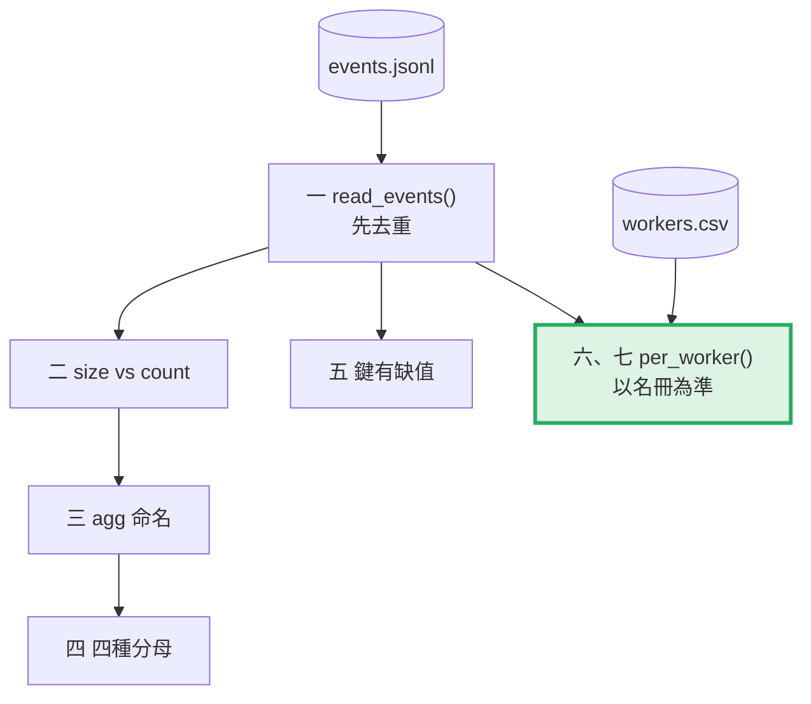

每段都是：**問題 → 位置（黃色）→ 步驟圖 → 程式 → 輸出 → 重點**。

## 零、準備：讀檔與違規類型

**問題：** 要用哪幾份資料？

**在流程中的位置：**

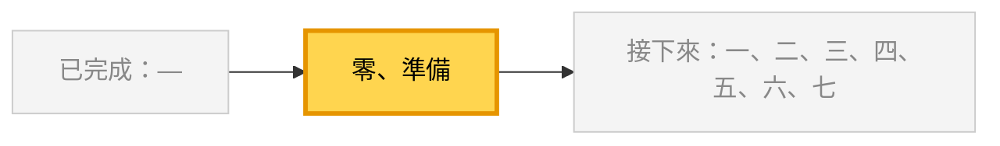

**這段做了什麼：**

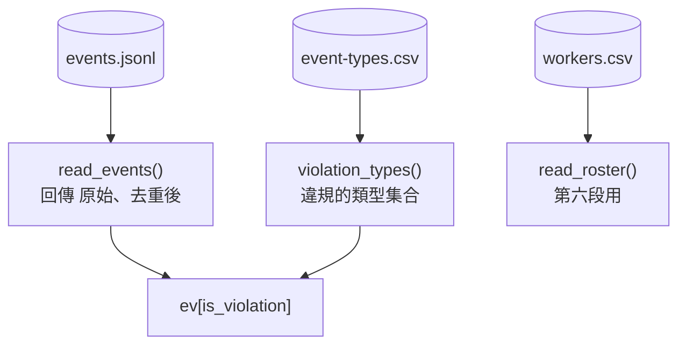

<!-- fn-table -->
| 函式名稱 | 說明 | 官方文件連結 |
|---|---|---|
| 前面介紹過 | 用法同前，括號內是在哪裡第一次介紹 | [`Path(__file__).resolve().parent`](https://docs.python.org/3.12/library/pathlib.html#pathlib.Path.resolve)（第 02 節）、[`df["欄"]`](https://pandas.pydata.org/docs/user_guide/indexing.html#basics)（第 02 節）、[`df[條件]`](https://pandas.pydata.org/docs/user_guide/indexing.html#boolean-indexing)（第 02 節）、[`pd.read_csv()`](https://pandas.pydata.org/docs/reference/api/pandas.read_csv.html#pandas.read_csv)（第 02 節）、[`.loc[]`](https://pandas.pydata.org/docs/reference/api/pandas.DataFrame.loc.html#pandas.DataFrame.loc)（第 03 節）、[`pd.read_json()`](https://pandas.pydata.org/docs/reference/api/pandas.read_json.html#pandas.read_json)（第 03 節）、[`.reset_index()`](https://pandas.pydata.org/docs/reference/api/pandas.DataFrame.reset_index.html#pandas.DataFrame.reset_index)（第 04 節）、[`.drop_duplicates()`](https://pandas.pydata.org/docs/reference/api/pandas.DataFrame.drop_duplicates.html#pandas.DataFrame.drop_duplicates)（第 08 節）、[`Path()`](https://docs.python.org/3.12/library/pathlib.html#pathlib.Path)（爬蟲 10） |

<!-- 節錄: 12_groupby_denominator.py -->
```python
from pathlib import Path

import numpy as np
import pandas as pd

DATA = Path(__file__).resolve().parent / "data"
EVENTS = DATA / "events"


def read_events(path=EVENTS / "events.jsonl"):
    """讀事件、依 event_id 去重（同一批補傳送了兩次，留先到的那份）。"""
    raw = pd.read_json(path, lines=True, dtype=False, convert_dates=False)
    return raw, raw.drop_duplicates("event_id", keep="first").reset_index(drop=True)


def violation_types(path=EVENTS / "event-types.csv"):
    types = pd.read_csv(path, dtype=str, keep_default_na=False)
    return set(types.loc[types["is_violation"] == "true", "event_type"])


def read_roster(path=EVENTS / "workers.csv"):
    return pd.read_csv(path, dtype=str, keep_default_na=False)
```

<!-- fn-table -->
| 函式名稱 | 說明 | 官方文件連結 |
|---|---|---|
| 前面介紹過 | 用法同前，括號內是在哪裡第一次介紹 | [`df["欄"]`](https://pandas.pydata.org/docs/user_guide/indexing.html#basics)（第 02 節）、[`s.isin()`](https://pandas.pydata.org/docs/reference/api/pandas.Series.isin.html#pandas.Series.isin)（第 07 節） |

<!-- 節錄: 12_groupby_denominator.py -->
```python
raw, ev = read_events()
viol = violation_types()
ev["is_violation"] = ev["event_type"].isin(viol)
```

- `read_events()` 同時回傳原始與去重後兩份，第一、四段要比較。

## 一、事件不是行為；先去重

**問題：** 分母從哪一份資料算？

**在流程中的位置：**

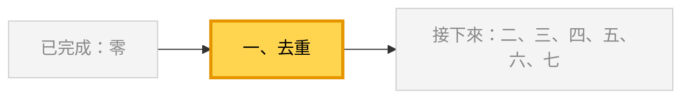

**這段做了什麼：**

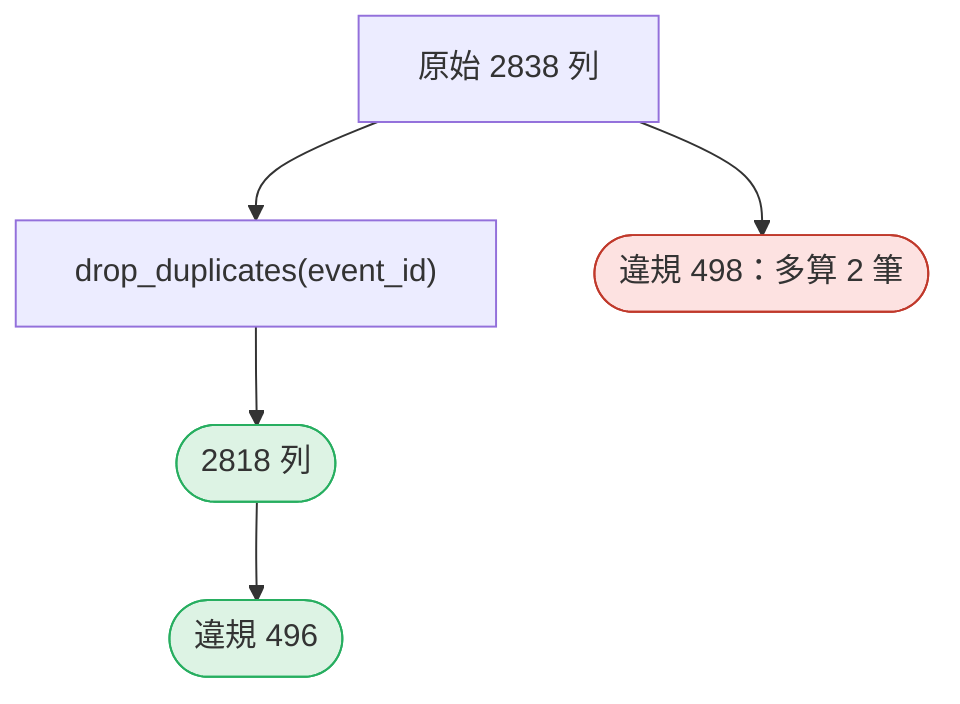

<!-- fn-table -->
| 函式名稱 | 說明 | 官方文件連結 |
|---|---|---|
| 前面介紹過 | 用法同前，括號內是在哪裡第一次介紹 | [`.sum()`](https://pandas.pydata.org/docs/reference/api/pandas.Series.sum.html#pandas.Series.sum)（第 02 節）、[`df["欄"]`](https://pandas.pydata.org/docs/user_guide/indexing.html#basics)（第 02 節）、[`.nunique()`](https://pandas.pydata.org/docs/reference/api/pandas.Series.nunique.html#pandas.Series.nunique)（第 05 節）、[`s.isin()`](https://pandas.pydata.org/docs/reference/api/pandas.Series.isin.html#pandas.Series.isin)（第 07 節） |

<!-- 節錄: 12_groupby_denominator.py -->
```python
print("== 1. 先去重：分母從哪一份資料算 ==")
print(f"原始 {len(raw)} 列，不同 event_id {raw['event_id'].nunique()} 個；去重後 {len(ev)} 列")
print(f"違規事件：去重前 {int(raw['event_type'].isin(viol).sum())} 筆，去重後 {int(ev['is_violation'].sum())} 筆")
```

```text
== 1. 先去重：分母從哪一份資料算 ==
原始 2838 列，不同 event_id 2818 個；去重後 2818 列
違規事件：去重前 498 筆，去重後 496 筆
```

- 差 2 筆看起來很小，但不會報錯，也不會只發生一次。

## 二、`size` 與 `count`

**問題：** `groupby().count()` 是事件數嗎？

**在流程中的位置：**

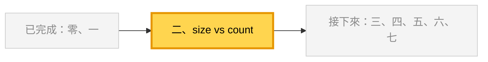

**這段做了什麼：**

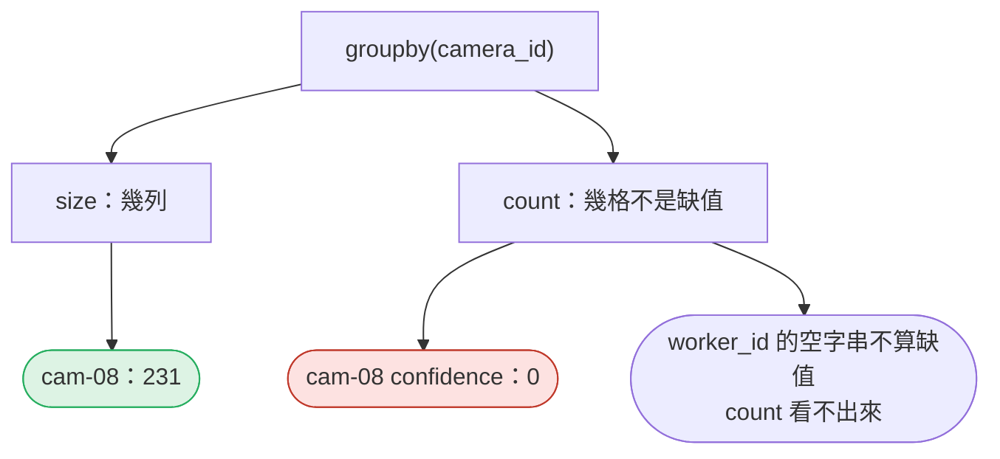

<!-- fn-table -->
| 函式名稱 | 說明 | 官方文件連結 |
|---|---|---|
| `.groupby(...).agg(新欄=("欄", "函式"))` | 一次算多種彙總，並替結果欄命名（named aggregation） | [文件](https://pandas.pydata.org/docs/reference/api/pandas.api.typing.DataFrameGroupBy.agg.html#pandas.api.typing.DataFrameGroupBy.agg) |
| `s.eq(值)` | 跟 `s == 值` 一樣，得到 True／False 一欄；寫成方法可以接著串 `.sum()` | [文件](https://pandas.pydata.org/docs/reference/api/pandas.Series.eq.html#pandas.Series.eq) |
| 前面介紹過 | 用法同前，括號內是在哪裡第一次介紹 | [`.sum()`](https://pandas.pydata.org/docs/reference/api/pandas.Series.sum.html#pandas.Series.sum)（第 02 節）、[`df.groupby()`](https://pandas.pydata.org/docs/reference/api/pandas.DataFrame.groupby.html#pandas.DataFrame.groupby)（第 02 節）、[`df.to_string()`](https://pandas.pydata.org/docs/reference/api/pandas.DataFrame.to_string.html#pandas.DataFrame.to_string)（第 02 節） |

<!-- 節錄: 12_groupby_denominator.py -->
```python
print("\n== 2. size 與 count：「幾列」和「幾格有值」 ==")
by_cam = ev.groupby("camera_id").agg(
    列數_size=("event_id", "size"),
    confidence_count=("confidence", "count"),
    worker_id_count=("worker_id", "count"),
    worker_id空字串=("worker_id", lambda s: int(s.eq("").sum())),
)
print(by_cam.to_string())
```

```text
== 2. size 與 count：「幾列」和「幾格有值」 ==
           列數_size  confidence_count  worker_id_count  worker_id空字串
camera_id                                                          
cam-01         466               466              466            51
cam-02         453               453              453            45
cam-03         311               311              311            48
cam-04         323               323              323            47
cam-05         394               394              394            46
cam-06         386               386              386            43
cam-07         254               254              254            41
cam-08         231                 0              231            43
```

- 事件數用 `size`。`count` 的結果**取決於缺值怎麼表示**。

## 三、`agg` 多重聚合與命名

**問題：** 一次要好幾個數字，怎麼寫？

**在流程中的位置：**


**這段做了什麼：**

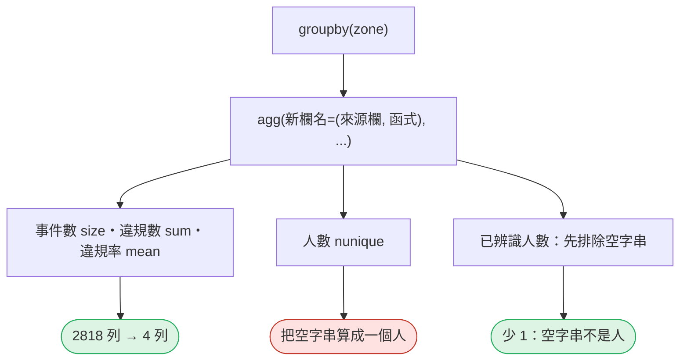

<!-- fn-table -->
| 函式名稱 | 說明 | 官方文件連結 |
|---|---|---|
| 前面介紹過 | 用法同前，括號內是在哪裡第一次介紹 | [`df.groupby()`](https://pandas.pydata.org/docs/reference/api/pandas.DataFrame.groupby.html#pandas.DataFrame.groupby)（第 02 節）、[`df.to_string()`](https://pandas.pydata.org/docs/reference/api/pandas.DataFrame.to_string.html#pandas.DataFrame.to_string)（第 02 節）、[`df[條件]`](https://pandas.pydata.org/docs/user_guide/indexing.html#boolean-indexing)（第 02 節）、[`.nunique()`](https://pandas.pydata.org/docs/reference/api/pandas.Series.nunique.html#pandas.Series.nunique)（第 05 節）、[`.round()`](https://pandas.pydata.org/docs/reference/api/pandas.DataFrame.round.html#pandas.DataFrame.round)（第 06 節）、[`groupby().agg()`](https://pandas.pydata.org/docs/reference/api/pandas.api.typing.DataFrameGroupBy.agg.html#pandas.api.typing.DataFrameGroupBy.agg)（第 12 節） |

<!-- 節錄: 12_groupby_denominator.py -->
```python
print("\n== 3. agg 多重聚合與命名：每區一列 ==")
by_zone = ev.groupby("zone").agg(
    事件數=("event_id", "size"),
    違規數=("is_violation", "sum"),
    違規率=("is_violation", "mean"),
    人數_nunique=("worker_id", "nunique"),
    已辨識人數=("worker_id", lambda s: s[s != ""].nunique()),
).round({"違規率": 3})
print(by_zone.to_string())
```

```text
== 3. agg 多重聚合與命名：每區一列 ==
      事件數  違規數    違規率  人數_nunique  已辨識人數
zone                                    
Z1    919  114  0.124          35     34
Z2    634  152  0.240          34     33
Z3    780  116  0.149          39     38
Z4    485  114  0.235          32     31
```

- 布林欄的 `mean` 就是比例：True 算 1、False 算 0。
- `新欄名=("來源欄", 函式)`：欄名由你決定。

## 四、違規率的分母

**問題：** 「違規率」只有一個答案嗎？

**在流程中的位置：**


**這段做了什麼：**

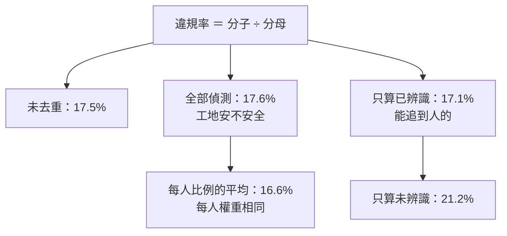

<!-- fn-table -->
| 函式名稱 | 說明 | 官方文件連結 |
|---|---|---|
| 前面介紹過 | 用法同前，括號內是在哪裡第一次介紹 | [`.sum()`](https://pandas.pydata.org/docs/reference/api/pandas.Series.sum.html#pandas.Series.sum)（第 02 節）、[`df.groupby()`](https://pandas.pydata.org/docs/reference/api/pandas.DataFrame.groupby.html#pandas.DataFrame.groupby)（第 02 節）、[`df["欄"]`](https://pandas.pydata.org/docs/user_guide/indexing.html#basics)（第 02 節）、[`df[條件]`](https://pandas.pydata.org/docs/user_guide/indexing.html#boolean-indexing)（第 02 節）、[`.loc[]`](https://pandas.pydata.org/docs/reference/api/pandas.DataFrame.loc.html#pandas.DataFrame.loc)（第 03 節）、[`s.mean()`](https://pandas.pydata.org/docs/reference/api/pandas.Series.mean.html#pandas.Series.mean)（第 06 節）、[`s.isin()`](https://pandas.pydata.org/docs/reference/api/pandas.Series.isin.html#pandas.Series.isin)（第 07 節）、[`groupby()[欄].mean()`](https://pandas.pydata.org/docs/reference/api/pandas.api.typing.SeriesGroupBy.mean.html#pandas.api.typing.SeriesGroupBy.mean)（第 08 節） |

<!-- 節錄: 12_groupby_denominator.py -->
```python
print("\n== 4. 違規率的分母 ==")
known = ev[ev["worker_id"] != ""]
rate_each = known.groupby("worker_id")["is_violation"].mean()
rows = [
    ("未去重：全部列", int(raw["event_type"].isin(viol).sum()), len(raw)),
    ("去重：全部偵測", int(ev["is_violation"].sum()), len(ev)),
    ("去重：只算已辨識", int(known["is_violation"].sum()), len(known)),
    ("去重：只算未辨識", int(ev.loc[ev["worker_id"] == "", "is_violation"].sum()), int((ev["worker_id"] == "").sum())),
]
for label, num, den in rows:
    print(f"{label:10} {num:4} / {den:4} = {num / den:.1%}")
print(f"每人違規率的平均（{len(rate_each)} 人，每人權重相同）= {rate_each.mean():.1%}")
```

```text
== 4. 違規率的分母 ==
未去重：全部列     498 / 2838 = 17.5%
去重：全部偵測     496 / 2818 = 17.6%
去重：只算已辨識    419 / 2454 = 17.1%
去重：只算未辨識     77 /  364 = 21.2%
每人違規率的平均（52 人，每人權重相同）= 16.6%
```

- 不是「哪個對」，是**哪個回答了你被問的問題**。
- 寫報告：比例旁寫分子／分母，例如「419／2454，已辨識」。

## 五、分組鍵有缺值：誰消失了

**問題：** `worker_id` 是 NaN 的列，`groupby` 之後在哪？

**在流程中的位置：**


**這段做了什麼：**

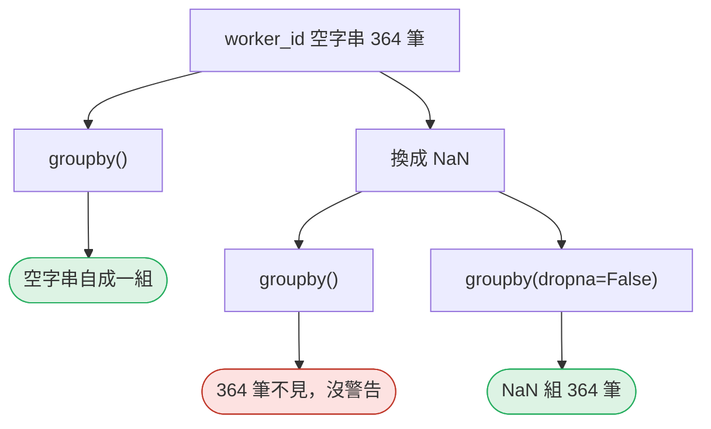

<!-- fn-table -->
| 函式名稱 | 說明 | 官方文件連結 |
|---|---|---|
| 前面介紹過 | 用法同前，括號內是在哪裡第一次介紹 | [`.iloc[]`](https://pandas.pydata.org/docs/reference/api/pandas.Series.iloc.html#pandas.Series.iloc)（第 02 節）、[`.sum()`](https://pandas.pydata.org/docs/reference/api/pandas.Series.sum.html#pandas.Series.sum)（第 02 節）、[`df.groupby()`](https://pandas.pydata.org/docs/reference/api/pandas.DataFrame.groupby.html#pandas.DataFrame.groupby)（第 02 節）、[`df["欄"]`](https://pandas.pydata.org/docs/user_guide/indexing.html#basics)（第 02 節）、[`groupby().size()`](https://pandas.pydata.org/docs/reference/api/pandas.api.typing.DataFrameGroupBy.size.html#pandas.api.typing.DataFrameGroupBy.size)（第 02 節）、[`.isna()`](https://pandas.pydata.org/docs/reference/api/pandas.Series.isna.html#pandas.Series.isna)（第 03 節）、[`.loc[]`](https://pandas.pydata.org/docs/reference/api/pandas.DataFrame.loc.html#pandas.DataFrame.loc)（第 03 節）、[`df.index`](https://pandas.pydata.org/docs/reference/api/pandas.DataFrame.index.html#pandas.DataFrame.index)（第 05 節）、[`s[標籤]`](https://pandas.pydata.org/docs/user_guide/indexing.html#basics)（第 05 節）、[`df.assign()`](https://pandas.pydata.org/docs/reference/api/pandas.DataFrame.assign.html#pandas.DataFrame.assign)（第 06 節）、[`.replace()`](https://pandas.pydata.org/docs/reference/api/pandas.Series.replace.html#pandas.Series.replace)（第 08 節）、[`np.nan`](https://numpy.org/doc/stable/reference/constants.html#numpy.nan)（第 08 節）、[`s.eq()`](https://pandas.pydata.org/docs/reference/api/pandas.Series.eq.html#pandas.Series.eq)（第 12 節） |

<!-- 節錄: 12_groupby_denominator.py -->
```python
print("\n== 5. 分組鍵有缺值：誰消失了 ==")
print(f"本資料 worker_id：空字串 {int(ev['worker_id'].eq('').sum())} 筆，NaN {int(ev['worker_id'].isna().sum())} 筆")
g = ev.groupby("worker_id").size()
print(f"groupby('worker_id')：{len(g)} 組，合計 {g.sum()}；空字串自成一組 {g.loc['']} 筆")
as_nan = ev.assign(worker_id=ev["worker_id"].replace("", np.nan))
g = as_nan.groupby("worker_id").size()
print(f"空字串轉成 NaN 後：{len(g)} 組，合計 {g.sum()}——{len(ev) - g.sum()} 筆不見了，沒有警告")
g = as_nan.groupby("worker_id", dropna=False).size()
print(f"加上 dropna=False：{len(g)} 組，合計 {g.sum()}；NaN 組 {g[g.index.isna()].iloc[0]} 筆")
```

```text
== 5. 分組鍵有缺值：誰消失了 ==
本資料 worker_id：空字串 364 筆，NaN 0 筆
groupby('worker_id')：53 組，合計 2818；空字串自成一組 364 筆
空字串轉成 NaN 後：52 組，合計 2454——364 筆不見了，沒有警告
加上 dropna=False：53 組，合計 2818；NaN 組 364 筆
```

- `groupby` 預設 `dropna=True`：鍵是缺值的列**整組丟掉**。

## 六、沒有事件的人：用名冊補回

**問題：** 沒有事件的人，在表上嗎？

**在流程中的位置：**


**這段做了什麼：**

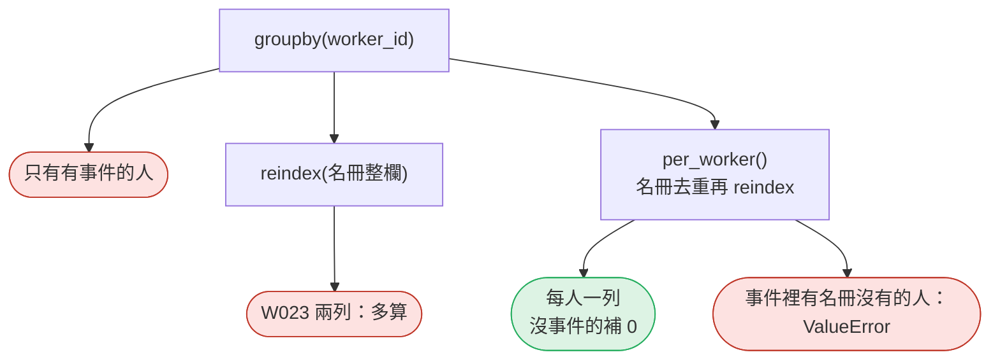

<!-- fn-table -->
| 函式名稱 | 說明 | 官方文件連結 |
|---|---|---|
| `pd.Index(值, name=)` | 建立一組標籤（列或欄的名字）；常拿來當 `reindex` 的目標 | [文件](https://pandas.pydata.org/docs/reference/api/pandas.Index.html#pandas.Index) |
| 前面介紹過 | 用法同前，括號內是在哪裡第一次介紹 | [`.any()`](https://pandas.pydata.org/docs/reference/api/pandas.Series.any.html#pandas.Series.any)（第 02 節）、[`df.groupby()`](https://pandas.pydata.org/docs/reference/api/pandas.DataFrame.groupby.html#pandas.DataFrame.groupby)（第 02 節）、[`df["欄"]`](https://pandas.pydata.org/docs/user_guide/indexing.html#basics)（第 02 節）、[`df[條件]`](https://pandas.pydata.org/docs/user_guide/indexing.html#boolean-indexing)（第 02 節）、[`.round()`](https://pandas.pydata.org/docs/reference/api/pandas.DataFrame.round.html#pandas.DataFrame.round)（第 06 節）、[`df.assign()`](https://pandas.pydata.org/docs/reference/api/pandas.DataFrame.assign.html#pandas.DataFrame.assign)（第 06 節）、[`整欄運算`](https://pandas.pydata.org/docs/user_guide/basics.html#flexible-binary-operations)（第 06 節）、[`s.isin()`](https://pandas.pydata.org/docs/reference/api/pandas.Series.isin.html#pandas.Series.isin)（第 07 節）、[`.drop_duplicates()`](https://pandas.pydata.org/docs/reference/api/pandas.DataFrame.drop_duplicates.html#pandas.DataFrame.drop_duplicates)（第 08 節）、[`.replace()`](https://pandas.pydata.org/docs/reference/api/pandas.Series.replace.html#pandas.Series.replace)（第 08 節）、[`np.nan`](https://numpy.org/doc/stable/reference/constants.html#numpy.nan)（第 08 節）、[`.reindex()`](https://pandas.pydata.org/docs/reference/api/pandas.DataFrame.reindex.html#pandas.DataFrame.reindex)（第 11 節）、[`groupby().agg()`](https://pandas.pydata.org/docs/reference/api/pandas.api.typing.DataFrameGroupBy.agg.html#pandas.api.typing.DataFrameGroupBy.agg)（第 12 節）、[`s.eq()`](https://pandas.pydata.org/docs/reference/api/pandas.Series.eq.html#pandas.Series.eq)（第 12 節） |

<!-- 節錄: 12_groupby_denominator.py -->
```python
def per_worker(events, roster, violations):
    """每人一列：以名冊為準（沒有事件的人也要在），未辨識的事件不屬於任何人。"""
    ids = roster["worker_id"].drop_duplicates()
    if ids.eq("").any():
        raise ValueError("名冊有空的 worker_id")
    known = events[events["worker_id"] != ""].assign(
        is_violation=lambda d: d["event_type"].isin(violations))
    stranger = sorted(set(known["worker_id"]) - set(ids))
    if stranger:
        raise ValueError(f"事件中有名冊沒有的人：{stranger[:5]}")
    table = (known.groupby("worker_id")
             .agg(events=("event_id", "size"), violations=("is_violation", "sum"))
             .reindex(pd.Index(ids, name="worker_id"), fill_value=0))
    table["violation_rate"] = (table["violations"] / table["events"].replace(0, np.nan)).round(3)
    return table
```

<!-- fn-table -->
| 函式名稱 | 說明 | 官方文件連結 |
|---|---|---|
| 前面介紹過 | 用法同前，括號內是在哪裡第一次介紹 | [`.sum()`](https://pandas.pydata.org/docs/reference/api/pandas.Series.sum.html#pandas.Series.sum)（第 02 節）、[`df.groupby()`](https://pandas.pydata.org/docs/reference/api/pandas.DataFrame.groupby.html#pandas.DataFrame.groupby)（第 02 節）、[`df["欄"]`](https://pandas.pydata.org/docs/user_guide/indexing.html#basics)（第 02 節）、[`df[條件]`](https://pandas.pydata.org/docs/user_guide/indexing.html#boolean-indexing)（第 02 節）、[`groupby().size()`](https://pandas.pydata.org/docs/reference/api/pandas.api.typing.DataFrameGroupBy.size.html#pandas.api.typing.DataFrameGroupBy.size)（第 02 節）、[`.tolist()`](https://pandas.pydata.org/docs/reference/api/pandas.Series.tolist.html)（第 04 節）、[`.nunique()`](https://pandas.pydata.org/docs/reference/api/pandas.Series.nunique.html#pandas.Series.nunique)（第 05 節）、[`df.index`](https://pandas.pydata.org/docs/reference/api/pandas.DataFrame.index.html#pandas.DataFrame.index)（第 05 節）、[`.reindex()`](https://pandas.pydata.org/docs/reference/api/pandas.DataFrame.reindex.html#pandas.DataFrame.reindex)（第 11 節） |

<!-- 節錄: 12_groupby_denominator.py -->
```python
print("\n== 6. 沒有事件的人：用名冊補回 ==")
roster = read_roster()
counts = known.groupby("worker_id").size()
print(f"groupby 結果 {len(counts)} 人；名冊 {len(roster)} 列、不同 worker_id {roster['worker_id'].nunique()} 個")
dup = counts.reindex(roster["worker_id"], fill_value=0)
print(f"reindex(名冊整欄)：{len(dup)} 列，W023 出現 {int((dup.index == 'W023').sum())} 次，事件合計 {dup.sum()}（多算 {dup.sum() - len(known)}）")
table = per_worker(ev, roster, viol)
zero = table.index[table["events"] == 0].tolist()
print(f"reindex(不重複 worker_id)：{len(table)} 列，事件合計 {table['events'].sum()}；事件 0 的 {len(zero)} 人：{zero[0]}…{zero[-1]}")
```

```text
== 6. 沒有事件的人：用名冊補回 ==
groupby 結果 52 人；名冊 61 列、不同 worker_id 60 個
reindex(名冊整欄)：61 列，W023 出現 2 次，事件合計 2506（多算 52）
reindex(不重複 worker_id)：60 列，事件合計 2454；事件 0 的 8 人：W053…W060
```

- 「每人」的分母是**名冊**，不是事件裡出現過的人。
- `violation_rate`：事件 0 的人是 NaN，不是 0（沒被拍到 ≠ 沒違規）。

## 七、每人彙總表

**問題：** 最後交出的表長什麼樣？

**在流程中的位置：**


**這段做了什麼：**

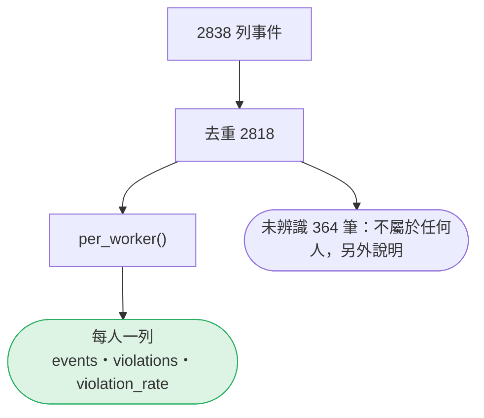

<!-- fn-table -->
| 函式名稱 | 說明 | 官方文件連結 |
|---|---|---|
| 前面介紹過 | 用法同前，括號內是在哪裡第一次介紹 | [`df.head()`](https://pandas.pydata.org/docs/reference/api/pandas.DataFrame.head.html#pandas.DataFrame.head)（第 02 節）、[`df.to_string()`](https://pandas.pydata.org/docs/reference/api/pandas.DataFrame.to_string.html#pandas.DataFrame.to_string)（第 02 節）、[`df.tail()`](https://pandas.pydata.org/docs/reference/api/pandas.DataFrame.tail.html#pandas.DataFrame.tail)（第 03 節）、[`.sort_values()`](https://pandas.pydata.org/docs/reference/api/pandas.DataFrame.sort_values.html#pandas.DataFrame.sort_values)（第 07 節） |

<!-- 節錄: 12_groupby_denominator.py -->
```python
print(f"\n== 7. 每人彙總表：{len(table)} 列，分母寫在表上 ==")
print(f"原始 {len(raw)} 列 → 每人 {len(table)} 列；另有未辨識 {len(ev) - len(known)} 筆事件不屬於任何人")
print(table.sort_values("violations", ascending=False, kind="stable").head(5).to_string())
print("…")
print(table.tail(3).to_string())
```

```text
== 7. 每人彙總表：60 列，分母寫在表上 ==
原始 2838 列 → 每人 60 列；另有未辨識 364 筆事件不屬於任何人
           events  violations  violation_rate
worker_id                                    
W041           67          36           0.537
W029           51          33           0.647
W044           47          27           0.574
W018           42          23           0.548
W007           52          16           0.308
…
           events  violations  violation_rate
worker_id                                    
W058            0           0             NaN
W059            0           0             NaN
W060            0           0             NaN
```

- 表上寫明：未辨識的事件不在任何人名下。

## Workshop：區域 × 週的違規表

### 任務與時間

**35–42 分鐘：做表。** 用去重後的事件，產出「區域 × 週」的彙總表：事件數、違規數、違規率。週的切法：台灣時間、週一到週日（第 11 節）。

<!-- fn-table -->
| 函式名稱 | 說明 | 官方文件連結 |
|---|---|---|
| `s.dt.to_period("W-SUN")` | 時間轉成「所在的期間」，例如所在的那一週 | [文件](https://pandas.pydata.org/docs/reference/api/pandas.Series.dt.to_period.html#pandas.Series.dt.to_period) |
| 前面介紹過 | 用法同前，括號內是在哪裡第一次介紹 | [`df.groupby()`](https://pandas.pydata.org/docs/reference/api/pandas.DataFrame.groupby.html#pandas.DataFrame.groupby)（第 02 節）、[`df["欄"]`](https://pandas.pydata.org/docs/user_guide/indexing.html#basics)（第 02 節）、[`pd.to_datetime()`](https://pandas.pydata.org/docs/reference/api/pandas.to_datetime.html#pandas.to_datetime)（第 02 節）、[`.astype()`](https://pandas.pydata.org/docs/reference/api/pandas.Series.astype.html#pandas.Series.astype)（第 06 節）、[`s.isin()`](https://pandas.pydata.org/docs/reference/api/pandas.Series.isin.html#pandas.Series.isin)（第 07 節）、[`s.dt.tz_convert()`](https://pandas.pydata.org/docs/reference/api/pandas.Series.dt.tz_convert.html#pandas.Series.dt.tz_convert)（第 10 節）、[`s.dt.tz_localize()`](https://pandas.pydata.org/docs/reference/api/pandas.Series.dt.tz_localize.html#pandas.Series.dt.tz_localize)（第 11 節）、[`groupby().agg()`](https://pandas.pydata.org/docs/reference/api/pandas.api.typing.DataFrameGroupBy.agg.html#pandas.api.typing.DataFrameGroupBy.agg)（第 12 節） |

```python
# Workshop 起手式，本節測試不涵蓋這段
raw, ev = read_events()
ev["is_violation"] = ev["event_type"].isin(violation_types())
t = pd.to_datetime(ev["event_time"], format="ISO8601").dt.tz_convert("Asia/Taipei")
ev["week"] = t.dt.tz_localize(None).dt.to_period("W-SUN").astype(str)
table = ev.groupby(["zone", "week"]).agg(...)   # 你來寫
```

然後回答：**表有幾列？違規率的分母是什麼？** 把答案寫在表的下面，一句話。

**42–46 分鐘：加總核對。** 你的表的 `events` 加總起來應該是多少？寫一行 `assert` 證明它。

**46–50 分鐘：抓 AI 的錯。** 請 OpenCode 寫「讀 events.jsonl，算每個工人的違規次數與違規率，列出前三名」。拿它的程式檢查四件事：有沒有去重？`count` 用在哪一欄？「違規」是怎麼判定的？結果裡有沒有一個叫 `""` 的人、有沒有 W053？

### 參考判讀

:::spoiler 教師用（點開）
- 表有 **16 列**（4 區 × 4 週），`events` 加總 **2818**。違規率的分母是「該區該週的全部偵測（含認不出人的）」。教師實測最高的一格是 **Z4 第 4 週（09-21～09-27）0.323**（42／130）——W041 在 09-22 的那串連續事件就在這裡。
- 若你的 `events` 加總是 2838，你忘了去重；若是 2454，你在某一步把認不出人的事件丟了（例如先轉 `NaN` 再分組）。**加總核對**是這兩種錯唯一的警報。
- 常見的 AI 版本（教師實測，一行 `read_json` ＋ `event_type != "ppe_ok"` ＋ `count`）得到 **53 組、合計 2838**：沒有去重，而且**第一名是 `""`**（總數 367、違規 77）——它把「認不出臉」當成一位違規最多的工人。W053–W060 不在結果裡。排第二的 W041（67／36）數字碰巧沒錯，因為重送的 20 筆裡沒有他的事件；**數字對了不代表方法對**。
- 「違規」若寫成 `event_type != "ppe_ok"`，本資料剛好跟 `event-types.csv` 的 `is_violation` 一致（4 種類型）；上游哪天新增一種非違規類型（例如 `vest_ok`），它就會被算成違規。違規的定義應該來自對照表，不是寫死在程式裡。
:::

### 驗收

- 區域 × 週表 16 列，附一句分母說明，`assert table["events"].sum() == 2818` 通過。
- 能說出 `size` 與 `count` 在 cam-08 的差別，以及為什麼 `worker_id` 的 `count` 沒有少。
- 能說出四個違規率各自的分子與分母，並指出「只算已辨識」為什麼比較低。
- AI 版本的四件事都檢查過，至少指出兩個錯。
- 每人彙總表 60 列、W053–W060 在表上、W023 只出現一次。

## 附錄：完整程式

```bash
python3 12_groupby_denominator.py
```

<!-- fn-table -->
| 函式名稱 | 說明 | 官方文件連結 |
|---|---|---|
| （同上） | 這支程式用到的函式，都已在上面各段的表格介紹過 | — |

<!-- demo: 12_groupby_denominator.py -->
```python
"""第 12 節：彙總——分母是什麼、漏掉了誰。"""

from pathlib import Path

import numpy as np
import pandas as pd

DATA = Path(__file__).resolve().parent / "data"
EVENTS = DATA / "events"


def read_events(path=EVENTS / "events.jsonl"):
    """讀事件、依 event_id 去重（同一批補傳送了兩次，留先到的那份）。"""
    raw = pd.read_json(path, lines=True, dtype=False, convert_dates=False)
    return raw, raw.drop_duplicates("event_id", keep="first").reset_index(drop=True)


def violation_types(path=EVENTS / "event-types.csv"):
    types = pd.read_csv(path, dtype=str, keep_default_na=False)
    return set(types.loc[types["is_violation"] == "true", "event_type"])


def read_roster(path=EVENTS / "workers.csv"):
    return pd.read_csv(path, dtype=str, keep_default_na=False)


def per_worker(events, roster, violations):
    """每人一列：以名冊為準（沒有事件的人也要在），未辨識的事件不屬於任何人。"""
    ids = roster["worker_id"].drop_duplicates()
    if ids.eq("").any():
        raise ValueError("名冊有空的 worker_id")
    known = events[events["worker_id"] != ""].assign(
        is_violation=lambda d: d["event_type"].isin(violations))
    stranger = sorted(set(known["worker_id"]) - set(ids))
    if stranger:
        raise ValueError(f"事件中有名冊沒有的人：{stranger[:5]}")
    table = (known.groupby("worker_id")
             .agg(events=("event_id", "size"), violations=("is_violation", "sum"))
             .reindex(pd.Index(ids, name="worker_id"), fill_value=0))
    table["violation_rate"] = (table["violations"] / table["events"].replace(0, np.nan)).round(3)
    return table


if __name__ == "__main__":
    raw, ev = read_events()
    viol = violation_types()
    ev["is_violation"] = ev["event_type"].isin(viol)

    print("== 1. 先去重：分母從哪一份資料算 ==")
    print(f"原始 {len(raw)} 列，不同 event_id {raw['event_id'].nunique()} 個；去重後 {len(ev)} 列")
    print(f"違規事件：去重前 {int(raw['event_type'].isin(viol).sum())} 筆，去重後 {int(ev['is_violation'].sum())} 筆")

    print("\n== 2. size 與 count：「幾列」和「幾格有值」 ==")
    by_cam = ev.groupby("camera_id").agg(
        列數_size=("event_id", "size"),
        confidence_count=("confidence", "count"),
        worker_id_count=("worker_id", "count"),
        worker_id空字串=("worker_id", lambda s: int(s.eq("").sum())),
    )
    print(by_cam.to_string())

    print("\n== 3. agg 多重聚合與命名：每區一列 ==")
    by_zone = ev.groupby("zone").agg(
        事件數=("event_id", "size"),
        違規數=("is_violation", "sum"),
        違規率=("is_violation", "mean"),
        人數_nunique=("worker_id", "nunique"),
        已辨識人數=("worker_id", lambda s: s[s != ""].nunique()),
    ).round({"違規率": 3})
    print(by_zone.to_string())

    print("\n== 4. 違規率的分母 ==")
    known = ev[ev["worker_id"] != ""]
    rate_each = known.groupby("worker_id")["is_violation"].mean()
    rows = [
        ("未去重：全部列", int(raw["event_type"].isin(viol).sum()), len(raw)),
        ("去重：全部偵測", int(ev["is_violation"].sum()), len(ev)),
        ("去重：只算已辨識", int(known["is_violation"].sum()), len(known)),
        ("去重：只算未辨識", int(ev.loc[ev["worker_id"] == "", "is_violation"].sum()), int((ev["worker_id"] == "").sum())),
    ]
    for label, num, den in rows:
        print(f"{label:10} {num:4} / {den:4} = {num / den:.1%}")
    print(f"每人違規率的平均（{len(rate_each)} 人，每人權重相同）= {rate_each.mean():.1%}")

    print("\n== 5. 分組鍵有缺值：誰消失了 ==")
    print(f"本資料 worker_id：空字串 {int(ev['worker_id'].eq('').sum())} 筆，NaN {int(ev['worker_id'].isna().sum())} 筆")
    g = ev.groupby("worker_id").size()
    print(f"groupby('worker_id')：{len(g)} 組，合計 {g.sum()}；空字串自成一組 {g.loc['']} 筆")
    as_nan = ev.assign(worker_id=ev["worker_id"].replace("", np.nan))
    g = as_nan.groupby("worker_id").size()
    print(f"空字串轉成 NaN 後：{len(g)} 組，合計 {g.sum()}——{len(ev) - g.sum()} 筆不見了，沒有警告")
    g = as_nan.groupby("worker_id", dropna=False).size()
    print(f"加上 dropna=False：{len(g)} 組，合計 {g.sum()}；NaN 組 {g[g.index.isna()].iloc[0]} 筆")

    print("\n== 6. 沒有事件的人：用名冊補回 ==")
    roster = read_roster()
    counts = known.groupby("worker_id").size()
    print(f"groupby 結果 {len(counts)} 人；名冊 {len(roster)} 列、不同 worker_id {roster['worker_id'].nunique()} 個")
    dup = counts.reindex(roster["worker_id"], fill_value=0)
    print(f"reindex(名冊整欄)：{len(dup)} 列，W023 出現 {int((dup.index == 'W023').sum())} 次，事件合計 {dup.sum()}（多算 {dup.sum() - len(known)}）")
    table = per_worker(ev, roster, viol)
    zero = table.index[table["events"] == 0].tolist()
    print(f"reindex(不重複 worker_id)：{len(table)} 列，事件合計 {table['events'].sum()}；事件 0 的 {len(zero)} 人：{zero[0]}…{zero[-1]}")

    print(f"\n== 7. 每人彙總表：{len(table)} 列，分母寫在表上 ==")
    print(f"原始 {len(raw)} 列 → 每人 {len(table)} 列；另有未辨識 {len(ev) - len(known)} 筆事件不屬於任何人")
    print(table.sort_values("violations", ascending=False, kind="stable").head(5).to_string())
    print("…")
    print(table.tail(3).to_string())
```

## 教師紀錄與下一步

:::spoiler 實測環境、版本差異、資料來源（點開）
**實測**：2026-10-05，Ubuntu 20.04，Python 3.11.8，pandas 3.0.6、numpy 2.4.6。本頁輸出為該環境實際執行貼上（**本機實測**）。另以 Python 3.10.15／pandas 2.3.3 執行，Demo **標準輸出逐字相同**。Workshop 的區域 × 週表兩版數字相同；AI 版本的 `worker_id` dtype 在 2.3.3 顯示 `object`、3.0 顯示 `str`，不影響計數。

> 兩版都實測過：`groupby` 預設丟掉 `NaN` 分組鍵（`dropna=True`）、`count` 不把空字串當缺值、`nunique` 把空字串算一個值。

**資料**：`data/events/` 為合成資料（`tools/build_events.py`，固定種子），人名、工號、事件皆虛構，**不代表任何真實工地的違規率**。本節用到的埋入狀況：重送 20 筆（違規 2 筆）、cam-08 無 confidence、worker_id 空字串 364 筆、W053–W060 無事件、W023 名冊兩列、W041 連續違規。違規的判定一律取自 `event-types.csv` 的 `is_violation`。

**界線**：本節的「每人違規率」只是描述，不是績效指標——偵測次數取決於這個人在哪一區工作、攝影機拍到他幾次，跨區比較並不公平。本節沒有處理 cam-02 的百分比 confidence（第 08 節），所以刻意沒有算平均信心度。本節**尚未實班試教**。

**舊教材**：改寫自 [依人／時間／區域彙總事件](https://hackmd.io/@yillkid/HyLKrIRE-e)。保留「事件 ≠ 行為、彙總是把很多列壓成少數列」的定位與 `groupby().size()` 作為第一個 API；**時間彙總移往第 11 節**；`value_counts` 的 Top-K 移往第 07 節（第 15 節的摘要再用到）；舊版「比例＝次數／總數」只有一種分母，改為四種分母對照；`size`／`count` 差異、named aggregation、`dropna`、名冊補人為新增。濃縮 [從事件到「行為紀錄」](https://hackmd.io/@yillkid/BJK6uTU4Zx)：只保留「單一事件＝事實，多個事件＝行為」一句；`shift`／`diff` 的序列語境本節不教（第 15 節的「連續違規」改用「同一人同一天違規達 5 筆」的規則，也沒有用 `shift`），舊版「太早 groupby 會破壞行為語境」的提醒改寫成第一段的去重與分母問題。
:::

**下一節**：第 13 節〈衍生欄位與可稽核規則〉——有了每人違規次數，下一步是把它分級成 `risk_level`。分級的門檻從哪裡來、誰能檢查，比用哪個函式分級更重要。
