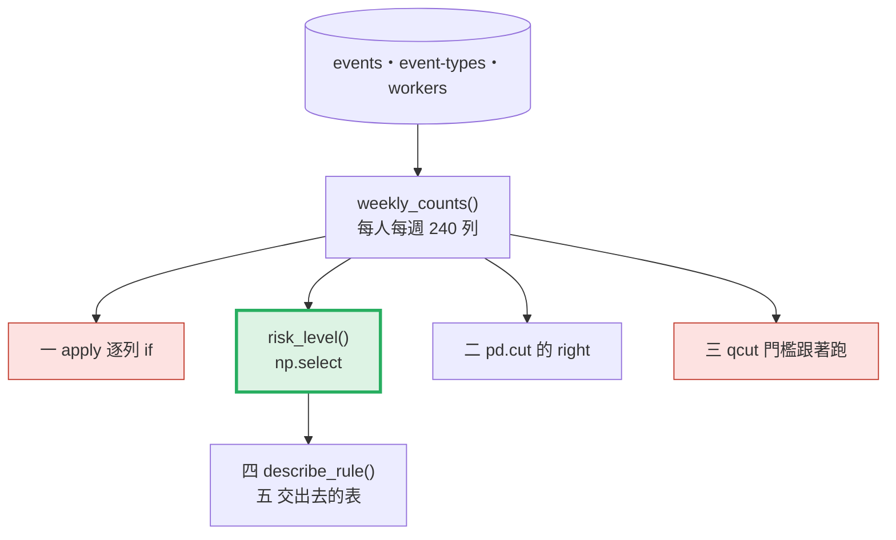
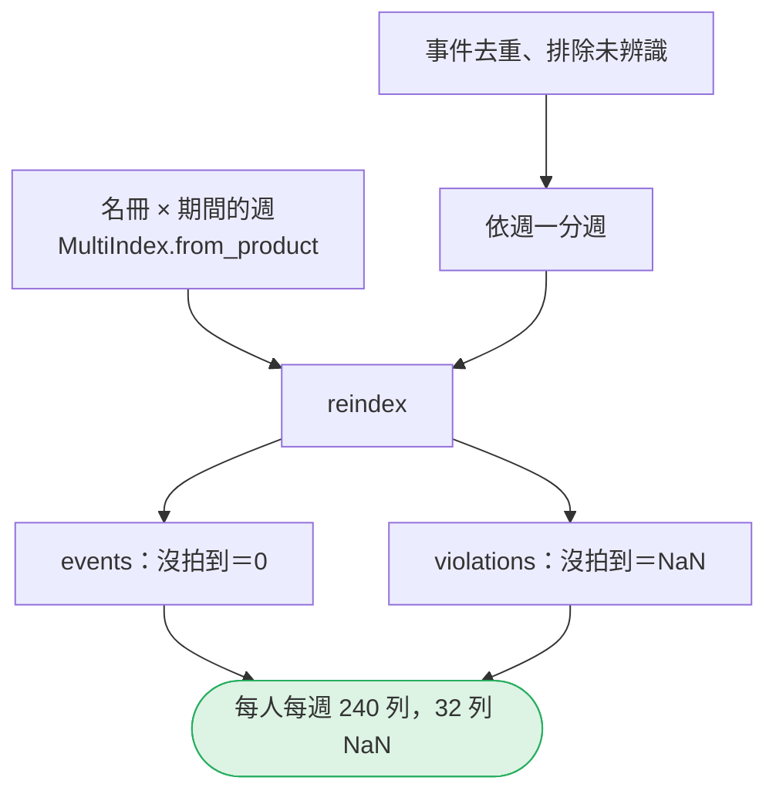
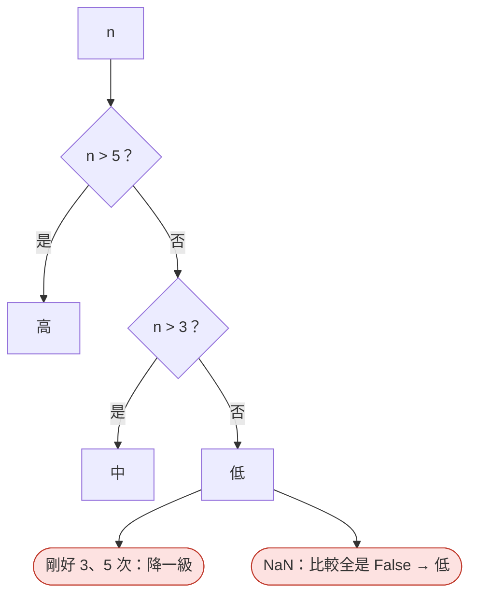
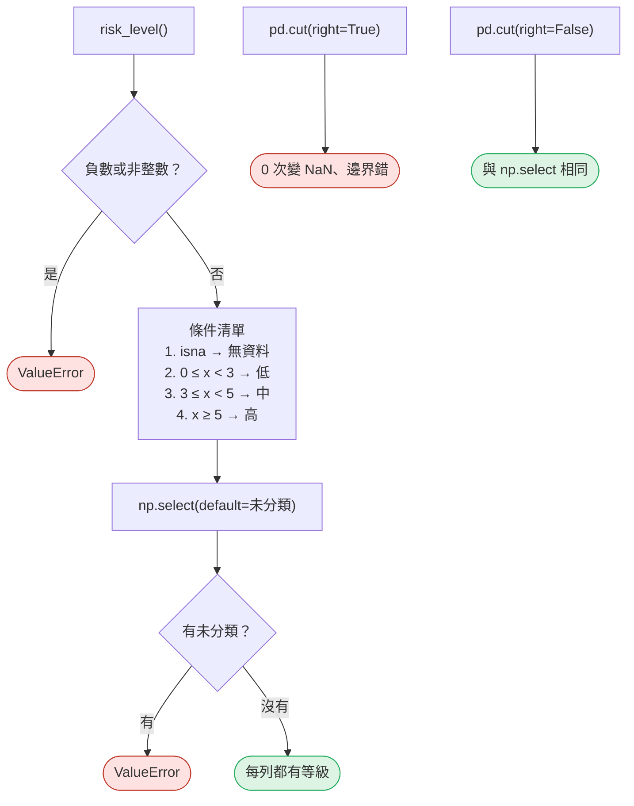
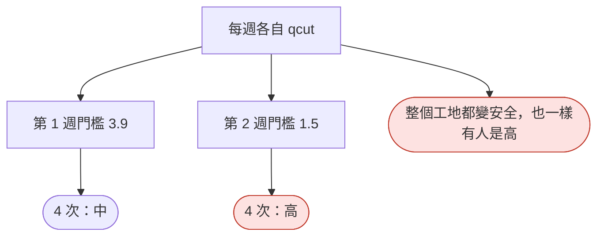
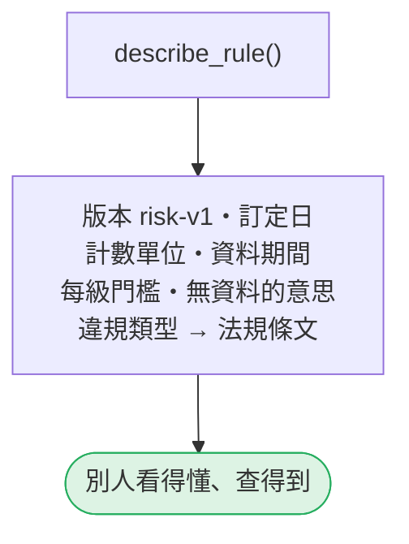
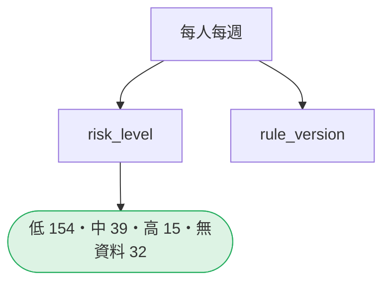

# 13｜衍生欄位與可稽核規則

> **2026-10-21 改版：每段一張圖。** 衍生欄位要可稽核：邊界明確、缺值有去處、規則有版本。

[回 18 節課綱](../../course-plans/2026-10-data-analysis-18.md)

## 範例程式碼

- [demo：13_derived_rules.py](https://github.com/4-learn/data-analysis-and-process-demo/blob/master/2026/13_derived_rules.py)（與本頁 Demo 逐字相同）
- 練習資料與環境說明：[2026/README](https://github.com/4-learn/data-analysis-and-process-demo/tree/master/2026)

## 學完能做到

| 時間 | 段落 | 學完能做到 |
| --- | --- | --- |
| 0–14 分 | 零、一 | 說出 `apply` 逐列 `if` 分錯了哪些列 |
| 14–22 分 | 二 | 用 `np.select`、`pd.cut(right=False)` 寫清楚邊界 |
| 22–28 分 | 三 | 說出 `qcut` 為什麼不適合當規則 |
| 28–35 分 | 四、五 | 規則寫上版本、門檻、期間、出處 |
| 35–50 分 | Workshop | 改規則，交出差異 |

## 本節流程



每段都是：**問題 → 位置（黃色）→ 步驟圖 → 程式 → 輸出 → 重點**。

## 零、準備：規則與每人每週表

**問題：** 要分級的數字從哪裡來？

**在流程中的位置：**


**這段做了什麼：**



<!-- fn-table -->
| 函式名稱 | 說明 | 官方文件連結 |
|---|---|---|
| `pd.to_timedelta(s, unit="D")` | 數字轉成時間長度，`unit="D"` 表示單位是天 | [文件](https://pandas.pydata.org/docs/reference/api/pandas.to_timedelta.html#pandas.to_timedelta) |
| `pd.MultiIndex.from_product([清單1, 清單2], names=)` | 產生兩個清單的所有組合（例如每個人 × 每一週），用來補齊沒出現的格子 | [文件](https://pandas.pydata.org/docs/reference/api/pandas.MultiIndex.from_product.html#pandas.MultiIndex.from_product) |
| 前面介紹過 | 用法同前，括號內是在哪裡第一次介紹 | [`Path(__file__).resolve().parent`](https://docs.python.org/3.12/library/pathlib.html#pathlib.Path.resolve)（第 02 節）、[`df.groupby()`](https://pandas.pydata.org/docs/reference/api/pandas.DataFrame.groupby.html#pandas.DataFrame.groupby)（第 02 節）、[`df["欄"]`](https://pandas.pydata.org/docs/user_guide/indexing.html#basics)（第 02 節）、[`df[條件]`](https://pandas.pydata.org/docs/user_guide/indexing.html#boolean-indexing)（第 02 節）、[`pd.read_csv()`](https://pandas.pydata.org/docs/reference/api/pandas.read_csv.html#pandas.read_csv)（第 02 節）、[`pd.to_datetime()`](https://pandas.pydata.org/docs/reference/api/pandas.to_datetime.html#pandas.to_datetime)（第 02 節）、[`.loc[]`](https://pandas.pydata.org/docs/reference/api/pandas.DataFrame.loc.html#pandas.DataFrame.loc)（第 03 節）、[`pd.read_json()`](https://pandas.pydata.org/docs/reference/api/pandas.read_json.html#pandas.read_json)（第 03 節）、[`.reset_index()`](https://pandas.pydata.org/docs/reference/api/pandas.DataFrame.reset_index.html#pandas.DataFrame.reset_index)（第 04 節）、[`s.unique()`](https://pandas.pydata.org/docs/reference/api/pandas.Series.unique.html#pandas.Series.unique)（第 05 節）、[`.astype()`](https://pandas.pydata.org/docs/reference/api/pandas.Series.astype.html#pandas.Series.astype)（第 06 節）、[`.fillna()`](https://pandas.pydata.org/docs/reference/api/pandas.Series.fillna.html#pandas.Series.fillna)（第 06 節）、[`s.max()`](https://pandas.pydata.org/docs/reference/api/pandas.Series.max.html#pandas.Series.max)（第 06 節）、[`s.min()`](https://pandas.pydata.org/docs/reference/api/pandas.Series.min.html#pandas.Series.min)（第 06 節）、[`s.str[a:b]`](https://pandas.pydata.org/docs/user_guide/text.html#indexing-with-str)（第 06 節）、[`整欄運算`](https://pandas.pydata.org/docs/user_guide/basics.html#flexible-binary-operations)（第 06 節）、[`.copy()`](https://pandas.pydata.org/docs/reference/api/pandas.DataFrame.copy.html#pandas.DataFrame.copy)（第 07 節）、[`s.isin()`](https://pandas.pydata.org/docs/reference/api/pandas.Series.isin.html#pandas.Series.isin)（第 07 節）、[`.drop_duplicates()`](https://pandas.pydata.org/docs/reference/api/pandas.DataFrame.drop_duplicates.html#pandas.DataFrame.drop_duplicates)（第 08 節）、[`pd.MultiIndex.from_arrays()`](https://pandas.pydata.org/docs/reference/api/pandas.MultiIndex.from_arrays.html#pandas.MultiIndex.from_arrays)（第 08 節）、[`.dayofweek`](https://pandas.pydata.org/docs/reference/api/pandas.Series.dt.dayofweek.html#pandas.Series.dt.dayofweek)（第 10 節）、[`.strftime()`](https://pandas.pydata.org/docs/reference/api/pandas.Series.dt.strftime.html#pandas.Series.dt.strftime)（第 10 節）、[`.reindex()`](https://pandas.pydata.org/docs/reference/api/pandas.DataFrame.reindex.html#pandas.DataFrame.reindex)（第 11 節）、[`groupby().agg()`](https://pandas.pydata.org/docs/reference/api/pandas.api.typing.DataFrameGroupBy.agg.html#pandas.api.typing.DataFrameGroupBy.agg)（第 12 節）、[`Path()`](https://docs.python.org/3.12/library/pathlib.html#pathlib.Path)（爬蟲 10） |

<!-- 節錄: 13_derived_rules.py -->
```python
from pathlib import Path

import numpy as np
import pandas as pd

DATA = Path(__file__).resolve().parent / "data"
EVENTS = DATA / "events"

RULE = {
    "version": "risk-v1",
    "decided": "2026-10-05",
    "unit": "每人每週（週一～週六，台灣時間）已辨識、依 event_id 去重後的違規次數",
    "levels": [("低", 0, 3), ("中", 3, 5), ("高", 5, None)],   # 下限含、上限不含
    "no_data": "無資料",
    "basis": "event-types.csv 的 is_violation；門檻為本課示範用，不是任何法規或公司規定",
}


def weekly_counts(events_path=EVENTS / "events.jsonl", types_path=EVENTS / "event-types.csv",
                  roster_path=EVENTS / "workers.csv"):
    """每人每週一列；以名冊 × 資料期間的週為骨架，沒被拍到的那一週留 NaN（不是 0）。"""
    ev = pd.read_json(events_path, lines=True, dtype=False, convert_dates=False).drop_duplicates("event_id")
    types = pd.read_csv(types_path, dtype=str, keep_default_na=False)
    roster = pd.read_csv(roster_path, dtype=str, keep_default_na=False)
    ev = ev[ev["worker_id"] != ""].copy()
    ev["is_violation"] = ev["event_type"].isin(types.loc[types["is_violation"] == "true", "event_type"])
    day = pd.to_datetime(ev["event_time"].str[:10], format="%Y-%m-%d")     # event_time 是工地當地時間
    ev["week"] = (day - pd.to_timedelta(day.dt.dayofweek, unit="D")).dt.strftime("%Y-%m-%d")
    grid = pd.MultiIndex.from_product([roster["worker_id"].drop_duplicates(), sorted(ev["week"].unique())],
                                      names=["worker_id", "week"])
    table = (ev.groupby(["worker_id", "week"])
             .agg(events=("event_id", "size"), violations=("is_violation", "sum"))
             .reindex(grid))
    table["events"] = table["events"].fillna(0).astype("int64")    # 沒被拍到＝0 筆偵測；違規次數則是「不知道」
    period = (ev["event_time"].min()[:10], ev["event_time"].max()[:10])
    return table.reset_index(), types, period
```

<!-- fn-table -->
| 函式名稱 | 說明 | 官方文件連結 |
|---|---|---|
| 前面介紹過 | 用法同前，括號內是在哪裡第一次介紹 | [`.sum()`](https://pandas.pydata.org/docs/reference/api/pandas.Series.sum.html#pandas.Series.sum)（第 02 節）、[`df["欄"]`](https://pandas.pydata.org/docs/user_guide/indexing.html#basics)（第 02 節）、[`.isna()`](https://pandas.pydata.org/docs/reference/api/pandas.Series.isna.html#pandas.Series.isna)（第 03 節）、[`.nunique()`](https://pandas.pydata.org/docs/reference/api/pandas.Series.nunique.html#pandas.Series.nunique)（第 05 節） |

<!-- 節錄: 13_derived_rules.py -->
```python
table, types, period = weekly_counts()
x = table["violations"]
print(f"每人每週 {len(table)} 列（{table['worker_id'].nunique()} 人 × {table['week'].nunique()} 週）；"
      f"violations 為 NaN 的 {int(x.isna().sum())} 列（那一週沒被拍到）\n")
```

- `RULE` 是一個 dict：版本、訂定日、計數單位、三級門檻（下限含、上限不含）。
- 沒被拍到的那一週：偵測次數是 0，違規次數是「不知道」（NaN）。

## 一、`apply` 逐列 `if`

**問題：** 「3 次以上為中、5 次以上為高」，AI 的 `if` 鏈錯在哪？

**在流程中的位置：**


**這段做了什麼：**



<!-- fn-table -->
| 函式名稱 | 說明 | 官方文件連結 |
|---|---|---|
| `.apply(函式)` | 對每個值（`DataFrame` 則是每一欄）套用函式 | [文件](https://pandas.pydata.org/docs/reference/api/pandas.Series.apply.html#pandas.Series.apply) |
| `df.values` | 去掉標籤，只留裡面的值（NumPy 陣列） | [文件](https://pandas.pydata.org/docs/reference/api/pandas.DataFrame.values.html#pandas.DataFrame.values) |
| 前面介紹過 | 用法同前，括號內是在哪裡第一次介紹 | [`df.to_string()`](https://pandas.pydata.org/docs/reference/api/pandas.DataFrame.to_string.html#pandas.DataFrame.to_string)（第 02 節）、[`df["欄"]`](https://pandas.pydata.org/docs/user_guide/indexing.html#basics)（第 02 節）、[`pd.DataFrame()`](https://pandas.pydata.org/docs/reference/api/pandas.DataFrame.html#pandas.DataFrame)（第 05 節）、[`np.nan`](https://numpy.org/doc/stable/reference/constants.html#numpy.nan)（第 08 節） |

<!-- 節錄: 13_derived_rules.py -->
```python
print("== 1. apply 逐列 if：邊界與 NaN ==")

def naive(n):          # 需求：「3 次以上為中、5 次以上為高」
    if n > 5:
        return "高"
    elif n > 3:
        return "中"
    else:
        return "低"

table["naive"] = x.apply(naive)
table["risk_level"] = risk_level(x)
probe = pd.DataFrame({"violations": [3.0, 5.0, np.nan]})
probe["apply_if"] = probe["violations"].apply(naive)
probe["np_select"] = risk_level(probe["violations"]).values
print(probe.to_string(index=False))
n_wrong, parts = error_breakdown(x, table["naive"], table["risk_level"])
print(f"{len(table)} 列中分錯 {n_wrong} 列：邊界 3 或 5 次 {parts['邊界 3 或 5 次']} 列、NaN 變成「低」 {parts['NaN']} 列、"
      f"其他 {parts['其他']} 列；沒有任何錯誤訊息")
```

```text
== 1. apply 逐列 if：邊界與 NaN ==
 violations apply_if np_select
        3.0        低         中
        5.0        中         高
        NaN        低       無資料
240 列中分錯 61 列：邊界 3 或 5 次 29 列、NaN 變成「低」 32 列、其他 0 列；沒有任何錯誤訊息
```

- 240 列分錯 61 列，**沒有錯誤訊息**。
- `error_breakdown()` 拿實際分錯的列拆原因（在第二段的程式裡）。

## 二、`np.select` 與 `pd.cut` 的邊界

**問題：** 怎麼寫才不會錯邊界、不會吞掉 NaN？

**在流程中的位置：**


**這段做了什麼：**



<!-- fn-table -->
| 函式名稱 | 說明 | 官方文件連結 |
|---|---|---|
| `np.select(條件清單, 結果清單, default=)` | 依序檢查條件，第一個成立的就給對應結果；都不成立給 `default` | [文件](https://numpy.org/doc/stable/reference/generated/numpy.select.html#numpy.select) |
| `d.values()` | dict 所有的值 | [文件](https://docs.python.org/3.12/library/stdtypes.html#dict.values) |
| `pd.cut(s, bins, right=, labels=)` | 依指定的分界把數字分組（例如 0–3 低、3–5 中）；`right=False` 是「含左不含右」 | [文件](https://pandas.pydata.org/docs/reference/api/pandas.cut.html#pandas.cut) |
| 前面介紹過 | 用法同前，括號內是在哪裡第一次介紹 | [`.any()`](https://pandas.pydata.org/docs/reference/api/pandas.Series.any.html#pandas.Series.any)（第 02 節）、[`.sum()`](https://pandas.pydata.org/docs/reference/api/pandas.Series.sum.html#pandas.Series.sum)（第 02 節）、[`df[條件]`](https://pandas.pydata.org/docs/user_guide/indexing.html#boolean-indexing)（第 02 節）、[`& \| ~`](https://pandas.pydata.org/docs/user_guide/indexing.html#boolean-operators)（第 03 節）、[`.isna()`](https://pandas.pydata.org/docs/reference/api/pandas.Series.isna.html#pandas.Series.isna)（第 03 節）、[`.tolist()`](https://pandas.pydata.org/docs/reference/api/pandas.Series.tolist.html)（第 04 節）、[`df.index`](https://pandas.pydata.org/docs/reference/api/pandas.DataFrame.index.html#pandas.DataFrame.index)（第 05 節）、[`pd.Series()`](https://pandas.pydata.org/docs/reference/api/pandas.Series.html#pandas.Series)（第 05 節）、[`.dropna()`](https://pandas.pydata.org/docs/reference/api/pandas.Series.dropna.html#pandas.Series.dropna)（第 06 節）、[`整欄運算`](https://pandas.pydata.org/docs/user_guide/basics.html#flexible-binary-operations)（第 06 節）、[`s.isin()`](https://pandas.pydata.org/docs/reference/api/pandas.Series.isin.html#pandas.Series.isin)（第 07 節） |

<!-- 節錄: 13_derived_rules.py -->
```python
def risk_level(violations, rule=RULE):
    """依規則分級；NaN 一律標「無資料」，不能落進任何一級。"""
    x = pd.Series(violations, dtype="float64")
    if (x < 0).any():
        raise ValueError(f"違規次數不可為負：{x[x < 0].tolist()[:3]}")
    if (x.dropna() % 1 != 0).any():
        raise ValueError("違規次數必須是整數")
    conds, labels = [x.isna()], [rule["no_data"]]
    for label, low, high in rule["levels"]:
        conds.append((x >= low) & (x < high) if high is not None else (x >= low))
        labels.append(label)
    out = np.select(conds, labels, default="未分類")
    if (out == "未分類").any():
        raise ValueError(f"規則沒有涵蓋：{x[out == '未分類'].tolist()[:3]}")
    return pd.Series(out, index=x.index, name="risk_level")


def error_breakdown(x, got, expected):
    """拿「實際分錯的列」拆原因，不是拿「值剛好在邊界的列」去湊。"""
    wrong = pd.Series(got, index=x.index) != pd.Series(expected, index=x.index)
    parts = {"邊界 3 或 5 次": int((wrong & x.isin([3, 5])).sum()), "NaN": int((wrong & x.isna()).sum())}
    parts["其他"] = int(wrong.sum()) - sum(parts.values())
    return int(wrong.sum()), parts


def cut_counts(x, bins, right, labels=("低", "中", "高")):
    """pd.cut 的各級列數；「其中 0 次」是 NaN 且原值為 0 的列，實際算出來，不是猜。"""
    c = pd.cut(x, bins, right=right, labels=list(labels))
    counts = {lb: int((c == lb).sum()) for lb in labels}
    counts["NaN"] = int(c.isna().sum())
    counts["0 次"] = int((c.isna() & (x == 0)).sum())
    return counts
```

<!-- fn-table -->
| 函式名稱 | 說明 | 官方文件連結 |
|---|---|---|
| `np.inf` | 無限大；常當最後一個分組的上限 | [文件](https://numpy.org/doc/stable/reference/constants.html#numpy.inf) |
| 前面介紹過 | 用法同前，括號內是在哪裡第一次介紹 | [`df.to_string()`](https://pandas.pydata.org/docs/reference/api/pandas.DataFrame.to_string.html#pandas.DataFrame.to_string)（第 02 節）、[`df["欄"]`](https://pandas.pydata.org/docs/user_guide/indexing.html#basics)（第 02 節）、[`df[條件]`](https://pandas.pydata.org/docs/user_guide/indexing.html#boolean-indexing)（第 02 節）、[`pd.DataFrame()`](https://pandas.pydata.org/docs/reference/api/pandas.DataFrame.html#pandas.DataFrame)（第 05 節）、[`.all()`](https://pandas.pydata.org/docs/reference/api/pandas.Series.all.html#pandas.Series.all)（第 06 節）、[`.astype()`](https://pandas.pydata.org/docs/reference/api/pandas.Series.astype.html#pandas.Series.astype)（第 06 節）、[`.fillna()`](https://pandas.pydata.org/docs/reference/api/pandas.Series.fillna.html#pandas.Series.fillna)（第 06 節）、[`pd.cut()`](https://pandas.pydata.org/docs/reference/api/pandas.cut.html#pandas.cut)（第 13 節） |

<!-- 節錄: 13_derived_rules.py -->
```python
print("\n== 2. pd.cut 的 right：同一組門檻，兩種邊界 ==")
bins = [0, 3, 5, np.inf]
probe = pd.DataFrame({"violations": [0, 2, 3, 4, 5, 24]})
for right in (True, False):
    probe[f"right={right}"] = pd.cut(probe["violations"], bins, right=right,
                                     labels=["低", "中", "高"]).astype(object).fillna("NaN")
print(probe.to_string(index=False))
for right in (True, False):
    k = cut_counts(x, bins, right)
    print(f"right={right!s:5}：低 {k['低']}、中 {k['中']}、高 {k['高']}、NaN {k['NaN']}（其中 0 次的 {k['0 次']} 列）")
same = pd.cut(x, bins, right=False, labels=["低", "中", "高"]).astype(object).fillna("無資料")
print(f"right=False 與 np.select 結果相同：{bool((same == table['risk_level']).all())}")
```

```text
== 2. pd.cut 的 right：同一組門檻，兩種邊界 ==
 violations right=True right=False
          0        NaN           低
          2          低           低
          3          低           中
          4          中           中
          5          中           高
         24          高           高
right=True ：低 135、中 18、高 11、NaN 76（其中 0 次的 44 列）
right=False：低 154、中 39、高 15、NaN 32（其中 0 次的 0 列）
right=False 與 np.select 結果相同：True
```

- 缺值**先**接住；每一級「下限含、上限不含」。
- `pd.cut` 的預設值不是你的規則：`right` 要明寫。

## 三、`qcut`：門檻跟著資料跑

**問題：** 依分位數分級，有什麼問題？

**在流程中的位置：**


**這段做了什麼：**



<!-- fn-table -->
| 函式名稱 | 說明 | 官方文件連結 |
|---|---|---|
| `pd.qcut(s, q, labels=, retbins=)` | 依**分位數**分組（每組人數差不多）；`retbins=True` 同時回傳實際分界 | [文件](https://pandas.pydata.org/docs/reference/api/pandas.qcut.html#pandas.qcut) |
| 前面介紹過 | 用法同前，括號內是在哪裡第一次介紹 | [`.sum()`](https://pandas.pydata.org/docs/reference/api/pandas.Series.sum.html#pandas.Series.sum)（第 02 節）、[`df.groupby()`](https://pandas.pydata.org/docs/reference/api/pandas.DataFrame.groupby.html#pandas.DataFrame.groupby)（第 02 節）、[`df.to_string()`](https://pandas.pydata.org/docs/reference/api/pandas.DataFrame.to_string.html#pandas.DataFrame.to_string)（第 02 節）、[`df["欄"]`](https://pandas.pydata.org/docs/user_guide/indexing.html#basics)（第 02 節）、[`df[條件]`](https://pandas.pydata.org/docs/user_guide/indexing.html#boolean-indexing)（第 02 節）、[`pd.concat()`](https://pandas.pydata.org/docs/reference/api/pandas.concat.html#pandas.concat)（第 02 節）、[`.loc[]`](https://pandas.pydata.org/docs/reference/api/pandas.DataFrame.loc.html#pandas.DataFrame.loc)（第 03 節）、[`df.index`](https://pandas.pydata.org/docs/reference/api/pandas.DataFrame.index.html#pandas.DataFrame.index)（第 05 節）、[`pd.DataFrame()`](https://pandas.pydata.org/docs/reference/api/pandas.DataFrame.html#pandas.DataFrame)（第 05 節）、[`.astype()`](https://pandas.pydata.org/docs/reference/api/pandas.Series.astype.html#pandas.Series.astype)（第 06 節）、[`.dropna()`](https://pandas.pydata.org/docs/reference/api/pandas.Series.dropna.html#pandas.Series.dropna)（第 06 節） |

<!-- 節錄: 13_derived_rules.py -->
```python
print("\n== 3. qcut：門檻跟著資料跑 ==")
q = [0, 0.5, 0.9, 1]
rows, by_qcut = [], []
for week, grp in table.dropna(subset=["violations"]).groupby("week"):
    cats, edges = pd.qcut(grp["violations"], q, labels=["低", "中", "高"], retbins=True)
    by_qcut.append(cats.astype(str))
    lookup = dict(zip(grp["violations"], cats.astype(str)))
    rows.append({"week": week, "門檻": [round(float(e), 1) for e in edges],
                 "2 次": lookup.get(2.0, "-"), "4 次": lookup.get(4.0, "-"), "高的人數": int((cats == "高").sum())})
print(pd.DataFrame(rows).to_string(index=False))
by_qcut = pd.concat(by_qcut)
differ = by_qcut != table.loc[by_qcut.index, "risk_level"]
print(f"每週各自 qcut 與固定規則 risk-v1 相比：{len(by_qcut)} 列中 {int(differ.sum())} 列等級不同")
```

```text
== 3. qcut：門檻跟著資料跑 ==
      week                    門檻 2 次 4 次  高的人數
2026-08-31 [0.0, 1.5, 4.0, 10.0]   中   中     2
2026-09-07  [0.0, 2.0, 3.9, 6.0]   低   高     6
2026-09-14 [0.0, 2.0, 5.0, 12.0]   低   中     5
2026-09-21 [0.0, 1.0, 3.9, 24.0]   中   高     6
每週各自 qcut 與固定規則 risk-v1 相比：208 列中 33 列等級不同
```

- 門檻是內插出來的，**不是任何人訂的**；被問「為什麼他是高」答不出來。

## 四、規則說明

**問題：** 交出去的分級，要附上什麼？

**在流程中的位置：**


**這段做了什麼：**



<!-- fn-table -->
| 函式名稱 | 說明 | 官方文件連結 |
|---|---|---|
| 前面介紹過 | 用法同前，括號內是在哪裡第一次介紹 | [`df["欄"]`](https://pandas.pydata.org/docs/user_guide/indexing.html#basics)（第 02 節）、[`df[條件]`](https://pandas.pydata.org/docs/user_guide/indexing.html#boolean-indexing)（第 02 節）、[`df.itertuples()`](https://pandas.pydata.org/docs/reference/api/pandas.DataFrame.itertuples.html#pandas.DataFrame.itertuples)（第 04 節） |

<!-- 節錄: 13_derived_rules.py -->
```python
def describe_rule(rule, types, period):
    lines = [f"規則 {rule['version']}（{rule['decided']} 訂定）",
             f"計數單位：{rule['unit']}",
             f"資料期間：{period[0]} ～ {period[1]}"]
    for label, low, high in rule["levels"]:
        lines.append(f"  {label}：{low} 次以上" + (f"、未滿 {high} 次" if high is not None else ""))
    lines.append(f"  {rule['no_data']}：該週沒有被辨識到任何事件（不是 0 次）")
    lines.append("計入的違規類型與依據（營造安全衛生設施標準，練習站條文，不具法律效力）：")
    for r in types[types["is_violation"] == "true"].itertuples():
        lines.append(f"  {r.event_type}（{r.label_zh}）→ {r.pcode} 第 {r.slug} 條：{r.basis}")
    lines.append(f"門檻依據：{rule['basis']}")
    return "\n".join(lines)
```

<!-- fn-table -->
| 函式名稱 | 說明 | 官方文件連結 |
|---|---|---|
| （無） | 本段只用到 Python 基礎與前幾門課學過的寫法，沒有新的函式 | — |

<!-- 節錄: 13_derived_rules.py -->
```python
print("\n== 4. 規則說明：版本、門檻、資料期間、出處 ==")
print(describe_rule(RULE, types, period))
```

```text
== 4. 規則說明：版本、門檻、資料期間、出處 ==
規則 risk-v1（2026-10-05 訂定）
計數單位：每人每週（週一～週六，台灣時間）已辨識、依 event_id 去重後的違規次數
資料期間：2026-08-31 ～ 2026-09-26
  低：0 次以上、未滿 3 次
  中：3 次以上、未滿 5 次
  高：5 次以上
  無資料：該週沒有被辨識到任何事件（不是 0 次）
計入的違規類型與依據（營造安全衛生設施標準，練習站條文，不具法律效力）：
  no_helmet（未戴安全帽）→ N0060014 第 11-1 條：進入營繕工程工作場所應正確戴用安全帽
  no_harness（高處未使用安全帶）→ N0060014 第 19 條：高度二公尺以上有墜落之虞且防護設備開啟時應使用安全帶
  restricted_entry（跨越警示線）→ N0060014 第 24 條：作業進行中應禁止勞工跨越警示線
門檻依據：event-types.csv 的 is_violation；門檻為本課示範用，不是任何法規或公司規定
```

- 門檻是本課示範用，**不是法規或公司規定**——說明裡要寫明。

## 五、交出去的表

**問題：** 最後的表長什麼樣？

**在流程中的位置：**


**這段做了什麼：**



<!-- fn-table -->
| 函式名稱 | 說明 | 官方文件連結 |
|---|---|---|
| 前面介紹過 | 用法同前，括號內是在哪裡第一次介紹 | [`df.to_string()`](https://pandas.pydata.org/docs/reference/api/pandas.DataFrame.to_string.html#pandas.DataFrame.to_string)（第 02 節）、[`df["欄"]`](https://pandas.pydata.org/docs/user_guide/indexing.html#basics)（第 02 節）、[`df[條件]`](https://pandas.pydata.org/docs/user_guide/indexing.html#boolean-indexing)（第 02 節）、[`s.value_counts()`](https://pandas.pydata.org/docs/reference/api/pandas.Series.value_counts.html#pandas.Series.value_counts)（第 05 節）、[`.reindex()`](https://pandas.pydata.org/docs/reference/api/pandas.DataFrame.reindex.html#pandas.DataFrame.reindex)（第 11 節） |

<!-- 節錄: 13_derived_rules.py -->
```python
print("\n== 5. 交出去的表 ==")
table["rule_version"] = RULE["version"]
out = table[["worker_id", "week", "events", "violations", "risk_level", "rule_version"]]
print(out["risk_level"].value_counts().reindex(["低", "中", "高", "無資料"]).to_string())
print(out[out["worker_id"] == "W041"].to_string(index=False))
```

```text
== 5. 交出去的表 ==
risk_level
低      154
中       39
高       15
無資料     32
worker_id       week  events  violations risk_level rule_version
     W041 2026-08-31       6         2.0          低      risk-v1
     W041 2026-09-07      12         4.0          中      risk-v1
     W041 2026-09-14      17         6.0          高      risk-v1
     W041 2026-09-21      32        24.0          高      risk-v1
```

- 每一列都有等級，「無資料」單獨一類。
- W041：低、中、高、高。等級看得出「變糟了」，看不出「為什麼」。

## Workshop：改規則，交出差異

### 任務與時間

**35–42 分鐘：發布 risk-v2。** 安全主管要求收緊：「2 次以上為中、4 次以上為高」。複製 `RULE`，改成 `risk-v2`，重新分級，並輸出新的規則說明。

<!-- fn-table -->
| 函式名稱 | 說明 | 官方文件連結 |
|---|---|---|
| 前面介紹過 | 用法同前，括號內是在哪裡第一次介紹 | [`df["欄"]`](https://pandas.pydata.org/docs/user_guide/indexing.html#basics)（第 02 節） |

```python
# Workshop 起手式，本節測試不涵蓋這段
table, types, period = weekly_counts()
table["v1"] = risk_level(table["violations"])
v2 = dict(RULE, version="risk-v2", levels=[("低", 0, 2), ("中", 2, 4), ("高", 4, None)])
table["v2"] = risk_level(table["violations"], v2)
```

**42–46 分鐘：交出差異。** 有幾列的等級變了？用 `pd.crosstab(table["v1"], table["v2"])` 看它們從哪裡移到哪裡。「無資料」有沒有變？應不應該變？

**46–50 分鐘：抓 AI 的錯。** 請 OpenCode 寫「依每週違規次數產生 risk_level：3 次以上中、5 次以上高」。拿它的程式跑本節的 240 列，檢查三件事：剛好 3 次、5 次的人是哪一級？W053 是哪一級？有沒有一段文字說明規則版本與門檻？

### 參考判讀

:::spoiler 教師用（點開）
- risk-v2 下，**67 列**等級改變；分布為低 101、中 78、高 29、無資料 32（教師實測）。「無資料」32 列不變——門檻怎麼改，沒拍到的人都不該被分到任何一級。
- 若你的 v2 讓「無資料」變少，代表你的程式在某一步把 NaN 補成了 0。教師實測：先 `fillna(0)` 再分級，v1 的「低」從 154 變 186。
- 常見的 AI 版本是 `apply` ＋ `if n >= 5 … elif n >= 3 … else`：邊界對了，但 W053–W060 的 32 列被標成「低」（教師實測 240 列中錯 32 列）；或是 `pd.cut(x, [0, 3, 5, inf])` 沒寫 `right`：3 次算低、0 次變 NaN。**兩種都不會報錯**。
- AI 幾乎不會主動輸出規則說明。沒有版本的分級結果，下週門檻改了，沒有人分得出哪些「高」是舊規則判的。
:::

### 驗收

- `risk_level` **不得以 `apply` 逐列判斷實作**；用 `np.select` 或 `pd.cut(right=False)`。
- 240 列每一列都有等級；NaN 的列是「無資料」，數量等於原本的缺值數（32）。
- 交出 risk-v2 的規則說明，五個問題（版本、單位、邊界、無資料、依據）都有回答，且寫明門檻沒有法規依據。
- 交出 v1 → v2 的差異列數與 crosstab，並能解釋為什麼「無資料」不變。
- 能說出 `qcut` 為什麼不能當判定規則（同樣 4 次，不同週不同級）。

## 附錄：完整程式

```bash
python3 13_derived_rules.py
```

<!-- fn-table -->
| 函式名稱 | 說明 | 官方文件連結 |
|---|---|---|
| （同上） | 這支程式用到的函式，都已在上面各段的表格介紹過 | — |

<!-- demo: 13_derived_rules.py -->
```python
"""第 13 節：衍生欄位與可稽核規則——把每人每週違規次數分級成 risk_level。"""

from pathlib import Path

import numpy as np
import pandas as pd

DATA = Path(__file__).resolve().parent / "data"
EVENTS = DATA / "events"

RULE = {
    "version": "risk-v1",
    "decided": "2026-10-05",
    "unit": "每人每週（週一～週六，台灣時間）已辨識、依 event_id 去重後的違規次數",
    "levels": [("低", 0, 3), ("中", 3, 5), ("高", 5, None)],   # 下限含、上限不含
    "no_data": "無資料",
    "basis": "event-types.csv 的 is_violation；門檻為本課示範用，不是任何法規或公司規定",
}


def weekly_counts(events_path=EVENTS / "events.jsonl", types_path=EVENTS / "event-types.csv",
                  roster_path=EVENTS / "workers.csv"):
    """每人每週一列；以名冊 × 資料期間的週為骨架，沒被拍到的那一週留 NaN（不是 0）。"""
    ev = pd.read_json(events_path, lines=True, dtype=False, convert_dates=False).drop_duplicates("event_id")
    types = pd.read_csv(types_path, dtype=str, keep_default_na=False)
    roster = pd.read_csv(roster_path, dtype=str, keep_default_na=False)
    ev = ev[ev["worker_id"] != ""].copy()
    ev["is_violation"] = ev["event_type"].isin(types.loc[types["is_violation"] == "true", "event_type"])
    day = pd.to_datetime(ev["event_time"].str[:10], format="%Y-%m-%d")     # event_time 是工地當地時間
    ev["week"] = (day - pd.to_timedelta(day.dt.dayofweek, unit="D")).dt.strftime("%Y-%m-%d")
    grid = pd.MultiIndex.from_product([roster["worker_id"].drop_duplicates(), sorted(ev["week"].unique())],
                                      names=["worker_id", "week"])
    table = (ev.groupby(["worker_id", "week"])
             .agg(events=("event_id", "size"), violations=("is_violation", "sum"))
             .reindex(grid))
    table["events"] = table["events"].fillna(0).astype("int64")    # 沒被拍到＝0 筆偵測；違規次數則是「不知道」
    period = (ev["event_time"].min()[:10], ev["event_time"].max()[:10])
    return table.reset_index(), types, period


def risk_level(violations, rule=RULE):
    """依規則分級；NaN 一律標「無資料」，不能落進任何一級。"""
    x = pd.Series(violations, dtype="float64")
    if (x < 0).any():
        raise ValueError(f"違規次數不可為負：{x[x < 0].tolist()[:3]}")
    if (x.dropna() % 1 != 0).any():
        raise ValueError("違規次數必須是整數")
    conds, labels = [x.isna()], [rule["no_data"]]
    for label, low, high in rule["levels"]:
        conds.append((x >= low) & (x < high) if high is not None else (x >= low))
        labels.append(label)
    out = np.select(conds, labels, default="未分類")
    if (out == "未分類").any():
        raise ValueError(f"規則沒有涵蓋：{x[out == '未分類'].tolist()[:3]}")
    return pd.Series(out, index=x.index, name="risk_level")


def error_breakdown(x, got, expected):
    """拿「實際分錯的列」拆原因，不是拿「值剛好在邊界的列」去湊。"""
    wrong = pd.Series(got, index=x.index) != pd.Series(expected, index=x.index)
    parts = {"邊界 3 或 5 次": int((wrong & x.isin([3, 5])).sum()), "NaN": int((wrong & x.isna()).sum())}
    parts["其他"] = int(wrong.sum()) - sum(parts.values())
    return int(wrong.sum()), parts


def cut_counts(x, bins, right, labels=("低", "中", "高")):
    """pd.cut 的各級列數；「其中 0 次」是 NaN 且原值為 0 的列，實際算出來，不是猜。"""
    c = pd.cut(x, bins, right=right, labels=list(labels))
    counts = {lb: int((c == lb).sum()) for lb in labels}
    counts["NaN"] = int(c.isna().sum())
    counts["0 次"] = int((c.isna() & (x == 0)).sum())
    return counts


def describe_rule(rule, types, period):
    lines = [f"規則 {rule['version']}（{rule['decided']} 訂定）",
             f"計數單位：{rule['unit']}",
             f"資料期間：{period[0]} ～ {period[1]}"]
    for label, low, high in rule["levels"]:
        lines.append(f"  {label}：{low} 次以上" + (f"、未滿 {high} 次" if high is not None else ""))
    lines.append(f"  {rule['no_data']}：該週沒有被辨識到任何事件（不是 0 次）")
    lines.append("計入的違規類型與依據（營造安全衛生設施標準，練習站條文，不具法律效力）：")
    for r in types[types["is_violation"] == "true"].itertuples():
        lines.append(f"  {r.event_type}（{r.label_zh}）→ {r.pcode} 第 {r.slug} 條：{r.basis}")
    lines.append(f"門檻依據：{rule['basis']}")
    return "\n".join(lines)


if __name__ == "__main__":
    table, types, period = weekly_counts()
    x = table["violations"]
    print(f"每人每週 {len(table)} 列（{table['worker_id'].nunique()} 人 × {table['week'].nunique()} 週）；"
          f"violations 為 NaN 的 {int(x.isna().sum())} 列（那一週沒被拍到）\n")

    print("== 1. apply 逐列 if：邊界與 NaN ==")

    def naive(n):          # 需求：「3 次以上為中、5 次以上為高」
        if n > 5:
            return "高"
        elif n > 3:
            return "中"
        else:
            return "低"

    table["naive"] = x.apply(naive)
    table["risk_level"] = risk_level(x)
    probe = pd.DataFrame({"violations": [3.0, 5.0, np.nan]})
    probe["apply_if"] = probe["violations"].apply(naive)
    probe["np_select"] = risk_level(probe["violations"]).values
    print(probe.to_string(index=False))
    n_wrong, parts = error_breakdown(x, table["naive"], table["risk_level"])
    print(f"{len(table)} 列中分錯 {n_wrong} 列：邊界 3 或 5 次 {parts['邊界 3 或 5 次']} 列、NaN 變成「低」 {parts['NaN']} 列、"
          f"其他 {parts['其他']} 列；沒有任何錯誤訊息")

    print("\n== 2. pd.cut 的 right：同一組門檻，兩種邊界 ==")
    bins = [0, 3, 5, np.inf]
    probe = pd.DataFrame({"violations": [0, 2, 3, 4, 5, 24]})
    for right in (True, False):
        probe[f"right={right}"] = pd.cut(probe["violations"], bins, right=right,
                                         labels=["低", "中", "高"]).astype(object).fillna("NaN")
    print(probe.to_string(index=False))
    for right in (True, False):
        k = cut_counts(x, bins, right)
        print(f"right={right!s:5}：低 {k['低']}、中 {k['中']}、高 {k['高']}、NaN {k['NaN']}（其中 0 次的 {k['0 次']} 列）")
    same = pd.cut(x, bins, right=False, labels=["低", "中", "高"]).astype(object).fillna("無資料")
    print(f"right=False 與 np.select 結果相同：{bool((same == table['risk_level']).all())}")

    print("\n== 3. qcut：門檻跟著資料跑 ==")
    q = [0, 0.5, 0.9, 1]
    rows, by_qcut = [], []
    for week, grp in table.dropna(subset=["violations"]).groupby("week"):
        cats, edges = pd.qcut(grp["violations"], q, labels=["低", "中", "高"], retbins=True)
        by_qcut.append(cats.astype(str))
        lookup = dict(zip(grp["violations"], cats.astype(str)))
        rows.append({"week": week, "門檻": [round(float(e), 1) for e in edges],
                     "2 次": lookup.get(2.0, "-"), "4 次": lookup.get(4.0, "-"), "高的人數": int((cats == "高").sum())})
    print(pd.DataFrame(rows).to_string(index=False))
    by_qcut = pd.concat(by_qcut)
    differ = by_qcut != table.loc[by_qcut.index, "risk_level"]
    print(f"每週各自 qcut 與固定規則 risk-v1 相比：{len(by_qcut)} 列中 {int(differ.sum())} 列等級不同")

    print("\n== 4. 規則說明：版本、門檻、資料期間、出處 ==")
    print(describe_rule(RULE, types, period))

    print("\n== 5. 交出去的表 ==")
    table["rule_version"] = RULE["version"]
    out = table[["worker_id", "week", "events", "violations", "risk_level", "rule_version"]]
    print(out["risk_level"].value_counts().reindex(["低", "中", "高", "無資料"]).to_string())
    print(out[out["worker_id"] == "W041"].to_string(index=False))
```

## 教師紀錄與下一步

:::spoiler 實測環境、版本差異、資料來源（點開）
**實測**：2026-10-05，Ubuntu 20.04，Python 3.11.8，pandas 3.0.6、numpy 2.4.6。本頁輸出為該環境實際執行貼上（**本機實測**）。另以 Python 3.10.15／pandas 2.3.3 執行，Demo **標準輸出逐字相同**；Workshop 參考判讀的數字兩版相同。兩版都實測過：`pd.cut` 預設 `right=True` 讓左端點 0 變 NaN；`qcut` 以 `[0, 0.5, 0.9, 1]` 切本資料四週皆不需 `duplicates="drop"`。

**資料**：同第 12 節，合成資料，不代表任何真實工地。門檻 3／5 次為**示範用**，不是任何法規、標準或公司規定；違規類型對應的法條取自練習站 `articles.jsonl`，可能經刻意修改，不具法律效力。週以 `event_time` 的當地日期計算（週一起算，週日停工）。

**與機器學習課的對齊**（ML 課第 02 節接手「事件彙總表」）：

- 本節產出的欄位是 `worker_id, week, events, violations, risk_level, rule_version`，一列是「一人一週」。ML 課的問題是「這個**事件**要不要通知主管」，一列是一個事件；y 是「主管實際有沒有處理」，也就是 `handled_at` 是否非空（教師實測：已辨識的違規 419 筆中，有 `handled_at` 的 190 筆）。
- **`handled_at` 及任何由它衍生的欄位都是答案的影子**：「處理時間」「本週已處理次數」「處理率」……只要從 `handled_at` 算出來，就是把 y 放進 X。本節的表刻意**不含** `handled_at` 衍生欄位；若 ML 課要加，必須在講義中標成洩漏欄位，不是特徵。
- 本節的 `violations`、`risk_level` 是**整週**算的。若直接依 `(worker_id, week)` 接回事件當特徵，週一的事件就看得到週六才發生的違規。教師實測：2454 筆已辨識事件中，「整週等級」與「事件發生當下、只算這週之前已發生的違規」的等級不同者 **490 筆**；整週等級為「高」的事件 213 筆，當下就已達「高」的只有 82 筆。ML 課若要用，需改成「截至事件時間之前」的累計（`groupby().cumsum()` 減去自己），或用前一週的等級。此項建議需 ML 課第 02、03 節撰寫者確認。
- `risk_level` 本身是規則的輸出；ML 課第 01 節的「規則版 baseline」可以直接用它，但要記錄 `rule_version`。

**界線**：本節不談「門檻該訂多少」——那需要現場與安全主管的判斷，不是資料能決定的。`np.select` 在大資料上比 `apply` 快，但本節**沒有做速度比較**，也不以速度當論點。本節**尚未實班試教**。

**舊教材**：改寫自 [新增衍生欄位（風險分數、等級）](https://hackmd.io/@yillkid/B1904jR4-l)。保留「衍生欄位不是原始資料、是定義規則後算出來的」與「一整欄一起算」；舊版的 `apply(risk_level)` 改為**反例**，並實測它在本資料的邊界與 NaN 錯誤；`risk_score = fail_count` 這一步（把一欄複製成另一欄）刪除；「對 AI 模型來說這是 Feature Engineering 的第一步」的論述**換成「可稽核的判定規則」**，特徵工程交給 ML 課。[DataFrame 合併與操作](https://hackmd.io/@yillkid/SJENzeiEc) 的運算部分（`subtract` 兩表相減）不採用：它示範的是 index 對齊的算術，與分級無關；本節 Workshop 的 v1／v2 比較改用 `crosstab`。`np.select`、`pd.cut`、`qcut`、規則說明與版本皆為新增。
:::

**下一節**：第 14 節〈跨來源合併與 fan-out〉——規則說明裡的「N0060014 第 19 條」只是一個代碼。下一節把事件、名冊、事件類型、法條原文四份資料接起來，並看 W023 的兩列名冊會讓數字翻倍到什麼程度。
