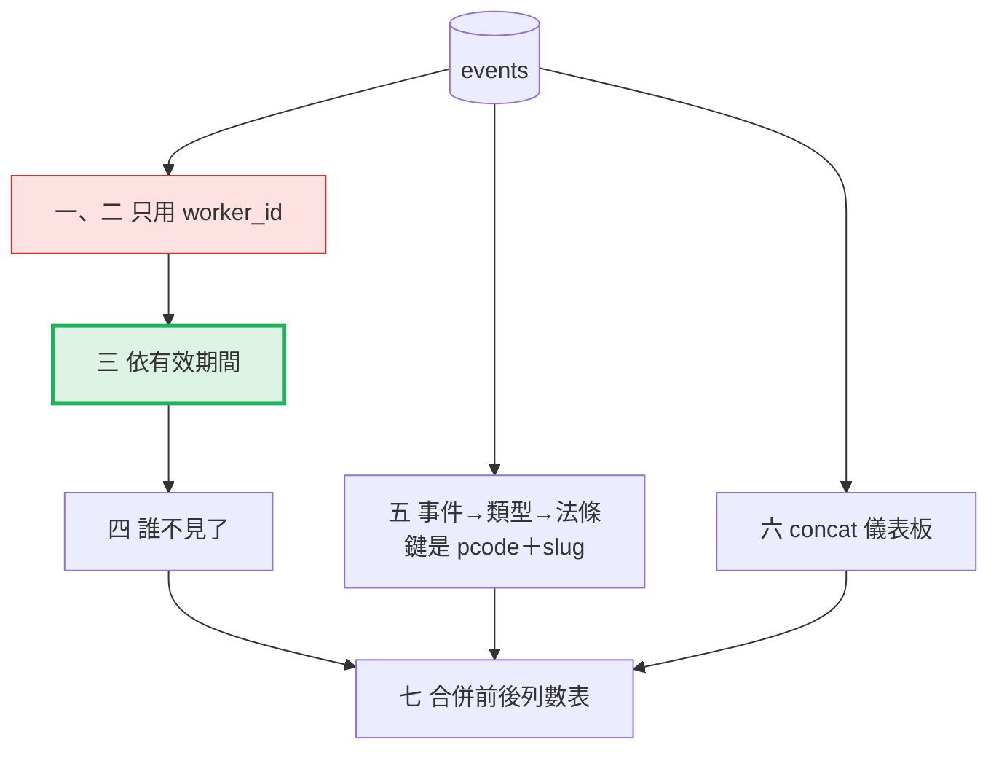
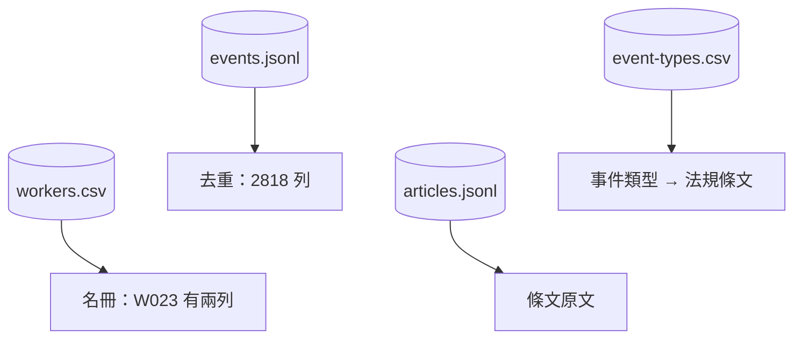
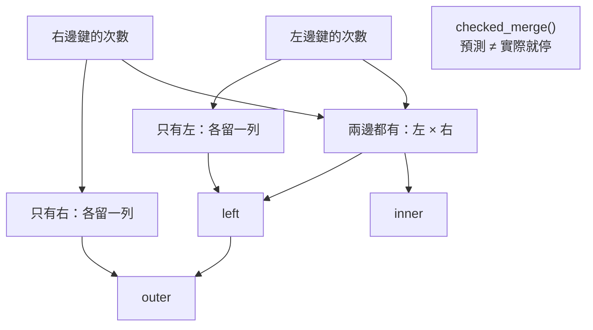
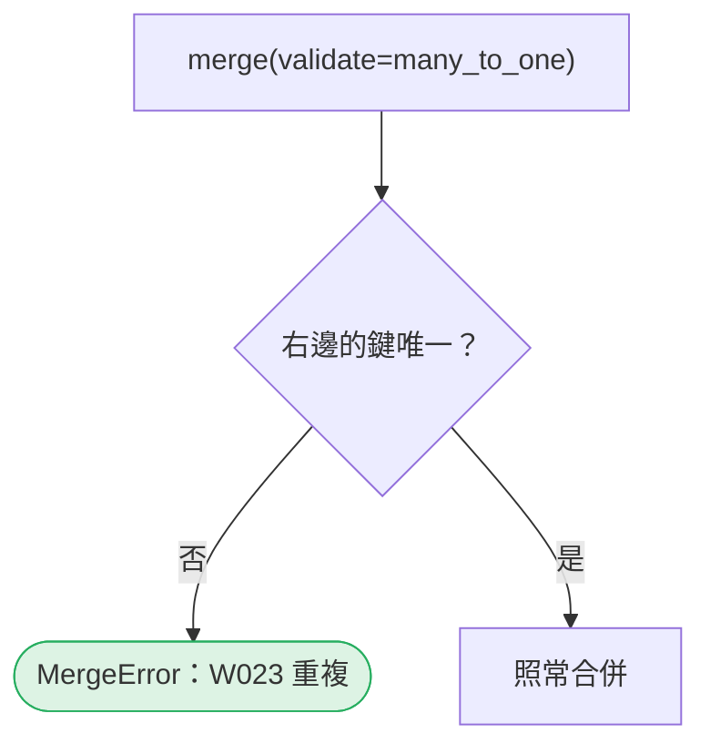
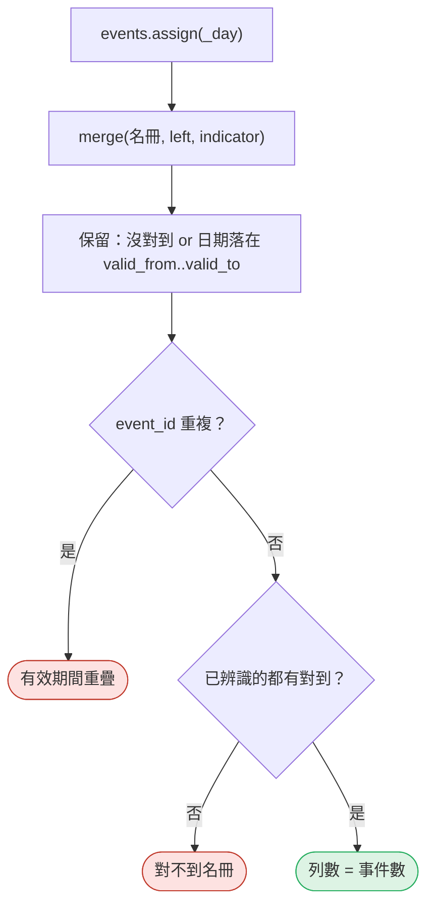
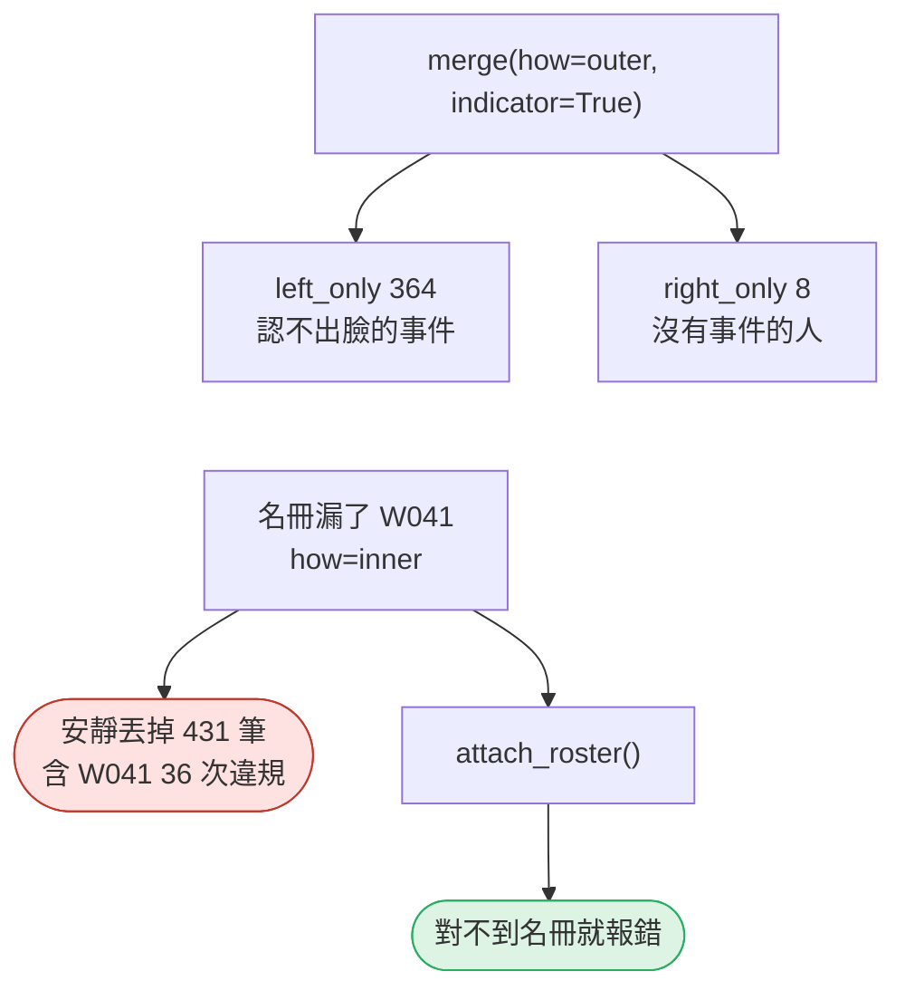
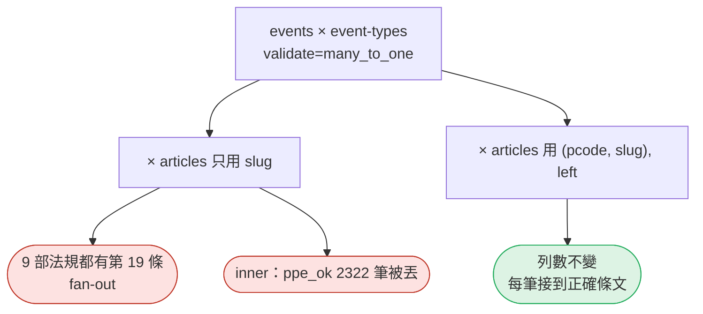
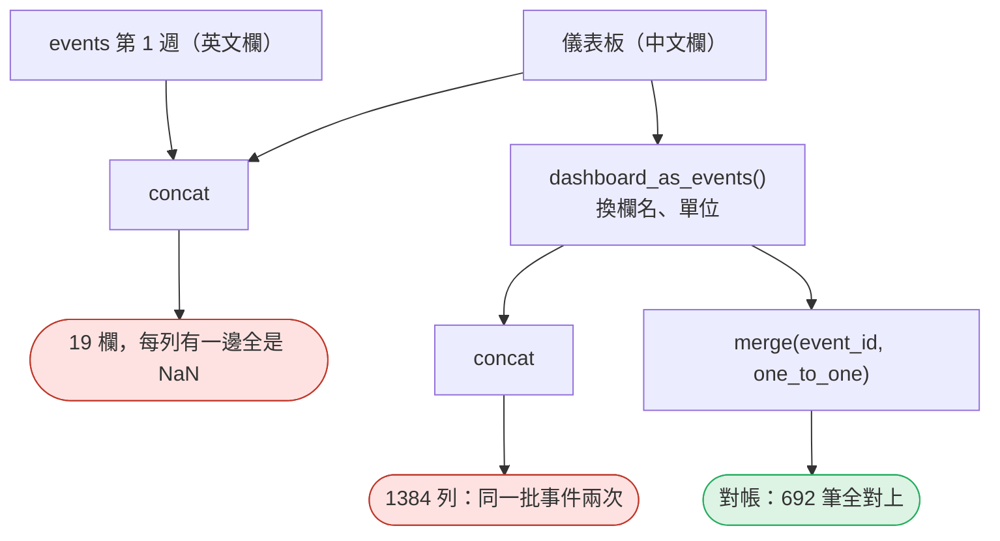
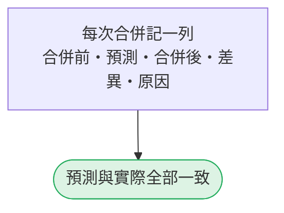

# 14｜跨來源合併與 fan-out

> **2026-10-21 改版：每段一張圖。** 跨來源合併：先預測列數，合併後驗證列數。

[回 18 節課綱](../../course-plans/2026-10-data-analysis-18.md)

## 範例程式碼

- [demo：14_merge_fanout.py](https://github.com/4-learn/data-analysis-and-process-demo/blob/master/2026/14_merge_fanout.py)（與本頁 Demo 逐字相同）
- 練習資料與環境說明：[2026/README](https://github.com/4-learn/data-analysis-and-process-demo/tree/master/2026)

## 學完能做到

| 時間 | 段落 | 學完能做到 |
| --- | --- | --- |
| 0–10 分 | 一、二 | 由鍵的次數預測列數；用 `validate` 擋 fan-out |
| 10–18 分 | 三 | 依有效期間合併名冊 |
| 18–24 分 | 四 | 用 `indicator` 找出誰不見了 |
| 24–35 分 | 五、六 | 三方合併的鍵；`concat` 的欄位對齊 |
| 35–50 分 | Workshop | 每個承攬商的違規率＋列數表 |

## 本節流程



每段都是：**問題 → 位置（黃色）→ 步驟圖 → 程式 → 輸出 → 重點**。

## 零、準備：四份資料

**問題：** 要合併哪幾份資料？

**在流程中的位置：**


**這段做了什麼：**



<!-- fn-table -->
| 函式名稱 | 說明 | 官方文件連結 |
|---|---|---|
| 前面介紹過 | 用法同前，括號內是在哪裡第一次介紹 | [`Path(__file__).resolve().parent`](https://docs.python.org/3.12/library/pathlib.html#pathlib.Path.resolve)（第 02 節）、[`pd.read_csv()`](https://pandas.pydata.org/docs/reference/api/pandas.read_csv.html#pandas.read_csv)（第 02 節）、[`pd.read_json()`](https://pandas.pydata.org/docs/reference/api/pandas.read_json.html#pandas.read_json)（第 03 節）、[`.reset_index()`](https://pandas.pydata.org/docs/reference/api/pandas.DataFrame.reset_index.html#pandas.DataFrame.reset_index)（第 04 節）、[`.drop_duplicates()`](https://pandas.pydata.org/docs/reference/api/pandas.DataFrame.drop_duplicates.html#pandas.DataFrame.drop_duplicates)（第 08 節）、[`Path()`](https://docs.python.org/3.12/library/pathlib.html#pathlib.Path)（爬蟲 10） |

<!-- 節錄: 14_merge_fanout.py -->
```python
import json
from pathlib import Path

import numpy as np
import pandas as pd

DATA = Path(__file__).resolve().parent / "data"
EVENTS = DATA / "events"
VIOLATIONS = {"no_helmet", "no_harness", "restricted_entry"}


def read_events():
    ev = pd.read_json(EVENTS / "events.jsonl", lines=True, dtype=False, convert_dates=False)
    return ev.drop_duplicates("event_id").reset_index(drop=True)


def read_csv(name):
    return pd.read_csv(EVENTS / name, dtype=str, keep_default_na=False)
```

<!-- fn-table -->
| 函式名稱 | 說明 | 官方文件連結 |
|---|---|---|
| 前面介紹過 | 用法同前，括號內是在哪裡第一次介紹 | [`df["欄"]`](https://pandas.pydata.org/docs/user_guide/indexing.html#basics)（第 02 節）、[`df[條件]`](https://pandas.pydata.org/docs/user_guide/indexing.html#boolean-indexing)（第 02 節）、[`pd.read_json()`](https://pandas.pydata.org/docs/reference/api/pandas.read_json.html#pandas.read_json)（第 03 節）、[`s.isin()`](https://pandas.pydata.org/docs/reference/api/pandas.Series.isin.html#pandas.Series.isin)（第 07 節） |

<!-- 節錄: 14_merge_fanout.py -->
```python
ev = read_events()
roster = read_csv("workers.csv")
types = read_csv("event-types.csv")
articles = pd.read_json(DATA / "articles.jsonl", lines=True, dtype=False, convert_dates=False)
ev["violation"] = ev["event_type"].isin(VIOLATIONS)   # 布林；event-types.csv 的 is_violation 是字串
known = ev["worker_id"] != ""
log = []
```

- `violation` 用布林欄；`event-types.csv` 的 `is_violation` 是字串 `"true"`。

## 一、先預測，再執行

**問題：** `merge` 之前，能先算出會有幾列嗎？

**在流程中的位置：**


**這段做了什麼：**



<!-- fn-table -->
| 函式名稱 | 說明 | 官方文件連結 |
|---|---|---|
| `idx1.intersection(idx2)` | 兩組標籤都有的部分（交集） | [文件](https://pandas.pydata.org/docs/reference/api/pandas.Index.intersection.html#pandas.Index.intersection) |
| 前面介紹過 | 用法同前，括號內是在哪裡第一次介紹 | [`.sum()`](https://pandas.pydata.org/docs/reference/api/pandas.Series.sum.html#pandas.Series.sum)（第 02 節）、[`df["欄"]`](https://pandas.pydata.org/docs/user_guide/indexing.html#basics)（第 02 節）、[`.drop()`](https://pandas.pydata.org/docs/reference/api/pandas.DataFrame.drop.html#pandas.DataFrame.drop)（第 03 節）、[`left.merge()`](https://pandas.pydata.org/docs/reference/api/pandas.DataFrame.merge.html#pandas.DataFrame.merge)（第 03 節）、[`df.index`](https://pandas.pydata.org/docs/reference/api/pandas.DataFrame.index.html#pandas.DataFrame.index)（第 05 節）、[`s.value_counts()`](https://pandas.pydata.org/docs/reference/api/pandas.Series.value_counts.html#pandas.Series.value_counts)（第 05 節）、[`s[標籤]`](https://pandas.pydata.org/docs/user_guide/indexing.html#basics)（第 05 節）、[`整欄運算`](https://pandas.pydata.org/docs/user_guide/basics.html#flexible-binary-operations)（第 06 節） |

<!-- 節錄: 14_merge_fanout.py -->
```python
def predict_rows(left, right, on, how):
    """不執行 merge，只看兩邊鍵的出現次數，算出 merge 會產生幾列。"""
    lk = left[on].value_counts()
    rk = right[on].value_counts()
    both = lk.index.intersection(rk.index)
    n = int((lk[both] * rk[both]).sum())                      # 兩邊都有的鍵：左 × 右
    if how in ("left", "outer"):
        n += int(lk.drop(both).sum())                         # 只有左邊有：各留一列
    if how in ("right", "outer"):
        n += int(rk.drop(both).sum())
    return n


def checked_merge(log, step, left, right, reason, **kw):
    """先預測、再執行、再核對；預測不準就停下來，並把結果記進合併前後列數表。"""
    guess = predict_rows(left, right, kw["on"], kw.get("how", "inner"))
    out = left.merge(right, **kw)
    if len(out) != guess:
        raise ValueError(f"{step}：預測 {guess} 列，實際 {len(out)} 列")
    log.append((step, len(left), guess, len(out), reason))
    return out
```

<!-- fn-table -->
| 函式名稱 | 說明 | 官方文件連結 |
|---|---|---|
| 前面介紹過 | 用法同前，括號內是在哪裡第一次介紹 | [`.sum()`](https://pandas.pydata.org/docs/reference/api/pandas.Series.sum.html#pandas.Series.sum)（第 02 節）、[`df["欄"]`](https://pandas.pydata.org/docs/user_guide/indexing.html#basics)（第 02 節）、[`df[條件]`](https://pandas.pydata.org/docs/user_guide/indexing.html#boolean-indexing)（第 02 節）、[`& \| ~`](https://pandas.pydata.org/docs/user_guide/indexing.html#boolean-operators)（第 03 節）、[`left.merge()`](https://pandas.pydata.org/docs/reference/api/pandas.DataFrame.merge.html#pandas.DataFrame.merge)（第 03 節）、[`.nunique()`](https://pandas.pydata.org/docs/reference/api/pandas.Series.nunique.html#pandas.Series.nunique)（第 05 節）、[`df.index`](https://pandas.pydata.org/docs/reference/api/pandas.DataFrame.index.html#pandas.DataFrame.index)（第 05 節）、[`s.value_counts()`](https://pandas.pydata.org/docs/reference/api/pandas.Series.value_counts.html#pandas.Series.value_counts)（第 05 節）、[`s[標籤]`](https://pandas.pydata.org/docs/user_guide/indexing.html#basics)（第 05 節） |

<!-- 節錄: 14_merge_fanout.py -->
```python
print("== 1. 先預測，再執行 ==")
rows_per = roster["worker_id"].value_counts()
multi = rows_per[rows_per > 1]
fan = {w: int((ev["worker_id"] == w).sum()) for w in multi.index}
no_event = len(set(roster["worker_id"]) - set(ev["worker_id"]))
print(f"事件 {len(ev)} 列（已辨識 {int(known.sum())}、未辨識 {int((~known).sum())}）；名冊 {len(roster)} 列、"
      f"不同 worker_id {roster['worker_id'].nunique()}；名冊不只一列的人 "
      + "、".join(f"{w}（{multi[w]} 列、事件 {fan[w]} 筆）" for w in multi.index)
      + f"；名冊上沒有事件的 {no_event} 人")
for how in ("inner", "left", "outer"):
    guess = predict_rows(ev, roster, "worker_id", how)
    got = len(ev.merge(roster, on="worker_id", how=how))
    print(f"how={how:5}  預測 {guess}  實際 {got}  與事件數相差 {got - len(ev):+d}")
extra = sum(fan[w] * (multi[w] - 1) for w in multi.index)
naive = checked_merge(log, "events × workers.csv（只用 worker_id, left）", ev, roster,
                      "、".join(f"{w} 名冊 {multi[w]} 列" for w in multi.index) + f"：{extra} 筆事件被複製",
                      on="worker_id", how="left")
```

```text
== 1. 先預測，再執行 ==
事件 2818 列（已辨識 2454、未辨識 364）；名冊 61 列、不同 worker_id 60；名冊不只一列的人 W023（2 列、事件 52 筆）；名冊上沒有事件的 8 人
how=inner  預測 2506  實際 2506  與事件數相差 -312
how=left   預測 2870  實際 2870  與事件數相差 +52
how=outer  預測 2878  實際 2878  與事件數相差 +60
```

- W023 在名冊有兩列：他的 52 筆各變兩列，left = 2818＋52 = 2870。
- 預測不準就停——**列數是合併的驗收條件**。

## 二、`validate` 讓 fan-out 變成錯誤

**問題：** 怎麼讓 pandas 替你擋 fan-out？

**在流程中的位置：**


**這段做了什麼：**



<!-- fn-table -->
| 函式名稱 | 說明 | 官方文件連結 |
|---|---|---|
| `pd.errors.MergeError` | `merge` 的 `validate` 檢查不通過時拋出的例外 | [文件](https://pandas.pydata.org/docs/reference/api/pandas.errors.MergeError.html#pandas.errors.MergeError) |
| 前面介紹過 | 用法同前，括號內是在哪裡第一次介紹 | [`left.merge()`](https://pandas.pydata.org/docs/reference/api/pandas.DataFrame.merge.html#pandas.DataFrame.merge)（第 03 節） |

<!-- 節錄: 14_merge_fanout.py -->
```python
print("\n== 2. validate 讓 fan-out 變成錯誤 ==")
try:
    ev.merge(roster, on="worker_id", how="left", validate="many_to_one")
except pd.errors.MergeError as exc:
    print("MergeError:", str(exc).splitlines()[0])
```

```text
== 2. validate 讓 fan-out 變成錯誤 ==
MergeError: Merge keys are not unique in right dataset; not a many-to-one merge
```

- 不寫 `validate`，fan-out 不會報錯，只會讓數字變大。

## 三、依有效期間合併

**問題：** W023 換了承攬商，事件該算誰的？

**在流程中的位置：**


**這段做了什麼：**



<!-- fn-table -->
| 函式名稱 | 說明 | 官方文件連結 |
|---|---|---|
| 前面介紹過 | 用法同前，括號內是在哪裡第一次介紹 | [`.any()`](https://pandas.pydata.org/docs/reference/api/pandas.Series.any.html#pandas.Series.any)（第 02 節）、[`.duplicated()`](https://pandas.pydata.org/docs/reference/api/pandas.DataFrame.duplicated.html#pandas.DataFrame.duplicated)（第 02 節）、[`df["欄"]`](https://pandas.pydata.org/docs/user_guide/indexing.html#basics)（第 02 節）、[`df[條件]`](https://pandas.pydata.org/docs/user_guide/indexing.html#boolean-indexing)（第 02 節）、[`& \| ~`](https://pandas.pydata.org/docs/user_guide/indexing.html#boolean-operators)（第 03 節）、[`.drop()`](https://pandas.pydata.org/docs/reference/api/pandas.DataFrame.drop.html#pandas.DataFrame.drop)（第 03 節）、[`.loc[]`](https://pandas.pydata.org/docs/reference/api/pandas.DataFrame.loc.html#pandas.DataFrame.loc)（第 03 節）、[`left.merge()`](https://pandas.pydata.org/docs/reference/api/pandas.DataFrame.merge.html#pandas.DataFrame.merge)（第 03 節）、[`.reset_index()`](https://pandas.pydata.org/docs/reference/api/pandas.DataFrame.reset_index.html#pandas.DataFrame.reset_index)（第 04 節）、[`.tolist()`](https://pandas.pydata.org/docs/reference/api/pandas.Series.tolist.html)（第 04 節）、[`s.unique()`](https://pandas.pydata.org/docs/reference/api/pandas.Series.unique.html#pandas.Series.unique)（第 05 節）、[`df.assign()`](https://pandas.pydata.org/docs/reference/api/pandas.DataFrame.assign.html#pandas.DataFrame.assign)（第 06 節）、[`s.str[a:b]`](https://pandas.pydata.org/docs/user_guide/text.html#indexing-with-str)（第 06 節）、[`s.eq()`](https://pandas.pydata.org/docs/reference/api/pandas.Series.eq.html#pandas.Series.eq)（第 12 節） |

<!-- 節錄: 14_merge_fanout.py -->
```python
def attach_roster(events, roster):
    """事件接名冊：以事件「當地日期」落在 valid_from..valid_to（空＝至今）的那一列為準。

    left join：認不出人的事件保留；合併後列數必須等於事件數，否則就是 fan-out。
    """
    if roster["valid_from"].eq("").any():
        raise ValueError("名冊有空的 valid_from")
    day = events["event_time"].str[:10]                       # event_time 是 +08:00 當地時間
    m = events.assign(_day=day).merge(roster, on="worker_id", how="left", indicator=True)
    in_range = (m["_day"] >= m["valid_from"]) & ((m["valid_to"] == "") | (m["_day"] <= m["valid_to"]))
    keep = (m["_merge"] == "left_only") | in_range
    out = m[keep].drop(columns="_day")
    if out["event_id"].duplicated().any():
        dup = out.loc[out["event_id"].duplicated(), "worker_id"].unique().tolist()
        raise ValueError(f"名冊有效期間重疊：{dup[:5]}")
    unmatched = set(out.loc[(out["_merge"] == "left_only") & (out["worker_id"] != ""), "event_id"])
    lost = sorted(set(events.loc[events["worker_id"] != "", "event_id"]) - set(out["event_id"]) | unmatched)
    if lost:
        raise ValueError(f"{len(lost)} 筆已辨識事件對不到名冊（不在名冊或不在有效期間內），例如 {lost[0]}")
    if len(out) != len(events):
        raise ValueError(f"合併前 {len(events)} 列，合併後 {len(out)} 列")
    return out.reset_index(drop=True)
```

<!-- fn-table -->
| 函式名稱 | 說明 | 官方文件連結 |
|---|---|---|
| 前面介紹過 | 用法同前，括號內是在哪裡第一次介紹 | [`.sum()`](https://pandas.pydata.org/docs/reference/api/pandas.Series.sum.html#pandas.Series.sum)（第 02 節）、[`df.groupby()`](https://pandas.pydata.org/docs/reference/api/pandas.DataFrame.groupby.html#pandas.DataFrame.groupby)（第 02 節）、[`df.to_string()`](https://pandas.pydata.org/docs/reference/api/pandas.DataFrame.to_string.html#pandas.DataFrame.to_string)（第 02 節）、[`df["欄"]`](https://pandas.pydata.org/docs/user_guide/indexing.html#basics)（第 02 節）、[`df[條件]`](https://pandas.pydata.org/docs/user_guide/indexing.html#boolean-indexing)（第 02 節）、[`groupby().size()`](https://pandas.pydata.org/docs/reference/api/pandas.api.typing.DataFrameGroupBy.size.html#pandas.api.typing.DataFrameGroupBy.size)（第 02 節）、[`.loc[]`](https://pandas.pydata.org/docs/reference/api/pandas.DataFrame.loc.html#pandas.DataFrame.loc)（第 03 節）、[`pd.DataFrame()`](https://pandas.pydata.org/docs/reference/api/pandas.DataFrame.html#pandas.DataFrame)（第 05 節）、[`s.str[a:b]`](https://pandas.pydata.org/docs/user_guide/text.html#indexing-with-str)（第 06 節）、[`groupby().agg()`](https://pandas.pydata.org/docs/reference/api/pandas.api.typing.DataFrameGroupBy.agg.html#pandas.api.typing.DataFrameGroupBy.agg)（第 12 節）、[`.apply()`](https://pandas.pydata.org/docs/reference/api/pandas.Series.apply.html#pandas.Series.apply)（第 13 節） |

<!-- 節錄: 14_merge_fanout.py -->
```python
print("\n== 3. 依有效期間合併 ==")
staff = attach_roster(ev, roster)
log.append(("events × workers.csv（依有效期間）", len(ev), len(ev), len(staff), "attach_roster() 內部核對：每筆事件只對到一段名冊"))
w23 = staff[staff["worker_id"] == "W023"].groupby("contractor", sort=False).agg(
    事件=("event_id", "size"), 違規=("violation", "sum"), 最早=("event_time", "min"), 最晚=("event_time", "max"))
w23[["最早", "最晚"]] = w23[["最早", "最晚"]].apply(lambda s: s.str[:10])
print(w23.to_string())
by = pd.DataFrame({
    "天真合併": naive[naive["violation"]].groupby("contractor").size(),
    "依有效期間": staff[staff["violation"]].groupby("contractor").size(),
})
print(by.to_string())
print(f"違規合計：天真合併 {int(by['天真合併'].sum())}、依有效期間 {int(by['依有效期間'].sum())}"
      f"（已辨識違規 {int(ev.loc[known, 'violation'].sum())}）")
```

```text
== 3. 依有效期間合併 ==
            事件  違規          最早          最晚
contractor                                
乙鋼構         29   2  2026-08-31  2026-09-12
丙土木         23   3  2026-09-14  2026-09-26
            天真合併  依有效期間
contractor             
丙土木          115    113
乙鋼構          204    201
甲營造          105    105
違規合計：天真合併 424、依有效期間 419（已辨識違規 419）
```

- W023 的 52 筆分成 29＋23，在 09-13／09-14 切開。
- 天真合併違規 424 ≠ 已辨識違規 419：**加總對不上就是 fan-out**。

## 四、`how` 與 `indicator`：誰不見了

**問題：** `how` 選錯，會丟掉誰？

**在流程中的位置：**


**這段做了什麼：**



<!-- fn-table -->
| 函式名稱 | 說明 | 官方文件連結 |
|---|---|---|
| 前面介紹過 | 用法同前，括號內是在哪裡第一次介紹 | [`.sum()`](https://pandas.pydata.org/docs/reference/api/pandas.Series.sum.html#pandas.Series.sum)（第 02 節）、[`df.to_string()`](https://pandas.pydata.org/docs/reference/api/pandas.DataFrame.to_string.html#pandas.DataFrame.to_string)（第 02 節）、[`df["欄"]`](https://pandas.pydata.org/docs/user_guide/indexing.html#basics)（第 02 節）、[`df[條件]`](https://pandas.pydata.org/docs/user_guide/indexing.html#boolean-indexing)（第 02 節）、[`& \| ~`](https://pandas.pydata.org/docs/user_guide/indexing.html#boolean-operators)（第 03 節）、[`.loc[]`](https://pandas.pydata.org/docs/reference/api/pandas.DataFrame.loc.html#pandas.DataFrame.loc)（第 03 節）、[`left.merge()`](https://pandas.pydata.org/docs/reference/api/pandas.DataFrame.merge.html#pandas.DataFrame.merge)（第 03 節）、[`.tolist()`](https://pandas.pydata.org/docs/reference/api/pandas.Series.tolist.html)（第 04 節）、[`s.unique()`](https://pandas.pydata.org/docs/reference/api/pandas.Series.unique.html#pandas.Series.unique)（第 05 節）、[`s.value_counts()`](https://pandas.pydata.org/docs/reference/api/pandas.Series.value_counts.html#pandas.Series.value_counts)（第 05 節）、[`s.max()`](https://pandas.pydata.org/docs/reference/api/pandas.Series.max.html#pandas.Series.max)（第 06 節）、[`s.min()`](https://pandas.pydata.org/docs/reference/api/pandas.Series.min.html#pandas.Series.min)（第 06 節）、[`s.isin()`](https://pandas.pydata.org/docs/reference/api/pandas.Series.isin.html#pandas.Series.isin)（第 07 節）、[`.drop_duplicates()`](https://pandas.pydata.org/docs/reference/api/pandas.DataFrame.drop_duplicates.html#pandas.DataFrame.drop_duplicates)（第 08 節） |

<!-- 節錄: 14_merge_fanout.py -->
```python
print("\n== 4. how 與 indicator：誰不見了 ==")
audit = ev.merge(roster.drop_duplicates("worker_id"), on="worker_id", how="outer", indicator=True)
print(audit["_merge"].value_counts().to_string())
left_only = audit[audit["_merge"] == "left_only"]
right_only = audit[audit["_merge"] == "right_only"]
print(f"left_only 的 worker_id：{left_only['worker_id'].unique().tolist()}；right_only：{right_only['worker_id'].min()}…{right_only['worker_id'].max()}")
old = roster[roster["worker_id"] != "W041"]          # 假設：拿到一份漏了 W041 的舊名冊
inner = ev.merge(old.drop_duplicates("worker_id"), on="worker_id", how="inner")
gone = ev[~ev["event_id"].isin(inner["event_id"])]
print(f"名冊漏了 W041 時 how=inner：{len(ev)} → {len(inner)} 列；消失 {len(gone)} 筆，"
      f"其中未辨識 {int((gone['worker_id'] == '').sum())}、W041 {int((gone['worker_id'] == 'W041').sum())}（違規 {int(gone.loc[gone['worker_id'] == 'W041', 'violation'].sum())}）")
try:
    attach_roster(ev, old)
except ValueError as exc:
    print("attach_roster:", exc)
checked_merge(log, "events × workers.csv（名冊去重, inner）", ev, roster.drop_duplicates("worker_id"),
              f"未辨識 {int((~known).sum())} 筆沒有 worker_id 可對", on="worker_id", how="inner")
```

```text
== 4. how 與 indicator：誰不見了 ==
_merge
both          2454
left_only      364
right_only       8
left_only 的 worker_id：['']；right_only：W053…W060
名冊漏了 W041 時 how=inner：2818 → 2387 列；消失 431 筆，其中未辨識 364、W041 67（違規 36）
attach_roster: 67 筆已辨識事件對不到名冊（不在名冊或不在有效期間內），例如 cam-01-20260923-0010
```

- `how` 不是語法問題，是「**誰可以消失**」的決定。
- 事件接參考資料：用 `left`，再檢查 `left_only` 是不是預期的。

## 五、三方合併：事件 → 類型 → 法條

**問題：** 只用 `slug` 接條文會怎樣？

**在流程中的位置：**


**這段做了什麼：**



<!-- fn-table -->
| 函式名稱 | 說明 | 官方文件連結 |
|---|---|---|
| 前面介紹過 | 用法同前，括號內是在哪裡第一次介紹 | [`df["欄"]`](https://pandas.pydata.org/docs/user_guide/indexing.html#basics)（第 02 節）、[`df[條件]`](https://pandas.pydata.org/docs/user_guide/indexing.html#boolean-indexing)（第 02 節）、[`& \| ~`](https://pandas.pydata.org/docs/user_guide/indexing.html#boolean-operators)（第 03 節）、[`.drop()`](https://pandas.pydata.org/docs/reference/api/pandas.DataFrame.drop.html#pandas.DataFrame.drop)（第 03 節）、[`.isna()`](https://pandas.pydata.org/docs/reference/api/pandas.Series.isna.html#pandas.Series.isna)（第 03 節）、[`.loc[]`](https://pandas.pydata.org/docs/reference/api/pandas.DataFrame.loc.html#pandas.DataFrame.loc)（第 03 節）、[`left.merge()`](https://pandas.pydata.org/docs/reference/api/pandas.DataFrame.merge.html#pandas.DataFrame.merge)（第 03 節）、[`.tolist()`](https://pandas.pydata.org/docs/reference/api/pandas.Series.tolist.html)（第 04 節）、[`s.unique()`](https://pandas.pydata.org/docs/reference/api/pandas.Series.unique.html#pandas.Series.unique)（第 05 節）、[`.drop_duplicates()`](https://pandas.pydata.org/docs/reference/api/pandas.DataFrame.drop_duplicates.html#pandas.DataFrame.drop_duplicates)（第 08 節）、[`df.values`](https://pandas.pydata.org/docs/reference/api/pandas.DataFrame.values.html#pandas.DataFrame.values)（第 13 節） |

<!-- 節錄: 14_merge_fanout.py -->
```python
def attach_articles(events, types, articles):
    """事件 → 事件類型 → 法條原文。鍵是 (pcode, slug)，不是只有 slug。"""
    cols = ["pcode", "slug", "law_name", "article_no", "content", "source_url"]
    m = (events.merge(types, on="event_type", how="left", validate="many_to_one", indicator="_type")
         .merge(articles[cols], on=["pcode", "slug"], how="left", validate="many_to_one"))
    unknown = m.loc[m["_type"] == "left_only", "event_type"].unique().tolist()
    if unknown:
        raise ValueError(f"事件類型不在對照表：{unknown}")
    no_text = m[(m["is_violation"] == "true") & m["content"].isna()]
    if len(no_text):
        raise ValueError(f"違規事件找不到法條：{no_text[['event_type', 'pcode', 'slug']].drop_duplicates().values.tolist()}")
    if len(m) != len(events):
        raise ValueError(f"合併前 {len(events)} 列，合併後 {len(m)} 列")
    return m.drop(columns="_type")
```

<!-- fn-table -->
| 函式名稱 | 說明 | 官方文件連結 |
|---|---|---|
| `s.items()` | 逐一取出（標籤, 值），可以放進 `for` 迴圈 | [文件](https://pandas.pydata.org/docs/reference/api/pandas.Series.items.html#pandas.Series.items) |
| `s.str.replace(舊, 新, regex=)` | 每個字串裡的文字替換 | [文件](https://pandas.pydata.org/docs/reference/api/pandas.Series.str.replace.html#pandas.Series.str.replace) |
| 前面介紹過 | 用法同前，括號內是在哪裡第一次介紹 | [`.sum()`](https://pandas.pydata.org/docs/reference/api/pandas.Series.sum.html#pandas.Series.sum)（第 02 節）、[`df.groupby()`](https://pandas.pydata.org/docs/reference/api/pandas.DataFrame.groupby.html#pandas.DataFrame.groupby)（第 02 節）、[`df.to_string()`](https://pandas.pydata.org/docs/reference/api/pandas.DataFrame.to_string.html#pandas.DataFrame.to_string)（第 02 節）、[`df["欄"]`](https://pandas.pydata.org/docs/user_guide/indexing.html#basics)（第 02 節）、[`df[條件]`](https://pandas.pydata.org/docs/user_guide/indexing.html#boolean-indexing)（第 02 節）、[`& \| ~`](https://pandas.pydata.org/docs/user_guide/indexing.html#boolean-operators)（第 03 節）、[`.loc[]`](https://pandas.pydata.org/docs/reference/api/pandas.DataFrame.loc.html#pandas.DataFrame.loc)（第 03 節）、[`left.merge()`](https://pandas.pydata.org/docs/reference/api/pandas.DataFrame.merge.html#pandas.DataFrame.merge)（第 03 節）、[`d.items()`](https://docs.python.org/3.12/library/stdtypes.html#dict.items)（第 05 節）、[`df.index`](https://pandas.pydata.org/docs/reference/api/pandas.DataFrame.index.html#pandas.DataFrame.index)（第 05 節）、[`s.value_counts()`](https://pandas.pydata.org/docs/reference/api/pandas.Series.value_counts.html#pandas.Series.value_counts)（第 05 節）、[`s.str[a:b]`](https://pandas.pydata.org/docs/user_guide/text.html#indexing-with-str)（第 06 節）、[`整欄運算`](https://pandas.pydata.org/docs/user_guide/basics.html#flexible-binary-operations)（第 06 節）、[`s.isin()`](https://pandas.pydata.org/docs/reference/api/pandas.Series.isin.html#pandas.Series.isin)（第 07 節）、[`s.get()`](https://pandas.pydata.org/docs/reference/api/pandas.Series.get.html#pandas.Series.get)（第 08 節）、[`groupby().agg()`](https://pandas.pydata.org/docs/reference/api/pandas.api.typing.DataFrameGroupBy.agg.html#pandas.api.typing.DataFrameGroupBy.agg)（第 12 節） |

<!-- 節錄: 14_merge_fanout.py -->
```python
print("\n== 5. 三方合併：事件 → 類型 → 法條原文 ==")
typed = ev.merge(types, on="event_type", validate="many_to_one")
per_slug = articles["slug"].value_counts()
fan_out = {s: int(per_slug.get(s, 0)) for s in types.loc[types["is_violation"] == "true", "slug"]}
dropped = typed.loc[~typed["slug"].isin(per_slug.index), "event_type"].value_counts()
slug_only = checked_merge(log, "× event-types × articles（只用 slug）", typed, articles,
                          "違規 fan-out（" + "、".join(f"{s} 對 {k} 部" for s, k in fan_out.items() if k > 1) + "）＋"
                          + "、".join(f"{e} {n} 筆" for e, n in dropped.items()) + "被 inner 丟掉", on="slug")
print(f"只用 slug 接 articles：{len(ev)} → {len(slug_only)} 列；" + "、".join(f"'{s}' 對到 {k} 部" for s, k in fan_out.items()))
full = attach_articles(ev, types, articles)
log.append(("× event-types × articles（pcode＋slug, left）", len(ev), len(ev), len(full), "attach_articles() 內部核對：無差異"))
per_type = (full[full["violation"]]
            .groupby(["event_type", "law_name", "article_no"], sort=False)
            .agg(事件數=("event_id", "size"), 條文=("content", "first")))
per_type["條文"] = per_type["條文"].str.replace("\n", " ").str[:28] + "…"
print(per_type.to_string())
print(f"ppe_ok {int((full['event_type'] == 'ppe_ok').sum())} 筆沒有對應法條（不是違規，content 為 NaN）")
```

```text
== 5. 三方合併：事件 → 類型 → 法條原文 ==
只用 slug 接 articles：2818 → 2374 列；'11-1' 對到 1 部、'19' 對到 9 部、'24' 對到 8 部
                                        事件數                             條文
event_type       law_name   article_no                                    
no_harness       營造安全衛生設施標準 第 19 條      170  雇主對於高度二公尺以上之屋頂、鋼梁、開口部分、階梯、樓梯…
restricted_entry 營造安全衛生設施標準 第 24 條       74  雇主對於坡度小於十五度之勞工作業區域，距離開口部分、開放…
no_helmet        營造安全衛生設施標準 第 11-1 條    252  雇主對於進入營繕工程工作場所作業人員，應提供適當安全帽，…
ppe_ok 2322 筆沒有對應法條（不是違規，content 為 NaN）
```

- `slug` 是「第幾條」，不是哪部法規的哪一條。**鍵要完整**。

## 六、`concat`：欄名不同就不會對齊

**問題：** 兩份同一批事件的表，`concat` 起來會怎樣？

**在流程中的位置：**


**這段做了什麼：**



<!-- fn-table -->
| 函式名稱 | 說明 | 官方文件連結 |
|---|---|---|
| `s.str.rstrip(字元)` | 去掉每個字串右邊的指定字元 | [文件](https://pandas.pydata.org/docs/reference/api/pandas.Series.str.rstrip.html#pandas.Series.str.rstrip) |
| 前面介紹過 | 用法同前，括號內是在哪裡第一次介紹 | [`df["欄"]`](https://pandas.pydata.org/docs/user_guide/indexing.html#basics)（第 02 節）、[`pd.to_datetime()`](https://pandas.pydata.org/docs/reference/api/pandas.to_datetime.html#pandas.to_datetime)（第 02 節）、[`path.read_text()`](https://docs.python.org/3.12/library/pathlib.html#pathlib.Path.read_text)（第 03 節）、[`s.map()`](https://pandas.pydata.org/docs/reference/api/pandas.Series.map.html#pandas.Series.map)（第 03 節）、[`d.items()`](https://docs.python.org/3.12/library/stdtypes.html#dict.items)（第 05 節）、[`pd.DataFrame()`](https://pandas.pydata.org/docs/reference/api/pandas.DataFrame.html#pandas.DataFrame)（第 05 節）、[`pd.to_numeric()`](https://pandas.pydata.org/docs/reference/api/pandas.to_numeric.html#pandas.to_numeric)（第 06 節）、[`整欄運算`](https://pandas.pydata.org/docs/user_guide/basics.html#flexible-binary-operations)（第 06 節）、[`.replace()`](https://pandas.pydata.org/docs/reference/api/pandas.Series.replace.html#pandas.Series.replace)（第 08 節）、[`np.nan`](https://numpy.org/doc/stable/reference/constants.html#numpy.nan)（第 08 節）、[`.strftime()`](https://pandas.pydata.org/docs/reference/api/pandas.Series.dt.strftime.html#pandas.Series.dt.strftime)（第 10 節）、[`json.loads()`](https://docs.python.org/3.12/library/json.html#json.loads)（爬蟲 03） |

<!-- 節錄: 14_merge_fanout.py -->
```python
def dashboard_as_events(dash, types):
    """把儀表板匯出轉成事件表的欄名與單位，才能跟 events 對齊。"""
    zones = {v["name"]: k for k, v in json.loads((EVENTS / "MANIFEST.json").read_text(encoding="utf-8"))["zones"].items()}
    return pd.DataFrame({
        "event_id": dash["事件編號"],
        "zone": dash["區域"].map(zones),
        "camera_id": dash["攝影機"],
        "worker_id": dash["人員"].replace("未辨識", ""),
        "event_type": dash["事件"].map(dict(zip(types["label_zh"], types["event_type"]))),
        "confidence": pd.to_numeric(dash["信心度"].str.rstrip("%").replace("N/A", np.nan)) / 100,
        "event_time": pd.to_datetime(dash["發生時間"], format="%Y/%m/%d %H:%M").dt.strftime("%Y-%m-%dT%H:%M"),
    })
```

<!-- fn-table -->
| 函式名稱 | 說明 | 官方文件連結 |
|---|---|---|
| 前面介紹過 | 用法同前，括號內是在哪裡第一次介紹 | [`.duplicated()`](https://pandas.pydata.org/docs/reference/api/pandas.DataFrame.duplicated.html#pandas.DataFrame.duplicated)（第 02 節）、[`.sum()`](https://pandas.pydata.org/docs/reference/api/pandas.Series.sum.html#pandas.Series.sum)（第 02 節）、[`df.columns`](https://pandas.pydata.org/docs/reference/api/pandas.DataFrame.columns.html#pandas.DataFrame.columns)（第 02 節）、[`df["欄"]`](https://pandas.pydata.org/docs/user_guide/indexing.html#basics)（第 02 節）、[`df[條件]`](https://pandas.pydata.org/docs/user_guide/indexing.html#boolean-indexing)（第 02 節）、[`pd.concat()`](https://pandas.pydata.org/docs/reference/api/pandas.concat.html#pandas.concat)（第 02 節）、[`pd.read_csv()`](https://pandas.pydata.org/docs/reference/api/pandas.read_csv.html#pandas.read_csv)（第 02 節）、[`.drop()`](https://pandas.pydata.org/docs/reference/api/pandas.DataFrame.drop.html#pandas.DataFrame.drop)（第 03 節）、[`.isna()`](https://pandas.pydata.org/docs/reference/api/pandas.Series.isna.html#pandas.Series.isna)（第 03 節）、[`df.shape`](https://pandas.pydata.org/docs/reference/api/pandas.DataFrame.shape.html#pandas.DataFrame.shape)（第 03 節）、[`left.merge()`](https://pandas.pydata.org/docs/reference/api/pandas.DataFrame.merge.html#pandas.DataFrame.merge)（第 03 節）、[`.to_dict()`](https://pandas.pydata.org/docs/reference/api/pandas.Series.to_dict.html#pandas.Series.to_dict)（第 05 節）、[`s.value_counts()`](https://pandas.pydata.org/docs/reference/api/pandas.Series.value_counts.html#pandas.Series.value_counts)（第 05 節）、[`s[標籤]`](https://pandas.pydata.org/docs/user_guide/indexing.html#basics)（第 05 節）、[`s.str[a:b]`](https://pandas.pydata.org/docs/user_guide/text.html#indexing-with-str)（第 06 節）、[`整欄運算`](https://pandas.pydata.org/docs/user_guide/basics.html#flexible-binary-operations)（第 06 節）、[`s.abs()`](https://pandas.pydata.org/docs/reference/api/pandas.Series.abs.html#pandas.Series.abs)（第 08 節） |

<!-- 節錄: 14_merge_fanout.py -->
```python
print("\n== 6. concat：欄名不同就不會對齊 ==")
dash = pd.read_csv(EVENTS / "dashboard-export.csv", dtype=str, keep_default_na=False, encoding="utf-8-sig")
week1 = ev[ev["event_time"] < "2026-09-07"].drop(columns="violation")
stacked = pd.concat([week1, dash], ignore_index=True)
print(f"events 第 1 週 {week1.shape} ＋ 儀表板 {dash.shape} → {stacked.shape}")
half = stacked.isna().sum()
print(f"{int((half == len(week1)).sum())} 欄恰好有 {len(week1)} 個 NaN；例如 event_id 缺 {half['event_id']}、事件編號 缺 {half['事件編號']}")
shared = set(week1.columns) & set(dash.columns)
log.append(("concat events 第 1 週 ＋ 儀表板（原欄名）", len(week1), len(week1) + len(dash), len(stacked),
            f"欄名相同的 {len(shared)} 欄：{week1.shape[1]}＋{dash.shape[1]}＝{stacked.shape[1]} 欄，每列有一邊全是 NaN"))
aligned = dashboard_as_events(dash, types)
again = pd.concat([week1[aligned.columns], aligned], ignore_index=True)
print(f"轉成相同欄名後 concat：{again.shape}；event_id 重複 {int(again['event_id'].duplicated().sum())} 筆——同一週、同一批事件")
check = week1.merge(aligned, on="event_id", how="outer", validate="one_to_one", indicator=True, suffixes=("", "_dash"))
both = check[check["_merge"] == "both"]
diff = {c: int((both[c] != both[c + "_dash"]).sum()) for c in ["zone", "camera_id", "worker_id", "event_type"]}
diff["event_time"] = int((both["event_time"].str[:16] != both["event_time_dash"]).sum())
diff["confidence"] = int(((both["confidence"] - both["confidence_dash"]).abs() > 0.005).sum())
print(f"改用 merge 對帳：{check['_merge'].value_counts().to_dict()}；欄位不一致 {diff}")
```

```text
== 6. concat：欄名不同就不會對齊 ==
events 第 1 週 (692, 12) ＋ 儀表板 (692, 7) → (1384, 19)
18 欄恰好有 692 個 NaN；例如 event_id 缺 692、事件編號 缺 692
轉成相同欄名後 concat：(1384, 7)；event_id 重複 692 筆——同一週、同一批事件
改用 merge 對帳：{'both': 692, 'left_only': 0, 'right_only': 0}；欄位不一致 {'zone': 0, 'camera_id': 0, 'worker_id': 0, 'event_type': 0, 'event_time': 0, 'confidence': 0}
```

- `concat` 只看欄名；欄名對齊了，也要先問是不是**同一批資料**。
- 兩份來源要比對，用 `merge`，不是 `concat`。

## 七、合併前後列數

**問題：** 最後交出什麼證據？

**在流程中的位置：**


**這段做了什麼：**



<!-- fn-table -->
| 函式名稱 | 說明 | 官方文件連結 |
|---|---|---|
| `df.insert(位置, 欄名, 值)` | 在指定位置插入一欄（直接改原表） | [文件](https://pandas.pydata.org/docs/reference/api/pandas.DataFrame.insert.html#pandas.DataFrame.insert) |
| 前面介紹過 | 用法同前，括號內是在哪裡第一次介紹 | [`df.to_string()`](https://pandas.pydata.org/docs/reference/api/pandas.DataFrame.to_string.html#pandas.DataFrame.to_string)（第 02 節）、[`df["欄"]`](https://pandas.pydata.org/docs/user_guide/indexing.html#basics)（第 02 節）、[`df[條件]`](https://pandas.pydata.org/docs/user_guide/indexing.html#boolean-indexing)（第 02 節）、[`pd.DataFrame()`](https://pandas.pydata.org/docs/reference/api/pandas.DataFrame.html#pandas.DataFrame)（第 05 節）、[`.all()`](https://pandas.pydata.org/docs/reference/api/pandas.Series.all.html#pandas.Series.all)（第 06 節）、[`整欄運算`](https://pandas.pydata.org/docs/user_guide/basics.html#flexible-binary-operations)（第 06 節） |

<!-- 節錄: 14_merge_fanout.py -->
```python
print("\n== 7. 合併前後列數 ==")
report = pd.DataFrame(log, columns=["步驟", "合併前", "預測", "合併後", "原因"])
report.insert(4, "差異", report["合併後"] - report["合併前"])
print(report.to_string(index=False))
print(f"預測與實際全部一致：{bool((report['預測'] == report['合併後']).all())}")
```

```text
== 7. 合併前後列數 ==
                                        步驟  合併前   預測  合併後   差異                                                    原因
  events × workers.csv（只用 worker_id, left） 2818 2870 2870   52                                 W023 名冊 2 列：52 筆事件被複製
               events × workers.csv（依有效期間） 2818 2818 2818    0                      attach_roster() 內部核對：每筆事件只對到一段名冊
         events × workers.csv（名冊去重, inner） 2818 2454 2454 -364                              未辨識 364 筆沒有 worker_id 可對
         × event-types × articles（只用 slug） 2818 2374 2374 -444 違規 fan-out（19 對 9 部、24 對 8 部）＋ppe_ok 2322 筆被 inner 丟掉
× event-types × articles（pcode＋slug, left） 2818 2818 2818    0                            attach_articles() 內部核對：無差異
            concat events 第 1 週 ＋ 儀表板（原欄名）  692 1384 1384  692                       欄名相同的 0 欄：12＋7＝19 欄，每列有一邊全是 NaN
預測與實際全部一致：True
```

- 列數表是合併的**驗收紀錄**：差異的每一列都有原因。

## Workshop：每個承攬商的違規率

### 任務與時間

**35–40 分鐘：先預測。** 老闆要「每個承攬商的違規率（違規 ÷ 已辨識事件）」。在執行任何 `merge` 之前，寫下：只用 `worker_id` 做 `inner` 合併，**甲營造、乙鋼構、丙土木各會有幾列？** 提示：W023 的 52 筆會同時出現在乙鋼構與丙土木。

**40–45 分鐘：執行並核對。** 用 `attach_roster()` 合併，算出三個承攬商的事件數、違規數、違規率。再用天真的 `inner` 合併算一次。兩張表差在哪幾格？各承攬商的事件數加總，應該等於多少？

<!-- fn-table -->
| 函式名稱 | 說明 | 官方文件連結 |
|---|---|---|
| 前面介紹過 | 用法同前，括號內是在哪裡第一次介紹 | [`df.groupby()`](https://pandas.pydata.org/docs/reference/api/pandas.DataFrame.groupby.html#pandas.DataFrame.groupby)（第 02 節）、[`df["欄"]`](https://pandas.pydata.org/docs/user_guide/indexing.html#basics)（第 02 節）、[`df[條件]`](https://pandas.pydata.org/docs/user_guide/indexing.html#boolean-indexing)（第 02 節）、[`s.isin()`](https://pandas.pydata.org/docs/reference/api/pandas.Series.isin.html#pandas.Series.isin)（第 07 節）、[`groupby().agg()`](https://pandas.pydata.org/docs/reference/api/pandas.api.typing.DataFrameGroupBy.agg.html#pandas.api.typing.DataFrameGroupBy.agg)（第 12 節） |

```python
# Workshop 起手式，本節測試不涵蓋這段
ev = read_events()
ev["violation"] = ev["event_type"].isin(VIOLATIONS)
staff = attach_roster(ev, read_csv("workers.csv"))
table = staff[staff["worker_id"] != ""].groupby("contractor").agg(...)   # 你來寫
```

**45–50 分鐘：抓 AI 的錯。** 請 OpenCode 寫「把事件表和名冊合併，算每個承攬商的違規率」。拿它的程式檢查：它用哪個 `how`？有沒有 `validate`？W023 被算到哪裡？各承攬商事件數加總是 2454 嗎？若它有處理有效期間，再把 `event_time` 換成 UTC 給它跑一次。

### 參考判讀

:::spoiler 教師用（點開）
- 依有效期間（教師實測）：甲營造 817 事件／105 違規（0.129）、乙鋼構 846／201（0.238）、丙土木 791／113（0.143），事件加總 **2454**、違規加總 **419**。
- 天真 `inner`：甲營造 817／105、乙鋼構 **869／204**、丙土木 **820／115**，事件加總 2506。甲營造沒有 W023，所以完全相同；乙鋼構多 23 筆（W023 轉走之後的事件）、丙土木多 29 筆（W023 轉來之前的事件）——**每一家都多算了「不屬於自己的那一段」**。違規率只差千分之三，看起來沒事；但事件數加總 2506 ≠ 2454，核對一下就會發現。
- 常見的 AI 版本是 `pd.merge(events, workers, on="worker_id")`：預設 `inner`、沒有 `validate`、沒有去重。它同時犯了三個錯——沒去重（第 12 節）、未辨識的 364 筆消失、W023 fan-out——但三個錯都不會報錯。
- 若 AI 版本有處理有效期間，但拿 **UTC 日期**比 `valid_from`：教師實測 `attach_roster()` 會停下來，「4 筆已辨識事件對不到名冊（不在名冊或不在有效期間內）」——2026-08-31 早上 7 點多的事件在 UTC 是 08-30，早於所有人的 `valid_from`。沒有做這個檢查的版本，會讓這 4 筆安靜地掉到「沒有承攬商」。
- 名冊的期間若有重疊（例如把 W023 第一列的 `valid_to` 改成 2026-09-20），`attach_roster()` 拋「名冊有效期間重疊：['W023']」。這代表名冊本身有錯，要回頭找人事，不是在 pandas 裡挑一列。
:::

### 驗收

- 交出「合併前後列數」表：至少包含天真合併與依有效期間合併兩列，每列有**預測**、實際、差異與原因。
- 預測要在執行 `merge` **之前**由鍵的出現次數算出（可用 `predict_rows()` 或自己寫），不是把實際列數抄進預測欄；預測與實際一致，不一致時說明你的預測漏了什麼。
- 每個承攬商的事件數加總等於 2454、違規加總等於 419（用 `assert` 寫出來）。
- 能說出為什麼 `roster.drop_duplicates("worker_id")` 讓 `validate` 通過，卻是錯的。
- AI 版本至少指出兩個錯，並說明哪一個會讓數字變大、哪一個會讓數字變小。

## 附錄：完整程式

```bash
python3 14_merge_fanout.py
```

<!-- fn-table -->
| 函式名稱 | 說明 | 官方文件連結 |
|---|---|---|
| （同上） | 這支程式用到的函式，都已在上面各段的表格介紹過 | — |

<!-- demo: 14_merge_fanout.py -->
```python
"""第 14 節：跨來源合併——先預測列數，合併後驗證列數。"""

import json
from pathlib import Path

import numpy as np
import pandas as pd

DATA = Path(__file__).resolve().parent / "data"
EVENTS = DATA / "events"
VIOLATIONS = {"no_helmet", "no_harness", "restricted_entry"}


def read_events():
    ev = pd.read_json(EVENTS / "events.jsonl", lines=True, dtype=False, convert_dates=False)
    return ev.drop_duplicates("event_id").reset_index(drop=True)


def read_csv(name):
    return pd.read_csv(EVENTS / name, dtype=str, keep_default_na=False)


def attach_roster(events, roster):
    """事件接名冊：以事件「當地日期」落在 valid_from..valid_to（空＝至今）的那一列為準。

    left join：認不出人的事件保留；合併後列數必須等於事件數，否則就是 fan-out。
    """
    if roster["valid_from"].eq("").any():
        raise ValueError("名冊有空的 valid_from")
    day = events["event_time"].str[:10]                       # event_time 是 +08:00 當地時間
    m = events.assign(_day=day).merge(roster, on="worker_id", how="left", indicator=True)
    in_range = (m["_day"] >= m["valid_from"]) & ((m["valid_to"] == "") | (m["_day"] <= m["valid_to"]))
    keep = (m["_merge"] == "left_only") | in_range
    out = m[keep].drop(columns="_day")
    if out["event_id"].duplicated().any():
        dup = out.loc[out["event_id"].duplicated(), "worker_id"].unique().tolist()
        raise ValueError(f"名冊有效期間重疊：{dup[:5]}")
    unmatched = set(out.loc[(out["_merge"] == "left_only") & (out["worker_id"] != ""), "event_id"])
    lost = sorted(set(events.loc[events["worker_id"] != "", "event_id"]) - set(out["event_id"]) | unmatched)
    if lost:
        raise ValueError(f"{len(lost)} 筆已辨識事件對不到名冊（不在名冊或不在有效期間內），例如 {lost[0]}")
    if len(out) != len(events):
        raise ValueError(f"合併前 {len(events)} 列，合併後 {len(out)} 列")
    return out.reset_index(drop=True)


def attach_articles(events, types, articles):
    """事件 → 事件類型 → 法條原文。鍵是 (pcode, slug)，不是只有 slug。"""
    cols = ["pcode", "slug", "law_name", "article_no", "content", "source_url"]
    m = (events.merge(types, on="event_type", how="left", validate="many_to_one", indicator="_type")
         .merge(articles[cols], on=["pcode", "slug"], how="left", validate="many_to_one"))
    unknown = m.loc[m["_type"] == "left_only", "event_type"].unique().tolist()
    if unknown:
        raise ValueError(f"事件類型不在對照表：{unknown}")
    no_text = m[(m["is_violation"] == "true") & m["content"].isna()]
    if len(no_text):
        raise ValueError(f"違規事件找不到法條：{no_text[['event_type', 'pcode', 'slug']].drop_duplicates().values.tolist()}")
    if len(m) != len(events):
        raise ValueError(f"合併前 {len(events)} 列，合併後 {len(m)} 列")
    return m.drop(columns="_type")


def predict_rows(left, right, on, how):
    """不執行 merge，只看兩邊鍵的出現次數，算出 merge 會產生幾列。"""
    lk = left[on].value_counts()
    rk = right[on].value_counts()
    both = lk.index.intersection(rk.index)
    n = int((lk[both] * rk[both]).sum())                      # 兩邊都有的鍵：左 × 右
    if how in ("left", "outer"):
        n += int(lk.drop(both).sum())                         # 只有左邊有：各留一列
    if how in ("right", "outer"):
        n += int(rk.drop(both).sum())
    return n


def checked_merge(log, step, left, right, reason, **kw):
    """先預測、再執行、再核對；預測不準就停下來，並把結果記進合併前後列數表。"""
    guess = predict_rows(left, right, kw["on"], kw.get("how", "inner"))
    out = left.merge(right, **kw)
    if len(out) != guess:
        raise ValueError(f"{step}：預測 {guess} 列，實際 {len(out)} 列")
    log.append((step, len(left), guess, len(out), reason))
    return out


def dashboard_as_events(dash, types):
    """把儀表板匯出轉成事件表的欄名與單位，才能跟 events 對齊。"""
    zones = {v["name"]: k for k, v in json.loads((EVENTS / "MANIFEST.json").read_text(encoding="utf-8"))["zones"].items()}
    return pd.DataFrame({
        "event_id": dash["事件編號"],
        "zone": dash["區域"].map(zones),
        "camera_id": dash["攝影機"],
        "worker_id": dash["人員"].replace("未辨識", ""),
        "event_type": dash["事件"].map(dict(zip(types["label_zh"], types["event_type"]))),
        "confidence": pd.to_numeric(dash["信心度"].str.rstrip("%").replace("N/A", np.nan)) / 100,
        "event_time": pd.to_datetime(dash["發生時間"], format="%Y/%m/%d %H:%M").dt.strftime("%Y-%m-%dT%H:%M"),
    })


if __name__ == "__main__":
    ev = read_events()
    roster = read_csv("workers.csv")
    types = read_csv("event-types.csv")
    articles = pd.read_json(DATA / "articles.jsonl", lines=True, dtype=False, convert_dates=False)
    ev["violation"] = ev["event_type"].isin(VIOLATIONS)   # 布林；event-types.csv 的 is_violation 是字串
    known = ev["worker_id"] != ""
    log = []

    print("== 1. 先預測，再執行 ==")
    rows_per = roster["worker_id"].value_counts()
    multi = rows_per[rows_per > 1]
    fan = {w: int((ev["worker_id"] == w).sum()) for w in multi.index}
    no_event = len(set(roster["worker_id"]) - set(ev["worker_id"]))
    print(f"事件 {len(ev)} 列（已辨識 {int(known.sum())}、未辨識 {int((~known).sum())}）；名冊 {len(roster)} 列、"
          f"不同 worker_id {roster['worker_id'].nunique()}；名冊不只一列的人 "
          + "、".join(f"{w}（{multi[w]} 列、事件 {fan[w]} 筆）" for w in multi.index)
          + f"；名冊上沒有事件的 {no_event} 人")
    for how in ("inner", "left", "outer"):
        guess = predict_rows(ev, roster, "worker_id", how)
        got = len(ev.merge(roster, on="worker_id", how=how))
        print(f"how={how:5}  預測 {guess}  實際 {got}  與事件數相差 {got - len(ev):+d}")
    extra = sum(fan[w] * (multi[w] - 1) for w in multi.index)
    naive = checked_merge(log, "events × workers.csv（只用 worker_id, left）", ev, roster,
                          "、".join(f"{w} 名冊 {multi[w]} 列" for w in multi.index) + f"：{extra} 筆事件被複製",
                          on="worker_id", how="left")

    print("\n== 2. validate 讓 fan-out 變成錯誤 ==")
    try:
        ev.merge(roster, on="worker_id", how="left", validate="many_to_one")
    except pd.errors.MergeError as exc:
        print("MergeError:", str(exc).splitlines()[0])

    print("\n== 3. 依有效期間合併 ==")
    staff = attach_roster(ev, roster)
    log.append(("events × workers.csv（依有效期間）", len(ev), len(ev), len(staff), "attach_roster() 內部核對：每筆事件只對到一段名冊"))
    w23 = staff[staff["worker_id"] == "W023"].groupby("contractor", sort=False).agg(
        事件=("event_id", "size"), 違規=("violation", "sum"), 最早=("event_time", "min"), 最晚=("event_time", "max"))
    w23[["最早", "最晚"]] = w23[["最早", "最晚"]].apply(lambda s: s.str[:10])
    print(w23.to_string())
    by = pd.DataFrame({
        "天真合併": naive[naive["violation"]].groupby("contractor").size(),
        "依有效期間": staff[staff["violation"]].groupby("contractor").size(),
    })
    print(by.to_string())
    print(f"違規合計：天真合併 {int(by['天真合併'].sum())}、依有效期間 {int(by['依有效期間'].sum())}"
          f"（已辨識違規 {int(ev.loc[known, 'violation'].sum())}）")

    print("\n== 4. how 與 indicator：誰不見了 ==")
    audit = ev.merge(roster.drop_duplicates("worker_id"), on="worker_id", how="outer", indicator=True)
    print(audit["_merge"].value_counts().to_string())
    left_only = audit[audit["_merge"] == "left_only"]
    right_only = audit[audit["_merge"] == "right_only"]
    print(f"left_only 的 worker_id：{left_only['worker_id'].unique().tolist()}；right_only：{right_only['worker_id'].min()}…{right_only['worker_id'].max()}")
    old = roster[roster["worker_id"] != "W041"]          # 假設：拿到一份漏了 W041 的舊名冊
    inner = ev.merge(old.drop_duplicates("worker_id"), on="worker_id", how="inner")
    gone = ev[~ev["event_id"].isin(inner["event_id"])]
    print(f"名冊漏了 W041 時 how=inner：{len(ev)} → {len(inner)} 列；消失 {len(gone)} 筆，"
          f"其中未辨識 {int((gone['worker_id'] == '').sum())}、W041 {int((gone['worker_id'] == 'W041').sum())}（違規 {int(gone.loc[gone['worker_id'] == 'W041', 'violation'].sum())}）")
    try:
        attach_roster(ev, old)
    except ValueError as exc:
        print("attach_roster:", exc)
    checked_merge(log, "events × workers.csv（名冊去重, inner）", ev, roster.drop_duplicates("worker_id"),
                  f"未辨識 {int((~known).sum())} 筆沒有 worker_id 可對", on="worker_id", how="inner")

    print("\n== 5. 三方合併：事件 → 類型 → 法條原文 ==")
    typed = ev.merge(types, on="event_type", validate="many_to_one")
    per_slug = articles["slug"].value_counts()
    fan_out = {s: int(per_slug.get(s, 0)) for s in types.loc[types["is_violation"] == "true", "slug"]}
    dropped = typed.loc[~typed["slug"].isin(per_slug.index), "event_type"].value_counts()
    slug_only = checked_merge(log, "× event-types × articles（只用 slug）", typed, articles,
                              "違規 fan-out（" + "、".join(f"{s} 對 {k} 部" for s, k in fan_out.items() if k > 1) + "）＋"
                              + "、".join(f"{e} {n} 筆" for e, n in dropped.items()) + "被 inner 丟掉", on="slug")
    print(f"只用 slug 接 articles：{len(ev)} → {len(slug_only)} 列；" + "、".join(f"'{s}' 對到 {k} 部" for s, k in fan_out.items()))
    full = attach_articles(ev, types, articles)
    log.append(("× event-types × articles（pcode＋slug, left）", len(ev), len(ev), len(full), "attach_articles() 內部核對：無差異"))
    per_type = (full[full["violation"]]
                .groupby(["event_type", "law_name", "article_no"], sort=False)
                .agg(事件數=("event_id", "size"), 條文=("content", "first")))
    per_type["條文"] = per_type["條文"].str.replace("\n", " ").str[:28] + "…"
    print(per_type.to_string())
    print(f"ppe_ok {int((full['event_type'] == 'ppe_ok').sum())} 筆沒有對應法條（不是違規，content 為 NaN）")

    print("\n== 6. concat：欄名不同就不會對齊 ==")
    dash = pd.read_csv(EVENTS / "dashboard-export.csv", dtype=str, keep_default_na=False, encoding="utf-8-sig")
    week1 = ev[ev["event_time"] < "2026-09-07"].drop(columns="violation")
    stacked = pd.concat([week1, dash], ignore_index=True)
    print(f"events 第 1 週 {week1.shape} ＋ 儀表板 {dash.shape} → {stacked.shape}")
    half = stacked.isna().sum()
    print(f"{int((half == len(week1)).sum())} 欄恰好有 {len(week1)} 個 NaN；例如 event_id 缺 {half['event_id']}、事件編號 缺 {half['事件編號']}")
    shared = set(week1.columns) & set(dash.columns)
    log.append(("concat events 第 1 週 ＋ 儀表板（原欄名）", len(week1), len(week1) + len(dash), len(stacked),
                f"欄名相同的 {len(shared)} 欄：{week1.shape[1]}＋{dash.shape[1]}＝{stacked.shape[1]} 欄，每列有一邊全是 NaN"))
    aligned = dashboard_as_events(dash, types)
    again = pd.concat([week1[aligned.columns], aligned], ignore_index=True)
    print(f"轉成相同欄名後 concat：{again.shape}；event_id 重複 {int(again['event_id'].duplicated().sum())} 筆——同一週、同一批事件")
    check = week1.merge(aligned, on="event_id", how="outer", validate="one_to_one", indicator=True, suffixes=("", "_dash"))
    both = check[check["_merge"] == "both"]
    diff = {c: int((both[c] != both[c + "_dash"]).sum()) for c in ["zone", "camera_id", "worker_id", "event_type"]}
    diff["event_time"] = int((both["event_time"].str[:16] != both["event_time_dash"]).sum())
    diff["confidence"] = int(((both["confidence"] - both["confidence_dash"]).abs() > 0.005).sum())
    print(f"改用 merge 對帳：{check['_merge'].value_counts().to_dict()}；欄位不一致 {diff}")

    print("\n== 7. 合併前後列數 ==")
    report = pd.DataFrame(log, columns=["步驟", "合併前", "預測", "合併後", "原因"])
    report.insert(4, "差異", report["合併後"] - report["合併前"])
    print(report.to_string(index=False))
    print(f"預測與實際全部一致：{bool((report['預測'] == report['合併後']).all())}")
```

## 教師紀錄與下一步

:::spoiler 實測環境、版本差異、資料來源（點開）
**實測**：2026-10-05，Ubuntu 20.04，Python 3.11.8，pandas 3.0.6、numpy 2.4.6。本頁輸出為該環境實際執行貼上（**本機實測**）。另以 Python 3.10.15／pandas 2.3.3 執行，Demo **標準輸出逐字相同**（含 `MergeError` 第一行訊息）；Workshop 參考判讀的數字兩版相同。

> 撰寫時踩到的坑（已處理）：`event-types.csv` 有一欄 `is_violation`（字串 `"true"`／`"false"`）；若事件表也先建了同名的布林欄，合併後會變成 `is_violation_x`／`is_violation_y`，後續 `["is_violation"]` 直接 `KeyError`。Demo 把事件表的布林欄改名為 `violation`。合併前檢查兩邊有沒有同名的非鍵欄位，是值得教的習慣。

**資料**：同第 12 節，合成資料，不代表任何真實工地或承攬商。`dashboard-export.csv` 與 `events.jsonl` 第 1 週（`event_time` 早於 2026-09-07）692 筆一對一對上、六欄一致（教師以 Demo 第 6 段實測）。區域中文名對照取自 `data/events/MANIFEST.json` 的 `zones`。條文取自練習站 `articles.jsonl`，可能經刻意修改，不具法律效力。

**界線**：本節的有效期間合併用「先 fan-out 再篩選」，在名冊 61 列、事件 2818 列時沒有問題；名冊很大、每人很多段期間時，中間結果會很大，那時改用 `pd.merge_asof`（依時間取最近的一列）或在資料庫做。`merge_asof` 本節**沒有實測**，不展開。`right` join 只是 `left` 換邊，本節不另外示範。本節**尚未實班試教**。

**與機器學習課的對齊**：ML 課第 02 節的「事件彙總表」若要帶承攬商、工種等名冊欄位，必須用本節 `attach_roster()` 的有效期間合併；用 `worker_id` 直接接，W023 的事件會重複，切訓練／測試集時同一筆事件可能**同時出現在兩邊**（ML 課第 03 節的洩漏）。此項提醒需 ML 課撰寫者確認是否納入。

**舊教材**：改寫並大幅擴充自 [DataFrame 合併與操作](https://hackmd.io/@yillkid/SJENzeiEc)。保留 `concat` 上下接與 `ignore_index=True`，情境（兩台攝影機的事件接起來）改為「事件表 vs. 儀表板匯出」，並示範欄名不同時的 NaN 與「同一批事件不該 concat」。`subtract` 刪除（第 13 節教師紀錄已說明）。`merge` 的 `how`、`validate`、`indicator`、fan-out、有效期間合併、三方合併、合併前後列數表皆為新增——舊版全課 `merge` 僅 1 次。
:::

**下一節**：第 15 節〈濃縮：LLM 不該看到三萬筆〉——現在每一筆違規都接上了人、承攬商與法條原文，表變得又寬又長。下一節決定哪些東西真的要進 LLM 的 context，而且每一列摘要都要能追回這裡的 `event_id`。
