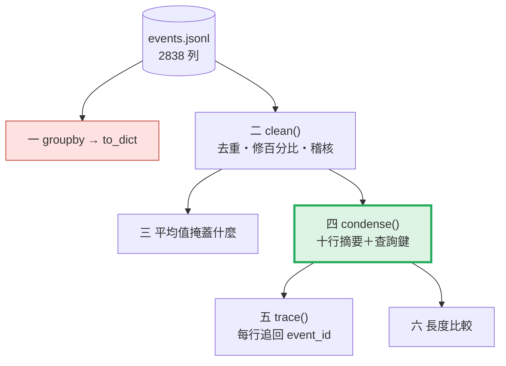
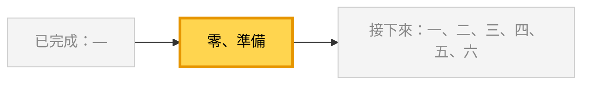
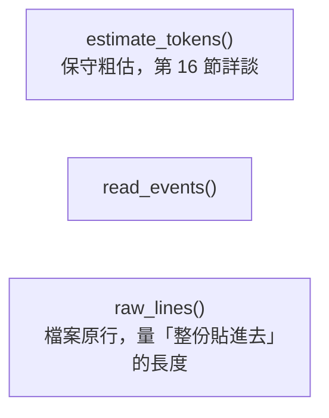
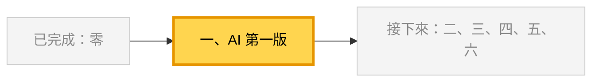
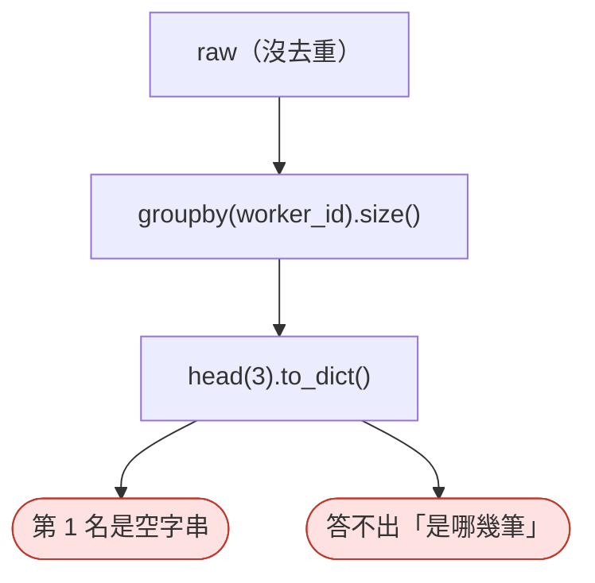
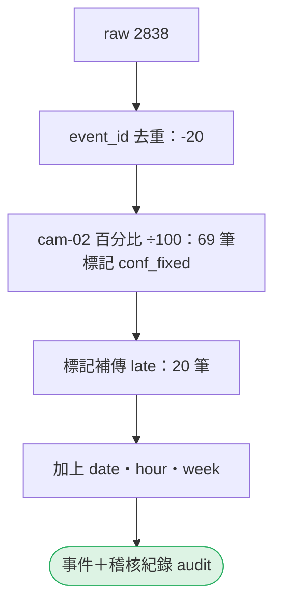
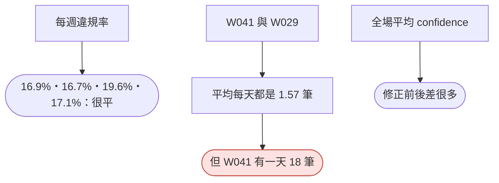
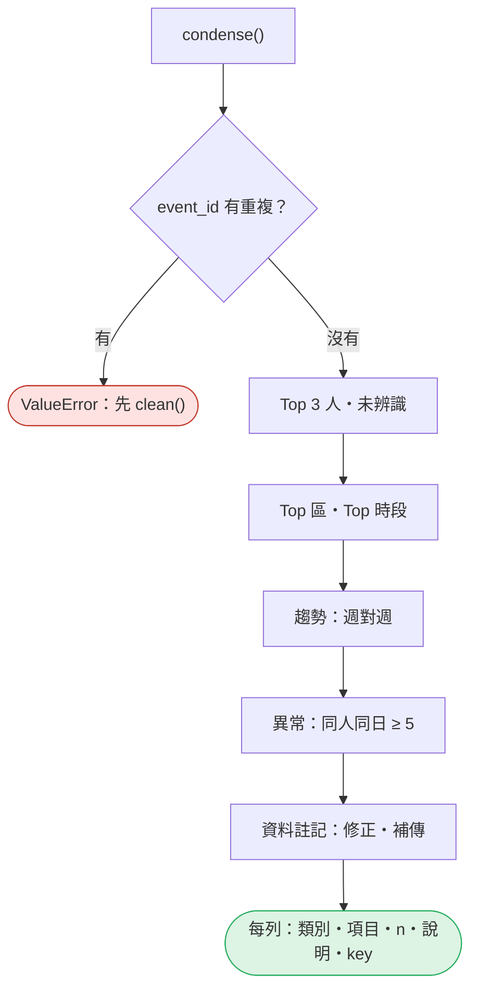
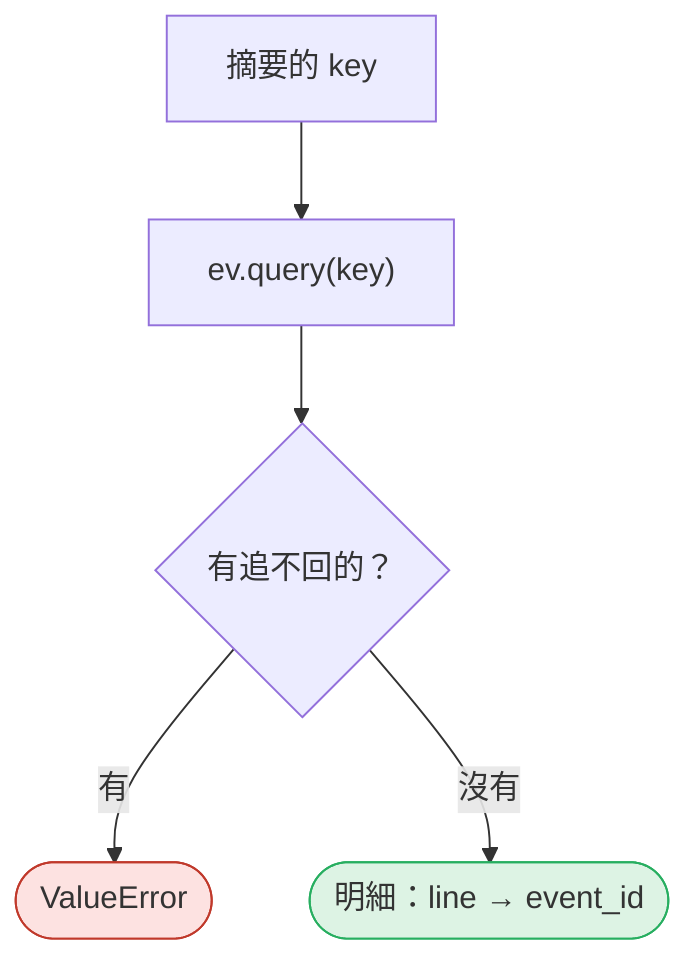
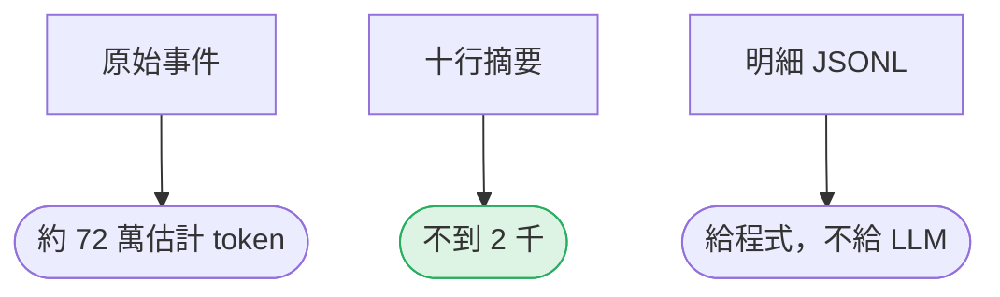

# 15｜濃縮：LLM 不該看到三萬筆

> **2026-10-21 改版：每段一張圖。** 兩千多筆事件濃縮成十行摘要，每一行都追得回原始事件。

[回 18 節課綱](../../course-plans/2026-10-data-analysis-18.md)

## 範例程式碼

- [demo：15_condense.py](https://github.com/4-learn/data-analysis-and-process-demo/blob/master/2026/15_condense.py)（與本頁 Demo 逐字相同）
- 練習資料與環境說明：[2026/README](https://github.com/4-learn/data-analysis-and-process-demo/tree/master/2026)

## 學完能做到

| 時間 | 段落 | 學完能做到 |
| --- | --- | --- |
| 0–12 分 | 一 | 說出 `groupby` → `to_dict` 的摘要缺了什麼 |
| 12–18 分 | 二 | 清理時記下改了什麼 |
| 18–24 分 | 三 | 看出平均值掩蓋了什麼 |
| 24–35 分 | 四～六 | 產生帶查詢鍵的十行摘要與明細 |
| 35–50 分 | Workshop | 拿掉一個異常，看排名怎麼變 |

## 本節流程



每段都是：**問題 → 位置（黃色）→ 步驟圖 → 程式 → 輸出 → 重點**。

## 零、準備：讀檔與 token 估算

**問題：** 這節要用哪些工具？

**在流程中的位置：**



**這段做了什麼：**



<!-- fn-table -->
| 函式名稱 | 說明 | 官方文件連結 |
|---|---|---|
| `ch.isascii()` | 這個字元是不是 ASCII（英數、符號）；中文是 False | [文件](https://docs.python.org/3.12/library/stdtypes.html#str.isascii) |
| `ch.isdigit()` | 這個字元是不是數字 | [文件](https://docs.python.org/3.12/library/stdtypes.html#str.isdigit) |
| `math.ceil(x)` | 無條件進位成整數 | [文件](https://docs.python.org/3.12/library/math.html#math.ceil) |
| 前面介紹過 | 用法同前，括號內是在哪裡第一次介紹 | [`Path(__file__).resolve().parent`](https://docs.python.org/3.12/library/pathlib.html#pathlib.Path.resolve)（第 02 節）、[`path.read_text()`](https://docs.python.org/3.12/library/pathlib.html#pathlib.Path.read_text)（第 03 節）、[`pd.read_json()`](https://pandas.pydata.org/docs/reference/api/pandas.read_json.html#pandas.read_json)（第 03 節）、[`df.index`](https://pandas.pydata.org/docs/reference/api/pandas.DataFrame.index.html#pandas.DataFrame.index)（第 05 節）、[`.drop_duplicates()`](https://pandas.pydata.org/docs/reference/api/pandas.DataFrame.drop_duplicates.html#pandas.DataFrame.drop_duplicates)（第 08 節）、[`Path()`](https://docs.python.org/3.12/library/pathlib.html#pathlib.Path)（爬蟲 10） |

<!-- 節錄: 15_condense.py -->
```python
import json
import math
from pathlib import Path

import pandas as pd

DATA = Path(__file__).resolve().parent / "data" / "events"
TOP_K = 3
BURST = 5          # 同一人同一天違規達 5 筆即列為異常（本資料其他人單日最多 3 筆）


def estimate_tokens(text):
    """沿用第 16 節的保守粗估：非 ASCII 字元與數字各算 1、其他 ASCII 算 0.5，再乘 1.2。"""
    heavy = sum(1 for ch in text if not ch.isascii() or ch.isdigit())
    return math.ceil((heavy + (len(text) - heavy) * 0.5) * 1.2)


def read_events(path=DATA / "events.jsonl"):
    return pd.read_json(path, lines=True, dtype=False, convert_dates=False)


def raw_lines(raw, path=DATA / "events.jsonl"):
    """檔案裡的原始 JSONL 行（以 event_id 去重、留最先到達的那行）——這才是「整份貼進去」的長度。

    不用 raw.to_json() 重新序列化：pandas 會把 / 寫成 \\/、拿掉空白，量到的是 pandas 的格式，不是檔案。
    """
    lines = path.read_text(encoding="utf-8").splitlines()
    if len(lines) != len(raw):
        raise ValueError(f"檔案 {len(lines)} 行，DataFrame {len(raw)} 列：行號對不上")
    keep = raw.drop_duplicates("event_id", keep="first").index
    return "\n".join(lines[i] for i in keep) + "\n"
```

<!-- fn-table -->
| 函式名稱 | 說明 | 官方文件連結 |
|---|---|---|
| 前面介紹過 | 用法同前，括號內是在哪裡第一次介紹 | [`path.read_text()`](https://docs.python.org/3.12/library/pathlib.html#pathlib.Path.read_text)（第 03 節）、[`d.items()`](https://docs.python.org/3.12/library/stdtypes.html#dict.items)（第 05 節）、[`json.loads()`](https://docs.python.org/3.12/library/json.html#json.loads)（爬蟲 03） |

<!-- 節錄: 15_condense.py -->
```python
raw = read_events()
zones = {z: v["name"] for z, v in json.loads((DATA / "MANIFEST.json").read_text(encoding="utf-8"))["zones"].items()}
```

- `TOP_K = 3`、`BURST = 5`：規則寫成常數，摘要裡用得到。

## 一、AI 的第一版：`groupby` → `to_dict`

**問題：** 「違規最多的前三名」直接給 LLM，夠嗎？

**在流程中的位置：**



**這段做了什麼：**



<!-- fn-table -->
| 函式名稱 | 說明 | 官方文件連結 |
|---|---|---|
| 前面介紹過 | 用法同前，括號內是在哪裡第一次介紹 | [`.sum()`](https://pandas.pydata.org/docs/reference/api/pandas.Series.sum.html#pandas.Series.sum)（第 02 節）、[`df.groupby()`](https://pandas.pydata.org/docs/reference/api/pandas.DataFrame.groupby.html#pandas.DataFrame.groupby)（第 02 節）、[`df.head()`](https://pandas.pydata.org/docs/reference/api/pandas.DataFrame.head.html#pandas.DataFrame.head)（第 02 節）、[`df["欄"]`](https://pandas.pydata.org/docs/user_guide/indexing.html#basics)（第 02 節）、[`df[條件]`](https://pandas.pydata.org/docs/user_guide/indexing.html#boolean-indexing)（第 02 節）、[`groupby().size()`](https://pandas.pydata.org/docs/reference/api/pandas.api.typing.DataFrameGroupBy.size.html#pandas.api.typing.DataFrameGroupBy.size)（第 02 節）、[`.reset_index()`](https://pandas.pydata.org/docs/reference/api/pandas.DataFrame.reset_index.html#pandas.DataFrame.reset_index)（第 04 節）、[`.to_dict()`](https://pandas.pydata.org/docs/reference/api/pandas.Series.to_dict.html#pandas.Series.to_dict)（第 05 節）、[`.sort_values()`](https://pandas.pydata.org/docs/reference/api/pandas.DataFrame.sort_values.html#pandas.DataFrame.sort_values)（第 07 節） |

<!-- 節錄: 15_condense.py -->
```python
print("== 1. AI 的第一版：groupby → to_dict ==")
naive = (raw[raw["event_type"] != "ppe_ok"].groupby("worker_id").size()
         .sort_values(ascending=False).head(3).reset_index(name="violations").to_dict("records"))
print(naive)
print(f"欄位只有 {list(naive[0])}：問「W041 的 36 筆是哪幾筆？」，摘要本身答不出來")
print(f"違規總數（沒去重）{int((raw['event_type'] != 'ppe_ok').sum())}；第 1 名 worker_id={naive[0]['worker_id']!r}")
```

```text
== 1. AI 的第一版：groupby → to_dict ==
[{'worker_id': '', 'violations': 77}, {'worker_id': 'W041', 'violations': 36}, {'worker_id': 'W029', 'violations': 33}]
欄位只有 ['worker_id', 'violations']：問「W041 的 36 筆是哪幾筆？」，摘要本身答不出來
違規總數（沒去重）498；第 1 名 worker_id=''
```

- 摘要只有數字、沒有鍵：問「W041 的 36 筆是哪幾筆」，答不出來。

## 二、清理並記下改了什麼

**問題：** 濃縮之前先做哪些事？

**在流程中的位置：**


**這段做了什麼：**



<!-- fn-table -->
| 函式名稱 | 說明 | 官方文件連結 |
|---|---|---|
| `s.dt.normalize()` | 把時間改成當天 00:00（保留日期與時區） | [文件](https://pandas.pydata.org/docs/reference/api/pandas.Series.dt.normalize.html#pandas.Series.dt.normalize) |
| `s.dt.weekday` | 星期幾：週一是 0、週日是 6 | [文件](https://pandas.pydata.org/docs/reference/api/pandas.Series.dt.weekday.html#pandas.Series.dt.weekday) |
| 前面介紹過 | 用法同前，括號內是在哪裡第一次介紹 | [`.sum()`](https://pandas.pydata.org/docs/reference/api/pandas.Series.sum.html#pandas.Series.sum)（第 02 節）、[`df["欄"]`](https://pandas.pydata.org/docs/user_guide/indexing.html#basics)（第 02 節）、[`df[條件]`](https://pandas.pydata.org/docs/user_guide/indexing.html#boolean-indexing)（第 02 節）、[`pd.to_datetime()`](https://pandas.pydata.org/docs/reference/api/pandas.to_datetime.html#pandas.to_datetime)（第 02 節）、[`.loc[]`](https://pandas.pydata.org/docs/reference/api/pandas.DataFrame.loc.html#pandas.DataFrame.loc)（第 03 節）、[`.reset_index()`](https://pandas.pydata.org/docs/reference/api/pandas.DataFrame.reset_index.html#pandas.DataFrame.reset_index)（第 04 節）、[`整欄運算`](https://pandas.pydata.org/docs/user_guide/basics.html#flexible-binary-operations)（第 06 節）、[`.copy()`](https://pandas.pydata.org/docs/reference/api/pandas.DataFrame.copy.html#pandas.DataFrame.copy)（第 07 節）、[`.drop_duplicates()`](https://pandas.pydata.org/docs/reference/api/pandas.DataFrame.drop_duplicates.html#pandas.DataFrame.drop_duplicates)（第 08 節）、[`.strftime()`](https://pandas.pydata.org/docs/reference/api/pandas.Series.dt.strftime.html#pandas.Series.dt.strftime)（第 10 節）、[`pd.Timedelta`](https://pandas.pydata.org/docs/reference/api/pandas.Timedelta.html#pandas.Timedelta)（第 10 節）、[`s.dt.hour`](https://pandas.pydata.org/docs/reference/api/pandas.Series.dt.hour.html#pandas.Series.dt.hour)（第 10 節）、[`pd.to_timedelta()`](https://pandas.pydata.org/docs/reference/api/pandas.to_timedelta.html#pandas.to_timedelta)（第 13 節） |

<!-- 節錄: 15_condense.py -->
```python
def clean(raw):
    """去重（留最先到達的那筆）、修正 cam-02 的百分比；回傳 (事件, 稽核紀錄)。"""
    ev = raw.drop_duplicates("event_id", keep="first").copy()
    t = pd.to_datetime(ev["event_time"], format="ISO8601")
    lag = pd.to_datetime(ev["ingested_at"], format="ISO8601") - t
    ev["conf_fixed"] = ev["confidence"] > 1
    ev.loc[ev["conf_fixed"], "confidence"] = ev.loc[ev["conf_fixed"], "confidence"] / 100
    ev["late"] = lag > pd.Timedelta(hours=1)
    ev["is_violation"] = ev["event_type"] != "ppe_ok"
    ev["date"] = t.dt.strftime("%Y-%m-%d")
    ev["hour"] = t.dt.hour
    ev["week"] = (t.dt.normalize() - pd.to_timedelta(t.dt.weekday, unit="D")).dt.strftime("%Y-%m-%d")
    audit = {"原始列數": len(raw), "重送去重": len(raw) - len(ev),
             "confidence 百分比÷100": int(ev["conf_fixed"].sum()), "補傳（到達晚於 1 小時）": int(ev["late"].sum())}
    return ev.reset_index(drop=True), audit
```

<!-- fn-table -->
| 函式名稱 | 說明 | 官方文件連結 |
|---|---|---|
| 前面介紹過 | 用法同前，括號內是在哪裡第一次介紹 | [`.sum()`](https://pandas.pydata.org/docs/reference/api/pandas.Series.sum.html#pandas.Series.sum)（第 02 節）、[`df["欄"]`](https://pandas.pydata.org/docs/user_guide/indexing.html#basics)（第 02 節） |

<!-- 節錄: 15_condense.py -->
```python
print("\n== 2. 清理：去重、修正百分比，並記下改了什麼 ==")
ev, audit = clean(raw)
print(audit)
print(f"清理後 {len(ev)} 筆；違規 {int(ev['is_violation'].sum())} 筆")
```

```text
== 2. 清理：去重、修正百分比，並記下改了什麼 ==
{'原始列數': 2838, '重送去重': 20, 'confidence 百分比÷100': 69, '補傳（到達晚於 1 小時）': 20}
清理後 2818 筆；違規 496 筆
```

- 每個修正都**標記**，不是默默改掉；稽核紀錄跟摘要一起交出去。

## 三、平均值掩蓋了什麼

**問題：** 「每週違規率約 17%」這句話漏了什麼？

**在流程中的位置：**


**這段做了什麼：**



<!-- fn-table -->
| 函式名稱 | 說明 | 官方文件連結 |
|---|---|---|
| 前面介紹過 | 用法同前，括號內是在哪裡第一次介紹 | [`.sum()`](https://pandas.pydata.org/docs/reference/api/pandas.Series.sum.html#pandas.Series.sum)（第 02 節）、[`df.groupby()`](https://pandas.pydata.org/docs/reference/api/pandas.DataFrame.groupby.html#pandas.DataFrame.groupby)（第 02 節）、[`df["欄"]`](https://pandas.pydata.org/docs/user_guide/indexing.html#basics)（第 02 節）、[`df[條件]`](https://pandas.pydata.org/docs/user_guide/indexing.html#boolean-indexing)（第 02 節）、[`groupby().size()`](https://pandas.pydata.org/docs/reference/api/pandas.api.typing.DataFrameGroupBy.size.html#pandas.api.typing.DataFrameGroupBy.size)（第 02 節）、[`& \| ~`](https://pandas.pydata.org/docs/user_guide/indexing.html#boolean-operators)（第 03 節）、[`.loc[]`](https://pandas.pydata.org/docs/reference/api/pandas.DataFrame.loc.html#pandas.DataFrame.loc)（第 03 節）、[`.nunique()`](https://pandas.pydata.org/docs/reference/api/pandas.Series.nunique.html#pandas.Series.nunique)（第 05 節）、[`s.max()`](https://pandas.pydata.org/docs/reference/api/pandas.Series.max.html#pandas.Series.max)（第 06 節）、[`s.mean()`](https://pandas.pydata.org/docs/reference/api/pandas.Series.mean.html#pandas.Series.mean)（第 06 節）、[`.drop_duplicates()`](https://pandas.pydata.org/docs/reference/api/pandas.DataFrame.drop_duplicates.html#pandas.DataFrame.drop_duplicates)（第 08 節）、[`groupby()[欄].mean()`](https://pandas.pydata.org/docs/reference/api/pandas.api.typing.SeriesGroupBy.mean.html#pandas.api.typing.SeriesGroupBy.mean)（第 08 節）、[`s.idxmax()`](https://pandas.pydata.org/docs/reference/api/pandas.Series.idxmax.html#pandas.Series.idxmax)（第 08 節）、[`s.items()`](https://pandas.pydata.org/docs/reference/api/pandas.Series.items.html#pandas.Series.items)（第 14 節） |

<!-- 節錄: 15_condense.py -->
```python
print("\n== 3. 平均值掩蓋了什麼 ==")
rate = ev.groupby("week")["is_violation"].mean()
print("每週違規率：" + "、".join(f"{w[5:]} {r:.1%}" for w, r in rate.items()))
w41 = ev[ev["is_violation"] & (ev["worker_id"] == "W041")].groupby("date").size()
days = ev.loc[ev["worker_id"] == "W041", "date"].nunique()
for wid in ("W041", "W029"):
    per = ev[ev["is_violation"] & (ev["worker_id"] == wid)].groupby("date").size()
    days = ev.loc[ev["worker_id"] == wid, "date"].nunique()
    print(f"{wid}：出勤 {days} 天、違規 {per.sum()} 筆，平均每天 {per.sum() / days:.2f} 筆；單日最多 {per.max()} 筆（{per.idxmax()}）")
before = raw.drop_duplicates("event_id", keep="first")             # 同樣去重，只差「有沒有 ÷100」
print(f"全場平均 confidence（去重後 {len(before)} 筆）：修正前 {before['confidence'].mean():.3f}，修正後 {ev['confidence'].mean():.3f}")
```

```text
== 3. 平均值掩蓋了什麼 ==
每週違規率：08-31 16.9%、09-07 16.7%、09-14 19.6%、09-21 17.1%
W041：出勤 23 天、違規 36 筆，平均每天 1.57 筆；單日最多 18 筆（2026-09-22）
W029：出勤 21 天、違規 33 筆，平均每天 1.57 筆；單日最多 3 筆（2026-09-10）
全場平均 confidence（去重後 2818 筆）：修正前 2.682，修正後 0.774
```

- 平均看不出異常：摘要要**另外列異常**。

## 四、十行摘要：每一列都帶查詢鍵

**問題：** 摘要要有哪些列？

**在流程中的位置：**


**這段做了什麼：**



<!-- fn-table -->
| 函式名稱 | 說明 | 官方文件連結 |
|---|---|---|
| `s.diff()` | 每一個值減去上一個值（第一個是 `NaN`） | [文件](https://pandas.pydata.org/docs/reference/api/pandas.Series.diff.html#pandas.Series.diff) |
| `s.dt.total_seconds()`／`td.total_seconds()` | 時間長度換算成秒數 | [文件](https://pandas.pydata.org/docs/reference/api/pandas.Series.dt.total_seconds.html#pandas.Series.dt.total_seconds) |
| `math.floor(x)` | 無條件捨去成整數 | [文件](https://docs.python.org/3.12/library/math.html#math.floor) |
| 前面介紹過 | 用法同前，括號內是在哪裡第一次介紹 | [`.any()`](https://pandas.pydata.org/docs/reference/api/pandas.Series.any.html#pandas.Series.any)（第 02 節）、[`.duplicated()`](https://pandas.pydata.org/docs/reference/api/pandas.DataFrame.duplicated.html#pandas.DataFrame.duplicated)（第 02 節）、[`.iloc[]`](https://pandas.pydata.org/docs/reference/api/pandas.Series.iloc.html#pandas.Series.iloc)（第 02 節）、[`df.groupby()`](https://pandas.pydata.org/docs/reference/api/pandas.DataFrame.groupby.html#pandas.DataFrame.groupby)（第 02 節）、[`df.head()`](https://pandas.pydata.org/docs/reference/api/pandas.DataFrame.head.html#pandas.DataFrame.head)（第 02 節）、[`df["欄"]`](https://pandas.pydata.org/docs/user_guide/indexing.html#basics)（第 02 節）、[`df[條件]`](https://pandas.pydata.org/docs/user_guide/indexing.html#boolean-indexing)（第 02 節）、[`groupby().size()`](https://pandas.pydata.org/docs/reference/api/pandas.api.typing.DataFrameGroupBy.size.html#pandas.api.typing.DataFrameGroupBy.size)（第 02 節）、[`pd.to_datetime()`](https://pandas.pydata.org/docs/reference/api/pandas.to_datetime.html#pandas.to_datetime)（第 02 節）、[`& \| ~`](https://pandas.pydata.org/docs/user_guide/indexing.html#boolean-operators)（第 03 節）、[`.loc[]`](https://pandas.pydata.org/docs/reference/api/pandas.DataFrame.loc.html#pandas.DataFrame.loc)（第 03 節）、[`.nunique()`](https://pandas.pydata.org/docs/reference/api/pandas.Series.nunique.html#pandas.Series.nunique)（第 05 節）、[`df.index`](https://pandas.pydata.org/docs/reference/api/pandas.DataFrame.index.html#pandas.DataFrame.index)（第 05 節）、[`pd.DataFrame()`](https://pandas.pydata.org/docs/reference/api/pandas.DataFrame.html#pandas.DataFrame)（第 05 節）、[`s.unique()`](https://pandas.pydata.org/docs/reference/api/pandas.Series.unique.html#pandas.Series.unique)（第 05 節）、[`s[標籤]`](https://pandas.pydata.org/docs/user_guide/indexing.html#basics)（第 05 節）、[`s.max()`](https://pandas.pydata.org/docs/reference/api/pandas.Series.max.html#pandas.Series.max)（第 06 節）、[`s.min()`](https://pandas.pydata.org/docs/reference/api/pandas.Series.min.html#pandas.Series.min)（第 06 節）、[`整欄運算`](https://pandas.pydata.org/docs/user_guide/basics.html#flexible-binary-operations)（第 06 節）、[`.sort_values()`](https://pandas.pydata.org/docs/reference/api/pandas.DataFrame.sort_values.html#pandas.DataFrame.sort_values)（第 07 節）、[`df.query()`](https://pandas.pydata.org/docs/reference/api/pandas.DataFrame.query.html#pandas.DataFrame.query)（第 07 節）、[`groupby()[欄].mean()`](https://pandas.pydata.org/docs/reference/api/pandas.api.typing.SeriesGroupBy.mean.html#pandas.api.typing.SeriesGroupBy.mean)（第 08 節）、[`s.items()`](https://pandas.pydata.org/docs/reference/api/pandas.Series.items.html#pandas.Series.items)（第 14 節）、[`math.ceil()`](https://docs.python.org/3.12/library/math.html#math.ceil)（第 15 節） |

<!-- 節錄: 15_condense.py -->
```python
def condense(ev, zones):
    """產生十行摘要；每一列的 key 是可以直接丟給 ev.query() 的條件，n 是它選到的筆數。"""
    if ev["event_id"].duplicated().any():
        raise ValueError("event_id 有重複：先 clean() 去重再濃縮，否則每個數字都會多算")
    v = ev[ev["is_violation"]]
    rows = []

    def add(kind, item, key, note=""):
        rows.append({"類別": kind, "項目": item, "n": len(ev.query(key)), "說明": note, "key": key})

    people = v[v["worker_id"] != ""].groupby("worker_id").size().sort_values(ascending=False, kind="stable")
    for wid in people.head(TOP_K).index:
        add("Top 人", wid, f"is_violation and worker_id == '{wid}'",
            f"出現於 {v.loc[v['worker_id'] == wid, 'date'].nunique()} 天")
    add("未辨識", "辨識不到臉", "is_violation and worker_id == ''", "不是一個人，不列入排名")
    zone = v.groupby("zone").size().sort_values(ascending=False, kind="stable").index[0]
    add("Top 區", f"{zone} {zones[zone]}", f"is_violation and zone == '{zone}'")
    hour = int(v.groupby("hour").size().sort_values(ascending=False, kind="stable").index[0])
    add("Top 時段", f"{hour:02d}:00–{hour:02d}:59", f"is_violation and hour == {hour}")
    weeks = v.groupby("week").size()
    last, prev = weeks.index[-1], weeks.index[-2]
    rate = ev.groupby("week")["is_violation"].mean()
    add("趨勢", f"週 {last}", f"is_violation and week == '{last}'",
        f"前週 {weeks[prev]} 筆；違規率 {rate[prev]:.1%}→{rate[last]:.1%}")
    per_day = v[v["worker_id"] != ""].groupby(["worker_id", "date"]).size()
    for (wid, day), n in per_day[per_day >= BURST].items():
        hit = v[(v["worker_id"] == wid) & (v["date"] == day)]
        t = pd.to_datetime(hit["event_time"], format="ISO8601").sort_values()
        gap = math.ceil(t.diff().max().total_seconds() / 60)          # 相鄰兩筆最長間隔，算出來，不寫死「連續」
        types = "、".join(sorted(hit["event_type"].unique()))
        add("異常", f"{wid} {day}", f"is_violation and worker_id == '{wid}' and date == '{day}'",
            f"{t.iloc[0]:%H:%M}–{t.iloc[-1]:%H:%M} {types}，間隔 ≤{gap} 分鐘")
    fixed = ev[ev["conf_fixed"]]
    add("資料註記", f"{'、'.join(sorted(fixed['camera_id'].unique()))} confidence", "conf_fixed",
        f"{fixed['date'].min()[5:]}～{fixed['date'].max()[5:]} 輸出百分比，已÷100")
    late = ev[ev["late"]]
    lag = (pd.to_datetime(late["ingested_at"], format="ISO8601")
           - pd.to_datetime(late["event_time"], format="ISO8601")).dt.total_seconds() / 3600
    add("資料註記", "補傳", "late",
        f"{'、'.join(sorted(late['camera_id'].unique()))} {late['date'].min()[5:]} 的事件晚 "
        f"{math.floor(lag.min())}–{math.ceil(lag.max())} 小時才到；重送已去重")
    return pd.DataFrame(rows)
```

<!-- fn-table -->
| 函式名稱 | 說明 | 官方文件連結 |
|---|---|---|
| `df.to_markdown(index=False)` | 把表格轉成 Markdown 表格字串（需要安裝 `tabulate`） | [文件](https://pandas.pydata.org/docs/reference/api/pandas.DataFrame.to_markdown.html#pandas.DataFrame.to_markdown) |

<!-- 節錄: 15_condense.py -->
```python
print("\n== 4. 十行摘要：每一列都帶查詢鍵 ==")
summary = condense(ev, zones)
print(summary.to_markdown(index=False))
```

```text
== 4. 十行摘要：每一列都帶查詢鍵 ==
| 類別     | 項目                |   n | 說明                                 | key                                                           |
|:-------|:------------------|----:|:-----------------------------------|:--------------------------------------------------------------|
| Top 人  | W041              |  36 | 出現於 14 天                           | is_violation and worker_id == 'W041'                          |
| Top 人  | W029              |  33 | 出現於 18 天                           | is_violation and worker_id == 'W029'                          |
| Top 人  | W044              |  27 | 出現於 14 天                           | is_violation and worker_id == 'W044'                          |
| 未辨識    | 辨識不到臉             |  77 | 不是一個人，不列入排名                        | is_violation and worker_id == ''                              |
| Top 區  | Z2 鋼構組立           | 152 |                                    | is_violation and zone == 'Z2'                                 |
| Top 時段 | 14:00–14:59       |  78 |                                    | is_violation and hour == 14                                   |
| 趨勢     | 週 2026-09-21      | 123 | 前週 140 筆；違規率 19.6%→17.1%           | is_violation and week == '2026-09-21'                         |
| 異常     | W041 2026-09-22   |  18 | 14:02–14:53 no_harness，間隔 ≤4 分鐘    | is_violation and worker_id == 'W041' and date == '2026-09-22' |
| 資料註記   | cam-02 confidence |  69 | 09-15～09-17 輸出百分比，已÷100            | conf_fixed                                                    |
| 資料註記   | 補傳                |  20 | cam-05 09-10 的事件晚 16–23 小時才到；重送已去重 | late                                                          |
```

- `key` 是可以直接丟給 `ev.query()` 的條件；`n` 是它選到的筆數。
- 未辨識獨立一列：不參加排名，但不能刪。
- Top 時段 14:00 裡有 18 筆是 W041 那一次——一個異常就能改變排名。

## 五、用鍵回答「哪幾筆？」

**問題：** 摘要的每一行，怎麼追回原始事件？

**在流程中的位置：**


**這段做了什麼：**



<!-- fn-table -->
| 函式名稱 | 說明 | 官方文件連結 |
|---|---|---|
| `df.empty` | 表格是不是一列都沒有（True／False） | [文件](https://pandas.pydata.org/docs/reference/api/pandas.DataFrame.empty.html#pandas.DataFrame.empty) |
| 前面介紹過 | 用法同前，括號內是在哪裡第一次介紹 | [`df.columns`](https://pandas.pydata.org/docs/reference/api/pandas.DataFrame.columns.html#pandas.DataFrame.columns)（第 02 節）、[`df["欄"]`](https://pandas.pydata.org/docs/user_guide/indexing.html#basics)（第 02 節）、[`pd.concat()`](https://pandas.pydata.org/docs/reference/api/pandas.concat.html#pandas.concat)（第 02 節）、[`df.assign()`](https://pandas.pydata.org/docs/reference/api/pandas.DataFrame.assign.html#pandas.DataFrame.assign)（第 06 節）、[`.sort_values()`](https://pandas.pydata.org/docs/reference/api/pandas.DataFrame.sort_values.html#pandas.DataFrame.sort_values)（第 07 節）、[`df.query()`](https://pandas.pydata.org/docs/reference/api/pandas.DataFrame.query.html#pandas.DataFrame.query)（第 07 節） |

<!-- 節錄: 15_condense.py -->
```python
def trace(ev, summary):
    """可回溯的明細：摘要第幾行 → 它涵蓋的每一筆 event_id。"""
    empty = [key for key in summary["key"] if ev.query(key).empty]
    if empty:
        raise ValueError(f"摘要有 {len(empty)} 列追不回任何事件，例如 {empty[0]!r}")
    parts = [ev.query(key)[["event_id", "event_time", "worker_id", "zone", "event_type"]].assign(line=i + 1)
             for i, key in enumerate(summary["key"])]
    detail = (pd.concat(parts, ignore_index=True)
              .sort_values(["line", "event_time", "event_id"], kind="stable", ignore_index=True))  # 不靠檔案順序
    return detail[["line"] + [c for c in detail.columns if c != "line"]]
```

<!-- fn-table -->
| 函式名稱 | 說明 | 官方文件連結 |
|---|---|---|
| 前面介紹過 | 用法同前，括號內是在哪裡第一次介紹 | [`.iloc[]`](https://pandas.pydata.org/docs/reference/api/pandas.Series.iloc.html#pandas.Series.iloc)（第 02 節）、[`df.groupby()`](https://pandas.pydata.org/docs/reference/api/pandas.DataFrame.groupby.html#pandas.DataFrame.groupby)（第 02 節）、[`df.head()`](https://pandas.pydata.org/docs/reference/api/pandas.DataFrame.head.html#pandas.DataFrame.head)（第 02 節）、[`df.to_string()`](https://pandas.pydata.org/docs/reference/api/pandas.DataFrame.to_string.html#pandas.DataFrame.to_string)（第 02 節）、[`df["欄"]`](https://pandas.pydata.org/docs/user_guide/indexing.html#basics)（第 02 節）、[`df[條件]`](https://pandas.pydata.org/docs/user_guide/indexing.html#boolean-indexing)（第 02 節）、[`groupby().size()`](https://pandas.pydata.org/docs/reference/api/pandas.api.typing.DataFrameGroupBy.size.html#pandas.api.typing.DataFrameGroupBy.size)（第 02 節）、[`.nunique()`](https://pandas.pydata.org/docs/reference/api/pandas.Series.nunique.html#pandas.Series.nunique)（第 05 節）、[`df.index`](https://pandas.pydata.org/docs/reference/api/pandas.DataFrame.index.html#pandas.DataFrame.index)（第 05 節）、[`.all()`](https://pandas.pydata.org/docs/reference/api/pandas.Series.all.html#pandas.Series.all)（第 06 節）、[`df.values`](https://pandas.pydata.org/docs/reference/api/pandas.DataFrame.values.html#pandas.DataFrame.values)（第 13 節） |

<!-- 節錄: 15_condense.py -->
```python
print("\n== 5. 用鍵回答「哪幾筆？」 ==")
detail = trace(ev, summary)
print(f"明細 {len(detail)} 列，涵蓋 {detail['event_id'].nunique()} 個不同事件；每行 n 與明細列數一致："
      f"{(detail.groupby('line').size().values == summary['n'].values).all()}")
burst = detail[detail["line"] == summary.index[summary["類別"] == "異常"][0] + 1]
print(burst.head(3).to_string(index=False))
print(f"…共 {len(burst)} 筆，最後一筆 {burst['event_id'].iloc[-1]}")
```

```text
== 5. 用鍵回答「哪幾筆？」 ==
明細 633 列，涵蓋 403 個不同事件；每行 n 與明細列數一致：True
 line             event_id                event_time worker_id zone event_type
    8 cam-07-20260922-0014 2026-09-22T14:02:00+08:00      W041   Z4 no_harness
    8 cam-07-20260922-0015 2026-09-22T14:05:48+08:00      W041   Z4 no_harness
    8 cam-07-20260922-0016 2026-09-22T14:08:38+08:00      W041   Z4 no_harness
…共 18 筆，最後一筆 cam-07-20260922-0031
```

- 每行 `n` 等於明細列數：摘要和明細互相對得上。

## 六、長度：原始事件 vs 摘要

**問題：** 摘要比原始事件短多少？

**在流程中的位置：**


**這段做了什麼：**



<!-- fn-table -->
| 函式名稱 | 說明 | 官方文件連結 |
|---|---|---|
| 前面介紹過 | 用法同前，括號內是在哪裡第一次介紹 | [`.drop()`](https://pandas.pydata.org/docs/reference/api/pandas.DataFrame.drop.html#pandas.DataFrame.drop)（第 03 節）、[`df.to_json()`](https://pandas.pydata.org/docs/reference/api/pandas.DataFrame.to_json.html#pandas.DataFrame.to_json)（第 03 節）、[`df.to_markdown()`](https://pandas.pydata.org/docs/reference/api/pandas.DataFrame.to_markdown.html#pandas.DataFrame.to_markdown)（第 15 節） |

<!-- 節錄: 15_condense.py -->
```python
print("\n== 6. 長度：原始事件 vs 摘要 ==")
md = summary.to_markdown(index=False)
for label, text in [("原始事件（檔案原行，去重後）", raw_lines(raw)),
                    ("十行摘要（Markdown）", md),
                    ("摘要去掉 key 欄", summary.drop(columns="key").to_markdown(index=False)),
                    ("明細（JSONL，給程式不給 LLM）", detail.to_json(orient="records", lines=True, force_ascii=False))]:
    print(f"{label:24} 字元 {len(text):>9,}  估計 token {estimate_tokens(text):>9,}")
dense = len("".join(md.split()))
no_key = len("".join(summary.drop(columns="key").to_markdown(index=False).split()))
print(f"十行摘要 {len(md):,} 字元中，Markdown 對齊用的空白 {md.count(' '):,} 個；"
      f"去掉空白後 {dense:,} 字元，key 欄佔 {(dense - no_key) / dense:.0%}")
```

```text
== 6. 長度：原始事件 vs 摘要 ==
原始事件（檔案原行，去重後）           字元   975,730  估計 token   722,019
十行摘要（Markdown）           字元     1,655  估計 token     1,137
摘要去掉 key 欄               字元       887  估計 token       657
明細（JSONL，給程式不給 LLM）      字元    89,609  估計 token    67,575
十行摘要 1,655 字元中，Markdown 對齊用的空白 894 個；去掉空白後 750 字元，key 欄佔 47%
```

- 給 LLM 的是摘要；明細留給程式和人核對。
- Markdown 對齊用的空白也算 token：第 16 節處理。

## Workshop：一個異常，能改寫幾行摘要？

### 任務與時間

**35–42 分鐘：拿掉 W041 那一天。** 假設有人在「清理」時把 W041 09-22 的 18 筆當離群值刪掉。用 Demo 的函式重做摘要，逐行比較：

<!-- fn-table -->
| 函式名稱 | 說明 | 官方文件連結 |
|---|---|---|
| 前面介紹過 | 用法同前，括號內是在哪裡第一次介紹 | [`df.to_string()`](https://pandas.pydata.org/docs/reference/api/pandas.DataFrame.to_string.html#pandas.DataFrame.to_string)（第 02 節）、[`.drop()`](https://pandas.pydata.org/docs/reference/api/pandas.DataFrame.drop.html#pandas.DataFrame.drop)（第 03 節）、[`df.query()`](https://pandas.pydata.org/docs/reference/api/pandas.DataFrame.query.html#pandas.DataFrame.query)（第 07 節） |

```python
# Workshop 起手式，本節測試不涵蓋這段
from my_condense import read_events, clean, condense   # 先把本節 Demo 存成 my_condense.py
zones = {"Z1": "出入口", "Z2": "鋼構組立", "Z3": "開挖區", "Z4": "施工架"}
ev, audit = clean(read_events())
cut = ev.query("not (worker_id == 'W041' and date == '2026-09-22' and is_violation)")
print(condense(cut, zones).drop(columns="key").to_string())
```

回答：哪幾行變了？如果交給 LLM 的是這份，它會怎麼描述最後一週？

**42–46 分鐘：鍵的契約。** 對 Demo 的摘要每一行，用 `ev.query(key)` 查出來的筆數是不是等於 `n`？再故意把某一列的 `key` 改錯（例如 `'W041'` 改成 `'W401'`），呼叫 `trace()`，看會發生什麼。

**46–50 分鐘：抓 AI 的錯。** 請 OpenCode 寫「把 events.jsonl 濃縮成給 LLM 的摘要」。拿它的版本檢查四件事：(1) 有沒有以 `event_id` 去重？(2) Top-K 第 1 名是不是空字串？(3) 有沒有用平均（每週違規率、每人平均每天幾筆）取代異常清單？(4) 摘要裡任挑一個數字，**你能不能不重跑它的程式就找出是哪幾筆？**

### 參考判讀

:::spoiler 教師用（點開）
- 拿掉 W041 那 18 筆後（教師實測，2,800 筆）：Top 人變成 W029 33、W044 27、W018 23，**W041 從第 1 名掉出前三**（剩 18 筆）；Top 時段從 14 點（78）變成 **13 點（64）**；最後一週從 123 筆、17.1% 變成 **105 筆、15.0%**；**異常清單整列消失**，摘要從 10 行變 9 行。LLM 拿到這份，會寫出「最後一週明顯改善、無異常」——四週裡最危險的事件，被一次「清理」從四個地方同時抹掉。
- 這也是為什麼第 08 節說「異常要分兩種」：cam-02 的百分比是 bug，修正並註記；W041 是真的出事，**保留並單獨列出**。兩者都進摘要，但類別不同。
- 鍵的契約：Demo 第五段已印出「每行 n 與明細列數一致：True」。把 `key` 改成 `'W401'`，`trace()` 會拋出 `ValueError: 摘要有 1 列追不回任何事件…`。若你的版本只是印出空表格，代表它沒有守這個契約。
- 常見的 AI 版本就是第二段：`groupby("worker_id").size()` 再 `to_dict`。第 1 名是 `''`（77 筆）、總數 498（沒去重）。這兩個錯都**不會有錯誤訊息**；只有你去看第 1 名是誰，才會發現。
- AI 也常寫「每人平均每日違規次數」當作「風險指標」：W041 是 1.57，與 W029 並列（第三段），看不出 W041 有一天 18 筆、W029 單日最多 3 筆。平均值本身沒有錯，錯在**只有平均值**。
:::

### 驗收

- 能重現 Demo 第 4 段的十行摘要，並說出每一列的 `key` 是什麼意思。
- 拿掉 W041 09-22 之後，能指出至少三行的變化（Top 人、Top 時段、趨勢、異常）。
- 能示範：給定摘要任一列，用 `key` 在 30 秒內列出對應的 `event_id`。
- 對 AI 的版本，四項檢查都有結論；至少找出一個「跑得動但答案會誤導」的地方。

## 附錄：完整程式

```bash
python3 15_condense.py
```

<!-- fn-table -->
| 函式名稱 | 說明 | 官方文件連結 |
|---|---|---|
| （同上） | 這支程式用到的函式，都已在上面各段的表格介紹過 | — |

<!-- demo: 15_condense.py -->
```python
"""第 15 節：把兩千多筆事件濃縮成給 LLM 的十行摘要，而且每一行都追得回原始事件。"""

import json
import math
from pathlib import Path

import pandas as pd

DATA = Path(__file__).resolve().parent / "data" / "events"
TOP_K = 3
BURST = 5          # 同一人同一天違規達 5 筆即列為異常（本資料其他人單日最多 3 筆）


def estimate_tokens(text):
    """沿用第 16 節的保守粗估：非 ASCII 字元與數字各算 1、其他 ASCII 算 0.5，再乘 1.2。"""
    heavy = sum(1 for ch in text if not ch.isascii() or ch.isdigit())
    return math.ceil((heavy + (len(text) - heavy) * 0.5) * 1.2)


def read_events(path=DATA / "events.jsonl"):
    return pd.read_json(path, lines=True, dtype=False, convert_dates=False)


def raw_lines(raw, path=DATA / "events.jsonl"):
    """檔案裡的原始 JSONL 行（以 event_id 去重、留最先到達的那行）——這才是「整份貼進去」的長度。

    不用 raw.to_json() 重新序列化：pandas 會把 / 寫成 \\/、拿掉空白，量到的是 pandas 的格式，不是檔案。
    """
    lines = path.read_text(encoding="utf-8").splitlines()
    if len(lines) != len(raw):
        raise ValueError(f"檔案 {len(lines)} 行，DataFrame {len(raw)} 列：行號對不上")
    keep = raw.drop_duplicates("event_id", keep="first").index
    return "\n".join(lines[i] for i in keep) + "\n"


def clean(raw):
    """去重（留最先到達的那筆）、修正 cam-02 的百分比；回傳 (事件, 稽核紀錄)。"""
    ev = raw.drop_duplicates("event_id", keep="first").copy()
    t = pd.to_datetime(ev["event_time"], format="ISO8601")
    lag = pd.to_datetime(ev["ingested_at"], format="ISO8601") - t
    ev["conf_fixed"] = ev["confidence"] > 1
    ev.loc[ev["conf_fixed"], "confidence"] = ev.loc[ev["conf_fixed"], "confidence"] / 100
    ev["late"] = lag > pd.Timedelta(hours=1)
    ev["is_violation"] = ev["event_type"] != "ppe_ok"
    ev["date"] = t.dt.strftime("%Y-%m-%d")
    ev["hour"] = t.dt.hour
    ev["week"] = (t.dt.normalize() - pd.to_timedelta(t.dt.weekday, unit="D")).dt.strftime("%Y-%m-%d")
    audit = {"原始列數": len(raw), "重送去重": len(raw) - len(ev),
             "confidence 百分比÷100": int(ev["conf_fixed"].sum()), "補傳（到達晚於 1 小時）": int(ev["late"].sum())}
    return ev.reset_index(drop=True), audit


def condense(ev, zones):
    """產生十行摘要；每一列的 key 是可以直接丟給 ev.query() 的條件，n 是它選到的筆數。"""
    if ev["event_id"].duplicated().any():
        raise ValueError("event_id 有重複：先 clean() 去重再濃縮，否則每個數字都會多算")
    v = ev[ev["is_violation"]]
    rows = []

    def add(kind, item, key, note=""):
        rows.append({"類別": kind, "項目": item, "n": len(ev.query(key)), "說明": note, "key": key})

    people = v[v["worker_id"] != ""].groupby("worker_id").size().sort_values(ascending=False, kind="stable")
    for wid in people.head(TOP_K).index:
        add("Top 人", wid, f"is_violation and worker_id == '{wid}'",
            f"出現於 {v.loc[v['worker_id'] == wid, 'date'].nunique()} 天")
    add("未辨識", "辨識不到臉", "is_violation and worker_id == ''", "不是一個人，不列入排名")
    zone = v.groupby("zone").size().sort_values(ascending=False, kind="stable").index[0]
    add("Top 區", f"{zone} {zones[zone]}", f"is_violation and zone == '{zone}'")
    hour = int(v.groupby("hour").size().sort_values(ascending=False, kind="stable").index[0])
    add("Top 時段", f"{hour:02d}:00–{hour:02d}:59", f"is_violation and hour == {hour}")
    weeks = v.groupby("week").size()
    last, prev = weeks.index[-1], weeks.index[-2]
    rate = ev.groupby("week")["is_violation"].mean()
    add("趨勢", f"週 {last}", f"is_violation and week == '{last}'",
        f"前週 {weeks[prev]} 筆；違規率 {rate[prev]:.1%}→{rate[last]:.1%}")
    per_day = v[v["worker_id"] != ""].groupby(["worker_id", "date"]).size()
    for (wid, day), n in per_day[per_day >= BURST].items():
        hit = v[(v["worker_id"] == wid) & (v["date"] == day)]
        t = pd.to_datetime(hit["event_time"], format="ISO8601").sort_values()
        gap = math.ceil(t.diff().max().total_seconds() / 60)          # 相鄰兩筆最長間隔，算出來，不寫死「連續」
        types = "、".join(sorted(hit["event_type"].unique()))
        add("異常", f"{wid} {day}", f"is_violation and worker_id == '{wid}' and date == '{day}'",
            f"{t.iloc[0]:%H:%M}–{t.iloc[-1]:%H:%M} {types}，間隔 ≤{gap} 分鐘")
    fixed = ev[ev["conf_fixed"]]
    add("資料註記", f"{'、'.join(sorted(fixed['camera_id'].unique()))} confidence", "conf_fixed",
        f"{fixed['date'].min()[5:]}～{fixed['date'].max()[5:]} 輸出百分比，已÷100")
    late = ev[ev["late"]]
    lag = (pd.to_datetime(late["ingested_at"], format="ISO8601")
           - pd.to_datetime(late["event_time"], format="ISO8601")).dt.total_seconds() / 3600
    add("資料註記", "補傳", "late",
        f"{'、'.join(sorted(late['camera_id'].unique()))} {late['date'].min()[5:]} 的事件晚 "
        f"{math.floor(lag.min())}–{math.ceil(lag.max())} 小時才到；重送已去重")
    return pd.DataFrame(rows)


def trace(ev, summary):
    """可回溯的明細：摘要第幾行 → 它涵蓋的每一筆 event_id。"""
    empty = [key for key in summary["key"] if ev.query(key).empty]
    if empty:
        raise ValueError(f"摘要有 {len(empty)} 列追不回任何事件，例如 {empty[0]!r}")
    parts = [ev.query(key)[["event_id", "event_time", "worker_id", "zone", "event_type"]].assign(line=i + 1)
             for i, key in enumerate(summary["key"])]
    detail = (pd.concat(parts, ignore_index=True)
              .sort_values(["line", "event_time", "event_id"], kind="stable", ignore_index=True))  # 不靠檔案順序
    return detail[["line"] + [c for c in detail.columns if c != "line"]]


if __name__ == "__main__":
    raw = read_events()
    zones = {z: v["name"] for z, v in json.loads((DATA / "MANIFEST.json").read_text(encoding="utf-8"))["zones"].items()}

    print("== 1. AI 的第一版：groupby → to_dict ==")
    naive = (raw[raw["event_type"] != "ppe_ok"].groupby("worker_id").size()
             .sort_values(ascending=False).head(3).reset_index(name="violations").to_dict("records"))
    print(naive)
    print(f"欄位只有 {list(naive[0])}：問「W041 的 36 筆是哪幾筆？」，摘要本身答不出來")
    print(f"違規總數（沒去重）{int((raw['event_type'] != 'ppe_ok').sum())}；第 1 名 worker_id={naive[0]['worker_id']!r}")

    print("\n== 2. 清理：去重、修正百分比，並記下改了什麼 ==")
    ev, audit = clean(raw)
    print(audit)
    print(f"清理後 {len(ev)} 筆；違規 {int(ev['is_violation'].sum())} 筆")

    print("\n== 3. 平均值掩蓋了什麼 ==")
    rate = ev.groupby("week")["is_violation"].mean()
    print("每週違規率：" + "、".join(f"{w[5:]} {r:.1%}" for w, r in rate.items()))
    w41 = ev[ev["is_violation"] & (ev["worker_id"] == "W041")].groupby("date").size()
    days = ev.loc[ev["worker_id"] == "W041", "date"].nunique()
    for wid in ("W041", "W029"):
        per = ev[ev["is_violation"] & (ev["worker_id"] == wid)].groupby("date").size()
        days = ev.loc[ev["worker_id"] == wid, "date"].nunique()
        print(f"{wid}：出勤 {days} 天、違規 {per.sum()} 筆，平均每天 {per.sum() / days:.2f} 筆；單日最多 {per.max()} 筆（{per.idxmax()}）")
    before = raw.drop_duplicates("event_id", keep="first")             # 同樣去重，只差「有沒有 ÷100」
    print(f"全場平均 confidence（去重後 {len(before)} 筆）：修正前 {before['confidence'].mean():.3f}，修正後 {ev['confidence'].mean():.3f}")

    print("\n== 4. 十行摘要：每一列都帶查詢鍵 ==")
    summary = condense(ev, zones)
    print(summary.to_markdown(index=False))

    print("\n== 5. 用鍵回答「哪幾筆？」 ==")
    detail = trace(ev, summary)
    print(f"明細 {len(detail)} 列，涵蓋 {detail['event_id'].nunique()} 個不同事件；每行 n 與明細列數一致："
          f"{(detail.groupby('line').size().values == summary['n'].values).all()}")
    burst = detail[detail["line"] == summary.index[summary["類別"] == "異常"][0] + 1]
    print(burst.head(3).to_string(index=False))
    print(f"…共 {len(burst)} 筆，最後一筆 {burst['event_id'].iloc[-1]}")

    print("\n== 6. 長度：原始事件 vs 摘要 ==")
    md = summary.to_markdown(index=False)
    for label, text in [("原始事件（檔案原行，去重後）", raw_lines(raw)),
                        ("十行摘要（Markdown）", md),
                        ("摘要去掉 key 欄", summary.drop(columns="key").to_markdown(index=False)),
                        ("明細（JSONL，給程式不給 LLM）", detail.to_json(orient="records", lines=True, force_ascii=False))]:
        print(f"{label:24} 字元 {len(text):>9,}  估計 token {estimate_tokens(text):>9,}")
    dense = len("".join(md.split()))
    no_key = len("".join(summary.drop(columns="key").to_markdown(index=False).split()))
    print(f"十行摘要 {len(md):,} 字元中，Markdown 對齊用的空白 {md.count(' '):,} 個；"
          f"去掉空白後 {dense:,} 字元，key 欄佔 {(dense - no_key) / dense:.0%}")
```

## 教師紀錄與下一步

:::spoiler 實測環境、版本差異、資料來源（點開）
**實測**：2026-10-05，Ubuntu 20.04，Python 3.11.8，pandas 3.0.6、numpy 2.4.6、tabulate 0.10.0。本頁所有輸出為該環境實際執行貼上（**本機實測**）。另以 Python 3.10.15／pandas 2.3.3 執行，標準輸出**逐字相同**。舊稿的「原始事件」長度是用 `to_json()` 重新序列化量的（916,552 字元）：pandas 會去掉 `": "` 後的空白、把 `/` 寫成 `\/`，量到的是 pandas 的輸出格式而不是檔案；現改量檔案原行（975,730 字元）。

**token 數字的等級**：全部是第 16 節的**粗估**（`estimate_tokens()` 同一規則，本節重寫一份以維持單檔），不是 tokenizer 實測。

**資料**：`data/events/` 為 `tools/build_events.py` 產生的**合成資料**（固定種子，雜湊記於 `data/events/MANIFEST.json`）。W041、cam-02、cam-05 都是刻意埋入的狀況，見 MANIFEST 的 `planted`。本節的排名與趨勢**不代表任何真實工地的統計結論**；事件類型對應的法條取自練習站，可能經刻意修改，不具法律效力。

**界線**：

- 異常門檻「單日 5 筆」是看過這份資料的分布後定的，**不是通用標準**；換一個工地要重新看分布。
- `key` 用 `DataFrame.query()` 字串，前提是值裡沒有單引號。本資料的 `worker_id`、`zone`、日期都不會有；若鍵的值來自自由文字，要改用欄位＋值的結構化格式（例如 `{"worker_id": "W041", "date": "2026-09-22"}`）。
- 本節不呼叫 LLM，不宣稱「有鍵的摘要讓模型答得比較好」；那需要評測（LLM 課第 07 節）。本節只驗證「摘要的每個數字都能從原始資料重算出來」。
- 本節**尚未實班試教**。

**舊教材**：改寫自 [Workshop：將事件資料轉為長期行為表](https://hackmd.io/@yillkid/SkKZy30Ebl)。保留：情境（AI 攝影機 × 工地安全）、流程「篩選 → 彙總 → 結構化輸出」、「把事件轉成以人為單位的摘要」的目標。刪除：手打的 4 列 `DataFrame`（改用 2,838 列的真實檔案）、`value` 欄（本資料以 `event_type` 表達）、`timestamp` 轉換步驟（第 11 節已教）。舊版終點 `to_dict(orient="records")` 原樣保留在第二段，作為「沒有鍵的摘要」反例；序列化本身移到第 16 節。
:::

**下一節**：第 16 節〈序列化與 context 預算〉——這份十行摘要要用什麼格式送出？`key` 欄要不要一起送？
