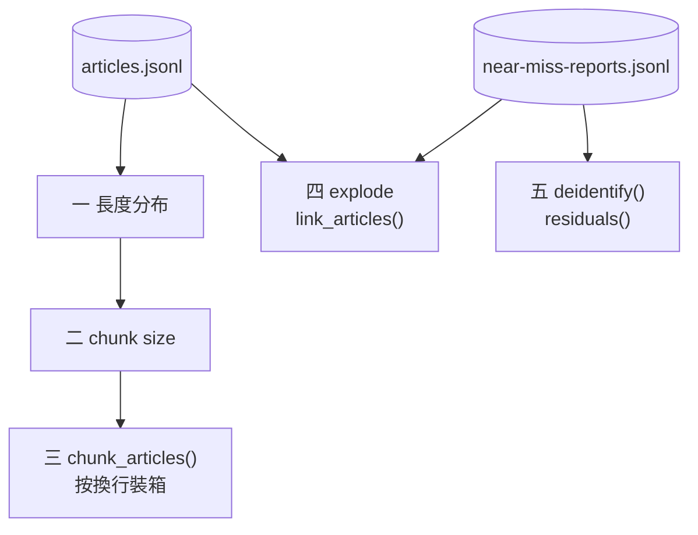
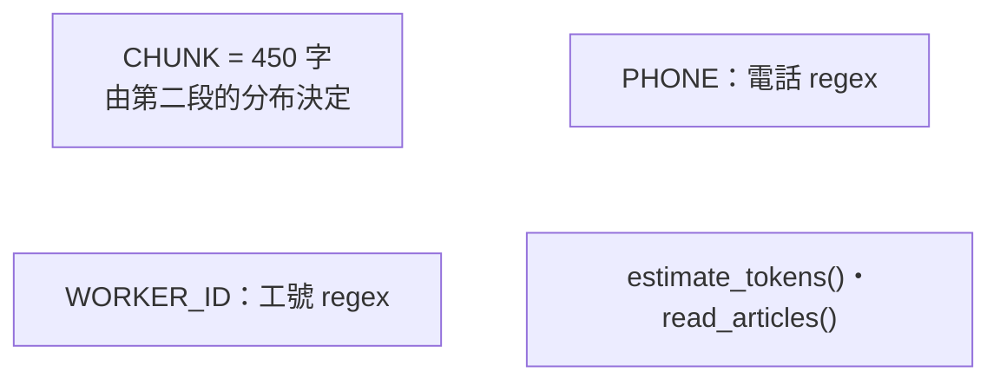
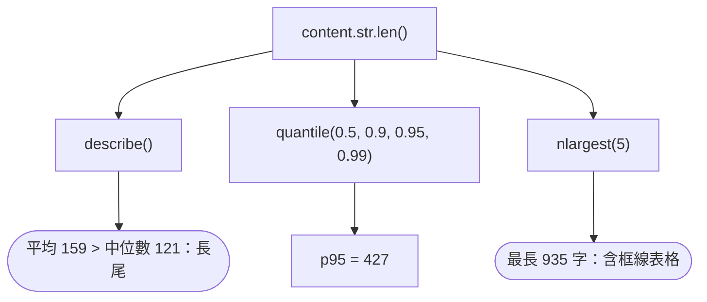
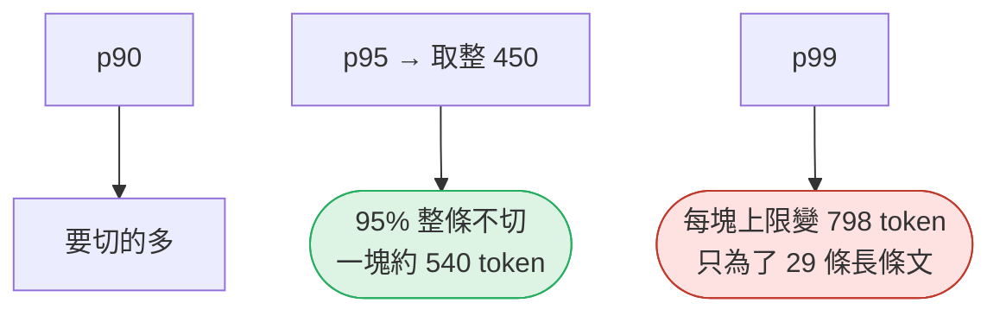
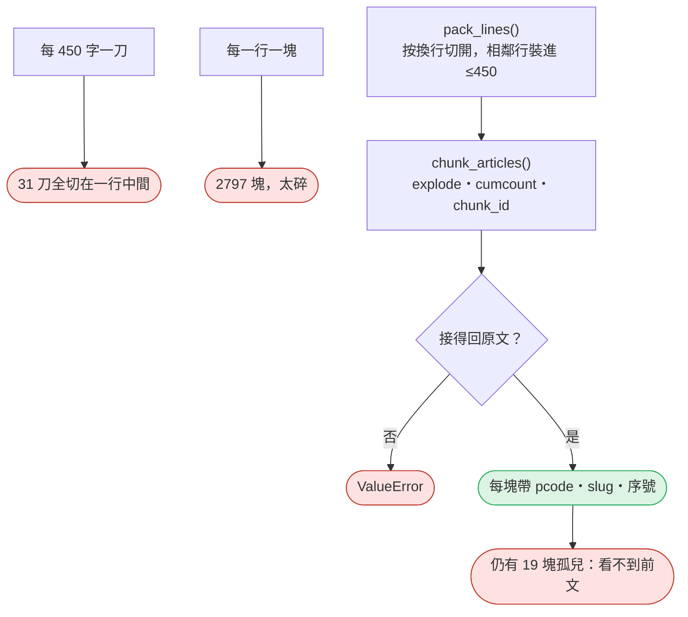
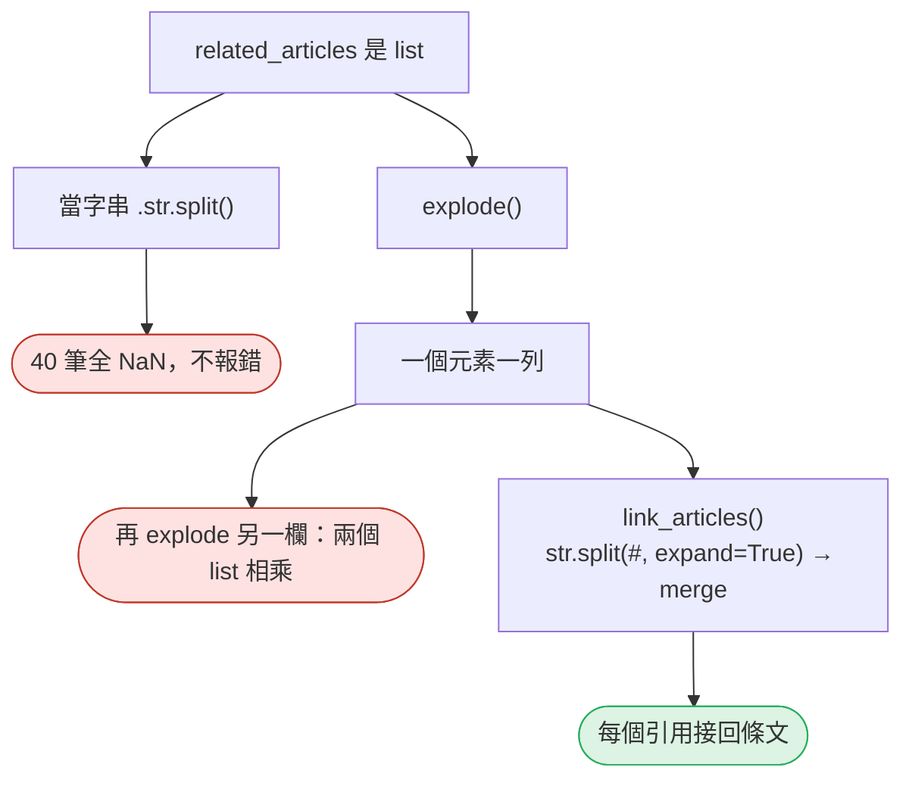
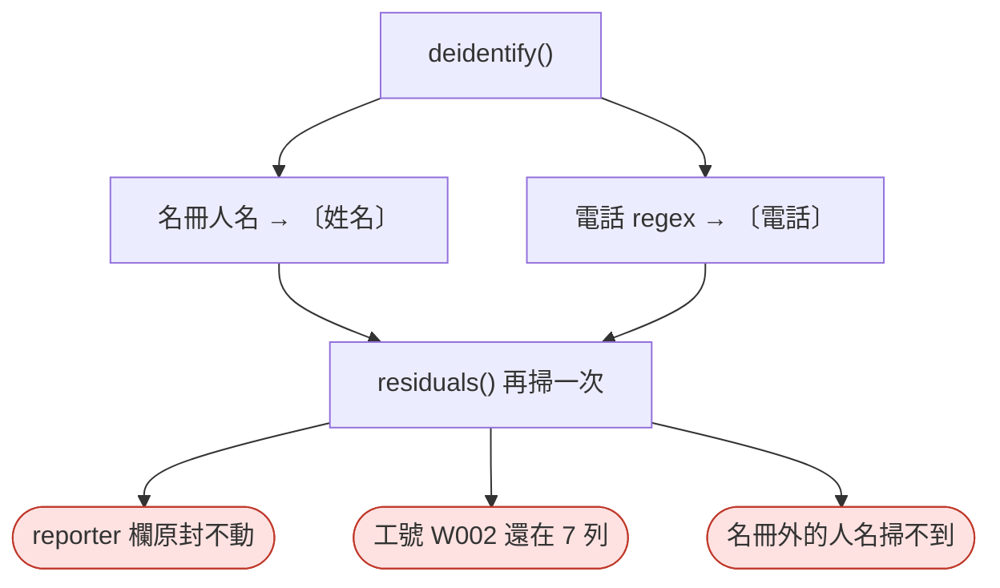

# 17｜文字語料：切塊、多值與去識別

> **2026-10-21 改版：每段一張圖。** 文字語料：長度分布決定切塊、多值欄位要 explode、通報文字先去識別。

[回 18 節課綱](../../course-plans/2026-10-data-analysis-18.md)

## 範例程式碼

- [demo：17_text_corpus.py](https://github.com/4-learn/data-analysis-and-process-demo/blob/master/2026/17_text_corpus.py)（與本頁 Demo 逐字相同）
- 練習資料與環境說明：[2026/README](https://github.com/4-learn/data-analysis-and-process-demo/tree/master/2026)

## 學完能做到

| 時間 | 段落 | 學完能做到 |
| --- | --- | --- |
| 0–12 分 | 一、二 | 從長度分布決定 chunk size |
| 12–22 分 | 三 | 按換行裝箱切塊，每塊接得回原文 |
| 22–30 分 | 四 | 用 `explode` 處理 list 欄，注意列膨脹 |
| 30–35 分 | 五 | 去識別後掃殘留，說出掃不到什麼 |
| 35–50 分 | Workshop | 切塊與去識別的驗收 |

## 本節流程



每段都是：**問題 → 位置（黃色）→ 步驟圖 → 程式 → 輸出 → 重點**。

## 零、準備：常數與讀檔

**問題：** 切塊與去識別要用哪些規則？

**在流程中的位置：**


**這段做了什麼：**



<!-- fn-table -->
| 函式名稱 | 說明 | 官方文件連結 |
|---|---|---|
| 前面介紹過 | 用法同前，括號內是在哪裡第一次介紹 | [`Path(__file__).resolve().parent`](https://docs.python.org/3.12/library/pathlib.html#pathlib.Path.resolve)（第 02 節）、[`pd.read_json()`](https://pandas.pydata.org/docs/reference/api/pandas.read_json.html#pandas.read_json)（第 03 節）、[`re.compile()`](https://docs.python.org/3.12/library/re.html#re.compile)（第 06 節）、[`ch.isascii()`](https://docs.python.org/3.12/library/stdtypes.html#str.isascii)（第 15 節）、[`ch.isdigit()`](https://docs.python.org/3.12/library/stdtypes.html#str.isdigit)（第 15 節）、[`math.ceil()`](https://docs.python.org/3.12/library/math.html#math.ceil)（第 15 節）、[`Path()`](https://docs.python.org/3.12/library/pathlib.html#pathlib.Path)（爬蟲 10） |

<!-- 節錄: 17_text_corpus.py -->
```python
import math
import re
from pathlib import Path

import pandas as pd

DATA = Path(__file__).resolve().parent / "data"
CHUNK = 450        # 字元；由第 2 段的分布決定（p95 ≈ 427，取整到 450）
PHONE = re.compile(r"\(?0\d{1,3}\)?[- ]?\d{3,4}-?\d{3,4}")
WORKER_ID = re.compile(r"W\d{3}")


def estimate_tokens(text):
    """沿用第 16 節的保守粗估：非 ASCII 字元與數字各算 1、其他 ASCII 算 0.5，再乘 1.2。"""
    heavy = sum(1 for ch in text if not ch.isascii() or ch.isdigit())
    return math.ceil((heavy + (len(text) - heavy) * 0.5) * 1.2)


def read_articles():
    return pd.read_json(DATA / "articles.jsonl", lines=True, dtype=False, convert_dates=False)
```

<!-- fn-table -->
| 函式名稱 | 說明 | 官方文件連結 |
|---|---|---|
| `s.str.len()` | 每個字串的長度（字元數） | [文件](https://pandas.pydata.org/docs/reference/api/pandas.Series.str.len.html#pandas.Series.str.len) |
| 前面介紹過 | 用法同前，括號內是在哪裡第一次介紹 | [`df["欄"]`](https://pandas.pydata.org/docs/user_guide/indexing.html#basics)（第 02 節） |

<!-- 節錄: 17_text_corpus.py -->
```python
articles = read_articles()
length = articles["content"].str.len()
```

- 常數旁寫明它從哪裡來：450 不是拍腦袋的數字。

## 一、條文有多長？

**問題：** 平均長度能代表一般條文嗎？

**在流程中的位置：**


**這段做了什麼：**



<!-- fn-table -->
| 函式名稱 | 說明 | 官方文件連結 |
|---|---|---|
| 前面介紹過 | 用法同前，括號內是在哪裡第一次介紹 | [`df.to_string()`](https://pandas.pydata.org/docs/reference/api/pandas.DataFrame.to_string.html#pandas.DataFrame.to_string)（第 02 節）、[`df["欄"]`](https://pandas.pydata.org/docs/user_guide/indexing.html#basics)（第 02 節）、[`s.map()`](https://pandas.pydata.org/docs/reference/api/pandas.Series.map.html#pandas.Series.map)（第 03 節）、[`.round()`](https://pandas.pydata.org/docs/reference/api/pandas.DataFrame.round.html#pandas.DataFrame.round)（第 06 節）、[`df.assign()`](https://pandas.pydata.org/docs/reference/api/pandas.DataFrame.assign.html#pandas.DataFrame.assign)（第 06 節）、[`df.describe()`](https://pandas.pydata.org/docs/reference/api/pandas.DataFrame.describe.html#pandas.DataFrame.describe)（第 06 節）、[`.nlargest()`](https://pandas.pydata.org/docs/reference/api/pandas.Series.nlargest.html#pandas.Series.nlargest)（第 07 節）、[`s.quantile()`](https://pandas.pydata.org/docs/reference/api/pandas.Series.quantile.html#pandas.Series.quantile)（第 08 節）、[`s.items()`](https://pandas.pydata.org/docs/reference/api/pandas.Series.items.html#pandas.Series.items)（第 14 節）、[`math.ceil()`](https://docs.python.org/3.12/library/math.html#math.ceil)（第 15 節） |

<!-- 節錄: 17_text_corpus.py -->
```python
print("== 1. 條文長度分布（字元） ==")
print(length.describe().round(1).to_string())
q = length.quantile([0.5, 0.9, 0.95, 0.99]).map(math.ceil)    # 無條件進位：p95=427 代表 95% 的條文 ≤427 字
print("分位數（進位）：" + "、".join(f"p{round(p * 100)} {v}" for p, v in q.items()))
longest = articles.assign(chars=length).nlargest(5, "chars")
print(longest[["law_name", "article_no", "chars"]].to_string(index=False))
```

```text
== 1. 條文長度分布（字元） ==
count    749.0
mean     159.3
std      137.7
min        4.0
25%       57.0
50%      121.0
75%      215.0
max      935.0
分位數（進位）：p50 121、p90 326、p95 427、p99 665
  law_name article_no  chars
營造安全衛生設施標準     第 59 條    935
營造安全衛生設施標準     第 64 條    824
     就業服務法     第 40 條    778
營造安全衛生設施標準     第 23 條    764
   性別平等工作法     第 13 條    737
```

- 只報平均會高估一般條文的長度；要看**分位數**。

## 二、chunk size 從分布來

**問題：** 一塊要多大？

**在流程中的位置：**


**這段做了什麼：**



<!-- fn-table -->
| 函式名稱 | 說明 | 官方文件連結 |
|---|---|---|
| 前面介紹過 | 用法同前，括號內是在哪裡第一次介紹 | [`.sum()`](https://pandas.pydata.org/docs/reference/api/pandas.Series.sum.html#pandas.Series.sum)（第 02 節）、[`df[條件]`](https://pandas.pydata.org/docs/user_guide/indexing.html#boolean-indexing)（第 02 節）、[`s[標籤]`](https://pandas.pydata.org/docs/user_guide/indexing.html#basics)（第 05 節） |

<!-- 節錄: 17_text_corpus.py -->
```python
print("\n== 2. chunk size 要多大？ ==")
for label, size in [("p90", q[0.9]), ("p95", q[0.95]), ("本節採用", CHUNK), ("p99", q[0.99])]:
    over = int((length > size).sum())
    print(f"{label:6} {size:>4} 字：{over:>3} 條（{over / len(articles):.1%}）超過、要切；"
          f"一塊估計最多 {estimate_tokens('字' * size)} token")
```

```text
== 2. chunk size 要多大？ ==
p90     326 字： 75 條（10.0%）超過、要切；一塊估計最多 392 token
p95     427 字： 37 條（4.9%）超過、要切；一塊估計最多 513 token
本節採用    450 字： 30 條（4.0%）超過、要切；一塊估計最多 540 token
p99     665 字：  8 條（1.1%）超過、要切；一塊估計最多 798 token
```

- chunk size 的意思是「**多長以下的條文不切**」。條文是引用單位，要讓絕大多數整條在一塊裡。

## 三、怎麼切：一刀 vs 按換行

**問題：** 切在哪裡？

**在流程中的位置：**


**這段做了什麼：**



<!-- fn-table -->
| 函式名稱 | 說明 | 官方文件連結 |
|---|---|---|
| `.explode(欄, ignore_index=)` | 某欄的每一格是 list 時，把 list 拆開，一個元素一列 | [文件](https://pandas.pydata.org/docs/reference/api/pandas.DataFrame.explode.html#pandas.DataFrame.explode) |
| `.groupby(...).cumcount()` | 每列是組內的第幾個（從 0 起） | [文件](https://pandas.pydata.org/docs/reference/api/pandas.api.typing.DataFrameGroupBy.cumcount.html#pandas.api.typing.DataFrameGroupBy.cumcount) |
| 前面介紹過 | 用法同前，括號內是在哪裡第一次介紹 | [`df.groupby()`](https://pandas.pydata.org/docs/reference/api/pandas.DataFrame.groupby.html#pandas.DataFrame.groupby)（第 02 節）、[`df["欄"]`](https://pandas.pydata.org/docs/user_guide/indexing.html#basics)（第 02 節）、[`df[條件]`](https://pandas.pydata.org/docs/user_guide/indexing.html#boolean-indexing)（第 02 節）、[`.drop()`](https://pandas.pydata.org/docs/reference/api/pandas.DataFrame.drop.html#pandas.DataFrame.drop)（第 03 節）、[`.loc[]`](https://pandas.pydata.org/docs/reference/api/pandas.DataFrame.loc.html#pandas.DataFrame.loc)（第 03 節）、[`s.map()`](https://pandas.pydata.org/docs/reference/api/pandas.Series.map.html#pandas.Series.map)（第 03 節）、[`df.index`](https://pandas.pydata.org/docs/reference/api/pandas.DataFrame.index.html#pandas.DataFrame.index)（第 05 節）、[`df.set_index()`](https://pandas.pydata.org/docs/reference/api/pandas.DataFrame.set_index.html#pandas.DataFrame.set_index)（第 05 節）、[`.all()`](https://pandas.pydata.org/docs/reference/api/pandas.Series.all.html#pandas.Series.all)（第 06 節）、[`.astype()`](https://pandas.pydata.org/docs/reference/api/pandas.Series.astype.html#pandas.Series.astype)（第 06 節）、[`整欄運算`](https://pandas.pydata.org/docs/user_guide/basics.html#flexible-binary-operations)（第 06 節）、[`.copy()`](https://pandas.pydata.org/docs/reference/api/pandas.DataFrame.copy.html#pandas.DataFrame.copy)（第 07 節）、[`groupby()[欄].agg()`](https://pandas.pydata.org/docs/reference/api/pandas.api.typing.SeriesGroupBy.agg.html#pandas.api.typing.SeriesGroupBy.agg)（第 10 節） |

<!-- 節錄: 17_text_corpus.py -->
```python
def pack_lines(text, size=CHUNK):
    """依換行（項、款）切開，再把相鄰的行裝進不超過 size 的塊；單一行超過 size 才會單獨成塊。"""
    chunks, cur = [], ""
    for line in text.split("\n"):
        candidate = line if not cur else cur + "\n" + line
        if len(candidate) <= size or not cur:
            cur = candidate
        else:
            chunks.append(cur)
            cur = line
    chunks.append(cur)
    return chunks


def chunk_articles(articles, size=CHUNK):
    """一列一塊；每塊帶回到原條文的座標（pcode、slug、序號）與 source_url。"""
    out = articles[["pcode", "law_name", "slug", "article_no", "source_url", "content"]].copy()
    out["chunk"] = out["content"].map(lambda t: pack_lines(t, size))
    out["n_chunks"] = out["chunk"].map(len)
    out = out.explode("chunk", ignore_index=True)
    out["chunk_no"] = out.groupby(["pcode", "slug"]).cumcount() + 1
    out["chunk_id"] = out["pcode"] + "#" + out["slug"] + "-" + out["chunk_no"].astype(str)
    rebuilt = out.groupby(["pcode", "slug"], sort=False)["chunk"].agg("\n".join)
    original = articles.set_index(["pcode", "slug"])["content"].loc[rebuilt.index]
    if not (rebuilt == original).all():
        raise ValueError("切塊後接不回原文")
    return out.drop(columns="content")
```

<!-- fn-table -->
| 函式名稱 | 說明 | 官方文件連結 |
|---|---|---|
| （無） | 本段只用到 Python 基礎與前幾門課學過的寫法，沒有新的函式 | — |

<!-- 節錄: 17_text_corpus.py -->
```python
def mid_line_cuts(text, size=CHUNK):
    """每 size 字一刀時，有幾刀不是落在換行上。"""
    return sum(text[p - 1] != "\n" and text[p] != "\n" for p in range(size, len(text), size))
```

<!-- fn-table -->
| 函式名稱 | 說明 | 官方文件連結 |
|---|---|---|
| `s.str.split(分隔, expand=)` | 每個字串依分隔符切開；`expand=True` 切成多欄 | [文件](https://pandas.pydata.org/docs/reference/api/pandas.Series.str.split.html#pandas.Series.str.split) |
| `s.str.match(樣式)` | 字串**開頭**是否符合正規表示式 | [文件](https://pandas.pydata.org/docs/reference/api/pandas.Series.str.match.html#pandas.Series.str.match) |
| 前面介紹過 | 用法同前，括號內是在哪裡第一次介紹 | [`.iloc[]`](https://pandas.pydata.org/docs/reference/api/pandas.Series.iloc.html#pandas.Series.iloc)（第 02 節）、[`.sum()`](https://pandas.pydata.org/docs/reference/api/pandas.Series.sum.html#pandas.Series.sum)（第 02 節）、[`df.to_string()`](https://pandas.pydata.org/docs/reference/api/pandas.DataFrame.to_string.html#pandas.DataFrame.to_string)（第 02 節）、[`df["欄"]`](https://pandas.pydata.org/docs/user_guide/indexing.html#basics)（第 02 節）、[`df[條件]`](https://pandas.pydata.org/docs/user_guide/indexing.html#boolean-indexing)（第 02 節）、[`& \| ~`](https://pandas.pydata.org/docs/user_guide/indexing.html#boolean-operators)（第 03 節）、[`.loc[]`](https://pandas.pydata.org/docs/reference/api/pandas.DataFrame.loc.html#pandas.DataFrame.loc)（第 03 節）、[`s.map()`](https://pandas.pydata.org/docs/reference/api/pandas.Series.map.html#pandas.Series.map)（第 03 節）、[`df.assign()`](https://pandas.pydata.org/docs/reference/api/pandas.DataFrame.assign.html#pandas.DataFrame.assign)（第 06 節）、[`s.max()`](https://pandas.pydata.org/docs/reference/api/pandas.Series.max.html#pandas.Series.max)（第 06 節）、[`s.min()`](https://pandas.pydata.org/docs/reference/api/pandas.Series.min.html#pandas.Series.min)（第 06 節）、[`s.str[a:b]`](https://pandas.pydata.org/docs/user_guide/text.html#indexing-with-str)（第 06 節）、[`整欄運算`](https://pandas.pydata.org/docs/user_guide/basics.html#flexible-binary-operations)（第 06 節）、[`.drop_duplicates()`](https://pandas.pydata.org/docs/reference/api/pandas.DataFrame.drop_duplicates.html#pandas.DataFrame.drop_duplicates)（第 08 節）、[`s.median()`](https://pandas.pydata.org/docs/reference/api/pandas.Series.median.html#pandas.Series.median)（第 08 節）、[`s.eq()`](https://pandas.pydata.org/docs/reference/api/pandas.Series.eq.html#pandas.Series.eq)（第 12 節）、[`s.str.count()`](https://pandas.pydata.org/docs/reference/api/pandas.Series.str.count.html#pandas.Series.str.count)（第 16 節）、[`.explode()`](https://pandas.pydata.org/docs/reference/api/pandas.DataFrame.explode.html#pandas.DataFrame.explode)（第 17 節）、[`s.str.len()`](https://pandas.pydata.org/docs/reference/api/pandas.Series.str.len.html#pandas.Series.str.len)（第 17 節） |

<!-- 節錄: 17_text_corpus.py -->
```python
print("\n== 3. 切塊：直接每 450 字一刀 vs 依換行裝箱 ==")
fixed = articles["content"].map(lambda t: [t[i:i + CHUNK] for i in range(0, len(t), CHUNK)]).explode()
mid_line = int(articles["content"].map(mid_line_cuts).sum())
print(f"每 {CHUNK} 字一刀：{len(fixed)} 塊；{mid_line} 刀切在一行的中間")
lines = articles["content"].str.split("\n").explode()
print(f"每一行一塊：{len(lines)} 塊；中位數 {lines.str.len().median():.0f} 字，"
      f"最短 {lines.str.len().min()} 字（例如 {lines[lines.str.len() == lines.str.len().min()].iloc[0]!r}）")
chunks = chunk_articles(articles)
size = chunks["chunk"].str.len()
split = int((chunks.drop_duplicates(["pcode", "slug"])["n_chunks"] > 1).sum())
print(f"依換行裝箱 ≤{CHUNK}：{len(chunks)} 塊，{split} 條被切成多塊；最長 {size.max()} 字，每塊都接得回原文")
print(chunks.loc[chunks["pcode"].eq("N0060014") & chunks["slug"].eq("59"), ["chunk_id", "article_no"]]
      .assign(chars=size, first=chunks["chunk"].str[:18]).to_string(index=False))
later = chunks[chunks["chunk_no"] > 1]
kuan = later["chunk"].str.match(r"[一二三四五六七八九十]+、")          # 款：一、二、
mu = later["chunk"].str.match(r"（[一二三四五六七八九十]+）")           # 目：（一）（二）
xiang = later["chunk"].str.match(r"(?:前|第[一二三四五六七八九十]+)\S*項")  # 前項、前三項、第一項
print(f"第 2 塊以後共 {len(later)} 塊：{int((kuan | mu).sum())} 塊以款或目開頭（款 {int(kuan.sum())}、目 {int(mu.sum())}），"
      f"看不到前面的「應依下列規定辦理」；{int(xiang.sum())} 塊以「前項／第 N 項」開頭，看不到它指的那一項")
broken = chunks[chunks["chunk"].str.count("┌") != chunks["chunk"].str.count("└")]
print(f"表格被切成兩半的塊：{sorted(set(broken['pcode'] + '#' + broken['slug']))}")
```

```text
== 3. 切塊：直接每 450 字一刀 vs 依換行裝箱 ==
每 450 字一刀：780 塊；31 刀切在一行的中間
每一行一塊：2797 塊；中位數 36 字，最短 4 字（例如 '（刪除）'）
依換行裝箱 ≤450：780 塊，30 條被切成多塊；最長 447 字，每塊都接得回原文
     chunk_id article_no  chars              first
N0060014#59-1     第 59 條    423 雇主對於鋼管施工架之設置，應依下列規
N0060014#59-2     第 59 條    440 │                 
N0060014#59-3     第 59 條     70 前項內側以水平構件替換交叉拉桿之施工
第 2 塊以後共 31 塊：16 塊以款或目開頭（款 15、目 1），看不到前面的「應依下列規定辦理」；3 塊以「前項／第 N 項」開頭，看不到它指的那一項
表格被切成兩半的塊：['N0060014#59', 'N0060014#64']
```

- 每塊帶回到原條文的座標，才能引用、才能接回。
- 第 2 塊以後以「一、」「前項」開頭的，離開前文就讀不懂：切塊要記下這件事。

## 四、多值欄位：`explode`

**問題：** 一格裡是 list，怎麼處理？

**在流程中的位置：**


**這段做了什麼：**



<!-- fn-table -->
| 函式名稱 | 說明 | 官方文件連結 |
|---|---|---|
| 前面介紹過 | 用法同前，括號內是在哪裡第一次介紹 | [`.any()`](https://pandas.pydata.org/docs/reference/api/pandas.Series.any.html#pandas.Series.any)（第 02 節）、[`.iloc[]`](https://pandas.pydata.org/docs/reference/api/pandas.Series.iloc.html#pandas.Series.iloc)（第 02 節）、[`.sum()`](https://pandas.pydata.org/docs/reference/api/pandas.Series.sum.html#pandas.Series.sum)（第 02 節）、[`df["欄"]`](https://pandas.pydata.org/docs/user_guide/indexing.html#basics)（第 02 節）、[`df[條件]`](https://pandas.pydata.org/docs/user_guide/indexing.html#boolean-indexing)（第 02 節）、[`& \| ~`](https://pandas.pydata.org/docs/user_guide/indexing.html#boolean-operators)（第 03 節）、[`.drop()`](https://pandas.pydata.org/docs/reference/api/pandas.DataFrame.drop.html#pandas.DataFrame.drop)（第 03 節）、[`.isna()`](https://pandas.pydata.org/docs/reference/api/pandas.Series.isna.html#pandas.Series.isna)（第 03 節）、[`.loc[]`](https://pandas.pydata.org/docs/reference/api/pandas.DataFrame.loc.html#pandas.DataFrame.loc)（第 03 節）、[`left.merge()`](https://pandas.pydata.org/docs/reference/api/pandas.DataFrame.merge.html#pandas.DataFrame.merge)（第 03 節）、[`s.str.fullmatch()`](https://pandas.pydata.org/docs/reference/api/pandas.Series.str.fullmatch.html#pandas.Series.str.fullmatch)（第 06 節）、[`.copy()`](https://pandas.pydata.org/docs/reference/api/pandas.DataFrame.copy.html#pandas.DataFrame.copy)（第 07 節）、[`.explode()`](https://pandas.pydata.org/docs/reference/api/pandas.DataFrame.explode.html#pandas.DataFrame.explode)（第 17 節）、[`s.str.split()`](https://pandas.pydata.org/docs/reference/api/pandas.Series.str.split.html#pandas.Series.str.split)（第 17 節） |

<!-- 節錄: 17_text_corpus.py -->
```python
def link_articles(reports, articles):
    """related_articles 是 list：explode 成一列一個引用，拆成 pcode／slug 接回條文。空 list 會變成 NaN，先標出來。"""
    refs = reports[["report_id", "related_articles"]].explode("related_articles")
    no_ref = refs["related_articles"].isna()
    refs = refs[~no_ref].copy()
    bad = ~refs["related_articles"].str.fullmatch(r"N\d{7}#\d+(?:-\d+)?")
    if bad.any():
        raise ValueError(f"related_articles 格式不對：{refs.loc[bad, 'related_articles'].iloc[0]!r}")
    refs[["pcode", "slug"]] = refs["related_articles"].str.split("#", expand=True)
    linked = refs.merge(articles[["pcode", "slug", "law_name", "article_no"]], on=["pcode", "slug"],
                        how="left", validate="many_to_one", indicator=True)
    missing = linked["_merge"] != "both"
    if missing.any():
        raise ValueError(f"引用的條文不存在：{linked.loc[missing, 'related_articles'].iloc[0]!r}")
    return linked.drop(columns="_merge"), int(no_ref.sum())
```

<!-- fn-table -->
| 函式名稱 | 說明 | 官方文件連結 |
|---|---|---|
| 前面介紹過 | 用法同前，括號內是在哪裡第一次介紹 | [`.sum()`](https://pandas.pydata.org/docs/reference/api/pandas.Series.sum.html#pandas.Series.sum)（第 02 節）、[`df.groupby()`](https://pandas.pydata.org/docs/reference/api/pandas.DataFrame.groupby.html#pandas.DataFrame.groupby)（第 02 節）、[`df.to_string()`](https://pandas.pydata.org/docs/reference/api/pandas.DataFrame.to_string.html#pandas.DataFrame.to_string)（第 02 節）、[`df["欄"]`](https://pandas.pydata.org/docs/user_guide/indexing.html#basics)（第 02 節）、[`df[條件]`](https://pandas.pydata.org/docs/user_guide/indexing.html#boolean-indexing)（第 02 節）、[`groupby().size()`](https://pandas.pydata.org/docs/reference/api/pandas.api.typing.DataFrameGroupBy.size.html#pandas.api.typing.DataFrameGroupBy.size)（第 02 節）、[`.isna()`](https://pandas.pydata.org/docs/reference/api/pandas.Series.isna.html#pandas.Series.isna)（第 03 節）、[`.rename()`](https://pandas.pydata.org/docs/reference/api/pandas.Series.rename.html#pandas.Series.rename)（第 03 節）、[`pd.read_json()`](https://pandas.pydata.org/docs/reference/api/pandas.read_json.html#pandas.read_json)（第 03 節）、[`s.map()`](https://pandas.pydata.org/docs/reference/api/pandas.Series.map.html#pandas.Series.map)（第 03 節）、[`s.str.contains()`](https://pandas.pydata.org/docs/reference/api/pandas.Series.str.contains.html#pandas.Series.str.contains)（第 03 節）、[`.explode()`](https://pandas.pydata.org/docs/reference/api/pandas.DataFrame.explode.html#pandas.DataFrame.explode)（第 17 節）、[`s.str.split()`](https://pandas.pydata.org/docs/reference/api/pandas.Series.str.split.html#pandas.Series.str.split)（第 17 節） |

<!-- 節錄: 17_text_corpus.py -->
```python
print("\n== 4. 多值欄位：explode 的列膨脹 ==")
reports = pd.read_json(DATA / "events" / "near-miss-reports.jsonl", lines=True, dtype=False, convert_dates=False)
as_text = reports["related_articles"].str.split("#")
print(f"把 list 欄當字串：.str.split('#') 得到 {int(as_text.isna().sum())}/{len(reports)} 個 NaN；"
      f"tags.str.contains('墜落') 加總 = {reports['tags'].str.contains('墜落').sum()}，沒有錯誤訊息")
tags = reports.explode("tags")
both = tags.explode("related_articles")
print(f"通報 {len(reports)} 筆 → explode tags {len(tags)} 列 → 再 explode related_articles {len(both)} 列")
print(f"「墜落」：explode 兩次後數到 {int((both['tags'] == '墜落').sum())} 列；實際是 {int(reports['tags'].map(lambda t: '墜落' in t).sum())} 筆通報")
linked, no_ref = link_articles(reports, articles)
print(f"related_articles：{len(linked)} 個引用接回條文，全部對上；另有 {no_ref} 筆通報是空 list（explode 後變 NaN）")
print(linked.groupby(["related_articles", "article_no"]).size().rename("引用次數").to_string())
```

```text
== 4. 多值欄位：explode 的列膨脹 ==
把 list 欄當字串：.str.split('#') 得到 40/40 個 NaN；tags.str.contains('墜落') 加總 = 0.0，沒有錯誤訊息
通報 40 筆 → explode tags 82 列 → 再 explode related_articles 106 列
「墜落」：explode 兩次後數到 16 列；實際是 8 筆通報
related_articles：42 個引用接回條文，全部對上；另有 6 筆通報是空 list（explode 後變 NaN）
related_articles  article_no
N0060014#11-1     第 11-1 條       7
N0060014#144      第 144 條       10
N0060014#17       第 17 條         8
N0060014#19       第 19 條         8
N0060014#24       第 24 條         9
```

- 40 筆 → 82 列 → 106 列：**explode 兩欄就是乘積**。
- 空 list 會變成一列 NaN，不是消失：先數出來。

## 五、去識別：換掉了什麼、還剩什麼

**問題：** 人名、電話換掉之後，就安全了嗎？

**在流程中的位置：**


**這段做了什麼：**



<!-- fn-table -->
| 函式名稱 | 說明 | 官方文件連結 |
|---|---|---|
| `re.escape(文字)` | 把文字裡的特殊符號跳脫，讓它在正規表示式裡被當成普通文字 | [文件](https://docs.python.org/3.12/library/re.html#re.escape) |
| 前面介紹過 | 用法同前，括號內是在哪裡第一次介紹 | [`.sum()`](https://pandas.pydata.org/docs/reference/api/pandas.Series.sum.html#pandas.Series.sum)（第 02 節）、[`df["欄"]`](https://pandas.pydata.org/docs/user_guide/indexing.html#basics)（第 02 節）、[`s.str.contains()`](https://pandas.pydata.org/docs/reference/api/pandas.Series.str.contains.html#pandas.Series.str.contains)（第 03 節）、[`.astype()`](https://pandas.pydata.org/docs/reference/api/pandas.Series.astype.html#pandas.Series.astype)（第 06 節）、[`.copy()`](https://pandas.pydata.org/docs/reference/api/pandas.DataFrame.copy.html#pandas.DataFrame.copy)（第 07 節）、[`s.str.replace()`](https://pandas.pydata.org/docs/reference/api/pandas.Series.str.replace.html#pandas.Series.str.replace)（第 14 節） |

<!-- 節錄: 17_text_corpus.py -->
```python
def deidentify(reports, roster_names):
    """名冊比對換掉人名、regex 換掉電話；回傳新表，不改原表。"""
    names = sorted(set(roster_names), key=len, reverse=True)
    pattern = "|".join(map(re.escape, names))
    out = reports.copy()
    out["text"] = out["text"].str.replace(pattern, "〔姓名〕", regex=True).str.replace(PHONE, "〔電話〕", regex=True)
    return out


def residuals(df, columns, roster_names):
    """去識別之後再掃一次：還有幾列可能指回某個人。只掃得到「已知的樣子」，掃不到名冊外的人名。"""
    names = "|".join(map(re.escape, sorted(set(roster_names), key=len, reverse=True)))
    found = {}
    for col in columns:
        s = df[col].astype(str)
        found[f"{col}：名冊人名"] = int(s.str.contains(names).sum())
        found[f"{col}：像電話的數字"] = int(s.str.contains(r"\d{3,4}[- ]?\d{3,4}").sum())
        found[f"{col}：工號"] = int(s.str.contains(WORKER_ID).sum())
    return found
```

<!-- fn-table -->
| 函式名稱 | 說明 | 官方文件連結 |
|---|---|---|
| `s.str.findall(樣式)` | 每個字串裡所有符合的片段（list） | [文件](https://pandas.pydata.org/docs/reference/api/pandas.Series.str.findall.html#pandas.Series.str.findall) |
| 前面介紹過 | 用法同前，括號內是在哪裡第一次介紹 | [`.iloc[]`](https://pandas.pydata.org/docs/reference/api/pandas.Series.iloc.html#pandas.Series.iloc)（第 02 節）、[`.sum()`](https://pandas.pydata.org/docs/reference/api/pandas.Series.sum.html#pandas.Series.sum)（第 02 節）、[`df["欄"]`](https://pandas.pydata.org/docs/user_guide/indexing.html#basics)（第 02 節）、[`df[條件]`](https://pandas.pydata.org/docs/user_guide/indexing.html#boolean-indexing)（第 02 節）、[`pd.concat()`](https://pandas.pydata.org/docs/reference/api/pandas.concat.html#pandas.concat)（第 02 節）、[`pd.read_csv()`](https://pandas.pydata.org/docs/reference/api/pandas.read_csv.html#pandas.read_csv)（第 02 節）、[`& \| ~`](https://pandas.pydata.org/docs/user_guide/indexing.html#boolean-operators)（第 03 節）、[`.loc[]`](https://pandas.pydata.org/docs/reference/api/pandas.DataFrame.loc.html#pandas.DataFrame.loc)（第 03 節）、[`.tolist()`](https://pandas.pydata.org/docs/reference/api/pandas.Series.tolist.html)（第 04 節）、[`df.index`](https://pandas.pydata.org/docs/reference/api/pandas.DataFrame.index.html#pandas.DataFrame.index)（第 05 節）、[`pd.DataFrame()`](https://pandas.pydata.org/docs/reference/api/pandas.DataFrame.html#pandas.DataFrame)（第 05 節）、[`s.value_counts()`](https://pandas.pydata.org/docs/reference/api/pandas.Series.value_counts.html#pandas.Series.value_counts)（第 05 節）、[`.dropna()`](https://pandas.pydata.org/docs/reference/api/pandas.Series.dropna.html#pandas.Series.dropna)（第 06 節）、[`s.str[a:b]`](https://pandas.pydata.org/docs/user_guide/text.html#indexing-with-str)（第 06 節）、[`s.isin()`](https://pandas.pydata.org/docs/reference/api/pandas.Series.isin.html#pandas.Series.isin)（第 07 節）、[`s.str.count()`](https://pandas.pydata.org/docs/reference/api/pandas.Series.str.count.html#pandas.Series.str.count)（第 16 節）、[`.explode()`](https://pandas.pydata.org/docs/reference/api/pandas.DataFrame.explode.html#pandas.DataFrame.explode)（第 17 節） |

<!-- 節錄: 17_text_corpus.py -->
```python
print("\n== 5. 去識別：換掉了什麼、還剩什麼 ==")
roster = pd.read_csv(DATA / "events" / "workers.csv", dtype=str, keep_default_na=False)
extra = pd.DataFrame([  # 在記憶體中加兩筆名冊外的通報（不寫檔）
    {"report_id": "X001", "reporter": "陳志明", "text": "水電包商的張美華師傅在二樓開口旁作業未扣安全帶，聯絡電話0912345678。"},
    {"report_id": "X002", "reporter": "陳志明", "text": "外部稽核發現開口護欄缺口，請洽 (02)2345-6789 安衛室。"},
])
sample = pd.concat([reports[["report_id", "reporter", "text"]], extra], ignore_index=True)
clean = deidentify(sample, roster["name"])
print(f"人名替換 {int(clean['text'].str.count('〔姓名〕').sum())} 處、電話替換 {int(clean['text'].str.count('〔電話〕').sum())} 處")
print("殘留掃描（列數）：", residuals(clean, ["text", "reporter"], roster["name"]))
outside = clean.loc[~clean["reporter"].isin(roster["name"]), "reporter"]
print(f"reporter 欄共 {len(clean)} 列：名冊掃描抓到 {len(clean) - len(outside)} 列，另 {len(outside)} 列不在名冊、掃不到："
      f"{sorted(set(outside))}（{'、'.join(clean.loc[outside.index, 'report_id'])}）")
guess = f"[{''.join(sorted(set(roster['name'].str[0])))}][\u4e00-\u9fff]{{2}}"   # 「名冊姓氏＋兩個字」
hits = articles["content"].str.findall(guess).explode().dropna()
print(f"改用「姓氏＋兩字」regex 掃條文語料：誤判 {len(hits)} 處，例如 {hits.value_counts().index[:3].tolist()}")
for rid in ["R036", "X001", "X002"]:
    print(f"{rid}：{clean.loc[clean['report_id'] == rid, 'text'].iloc[0]}")
```

```text
== 5. 去識別：換掉了什麼、還剩什麼 ==
人名替換 67 處、電話替換 17 處
殘留掃描（列數）： {'text：名冊人名': 0, 'text：像電話的數字': 0, 'text：工號': 7, 'reporter：名冊人名': 40, 'reporter：像電話的數字': 0, 'reporter：工號': 0}
reporter 欄共 42 列：名冊掃描抓到 40 列，另 2 列不在名冊、掃不到：['陳志明']（X001、X002）
改用「姓氏＋兩字」regex 掃條文語料：誤判 85 處，例如 ['許可期', '許可及', '許可者']
R036：〔姓名〕（工號 W002）在鋼構組立進場時未戴安全帽，由警衛攔下。通報人：〔姓名〕（〔電話〕）。
X001：水電包商的張美華師傅在二樓開口旁作業未扣安全帶，聯絡電話〔電話〕。
X002：外部稽核發現開口護欄缺口，請洽 〔電話〕 安衛室。
```

- 名冊比對**只換得掉你已經知道的名字**；能指回一個人的不只名字。
- 殘留掃描要列出「掃不到什麼」：reporter 欄 42 列，名冊只抓到 40 列。

## Workshop：替一部法規挑 chunk size

### 任務與時間

**35–42 分鐘：分法規看分布。** 全部 749 條的 p95 是 427，但每部法規不一樣。輸出每部法規的條數、中位數、p95、最大值：

<!-- fn-table -->
| 函式名稱 | 說明 | 官方文件連結 |
|---|---|---|
| 前面介紹過 | 用法同前，括號內是在哪裡第一次介紹 | [`df.groupby()`](https://pandas.pydata.org/docs/reference/api/pandas.DataFrame.groupby.html#pandas.DataFrame.groupby)（第 02 節）、[`df["欄"]`](https://pandas.pydata.org/docs/user_guide/indexing.html#basics)（第 02 節）、[`.round()`](https://pandas.pydata.org/docs/reference/api/pandas.DataFrame.round.html#pandas.DataFrame.round)（第 06 節）、[`df.describe()`](https://pandas.pydata.org/docs/reference/api/pandas.DataFrame.describe.html#pandas.DataFrame.describe)（第 06 節）、[`s.str.len()`](https://pandas.pydata.org/docs/reference/api/pandas.Series.str.len.html#pandas.Series.str.len)（第 17 節） |

```python
# Workshop 起手式，本節測試不涵蓋這段
from my_corpus import read_articles, chunk_articles   # 先把本節 Demo 存成 my_corpus.py
df = read_articles()
length = df["content"].str.len()
print(length.groupby(df["law_name"], sort=False).describe(percentiles=[0.5, 0.95]).round(0))
```

回答：如果 LLM 組只做「營造安全衛生設施標準」問答，450 還適合嗎？用分布證據說明。

**42–46 分鐘：換 chunk size 比較。** 用 `chunk_articles(df, size)` 分別跑 300、450、500，交一張表：總塊數、被切成多塊的條文數、以款或目開頭的孤兒塊數、以「前項／第 N 項」開頭的孤兒塊數、最長一塊幾字。

**46–50 分鐘：抓 AI 的錯。** 請 OpenCode 寫「把通報文字去識別化」。拿它的版本跑 Demo 第 5 段的 `residuals()`，並檢查：(1) `reporter` 欄處理了沒？(2) 工號 `W002` 還在嗎？(3) 用 X001 的「張美華」測，它擋得住嗎？(4) 它是不是宣稱「已完成匿名化」？

### 參考判讀

:::spoiler 教師用（點開）
- 分法規的 p95（教師實測）：營造安全衛生設施標準 **524**、就業服務法 501、職業安全衛生法 496、性別平等工作法 452、勞動基準法 429、大量解僱勞工保護法 407、勞工職業災害保險及保護法 392、勞資爭議處理法 314、勞工退休金條例 294。**營造標準的 p95 高於 450**——用全語料的 450 去切它，189 條中有 12 條（6.3%）會被切，比全語料的 4.0% 高。只做這部法規時，chunk size 應該依它自己的分布重訂。全語料的 p95 是「平均起來」的 p95，不是每一部法規的。
- 換 chunk size（教師實測）：

  | chunk size | 總塊數 | 被切成多塊的條文 | 款或目開頭（款＋目） | 前項／第 N 項開頭 | 最長一塊 |
  | ---: | ---: | ---: | ---: | ---: | ---: |
  | 300 | 860 | 91 | 50（40＋10） | 20 | 300 |
  | 450 | 780 | 30 | 16（15＋1） | 3 | 447 |
  | 500 | 773 | 24 | 12（10＋2） | 3 | 500 |

  從 450 到 500，被切的條文只少 6 條；從 450 降到 300，被切的條文變 3 倍、款或目開頭的孤兒塊變 3 倍、「前項」開頭的變 6 倍多（3 → 20）。這張表就是「分布證據」：說得出每個選項會切壞多少。
- AI 的去識別版本最常見的漏洞：只處理 `text` 欄、沒處理工號、用固定格式 regex 抓電話（只抓 `09xx-xxx-xxx`，漏掉 `0912345678` 或市話）、以及**宣稱「已匿名化」**。去識別只能說「已替換已知的 X 類資訊」，名冊外的人名本節已示範擋不到。
- 若 AI 建議「轉成向量存起來就安全了」：這違反 MariaDB 課與本課共同的原則——向量不等於匿名化。
:::

### 驗收

- 能重現 Demo 第 1–2 段，並用分位數說明為什麼選 450、它會切幾條。
- 能說出按換行切仍會切壞的兩件事（孤兒塊、表格），以及各自影響幾塊（450 字：款或目開頭 16 塊＝款 15＋目 1、「前項／第 N 項」開頭 3 塊；表格 2 條）。
- 能預測 `explode` 後的列數（82、106），並解釋為什麼在 106 列上數「墜落」會得到 16 而不是 8。
- 去識別的交付包含殘留清單：至少列出 `reporter` 欄（42 列，其中 2 列名冊掃不到）、工號、名冊外人名三項。
- AI 版本的四項檢查都有結論。

## 附錄：完整程式

```bash
python3 17_text_corpus.py
```

<!-- fn-table -->
| 函式名稱 | 說明 | 官方文件連結 |
|---|---|---|
| （同上） | 這支程式用到的函式，都已在上面各段的表格介紹過 | — |

<!-- demo: 17_text_corpus.py -->
```python
"""第 17 節：條文語料的長度分布與切塊、多值欄位的 explode、通報文字的去識別。"""

import math
import re
from pathlib import Path

import pandas as pd

DATA = Path(__file__).resolve().parent / "data"
CHUNK = 450        # 字元；由第 2 段的分布決定（p95 ≈ 427，取整到 450）
PHONE = re.compile(r"\(?0\d{1,3}\)?[- ]?\d{3,4}-?\d{3,4}")
WORKER_ID = re.compile(r"W\d{3}")


def estimate_tokens(text):
    """沿用第 16 節的保守粗估：非 ASCII 字元與數字各算 1、其他 ASCII 算 0.5，再乘 1.2。"""
    heavy = sum(1 for ch in text if not ch.isascii() or ch.isdigit())
    return math.ceil((heavy + (len(text) - heavy) * 0.5) * 1.2)


def read_articles():
    return pd.read_json(DATA / "articles.jsonl", lines=True, dtype=False, convert_dates=False)


def pack_lines(text, size=CHUNK):
    """依換行（項、款）切開，再把相鄰的行裝進不超過 size 的塊；單一行超過 size 才會單獨成塊。"""
    chunks, cur = [], ""
    for line in text.split("\n"):
        candidate = line if not cur else cur + "\n" + line
        if len(candidate) <= size or not cur:
            cur = candidate
        else:
            chunks.append(cur)
            cur = line
    chunks.append(cur)
    return chunks


def chunk_articles(articles, size=CHUNK):
    """一列一塊；每塊帶回到原條文的座標（pcode、slug、序號）與 source_url。"""
    out = articles[["pcode", "law_name", "slug", "article_no", "source_url", "content"]].copy()
    out["chunk"] = out["content"].map(lambda t: pack_lines(t, size))
    out["n_chunks"] = out["chunk"].map(len)
    out = out.explode("chunk", ignore_index=True)
    out["chunk_no"] = out.groupby(["pcode", "slug"]).cumcount() + 1
    out["chunk_id"] = out["pcode"] + "#" + out["slug"] + "-" + out["chunk_no"].astype(str)
    rebuilt = out.groupby(["pcode", "slug"], sort=False)["chunk"].agg("\n".join)
    original = articles.set_index(["pcode", "slug"])["content"].loc[rebuilt.index]
    if not (rebuilt == original).all():
        raise ValueError("切塊後接不回原文")
    return out.drop(columns="content")


def link_articles(reports, articles):
    """related_articles 是 list：explode 成一列一個引用，拆成 pcode／slug 接回條文。空 list 會變成 NaN，先標出來。"""
    refs = reports[["report_id", "related_articles"]].explode("related_articles")
    no_ref = refs["related_articles"].isna()
    refs = refs[~no_ref].copy()
    bad = ~refs["related_articles"].str.fullmatch(r"N\d{7}#\d+(?:-\d+)?")
    if bad.any():
        raise ValueError(f"related_articles 格式不對：{refs.loc[bad, 'related_articles'].iloc[0]!r}")
    refs[["pcode", "slug"]] = refs["related_articles"].str.split("#", expand=True)
    linked = refs.merge(articles[["pcode", "slug", "law_name", "article_no"]], on=["pcode", "slug"],
                        how="left", validate="many_to_one", indicator=True)
    missing = linked["_merge"] != "both"
    if missing.any():
        raise ValueError(f"引用的條文不存在：{linked.loc[missing, 'related_articles'].iloc[0]!r}")
    return linked.drop(columns="_merge"), int(no_ref.sum())


def deidentify(reports, roster_names):
    """名冊比對換掉人名、regex 換掉電話；回傳新表，不改原表。"""
    names = sorted(set(roster_names), key=len, reverse=True)
    pattern = "|".join(map(re.escape, names))
    out = reports.copy()
    out["text"] = out["text"].str.replace(pattern, "〔姓名〕", regex=True).str.replace(PHONE, "〔電話〕", regex=True)
    return out


def residuals(df, columns, roster_names):
    """去識別之後再掃一次：還有幾列可能指回某個人。只掃得到「已知的樣子」，掃不到名冊外的人名。"""
    names = "|".join(map(re.escape, sorted(set(roster_names), key=len, reverse=True)))
    found = {}
    for col in columns:
        s = df[col].astype(str)
        found[f"{col}：名冊人名"] = int(s.str.contains(names).sum())
        found[f"{col}：像電話的數字"] = int(s.str.contains(r"\d{3,4}[- ]?\d{3,4}").sum())
        found[f"{col}：工號"] = int(s.str.contains(WORKER_ID).sum())
    return found


def mid_line_cuts(text, size=CHUNK):
    """每 size 字一刀時，有幾刀不是落在換行上。"""
    return sum(text[p - 1] != "\n" and text[p] != "\n" for p in range(size, len(text), size))


if __name__ == "__main__":
    articles = read_articles()
    length = articles["content"].str.len()

    print("== 1. 條文長度分布（字元） ==")
    print(length.describe().round(1).to_string())
    q = length.quantile([0.5, 0.9, 0.95, 0.99]).map(math.ceil)    # 無條件進位：p95=427 代表 95% 的條文 ≤427 字
    print("分位數（進位）：" + "、".join(f"p{round(p * 100)} {v}" for p, v in q.items()))
    longest = articles.assign(chars=length).nlargest(5, "chars")
    print(longest[["law_name", "article_no", "chars"]].to_string(index=False))

    print("\n== 2. chunk size 要多大？ ==")
    for label, size in [("p90", q[0.9]), ("p95", q[0.95]), ("本節採用", CHUNK), ("p99", q[0.99])]:
        over = int((length > size).sum())
        print(f"{label:6} {size:>4} 字：{over:>3} 條（{over / len(articles):.1%}）超過、要切；"
              f"一塊估計最多 {estimate_tokens('字' * size)} token")

    print("\n== 3. 切塊：直接每 450 字一刀 vs 依換行裝箱 ==")
    fixed = articles["content"].map(lambda t: [t[i:i + CHUNK] for i in range(0, len(t), CHUNK)]).explode()
    mid_line = int(articles["content"].map(mid_line_cuts).sum())
    print(f"每 {CHUNK} 字一刀：{len(fixed)} 塊；{mid_line} 刀切在一行的中間")
    lines = articles["content"].str.split("\n").explode()
    print(f"每一行一塊：{len(lines)} 塊；中位數 {lines.str.len().median():.0f} 字，"
          f"最短 {lines.str.len().min()} 字（例如 {lines[lines.str.len() == lines.str.len().min()].iloc[0]!r}）")
    chunks = chunk_articles(articles)
    size = chunks["chunk"].str.len()
    split = int((chunks.drop_duplicates(["pcode", "slug"])["n_chunks"] > 1).sum())
    print(f"依換行裝箱 ≤{CHUNK}：{len(chunks)} 塊，{split} 條被切成多塊；最長 {size.max()} 字，每塊都接得回原文")
    print(chunks.loc[chunks["pcode"].eq("N0060014") & chunks["slug"].eq("59"), ["chunk_id", "article_no"]]
          .assign(chars=size, first=chunks["chunk"].str[:18]).to_string(index=False))
    later = chunks[chunks["chunk_no"] > 1]
    kuan = later["chunk"].str.match(r"[一二三四五六七八九十]+、")          # 款：一、二、
    mu = later["chunk"].str.match(r"（[一二三四五六七八九十]+）")           # 目：（一）（二）
    xiang = later["chunk"].str.match(r"(?:前|第[一二三四五六七八九十]+)\S*項")  # 前項、前三項、第一項
    print(f"第 2 塊以後共 {len(later)} 塊：{int((kuan | mu).sum())} 塊以款或目開頭（款 {int(kuan.sum())}、目 {int(mu.sum())}），"
          f"看不到前面的「應依下列規定辦理」；{int(xiang.sum())} 塊以「前項／第 N 項」開頭，看不到它指的那一項")
    broken = chunks[chunks["chunk"].str.count("┌") != chunks["chunk"].str.count("└")]
    print(f"表格被切成兩半的塊：{sorted(set(broken['pcode'] + '#' + broken['slug']))}")

    print("\n== 4. 多值欄位：explode 的列膨脹 ==")
    reports = pd.read_json(DATA / "events" / "near-miss-reports.jsonl", lines=True, dtype=False, convert_dates=False)
    as_text = reports["related_articles"].str.split("#")
    print(f"把 list 欄當字串：.str.split('#') 得到 {int(as_text.isna().sum())}/{len(reports)} 個 NaN；"
          f"tags.str.contains('墜落') 加總 = {reports['tags'].str.contains('墜落').sum()}，沒有錯誤訊息")
    tags = reports.explode("tags")
    both = tags.explode("related_articles")
    print(f"通報 {len(reports)} 筆 → explode tags {len(tags)} 列 → 再 explode related_articles {len(both)} 列")
    print(f"「墜落」：explode 兩次後數到 {int((both['tags'] == '墜落').sum())} 列；實際是 {int(reports['tags'].map(lambda t: '墜落' in t).sum())} 筆通報")
    linked, no_ref = link_articles(reports, articles)
    print(f"related_articles：{len(linked)} 個引用接回條文，全部對上；另有 {no_ref} 筆通報是空 list（explode 後變 NaN）")
    print(linked.groupby(["related_articles", "article_no"]).size().rename("引用次數").to_string())

    print("\n== 5. 去識別：換掉了什麼、還剩什麼 ==")
    roster = pd.read_csv(DATA / "events" / "workers.csv", dtype=str, keep_default_na=False)
    extra = pd.DataFrame([  # 在記憶體中加兩筆名冊外的通報（不寫檔）
        {"report_id": "X001", "reporter": "陳志明", "text": "水電包商的張美華師傅在二樓開口旁作業未扣安全帶，聯絡電話0912345678。"},
        {"report_id": "X002", "reporter": "陳志明", "text": "外部稽核發現開口護欄缺口，請洽 (02)2345-6789 安衛室。"},
    ])
    sample = pd.concat([reports[["report_id", "reporter", "text"]], extra], ignore_index=True)
    clean = deidentify(sample, roster["name"])
    print(f"人名替換 {int(clean['text'].str.count('〔姓名〕').sum())} 處、電話替換 {int(clean['text'].str.count('〔電話〕').sum())} 處")
    print("殘留掃描（列數）：", residuals(clean, ["text", "reporter"], roster["name"]))
    outside = clean.loc[~clean["reporter"].isin(roster["name"]), "reporter"]
    print(f"reporter 欄共 {len(clean)} 列：名冊掃描抓到 {len(clean) - len(outside)} 列，另 {len(outside)} 列不在名冊、掃不到："
          f"{sorted(set(outside))}（{'、'.join(clean.loc[outside.index, 'report_id'])}）")
    guess = f"[{''.join(sorted(set(roster['name'].str[0])))}][\u4e00-\u9fff]{{2}}"   # 「名冊姓氏＋兩個字」
    hits = articles["content"].str.findall(guess).explode().dropna()
    print(f"改用「姓氏＋兩字」regex 掃條文語料：誤判 {len(hits)} 處，例如 {hits.value_counts().index[:3].tolist()}")
    for rid in ["R036", "X001", "X002"]:
        print(f"{rid}：{clean.loc[clean['report_id'] == rid, 'text'].iloc[0]}")
```

## 教師紀錄與下一步

:::spoiler 實測環境、版本差異、資料來源（點開）
**實測**：2026-10-05，Ubuntu 20.04，Python 3.11.8，pandas 3.0.6、numpy 2.4.6。本頁所有輸出為該環境實際執行貼上（**本機實測**）。另以 Python 3.10.15／pandas 2.3.3 執行，標準輸出**逐字相同**（包括 list 欄位上 `.str.split`／`.str.contains` 回傳 NaN 的行為）。

**token 數字的等級**：「一塊估計最多 N token」是以第 16 節的**粗估**計算「全部是中文字的 N 字」，不是 tokenizer 實測。

**資料**：`articles.jsonl` 條文取自爬蟲課練習站，可能經刻意修改，**不具法律效力**。`near-miss-reports.jsonl`、`workers.csv` 為 `tools/build_events.py` 產生的**合成資料**，人名、電話、工號全部虛構。Demo 第 5 段的 X001、X002 在記憶體中建立，不寫入任何檔案；「張美華」「(02)2345-6789」「0912345678」同為虛構。

**界線**：

- 本節的「字元數」是 Python `len()`，框線表格的全形空白與符號也算。chunk size 用字元不用 token，是因為下游模型未定；換成真實 tokenizer 時，分布的形狀會相同但數字會變。
- 本節不實作「表格不可切」與「孤兒塊補主詞」，只量出影響範圍，交給 LLM 課第 18 節決定。孤兒塊只用**開頭**判斷（款、目、「前項／第 N 項」），句中的「前二款」「依前條」沒算，19 是下限。
- 去識別只示範**替換**（`〔姓名〕`），不示範假名化（同一人換成同一代號）。假名化保留了「同一人出現幾次」的資訊，也就保留了被重新識別的風險，要另外評估。
- 不計算任何向量；「向量不等於匿名化」沿用 MariaDB 課原則，本節未實測。
- 本節**尚未實班試教**。

**舊教材**：無。本節為新增（課綱「新增待撰」）；舊版 `explode` 與文字長度統計皆 0 次。
:::

**下一節**：第 18 節〈從 JSONL 到 LLM 可讀摘要〉——把第 02–17 節的關卡串成一支可重跑的程式：讀取、清理、驗證、彙總、濃縮、序列化，並故意餵壞資料證明會被擋下。
