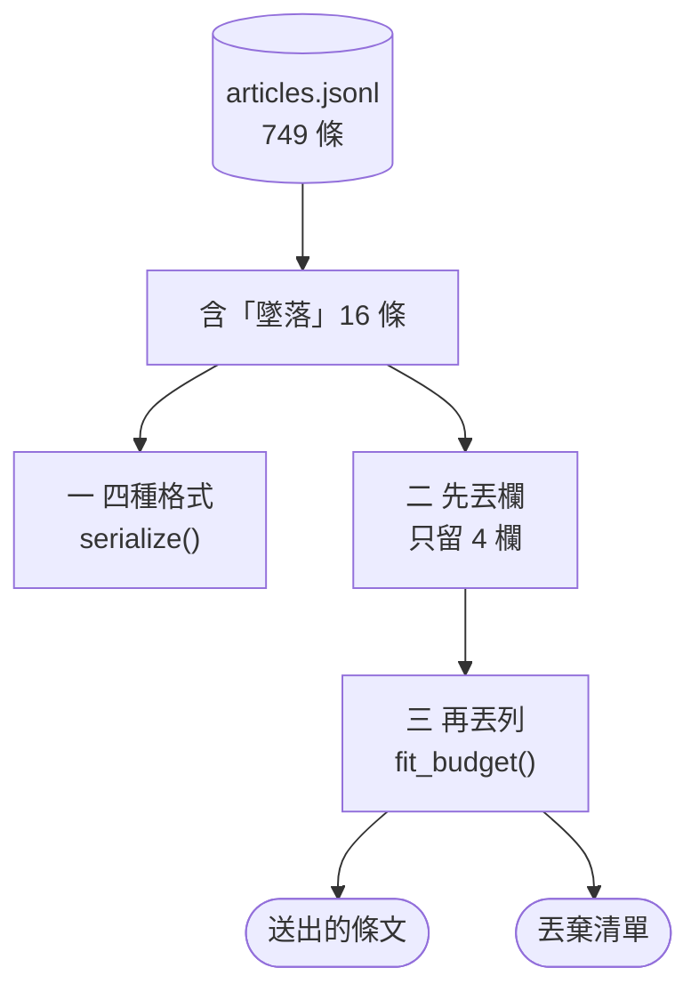
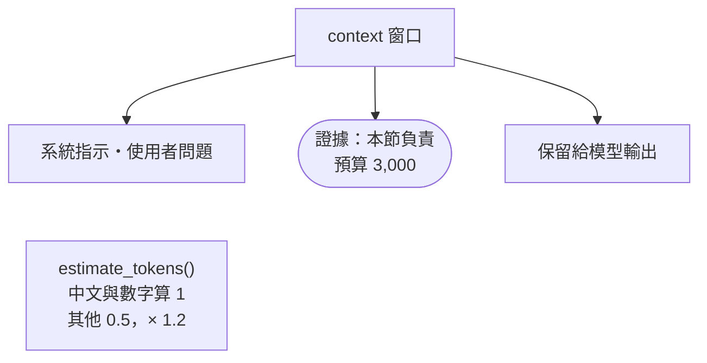
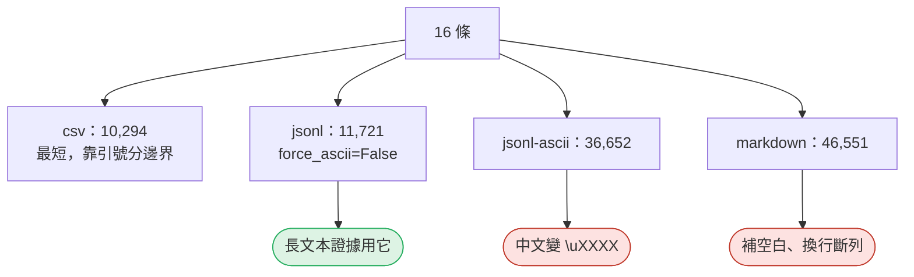
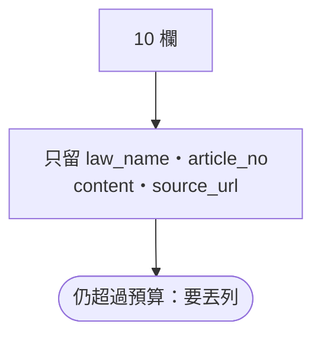
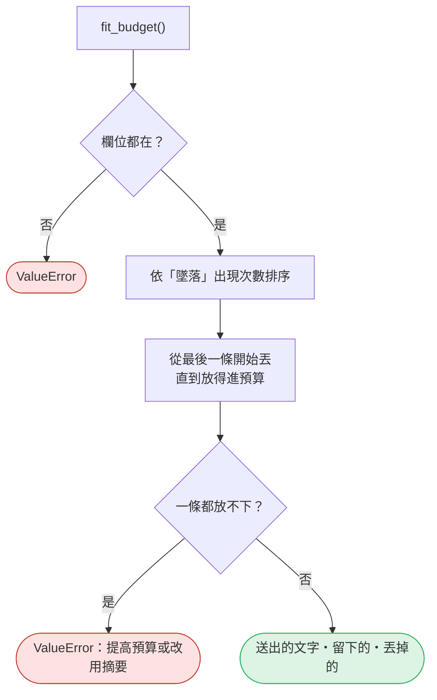

# 17｜序列化與 context 預算

> 同一批資料，用哪種格式、留哪些欄與列，才放得進 context 預算。

<!-- 格式：每段一張圖 -->
[回 19 節課綱](https://hackmd.io/@yillkid/BJAAalfofx)

## 範例程式碼

| 檔案 | 講解段落 | 內容 | 執行指令 |
| --- | --- | --- | --- |
| [`17_context_budget.py`](https://github.com/4-learn/data-analysis-and-process-demo/blob/master/2026/17_context_budget.py) | 零～三 | 四種格式、丟欄、丟列（fit_budget） | `python3 17_context_budget.py` |

- 在 [`2026/`](https://github.com/4-learn/data-analysis-and-process-demo/tree/master/2026) 資料夾執行；練習資料與環境說明見該資料夾的 README。
- 只讀 `data/`，不寫檔、不連網。

## 學完能做到

| 時間 | 段落 | 學完能做到 |
| --- | --- | --- |
| 0–6 分 | 零 | 說出預算有哪幾個去處；為什麼用粗估 |
| 6–24 分 | 一 | 比較四種格式的長度與陷阱 |
| 24–35 分 | 二、三 | 先丟欄、再丟列，並交出丟棄清單 |
| 35–50 分 | Workshop | 換排序，誰被丟掉了？ |

## 本節流程



每段都是：**問題 → 位置（黃色）→ 步驟圖 → 程式 → 輸出 → 重點**。

## 零、準備：預算與粗估

**問題：** context 窗口裡，證據能用多少？

**在流程中的位置：**


**這段做了什麼：**



<!-- fn-table -->
| 函式名稱 | 說明 | 官方文件連結 |
|---|---|---|
| 前面介紹過 | 用法同前，括號內是在哪裡第一次介紹 | [`Path(__file__).resolve().parent`](https://docs.python.org/3.12/library/pathlib.html#pathlib.Path.resolve)（第 02 節）、[`ch.isascii()`](https://docs.python.org/3.12/library/stdtypes.html#str.isascii)（第 16 節）、[`ch.isdigit()`](https://docs.python.org/3.12/library/stdtypes.html#str.isdigit)（第 16 節）、[`math.ceil()`](https://docs.python.org/3.12/library/math.html#math.ceil)（第 16 節）、[`Path()`](https://docs.python.org/3.12/library/pathlib.html#pathlib.Path)（爬蟲 10） |

<!-- 節錄: 17_context_budget.py -->
```python
import math
from pathlib import Path

import pandas as pd

DATA = Path(__file__).resolve().parent / "data" / "articles.jsonl"
QUERY = "墜落"
BUDGET = 3000              # 估計 token 上限；實際值依模型而定
KEEP = ["law_name", "article_no", "content", "source_url"]   # LLM 需要的；source_url 用來附出處


def estimate_tokens(text):
    """保守粗估，不是計數：非 ASCII 字元與數字各算 1、其他 ASCII 算 0.5，再乘 1.2 安全係數。"""
    heavy = sum(1 for ch in text if not ch.isascii() or ch.isdigit())
    light = len(text) - heavy
    return math.ceil((heavy + light * 0.5) * 1.2)
```

<!-- fn-table -->
| 函式名稱 | 說明 | 官方文件連結 |
|---|---|---|
| `s.str.count(樣式)` | 每個字串裡出現幾次 | [文件](https://pandas.pydata.org/docs/reference/api/pandas.Series.str.count.html#pandas.Series.str.count) |
| 前面介紹過 | 用法同前，括號內是在哪裡第一次介紹 | [`df["欄"]`](https://pandas.pydata.org/docs/user_guide/indexing.html#basics)（第 02 節）、[`df[條件]`](https://pandas.pydata.org/docs/user_guide/indexing.html#boolean-indexing)（第 02 節）、[`pd.read_json()`](https://pandas.pydata.org/docs/reference/api/pandas.read_json.html#pandas.read_json)（第 04 節）、[`s.str.contains()`](https://pandas.pydata.org/docs/reference/api/pandas.Series.str.contains.html#pandas.Series.str.contains)（第 04 節）、[`.copy()`](https://pandas.pydata.org/docs/reference/api/pandas.DataFrame.copy.html#pandas.DataFrame.copy)（第 08 節） |

<!-- 節錄: 17_context_budget.py -->
```python
articles = pd.read_json(DATA, lines=True, dtype=False, convert_dates=False)
hits = articles[articles["content"].str.contains(QUERY, regex=False)].copy()
hits["hits"] = hits["content"].str.count(QUERY)
print(f"全部 {len(articles)} 條；含「{QUERY}」{len(hits)} 條\n")
```

<sub>📄 來源：執行 `python3 17_context_budget.py` 的輸出（開頭幾行）</sub>

```text
全部 749 條；含「墜落」16 條
```

- 不用 `tiktoken`：換模型就不準。粗估在長文本偏保守，是**規劃用的估計**，不是計費依據。

| 模型 | 粗估低於實測 |
| --- | --- |
| `Qwen2.5-0.5B-Instruct` | 0 / 8 |
| `bge-small-zh-v1.5` | 2 / 8（短詞 `安全帽`、`頭盔`） |

## 一、同一批資料，四種格式

**問題：** 同樣 16 條，換格式差多少？

**在流程中的位置：**


**這段做了什麼：**



<!-- fn-table -->
| 函式名稱 | 說明 | 官方文件連結 |
|---|---|---|
| 前面介紹過 | 用法同前，括號內是在哪裡第一次介紹 | [`df.to_csv()`](https://pandas.pydata.org/docs/reference/api/pandas.DataFrame.to_csv.html#pandas.DataFrame.to_csv)（第 02 節）、[`df.to_json()`](https://pandas.pydata.org/docs/reference/api/pandas.DataFrame.to_json.html#pandas.DataFrame.to_json)（第 04 節）、[`df.to_markdown()`](https://pandas.pydata.org/docs/reference/api/pandas.DataFrame.to_markdown.html#pandas.DataFrame.to_markdown)（第 16 節） |

<!-- 節錄: 17_context_budget.py -->
```python
def serialize(df, fmt):
    if fmt == "csv":
        return df.to_csv(index=False)
    if fmt == "jsonl-ascii":
        return df.to_json(orient="records", lines=True)
    if fmt == "jsonl":
        return df.to_json(orient="records", lines=True, force_ascii=False)
    if fmt == "markdown":
        return df.to_markdown(index=False)
    raise ValueError(f"未知格式：{fmt}")
```

<!-- fn-table -->
| 函式名稱 | 說明 | 官方文件連結 |
|---|---|---|
| 前面介紹過 | 用法同前，括號內是在哪裡第一次介紹 | [`.drop()`](https://pandas.pydata.org/docs/reference/api/pandas.DataFrame.drop.html#pandas.DataFrame.drop)（第 04 節） |

<!-- 節錄: 17_context_budget.py -->
```python
print("== 1. 同樣 16 列、全部欄位，四種格式 ==")
for fmt in ("csv", "jsonl-ascii", "jsonl", "markdown"):
    text = serialize(hits.drop(columns="hits"), fmt)
    print(f"{fmt:12} 字元 {len(text):>6,}  估計 token {estimate_tokens(text):>6,}")
```

<sub>📄 來源：執行 `python3 17_context_budget.py` 的輸出（第 1 段）</sub>

```text
== 1. 同樣 16 列、全部欄位，四種格式 ==
csv          字元  9,681  估計 token 10,294
jsonl-ascii  字元 42,549  估計 token 36,652
jsonl        字元 12,059  估計 token 11,721
markdown     字元 70,109  估計 token 46,551
```

- Markdown 表格遇到條文裡的換行，16 列變成 171 行。

| 格式 | 長度 | 邊界 | 適合 |
| --- | --- | --- | --- |
| `jsonl`（`force_ascii=False`） | 中 | 可靠 | **長文本證據** |
| `csv` | 短 | 靠引號 | 欄位少、值短 |
| `markdown` | 長 | 遇換行會壞 | 短欄位摘要 |
| `jsonl-ascii` | 長 | 可靠 | 不要給 LLM |

## 二、先丟欄

**問題：** LLM 需要哪幾欄？

**在流程中的位置：**


**這段做了什麼：**



<!-- fn-table -->
| 函式名稱 | 說明 | 官方文件連結 |
|---|---|---|
| 前面介紹過 | 用法同前，括號內是在哪裡第一次介紹 | [`df["欄"]`](https://pandas.pydata.org/docs/user_guide/indexing.html#basics)（第 02 節） |

<!-- 節錄: 17_context_budget.py -->
```python
print(f"\n== 2. 先丟欄：只留 {KEEP} ==")
slim = serialize(hits[KEEP], "jsonl")
print(f"jsonl        字元 {len(slim):>6,}  估計 token {estimate_tokens(slim):>6,}  （預算 {BUDGET:,}）")
```

<sub>📄 來源：執行 `python3 17_context_budget.py` 的輸出（第 2 段）</sub>

```text
== 2. 先丟欄：只留 ['law_name', 'article_no', 'content', 'source_url'] ==
jsonl        字元  8,841  估計 token  9,007  （預算 3,000）
```

- `source_url` 要留：LLM 附出處用。

## 三、再丟列：整條保留或整條丟

**問題：** 放不下時，丟哪幾條？

**在流程中的位置：**


**這段做了什麼：**



<!-- fn-table -->
| 函式名稱 | 說明 | 官方文件連結 |
|---|---|---|
| 前面介紹過 | 用法同前，括號內是在哪裡第一次介紹 | [`.iloc[]`](https://pandas.pydata.org/docs/reference/api/pandas.Series.iloc.html#pandas.Series.iloc)（第 02 節）、[`.sort_values()`](https://pandas.pydata.org/docs/reference/api/pandas.DataFrame.sort_values.html#pandas.DataFrame.sort_values)（第 02 節）、[`df.columns`](https://pandas.pydata.org/docs/reference/api/pandas.DataFrame.columns.html#pandas.DataFrame.columns)（第 02 節）、[`df.head()`](https://pandas.pydata.org/docs/reference/api/pandas.DataFrame.head.html#pandas.DataFrame.head)（第 02 節）、[`df["欄"]`](https://pandas.pydata.org/docs/user_guide/indexing.html#basics)（第 02 節） |

<!-- 節錄: 17_context_budget.py -->
```python
def fit_budget(df, budget, columns, rank_by, count=estimate_tokens, fmt="jsonl"):
    """先丟欄、再丟列；條文不截斷。回傳 (要送出的文字, 留下的列, 被丟掉的列)。"""
    missing = [c for c in columns + [rank_by] if c not in df.columns]
    if missing:
        raise ValueError(f"缺少欄位 {missing}")
    ranked = df.sort_values([rank_by, "source_url"], ascending=[False, True])
    slim = ranked[columns]
    kept = len(slim)
    while kept > 0 and count(serialize(slim.head(kept), fmt)) > budget:
        kept -= 1
    if kept == 0:
        raise ValueError(f"預算 {budget} 連一條都放不下，請提高預算或改用摘要")
    return serialize(slim.head(kept), fmt), ranked.head(kept), ranked.iloc[kept:]
```

<!-- fn-table -->
| 函式名稱 | 說明 | 官方文件連結 |
|---|---|---|
| 前面介紹過 | 用法同前，括號內是在哪裡第一次介紹 | [`df.to_string()`](https://pandas.pydata.org/docs/reference/api/pandas.DataFrame.to_string.html#pandas.DataFrame.to_string)（第 02 節）、[`df["欄"]`](https://pandas.pydata.org/docs/user_guide/indexing.html#basics)（第 02 節）、[`s.str[a:b]`](https://pandas.pydata.org/docs/user_guide/text.html#indexing-with-str)（第 07 節）、[`整欄運算`](https://pandas.pydata.org/docs/user_guide/basics.html#flexible-binary-operations)（第 07 節） |

<!-- 節錄: 17_context_budget.py -->
```python
print("\n== 3. 再丟列：依「墜落」出現次數排序，整條保留或整條丟 ==")
text, kept, dropped = fit_budget(hits, BUDGET, KEEP, rank_by="hits")
print(f"送出 {len(kept)} 條，估計 token {estimate_tokens(text):,}：")
print(kept[["law_name", "article_no", "hits"]].to_string(index=False))
print(f"丟掉 {len(dropped)} 條（要留紀錄，不是默默消失）：")
print(", ".join(dropped["law_name"].str[:4] + dropped["article_no"]))
```

<sub>📄 來源：執行 `python3 17_context_budget.py` 的輸出（第 3 段）</sub>

```text
== 3. 再丟列：依「墜落」出現次數排序，整條保留或整條丟 ==
送出 4 條，估計 token 2,221：
  law_name article_no  hits
營造安全衛生設施標準     第 17 條     3
營造安全衛生設施標準     第 18 條     2
營造安全衛生設施標準     第 19 條     2
營造安全衛生設施標準     第 22 條     2
丟掉 12 條（要留紀錄，不是默默消失）：
職業安全第 6 條, 營造安全第 105 條, 營造安全第 131 條, 營造安全第 149-1 條, 營造安全第 162 條, 營造安全第 20 條, 營造安全第 24 條, 營造安全第 25 條, 營造安全第 42 條, 營造安全第 56 條, 營造安全第 59 條, 營造安全第 79 條
```

- 條文**不截斷**：半條條文比沒有更危險。
- 丟掉的要留紀錄，不是默默消失。排序規則決定誰被丟——Workshop 會換排序試試。

## Workshop：誰被丟掉了？

### 題目

**課堂題**（約 10 分鐘）：第三段「丟掉 12 條」裡，第一個被丟掉的是**職業安全衛生法第 6 條**。執行起手式印出它的內容。「營造安全衛生設施標準」第 1 條寫著「本標準依職業安全衛生法**第六條第三項**規定訂定之」——被送出的 4 條細則，母法依據正是被丟掉的這一條。判斷：對「墜落」這個問題，丟掉它合理嗎？

起手式 [`17_workshop_dropped.py`](https://github.com/4-learn/data-analysis-and-process-demo/blob/master/2026/17_workshop_dropped.py)（在 `2026/` 資料夾執行）：

<!-- fn-table -->
| 函式名稱 | 說明 | 官方文件連結 |
|---|---|---|
| 前面介紹過 | 用法同前，括號內是在哪裡第一次介紹 | [`.iloc[]`](https://pandas.pydata.org/docs/reference/api/pandas.Series.iloc.html#pandas.Series.iloc)（第 02 節）、[`Path(__file__).resolve().parent`](https://docs.python.org/3.12/library/pathlib.html#pathlib.Path.resolve)（第 02 節）、[`df["欄"]`](https://pandas.pydata.org/docs/user_guide/indexing.html#basics)（第 02 節）、[`pd.read_json()`](https://pandas.pydata.org/docs/reference/api/pandas.read_json.html#pandas.read_json)（第 04 節）、[`df.query()`](https://pandas.pydata.org/docs/reference/api/pandas.DataFrame.query.html#pandas.DataFrame.query)（第 08 節）、[`Path()`](https://docs.python.org/3.12/library/pathlib.html#pathlib.Path)（爬蟲 10） |

<!-- workshop: 17_workshop_dropped.py -->
```python
"""第 17 節 Workshop 課堂題：第一個被丟掉的條文（職業安全衛生法第 6 條）寫了什麼？"""

from pathlib import Path

import pandas as pd

DATA = Path(__file__).resolve().parent / "data"

if __name__ == "__main__":
    df = pd.read_json(DATA / "articles.jsonl", lines=True, dtype=False, convert_dates=False)
    print(df.query("pcode == 'N0060001' and slug == '6'")["content"].iloc[0])
```

**延伸題**（做完課堂題再做）：

1. 換一種排序，各跑一次 `fit_budget()`，比較送出哪幾條：**短的優先**（新增 `hits["length"] = hits["content"].str.len()`，以 `-length` 排序）、**母法優先**（新增欄位，職業安全衛生法為 1、其他為 0）。
2. 請 OpenCode 寫「把 DataFrame 轉成給 LLM 的 JSON，控制在 3,000 token 內」，檢查：`force_ascii=False`？丟掉的列有沒有紀錄？是不是用 `content.str[:200]` 截斷？

### 預期輸出

課堂題：

<sub>📄 來源：執行 `python3 17_workshop_dropped.py` 的輸出</sub>

```text
雇主對下列事項應有符合規定之必要安全衛生設備及措施：
一、防止機械、設備或器具等引起之危害。
二、防止爆炸性或發火性等物質引起之危害。
三、防止電、熱或其他之能引起之危害。
四、防止採石、採掘、裝卸、搬運、堆積或採伐等作業中引起之危害。
五、防止有墜落、物體飛落或崩塌等之虞之作業場所引起之危害。
六、防止高壓氣體引起之危害。
七、防止原料、材料、氣體、蒸氣、粉塵、溶劑、化學品、含毒性物質或缺氧空氣等引起之危害。
八、防止輻射、高溫、低溫、超音波、噪音、振動或異常氣壓等引起之危害。
九、防止監視儀表或精密作業等引起之危害。
十、防止廢氣、廢液或殘渣等廢棄物引起之危害。
十一、防止水患、風災或火災等引起之危害。
十二、防止動物、植物或微生物等引起之危害。
十三、防止通道、地板或階梯等引起之危害。
十四、防止未採取充足通風、採光、照明、保溫或防濕等引起之危害。
雇主對下列事項，應妥為規劃及採取必要之安全衛生措施：
一、重複性作業等促發肌肉骨骼疾病之預防。
二、輪班、夜間工作、長時間工作等異常工作負荷促發疾病之預防。
三、執行職務因他人行為遭受身體或精神不法侵害之預防，並建立申訴、調查及處理程序。
四、避難、急救、休息或其他為保護勞工身心健康之事項。
前二項必要之安全衛生設備與措施之標準及規則，由中央主管機關定之。
```

### 參考判讀

:::spoiler 教師用（點開）
- **丟掉母法第 6 條不合理**，但這不是 `fit_budget()` 的錯，是**排序規則**的錯。`fit_budget()` 只負責「照你的順序裝到滿」；什麼最重要，要另外判斷。這也是為什麼丟棄清單一定要輸出——沒有清單，沒人會發現母法被丟了。
- 教師實測（2026-10-05，同上環境）：

  | 排序 | 送出 | 估計 token | 職安法第 6 條 |
  | --- | ---: | ---: | --- |
  | 墜落次數（本節預設） | 4 條 | 2,221 | 丟掉 |
  | 短的優先 | 9 條 | 2,986 | 丟掉 |
  | 母法優先 | 6 條 | 2,884 | **送出** |

- 「短的優先」能塞進更多條，但「多」不等於「好」：短條文常是定義或罰則，不一定回答得了問題；職安法第 6 條本身很長，在這個排序下一樣被丟。
- 「母法優先」是一種**領域規則**，要寫下規則來源（第 14 節的「可稽核規則」），不能只是你覺得。
- 用 `content.str[:200]` 截斷的版本「每條都放得進去」，看起來比較好，但會截掉但書與款項。若 AI 的版本這樣做，要求它改成整條取捨。
- 第三題若 AI 的 JSON 裡出現 `\u`，就是漏了 `force_ascii=False`。
:::

### 驗收

- 說得出：丟掉第 6 條不合理，但錯的是**排序規則**，不是 `fit_budget()`。
- （延伸）兩種排序各一列：送出幾條、職安法第 6 條是否送出、估計 token；AI 版本三項檢查都有結論。

## 附錄：完整程式

```bash
python3 17_context_budget.py
```

<!-- fn-table -->
| 函式名稱 | 說明 | 官方文件連結 |
|---|---|---|
| （同上） | 這支程式用到的函式，都已在上面各段的表格介紹過 | — |

<!-- demo: 17_context_budget.py -->
```python
"""第 17 節：同一批資料，用哪種格式、留哪些欄位與列，才放得進 context 預算。"""

import math
from pathlib import Path

import pandas as pd

DATA = Path(__file__).resolve().parent / "data" / "articles.jsonl"
QUERY = "墜落"
BUDGET = 3000              # 估計 token 上限；實際值依模型而定
KEEP = ["law_name", "article_no", "content", "source_url"]   # LLM 需要的；source_url 用來附出處


def estimate_tokens(text):
    """保守粗估，不是計數：非 ASCII 字元與數字各算 1、其他 ASCII 算 0.5，再乘 1.2 安全係數。"""
    heavy = sum(1 for ch in text if not ch.isascii() or ch.isdigit())
    light = len(text) - heavy
    return math.ceil((heavy + light * 0.5) * 1.2)


def serialize(df, fmt):
    if fmt == "csv":
        return df.to_csv(index=False)
    if fmt == "jsonl-ascii":
        return df.to_json(orient="records", lines=True)
    if fmt == "jsonl":
        return df.to_json(orient="records", lines=True, force_ascii=False)
    if fmt == "markdown":
        return df.to_markdown(index=False)
    raise ValueError(f"未知格式：{fmt}")


def fit_budget(df, budget, columns, rank_by, count=estimate_tokens, fmt="jsonl"):
    """先丟欄、再丟列；條文不截斷。回傳 (要送出的文字, 留下的列, 被丟掉的列)。"""
    missing = [c for c in columns + [rank_by] if c not in df.columns]
    if missing:
        raise ValueError(f"缺少欄位 {missing}")
    ranked = df.sort_values([rank_by, "source_url"], ascending=[False, True])
    slim = ranked[columns]
    kept = len(slim)
    while kept > 0 and count(serialize(slim.head(kept), fmt)) > budget:
        kept -= 1
    if kept == 0:
        raise ValueError(f"預算 {budget} 連一條都放不下，請提高預算或改用摘要")
    return serialize(slim.head(kept), fmt), ranked.head(kept), ranked.iloc[kept:]


if __name__ == "__main__":
    articles = pd.read_json(DATA, lines=True, dtype=False, convert_dates=False)
    hits = articles[articles["content"].str.contains(QUERY, regex=False)].copy()
    hits["hits"] = hits["content"].str.count(QUERY)
    print(f"全部 {len(articles)} 條；含「{QUERY}」{len(hits)} 條\n")

    print("== 1. 同樣 16 列、全部欄位，四種格式 ==")
    for fmt in ("csv", "jsonl-ascii", "jsonl", "markdown"):
        text = serialize(hits.drop(columns="hits"), fmt)
        print(f"{fmt:12} 字元 {len(text):>6,}  估計 token {estimate_tokens(text):>6,}")

    print(f"\n== 2. 先丟欄：只留 {KEEP} ==")
    slim = serialize(hits[KEEP], "jsonl")
    print(f"jsonl        字元 {len(slim):>6,}  估計 token {estimate_tokens(slim):>6,}  （預算 {BUDGET:,}）")

    print("\n== 3. 再丟列：依「墜落」出現次數排序，整條保留或整條丟 ==")
    text, kept, dropped = fit_budget(hits, BUDGET, KEEP, rank_by="hits")
    print(f"送出 {len(kept)} 條，估計 token {estimate_tokens(text):,}：")
    print(kept[["law_name", "article_no", "hits"]].to_string(index=False))
    print(f"丟掉 {len(dropped)} 條（要留紀錄，不是默默消失）：")
    print(", ".join(dropped["law_name"].str[:4] + dropped["article_no"]))
```

## 教師紀錄與下一步

:::spoiler 實測環境、版本差異、資料來源（點開）
**實測**：2026-10-05，Ubuntu 20.04，Python 3.11.8，pandas 3.0.6、numpy 2.4.6、tabulate 0.10.0。本頁所有輸出為該環境實際執行貼上（**本機實測**）。另以 Python 3.10.15／pandas 2.3.3 執行，輸出**逐字相同**。

> 版本陷阱（已處理）：若讀檔時沒寫 `convert_dates=False`，pandas 會把 `fetched_at` 轉成日期；pandas 2.x 寫回 JSON 時變成毫秒整數 `1791173123000`，3.0 寫回 ISO 字串。兩版長度因此不同。本節明確關掉日期轉換，讓輸出不依版本而變。

**token 數字的等級**：全部是**粗估**（`estimate_tokens()`），不是任何 tokenizer 的實測，也不是計費依據。粗估與真實 tokenizer 的對照，使用 LLM 課 `data/tokenizer-fixtures.json` 的教師實測（2026-10-05；本課複本在 `data/17-tokenizer/`）。

**界線**：本節不呼叫 LLM，不宣稱「哪種格式模型答得比較好」——那需要評測，屬 LLM 課第 07 節。本節只處理**長度**與**結構是否保留**這兩件可以直接驗證的事。本節**尚未實班試教**。

:::

**下一節**：第 18 節〈文字語料：切塊、多值與去識別〉——當單一條文就超過預算（本資料最長一條 935 字）時，就不能再「整條取捨」，要切塊。
