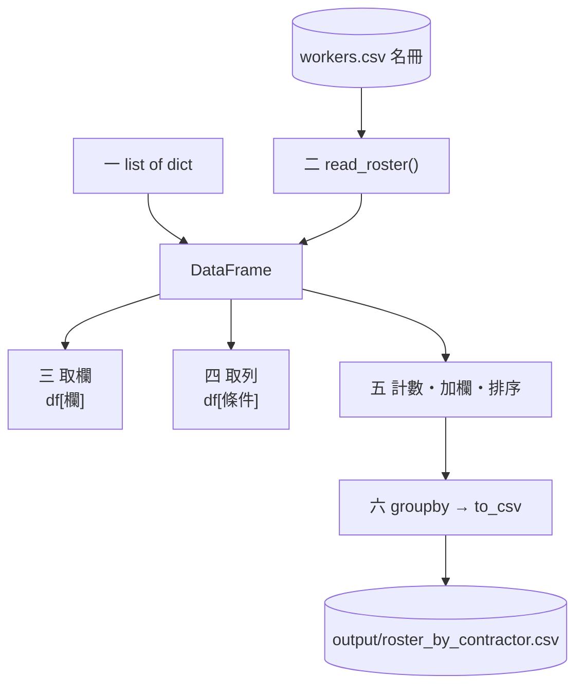
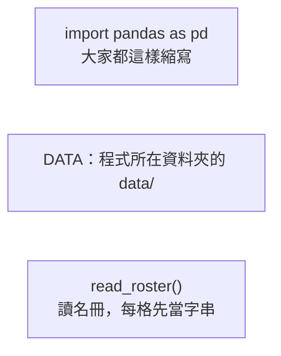
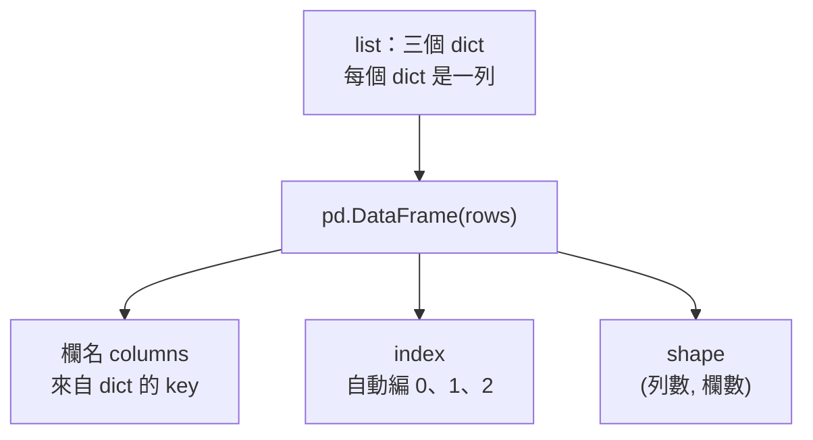
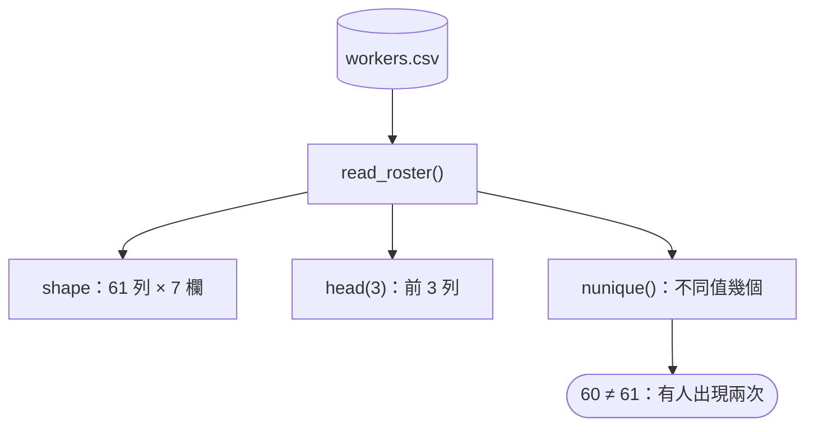
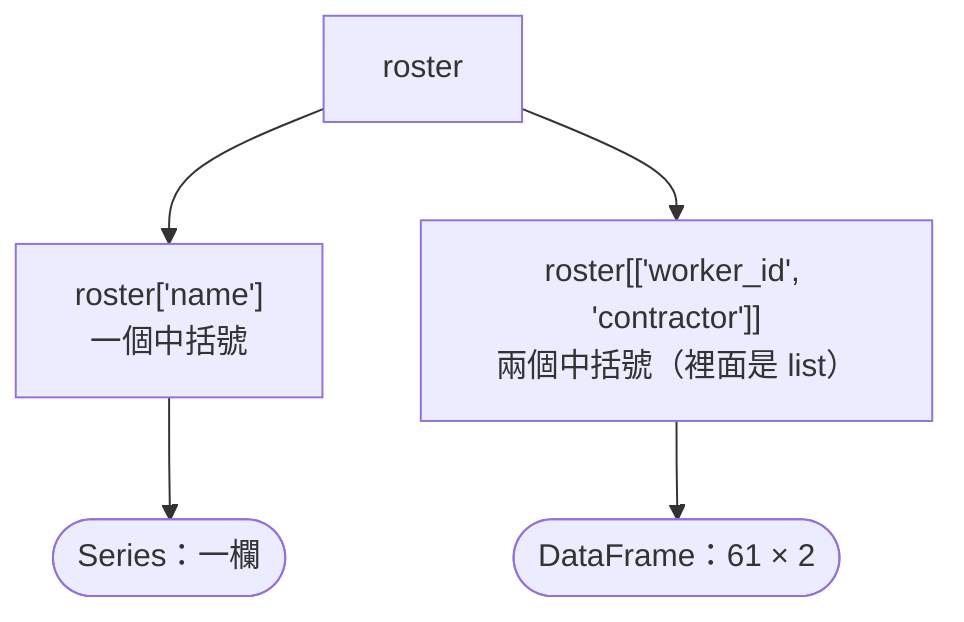
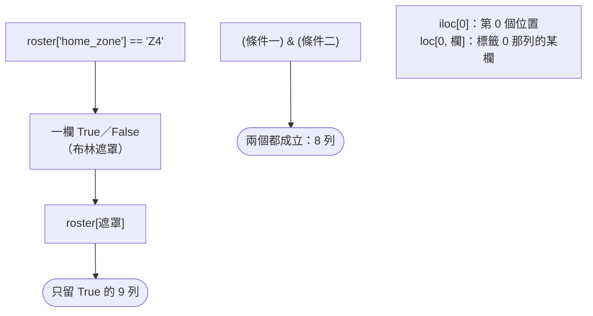
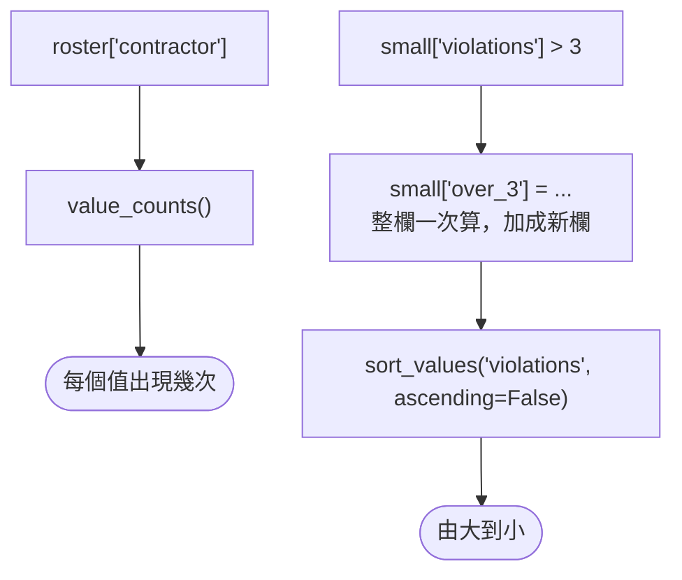
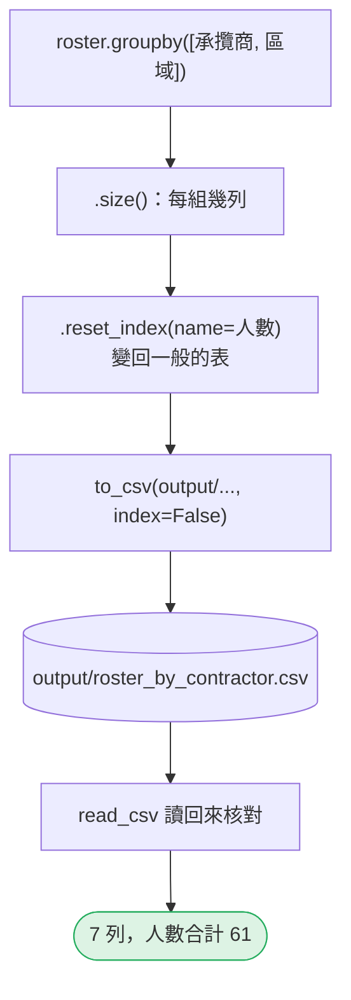

# 02｜pandas 入門：DataFrame 是什麼、怎麼看、怎麼取、怎麼存

> 本課所有程式都建在 DataFrame 上。這一節只做六件事：建一張表、讀一個檔、取欄、取列、算一算、存回去。

<!-- 格式：每段一張圖 -->
[回 19 節課綱](https://hackmd.io/@yillkid/BJAAalfofx)

## 範例程式碼

| 檔案 | 講解段落 | 內容 | 執行指令 |
| --- | --- | --- | --- |
| [`02_pandas_intro.py`](https://github.com/4-learn/data-analysis-and-process-demo/blob/master/2026/02_pandas_intro.py) | 零～六 | 建表、讀 CSV、取欄、取列、計數排序、分組存檔 | `python3 02_pandas_intro.py` |

- 在 [`2026/`](https://github.com/4-learn/data-analysis-and-process-demo/tree/master/2026) 資料夾執行；練習資料與環境說明見該資料夾的 README。
- 這支程式會寫一個檔：`output/roster_by_contractor.csv`；其他都只讀 `data/`。

## 學完能做到

| 時間 | 段落 | 學完能做到 |
| --- | --- | --- |
| 0–8 分 | 零、一 | 說出 DataFrame 的三個部分：欄、列、index |
| 8–16 分 | 二 | 讀一個 CSV，用 `shape`、`head()` 看它長什麼樣 |
| 16–28 分 | 三、四 | 取一欄、取幾欄、用條件取列 |
| 28–35 分 | 五、六 | 計數、加一欄、排序、分組、存成 CSV |
| 35–50 分 | Workshop | 課堂題：照著改；延伸題：自己組一張表 |

## 本節流程



每段都是：**問題 → 位置（黃色）→ 步驟圖 → 程式 → 輸出 → 重點**。

## 零、準備：匯入 pandas、找到檔案

**問題：** 程式開頭要寫什麼？

**在流程中的位置：**


**這段做了什麼：**



<!-- fn-table -->
| 函式名稱 | 說明 | 官方文件連結 |
|---|---|---|
| `Path(__file__).resolve().parent` | `__file__` 是這支程式自己的路徑；`resolve()` 轉成完整路徑，`.parent` 取所在資料夾。從哪裡執行都找得到 `data/` | [文件](https://docs.python.org/3.12/library/pathlib.html#pathlib.Path.resolve) |
| `pd.read_csv(path, dtype=str, keep_default_na=False, encoding=)` | 讀 CSV 成 `DataFrame`。`dtype=str` 每欄都當字串；`keep_default_na=False` 空格保持 `""` 不變 `NaN`；`encoding` 指定編碼 | [文件](https://pandas.pydata.org/docs/reference/api/pandas.read_csv.html#pandas.read_csv) |
| 前面介紹過 | 用法同前，括號內是在哪裡第一次介紹 | [`Path()`](https://docs.python.org/3.12/library/pathlib.html#pathlib.Path)（爬蟲 10） |

<!-- 節錄: 02_pandas_intro.py -->
```python
from pathlib import Path

import pandas as pd

DATA = Path(__file__).resolve().parent / "data"
ROSTER = DATA / "events" / "workers.csv"
OUTPUT = Path(__file__).resolve().parent / "output"


def read_roster(path=ROSTER):
    """名冊：每一格都先當字串讀進來；空格保持空字串，不變成 NaN（第 03 節會說明為什麼）。"""
    return pd.read_csv(path, dtype=str, keep_default_na=False)
```

- `Path(__file__)`：從哪個資料夾執行都找得到檔案。
- `dtype=str, keep_default_na=False` 先照抄，第 03 節說明為什麼。

## 一、從 list of dict 建一張表

**問題：** DataFrame 長什麼樣？

**在流程中的位置：**


**這段做了什麼：**



<!-- fn-table -->
| 函式名稱 | 說明 | 官方文件連結 |
|---|---|---|
| `pd.DataFrame(資料, columns=)` | 建立表格。資料可以是「一列一個 dict 的 list」或「欄名 → 一欄值的 dict」 | [文件](https://pandas.pydata.org/docs/reference/api/pandas.DataFrame.html#pandas.DataFrame) |
| `df.columns` | 所有欄名。可以 `for c in df.columns`，也可以 `"欄" in df.columns` 檢查有沒有這欄 | [文件](https://pandas.pydata.org/docs/reference/api/pandas.DataFrame.columns.html#pandas.DataFrame.columns) |
| `df.shape` | （列數, 欄數）的 tuple；`df.shape[1]` 是欄數 | [文件](https://pandas.pydata.org/docs/reference/api/pandas.DataFrame.shape.html#pandas.DataFrame.shape) |
| `.tolist()` | 轉成 Python list（`Series`、`Index`、`unique()` 的結果都可以） | [文件](https://pandas.pydata.org/docs/reference/api/pandas.Series.tolist.html) |
| `df.index` | 列的標籤（預設是 0、1、2…）；篩選後會保留原本的標籤，不會重新編號 | [文件](https://pandas.pydata.org/docs/reference/api/pandas.DataFrame.index.html#pandas.DataFrame.index) |

<!-- 節錄: 02_pandas_intro.py -->
```python
print("== 1. 從 list of dict 建一張 DataFrame ==")
rows = [
    {"worker_id": "W001", "name": "蔡靜宜", "zone": "Z3", "violations": 2},
    {"worker_id": "W002", "name": "李雅婷", "zone": "Z2", "violations": 0},
    {"worker_id": "W003", "name": "王志豪", "zone": "Z1", "violations": 5},
]
small = pd.DataFrame(rows)
print(small)
print(f"幾列幾欄 shape={small.shape}；欄名 columns={small.columns.tolist()}")
print(f"列的標籤 index={small.index.tolist()}")
```

<sub>📄 來源：執行 `python3 02_pandas_intro.py` 的輸出（第 1 段）</sub>

```text
== 1. 從 list of dict 建一張 DataFrame ==
  worker_id name zone  violations
0      W001  蔡靜宜   Z3           2
1      W002  李雅婷   Z2           0
2      W003  王志豪   Z1           5
幾列幾欄 shape=(3, 4)；欄名 columns=['worker_id', 'name', 'zone', 'violations']
列的標籤 index=[0, 1, 2]
```

- 一個 dict 一列，dict 的 key 變成欄名。
- 最左邊的 0、1、2 是 **index**（列的標籤），不是資料。

| index（列標籤） | worker_id | name | zone | violations |
| --- | --- | --- | --- | --- |
| **0** | W001 | 蔡靜宜 | Z3 | 2 |
| **1** | W002 | 李雅婷 | Z2 | 0 |
| **2** | W003 | 王志豪 | Z1 | 5 |

最上面一列是**欄名**（columns），最左邊粗體是 **index**；中間每一格才是資料。

## 二、讀一個 CSV，先看長相

**問題：** 讀進來之後，先看什麼？

**在流程中的位置：**


**這段做了什麼：**



<!-- fn-table -->
| 函式名稱 | 說明 | 官方文件連結 |
|---|---|---|
| `df.head(n)` | 前 n 列（預設 5） | [文件](https://pandas.pydata.org/docs/reference/api/pandas.DataFrame.head.html#pandas.DataFrame.head) |
| `df.to_string(index=)` | 把整張表轉成對齊好的文字（`print` 用）；不會像直接 `print(df)` 那樣把中間省略成 `...` | [文件](https://pandas.pydata.org/docs/reference/api/pandas.DataFrame.to_string.html#pandas.DataFrame.to_string) |
| `df["欄"]`／`df[["欄1", "欄2"]]` | 取一欄得到 `Series`；給一個 list 取多欄，得到 `DataFrame`。新增欄位也是 `df["新欄"] = 值` | [文件](https://pandas.pydata.org/docs/user_guide/indexing.html#basics) |
| `.nunique(dropna=)` | 有幾個不同的值；`dropna=False` 時 `NaN` 也算一種 | [文件](https://pandas.pydata.org/docs/reference/api/pandas.Series.nunique.html#pandas.Series.nunique) |
| 前面介紹過 | 用法同前，括號內是在哪裡第一次介紹 | [`df.shape`](https://pandas.pydata.org/docs/reference/api/pandas.DataFrame.shape.html#pandas.DataFrame.shape)（第 02 節） |

<!-- 節錄: 02_pandas_intro.py -->
```python
print("\n== 2. 讀一個 CSV，先看長相 ==")
roster = read_roster()
print(f"shape={roster.shape}")
print(roster.head(3)[["worker_id", "name", "contractor", "trade", "home_zone"]].to_string())
print(f"worker_id 不同值 {roster['worker_id'].nunique()} 個，比列數少 1：W023 換了承攬商，名冊有兩列")
```

<sub>📄 來源：執行 `python3 02_pandas_intro.py` 的輸出（第 2 段）</sub>

```text
== 2. 讀一個 CSV，先看長相 ==
shape=(61, 7)
  worker_id name contractor trade home_zone
0      W001  蔡靜宜        甲營造   開挖工        Z3
1      W002  李雅婷        乙鋼構   鋼構工        Z2
2      W003  陳建宏        丙土木  物料搬運        Z1
worker_id 不同值 60 個，比列數少 1：W023 換了承攬商，名冊有兩列
```

- 拿到一份檔，先看 **shape** 和 **head()**，不要直接開始算。
- 列數不一定等於人數：W023 換了承攬商，名冊有兩列。

## 三、取一欄、取幾欄

**問題：** `df["欄"]` 和 `df[["欄", "欄"]]` 差在哪？

**在流程中的位置：**


**這段做了什麼：**



<!-- fn-table -->
| 函式名稱 | 說明 | 官方文件連結 |
|---|---|---|
| 前面介紹過 | 用法同前，括號內是在哪裡第一次介紹 | [`.tolist()`](https://pandas.pydata.org/docs/reference/api/pandas.Series.tolist.html)（第 02 節）、[`df.head()`](https://pandas.pydata.org/docs/reference/api/pandas.DataFrame.head.html#pandas.DataFrame.head)（第 02 節）、[`df.shape`](https://pandas.pydata.org/docs/reference/api/pandas.DataFrame.shape.html#pandas.DataFrame.shape)（第 02 節）、[`df["欄"]`](https://pandas.pydata.org/docs/user_guide/indexing.html#basics)（第 02 節） |

<!-- 節錄: 02_pandas_intro.py -->
```python
print("\n== 3. 取一欄、取幾欄 ==")
names = roster["name"]
print(f"roster['name'] 是 {type(names).__name__}，長度 {len(names)}，前三個 {names.head(3).tolist()}")
two = roster[["worker_id", "contractor"]]
print(f"roster[['worker_id', 'contractor']] 是 {type(two).__name__}，shape={two.shape}")
```

<sub>📄 來源：執行 `python3 02_pandas_intro.py` 的輸出（第 3 段）</sub>

```text
== 3. 取一欄、取幾欄 ==
roster['name'] 是 Series，長度 61，前三個 ['蔡靜宜', '李雅婷', '陳建宏']
roster[['worker_id', 'contractor']] 是 DataFrame，shape=(61, 2)
```

- 一個欄名 → **Series**；一個欄名的 list → **DataFrame**。

## 四、取列：條件篩選

**問題：** 怎麼只留下 Z4 的人？

**在流程中的位置：**


**這段做了什麼：**



<!-- fn-table -->
| 函式名稱 | 說明 | 官方文件連結 |
|---|---|---|
| `df[條件]`（布林遮罩） | `df["zone"] == "Z4"` 會得到一整欄 True／False；放進 `df[...]` 只留下 True 的列。這是 pandas 篩選的基本寫法 | [文件](https://pandas.pydata.org/docs/user_guide/indexing.html#boolean-indexing) |
| `.sum()` | 加總。對 True／False 加總＝數有幾個 True | [文件](https://pandas.pydata.org/docs/reference/api/pandas.Series.sum.html#pandas.Series.sum) |
| `&`／`\|`／`~` | 布林遮罩的「且／或／非」。pandas 不能用 `and`／`or`／`not`；每個條件要加括號：`(a > 1) & (b == "x")` | [文件](https://pandas.pydata.org/docs/user_guide/indexing.html#boolean-operators) |
| `.iloc[位置]` | 依**位置**（第幾個，從 0 起）取值；`s.iloc[0]` 是第一個，不管它的標籤是什麼 | [文件](https://pandas.pydata.org/docs/reference/api/pandas.Series.iloc.html#pandas.Series.iloc) |
| `df.loc[列條件, 欄]` | 依**標籤**或布林條件選列，同時選欄：`df.loc[df["x"] > 1, "y"]`。要改值也用它 | [文件](https://pandas.pydata.org/docs/reference/api/pandas.DataFrame.loc.html#pandas.DataFrame.loc) |
| `s[標籤]` | 從 `Series` 依標籤取一個值，例如 `counts["W041"]`；給布林遮罩則是篩選 | [文件](https://pandas.pydata.org/docs/user_guide/indexing.html#basics) |
| 前面介紹過 | 用法同前，括號內是在哪裡第一次介紹 | [`.tolist()`](https://pandas.pydata.org/docs/reference/api/pandas.Series.tolist.html)（第 02 節）、[`df.head()`](https://pandas.pydata.org/docs/reference/api/pandas.DataFrame.head.html#pandas.DataFrame.head)（第 02 節）、[`df["欄"]`](https://pandas.pydata.org/docs/user_guide/indexing.html#basics)（第 02 節） |

<!-- 節錄: 02_pandas_intro.py -->
```python
print("\n== 4. 取列：條件篩選 ==")
is_z4 = roster["home_zone"] == "Z4"
print(f"roster['home_zone'] == 'Z4' 是一欄 True／False，True 有 {int(is_z4.sum())} 個")
z4 = roster[is_z4]
print(f"roster[條件] 留下 {len(z4)} 列：{z4['worker_id'].head(5).tolist()} …")
both = roster[(roster["home_zone"] == "Z4") & (roster["contractor"] == "乙鋼構")]
print(f"兩個條件用 & 接、各自加括號：{len(both)} 列")
print(f"第 0 列（用位置 iloc）：{roster.iloc[0]['name']}；第 0 列的 trade（用標籤 loc）：{roster.loc[0, 'trade']}")
```

<sub>📄 來源：執行 `python3 02_pandas_intro.py` 的輸出（第 4 段）</sub>

```text
== 4. 取列：條件篩選 ==
roster['home_zone'] == 'Z4' 是一欄 True／False，True 有 9 個
roster[條件] 留下 9 列：['W008', 'W017', 'W020', 'W023', 'W023'] …
兩個條件用 & 接、各自加括號：8 列
第 0 列（用位置 iloc）：蔡靜宜；第 0 列的 trade（用標籤 loc）：開挖工
```

- 比較會得到一欄 True／False，把它放進中括號就是篩選。
- 兩個條件：用 `&`（且）、`|`（或），**每個條件各自加括號**（第 08 節說明原因）。
- `iloc` 看位置、`loc` 看標籤；篩選後兩者會不一樣（第 08 節）。

## 五、數一數、加一欄、排序

**問題：** 每個承攬商幾人？誰的違規最多？

**在流程中的位置：**


**這段做了什麼：**



<!-- fn-table -->
| 函式名稱 | 說明 | 官方文件連結 |
|---|---|---|
| `s.value_counts()` | 每個值出現幾次，由多到少排列 | [文件](https://pandas.pydata.org/docs/reference/api/pandas.Series.value_counts.html#pandas.Series.value_counts) |
| `.sort_values(欄, ascending=, kind="stable")` | 依值排序；`ascending=False` 由大到小；`kind="stable"` 值相同時保留原本順序 | [文件](https://pandas.pydata.org/docs/reference/api/pandas.DataFrame.sort_values.html#pandas.DataFrame.sort_values) |
| 前面介紹過 | 用法同前，括號內是在哪裡第一次介紹 | [`df.to_string()`](https://pandas.pydata.org/docs/reference/api/pandas.DataFrame.to_string.html#pandas.DataFrame.to_string)（第 02 節）、[`df["欄"]`](https://pandas.pydata.org/docs/user_guide/indexing.html#basics)（第 02 節）、[`df[條件]`](https://pandas.pydata.org/docs/user_guide/indexing.html#boolean-indexing)（第 02 節） |

<!-- 節錄: 02_pandas_intro.py -->
```python
print("\n== 5. 數一數、加一欄、排序 ==")
print(roster["contractor"].value_counts().to_string())
small["over_3"] = small["violations"] > 3
print(small.sort_values("violations", ascending=False).to_string(index=False))
```

<sub>📄 來源：執行 `python3 02_pandas_intro.py` 的輸出（第 5 段）</sub>

```text
== 5. 數一數、加一欄、排序 ==
contractor
丙土木    21
甲營造    20
乙鋼構    20
worker_id name zone  violations  over_3
     W003  王志豪   Z1           5    True
     W001  蔡靜宜   Z3           2   False
     W002  李雅婷   Z2           0   False
```

- `df["新欄"] = 整欄的運算`：一次算完整欄，不用寫迴圈。
- 丙土木 21 列裡，有一列是 W023 換過來之後的紀錄。

## 六、分組計數，存成檔案

**問題：** 每個承攬商、每個區域各幾人？存成檔案給別人用。

**在流程中的位置：**


**這段做了什麼：**



<!-- fn-table -->
| 函式名稱 | 說明 | 官方文件連結 |
|---|---|---|
| `df.groupby(欄, sort=, dropna=)` | 依某欄的值分組，後面接 `.size()`、`.sum()`、`.agg()` 算每組。`dropna=False` 時缺值也自成一組（預設會**丟掉**） | [文件](https://pandas.pydata.org/docs/reference/api/pandas.DataFrame.groupby.html#pandas.DataFrame.groupby) |
| `.reset_index(name=, drop=)` | 把標籤變回一般欄位，列號重新從 0 開始。`drop=True` 直接丟掉舊標籤；`name=` 給 `Series` 的值欄取名 | [文件](https://pandas.pydata.org/docs/reference/api/pandas.DataFrame.reset_index.html#pandas.DataFrame.reset_index) |
| `.groupby(...).size()` | 每組有幾列 | [文件](https://pandas.pydata.org/docs/reference/api/pandas.api.typing.DataFrameGroupBy.size.html#pandas.api.typing.DataFrameGroupBy.size) |
| `folder.mkdir(exist_ok=True)` | 建立資料夾；`exist_ok=True` 表示已經存在也不報錯 | [文件](https://docs.python.org/3.12/library/pathlib.html#pathlib.Path.mkdir) |
| `df.to_csv(path=None, index=)` | `DataFrame` 轉 CSV；沒給路徑就回傳字串。`index=False` 不輸出列號 | [文件](https://pandas.pydata.org/docs/reference/api/pandas.DataFrame.to_csv.html#pandas.DataFrame.to_csv) |
| `path.name` | 路徑最後的檔名，例如 `mass-layoff.csv` | [文件](https://docs.python.org/3.12/library/pathlib.html#pathlib.PurePath.name) |
| 前面介紹過 | 用法同前，括號內是在哪裡第一次介紹 | [`.sum()`](https://pandas.pydata.org/docs/reference/api/pandas.Series.sum.html#pandas.Series.sum)（第 02 節）、[`df.head()`](https://pandas.pydata.org/docs/reference/api/pandas.DataFrame.head.html#pandas.DataFrame.head)（第 02 節）、[`df.shape`](https://pandas.pydata.org/docs/reference/api/pandas.DataFrame.shape.html#pandas.DataFrame.shape)（第 02 節）、[`df.to_string()`](https://pandas.pydata.org/docs/reference/api/pandas.DataFrame.to_string.html#pandas.DataFrame.to_string)（第 02 節）、[`df["欄"]`](https://pandas.pydata.org/docs/user_guide/indexing.html#basics)（第 02 節）、[`pd.read_csv()`](https://pandas.pydata.org/docs/reference/api/pandas.read_csv.html#pandas.read_csv)（第 02 節） |

<!-- 節錄: 02_pandas_intro.py -->
```python
print("\n== 6. 分組計數，存成檔案 ==")
table = roster.groupby(["contractor", "home_zone"]).size().reset_index(name="人數")
print(table.head(6).to_string(index=False))
OUTPUT.mkdir(exist_ok=True)
out = OUTPUT / "roster_by_contractor.csv"
table.to_csv(out, index=False)
back = pd.read_csv(out, dtype=str, keep_default_na=False)
print(f"寫入 output/{out.name}：{len(table)} 列；讀回來 {back.shape}，人數合計 {table['人數'].sum()}")
```

<sub>📄 來源：執行 `python3 02_pandas_intro.py` 的輸出（第 6 段）</sub>

```text
== 6. 分組計數，存成檔案 ==
contractor home_zone  人數
       丙土木        Z1   8
       丙土木        Z3  12
       丙土木        Z4   1
       乙鋼構        Z2  12
       乙鋼構        Z4   8
       甲營造        Z1  13
寫入 output/roster_by_contractor.csv：7 列；讀回來 (7, 3)，人數合計 61
```

- `groupby(...).size()` 的結果 index 是分組鍵；`reset_index(name=...)` 把它變回欄位。
- `to_csv(index=False)`：不要把 0、1、2 也寫進檔案。
- 存完讀回來核對一次：**寫出去的東西要能讀回來**。

## Workshop：照著改，然後自己組一張表

### 題目

**課堂題**（約 10 分鐘）：複製 `02_pandas_intro.py`，只改條件和欄名。

1. 把第四段的 `"Z4"` 改成 `"Z1"`，重新執行，記下「True 有幾個」。
2. 把第五段的 `roster["contractor"].value_counts()` 改成 `roster["trade"].value_counts()`，記下人數最多的工種。
3. 把第六段的 `groupby(["contractor", "home_zone"])` 改成 `groupby("trade")`，看 `output/roster_by_contractor.csv` 變成幾列。

**延伸題**（做完課堂題再做）：只用本節學過的寫法回答。

4. 甲營造有幾列？其中 `home_zone` 是 `Z3` 的有哪幾個 `worker_id`？
5. 名冊有 61 列、`worker_id` 只有 60 個。用 `drop_duplicates("worker_id")` 去掉重複後，三個承攬商各幾人？和第五段的數字差在哪裡？

### 預期輸出

課堂題：

| 題 | 答案 |
| --- | --- |
| 1 | `home_zone == "Z1"`：True 有 21 個 |
| 2 | 物料搬運 21 人最多，其次開挖工 19、鋼構工 12 |
| 3 | 4 列（每個工種一列） |

延伸題：

| 題 | 答案 |
| --- | --- |
| 4 | 甲營造 20 列；`Z3` 的有 7 個 |
| 5 | 甲營造 20、乙鋼構 20、丙土木 20；第五段乙鋼構 20、丙土木 21——W023 換承攬商，兩邊各算一次 |

### 驗收

- 課堂題三題都改完並重新執行；`output/` 裡有新的 CSV。
- 延伸題第 5 題說得出：**列數不等於人數**，名冊裡同一人可能有兩列（第 15 節會再遇到）。

## 附錄：完整程式

```bash
python3 02_pandas_intro.py
```

<!-- fn-table -->
| 函式名稱 | 說明 | 官方文件連結 |
|---|---|---|
| （同上） | 這支程式用到的函式，都已在上面各段的表格介紹過 | — |

<!-- demo: 02_pandas_intro.py -->
```python
"""第 02 節：pandas 入門——DataFrame 是什麼、怎麼看、怎麼取欄取列、怎麼算、怎麼存。"""

from pathlib import Path

import pandas as pd

DATA = Path(__file__).resolve().parent / "data"
ROSTER = DATA / "events" / "workers.csv"
OUTPUT = Path(__file__).resolve().parent / "output"


def read_roster(path=ROSTER):
    """名冊：每一格都先當字串讀進來；空格保持空字串，不變成 NaN（第 03 節會說明為什麼）。"""
    return pd.read_csv(path, dtype=str, keep_default_na=False)


if __name__ == "__main__":
    print("== 1. 從 list of dict 建一張 DataFrame ==")
    rows = [
        {"worker_id": "W001", "name": "蔡靜宜", "zone": "Z3", "violations": 2},
        {"worker_id": "W002", "name": "李雅婷", "zone": "Z2", "violations": 0},
        {"worker_id": "W003", "name": "王志豪", "zone": "Z1", "violations": 5},
    ]
    small = pd.DataFrame(rows)
    print(small)
    print(f"幾列幾欄 shape={small.shape}；欄名 columns={small.columns.tolist()}")
    print(f"列的標籤 index={small.index.tolist()}")

    print("\n== 2. 讀一個 CSV，先看長相 ==")
    roster = read_roster()
    print(f"shape={roster.shape}")
    print(roster.head(3)[["worker_id", "name", "contractor", "trade", "home_zone"]].to_string())
    print(f"worker_id 不同值 {roster['worker_id'].nunique()} 個，比列數少 1：W023 換了承攬商，名冊有兩列")

    print("\n== 3. 取一欄、取幾欄 ==")
    names = roster["name"]
    print(f"roster['name'] 是 {type(names).__name__}，長度 {len(names)}，前三個 {names.head(3).tolist()}")
    two = roster[["worker_id", "contractor"]]
    print(f"roster[['worker_id', 'contractor']] 是 {type(two).__name__}，shape={two.shape}")

    print("\n== 4. 取列：條件篩選 ==")
    is_z4 = roster["home_zone"] == "Z4"
    print(f"roster['home_zone'] == 'Z4' 是一欄 True／False，True 有 {int(is_z4.sum())} 個")
    z4 = roster[is_z4]
    print(f"roster[條件] 留下 {len(z4)} 列：{z4['worker_id'].head(5).tolist()} …")
    both = roster[(roster["home_zone"] == "Z4") & (roster["contractor"] == "乙鋼構")]
    print(f"兩個條件用 & 接、各自加括號：{len(both)} 列")
    print(f"第 0 列（用位置 iloc）：{roster.iloc[0]['name']}；第 0 列的 trade（用標籤 loc）：{roster.loc[0, 'trade']}")

    print("\n== 5. 數一數、加一欄、排序 ==")
    print(roster["contractor"].value_counts().to_string())
    small["over_3"] = small["violations"] > 3
    print(small.sort_values("violations", ascending=False).to_string(index=False))

    print("\n== 6. 分組計數，存成檔案 ==")
    table = roster.groupby(["contractor", "home_zone"]).size().reset_index(name="人數")
    print(table.head(6).to_string(index=False))
    OUTPUT.mkdir(exist_ok=True)
    out = OUTPUT / "roster_by_contractor.csv"
    table.to_csv(out, index=False)
    back = pd.read_csv(out, dtype=str, keep_default_na=False)
    print(f"寫入 output/{out.name}：{len(table)} 列；讀回來 {back.shape}，人數合計 {table['人數'].sum()}")
```

## 教師紀錄與下一步

:::spoiler 實測環境、版本差異、資料來源（點開）
**實測**：2026-11-02，Python 3.11，pandas 3.0.6、numpy 2.4.6；另以 pandas 2.3.3 執行，**標準輸出逐字相同**。**本節尚未實班試教。**

**資料**：`data/events/workers.csv` 是**合成**的人員名冊（人名、工號全部虛構），由 `tools/build_events.py` 產生；第 15 節會再用到它。

**界線**：本節只教「用起來」，不談型別怎麼被猜錯（第 03、04 節）、缺值（第 09 節）、合併（第 15 節）。讀檔一律寫 `dtype=str, keep_default_na=False`，原因留到第 03 節。
:::

**下一節**：第 03 節〈CSV、編碼與多檔讀取〉：三份不同來源的 CSV，一行 `read_csv` 會怎樣出錯。
